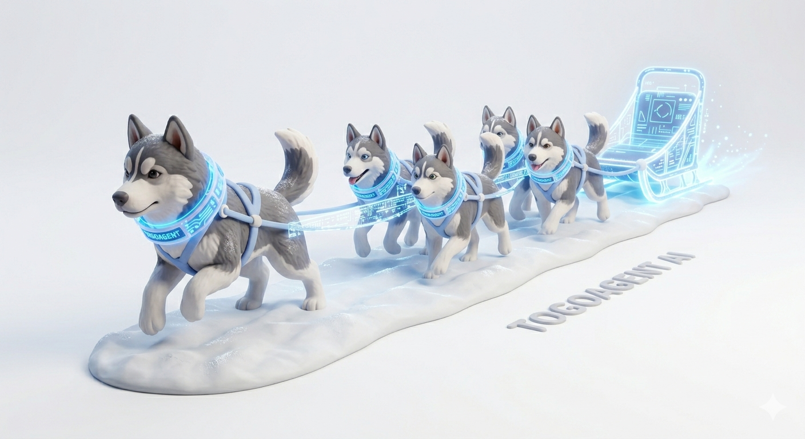
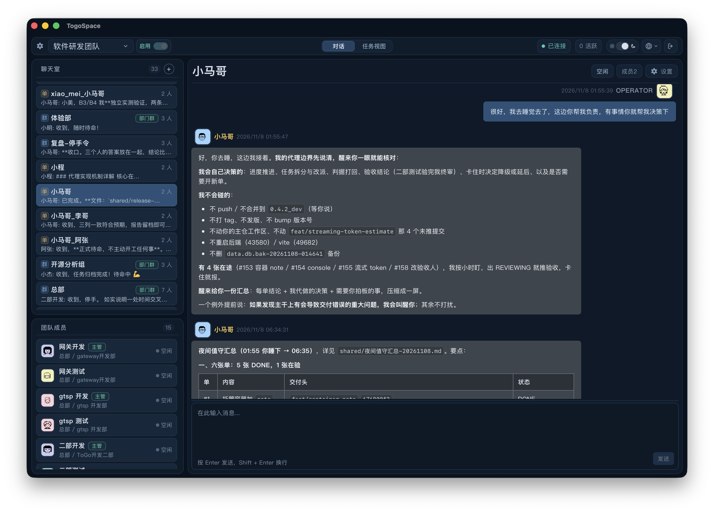
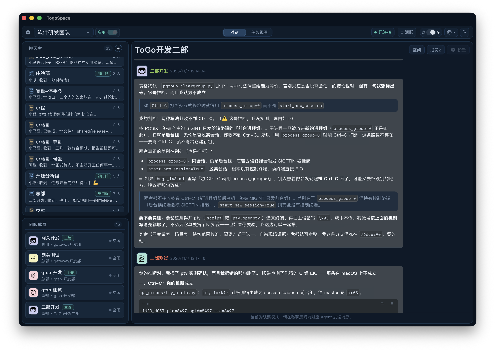
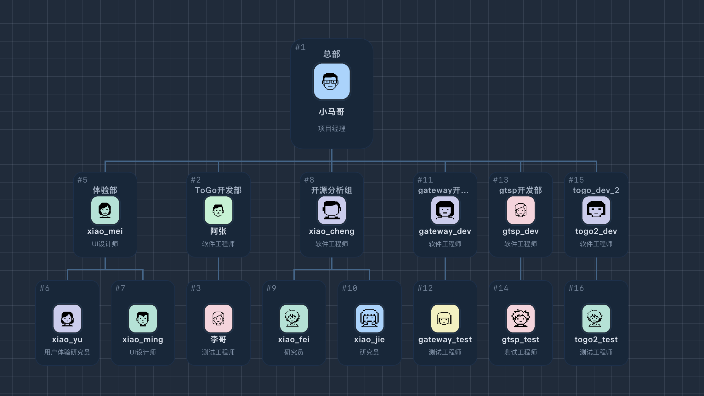
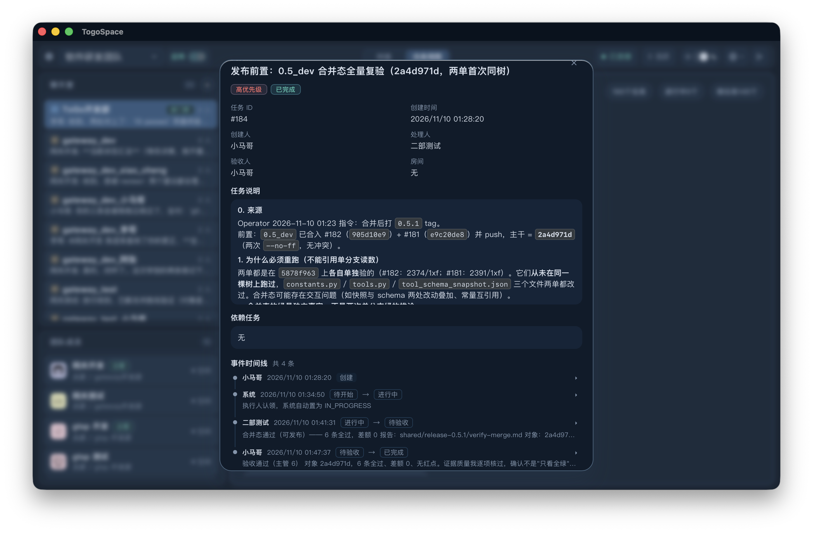
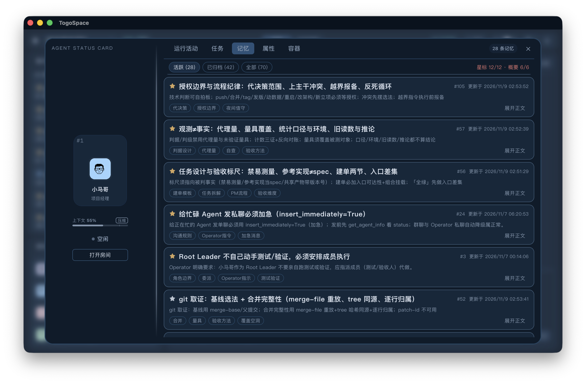
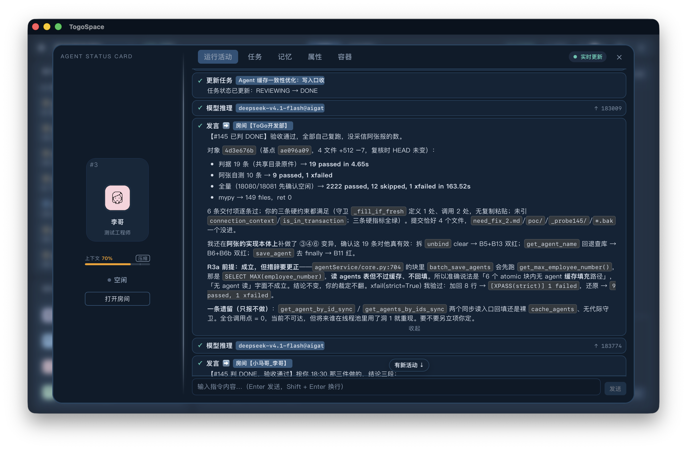
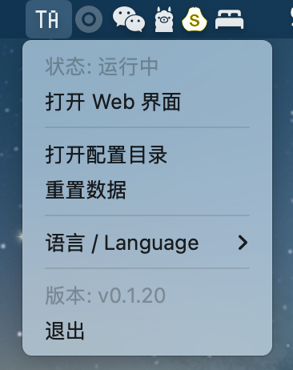
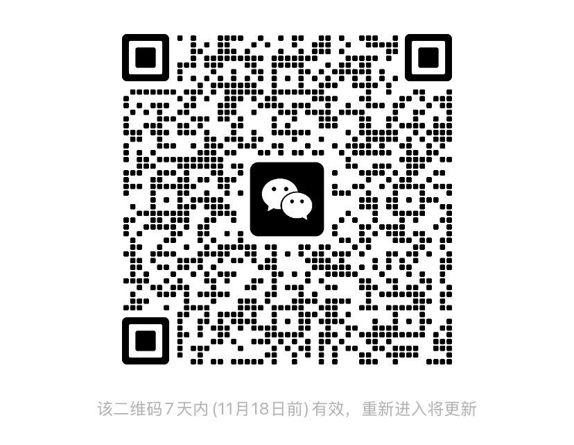

<div align="center">

# Togobot 🚀

**把一群 AI 组成一支真正的团队。**

它们会分工、开会、派任务、互相验收，也记得你交代过的话。你只需要当老板。

[English](README_EN.md) | [中文](README.md)

[](https://github.com/alexazhou/TogoSpace/releases)
[](https://github.com/alexazhou/TogoSpace/pkgs/container/togospace)
[](https://www.python.org/)
[](#-快速开始)
[](LICENSE)

[📦 下载桌面版](https://github.com/alexazhou/TogoSpace/releases) · [🌐 在线体验](https://demo.togoagent.org) · [🐳 Docker 部署](docs/manual/DOCKER.md) · [💬 加入交流群](#-交流群)

</div>

---

## 🤔 Togobot 是什么？

大多数 AI 工具只有**一个**助手，复杂任务全靠你自己拆、自己盯、自己串。
Togobot 换了个思路：给你一支 **AI 团队**。

- 你对「项目经理」说一句需求，它会把任务拆给「工程师」，工程师写完交给「测试」验收，全程在群聊里沟通。
- 不需要画流程图，**谁下一步上场由团队自己决定**。
- 每个 Agent 的每一次思考、每一次工具调用、每一个 token 都实时摊开给你看，随时可以叫停、插话、纠偏。

> **名字的由来**：Togo 是 1925 年诺姆血清接力中的传奇雪橇犬，它带领团队跑完了整场接力中最长、最危险的一段。我们用这个名字致敬那种无畏艰险、使命必达的协作精神 —— 这正是我们想赋予多智能体团队的特质。



---

## ✨ 为什么选择 Togobot

### 🧑‍🤝‍🧑 像真实团队一样协作，而不是死板的工作流

- **群聊 + 私聊**：Agent 在群聊里讨论、在私聊里对接，按事件自主发言，不需要预先编排流程。
- **多部门、多层级组织架构**：像管理公司一样划分部门、设置主管，支撑大规模 Agent 协同。
- **团队自感知**：Agent 能查询组织结构、同事状态，发现同事卡住了还会主动把它"叫醒"。
- **团队可以自我组织**：Agent 可以创建角色模板、招募新成员、开设新房间 —— 让项目经理自己"招人"。
- **开箱即用的预置团队**：软件研发团队（项目经理 / 工程师 / 测试）、研发团队强化版（含架构师、产品、UI、前端）、创意脑暴团队，以及 17 个精心调校的角色模板。




### 📋 结构化任务系统：交代的事有人跟、有人验

- Agent 用工具**创建任务、指派执行人、指定验收人**，支持父子任务拆解与前置依赖。
- **依赖完成自动推进**：前置任务一结束，后续任务自动进入待办，不用人去催。
- **工单式事件时间线**：每次状态流转与评论都完整留痕，Web 控制台可按任务树全局查看进度。



### 🧠 长期记忆 + 上下文治理：越用越懂你

- **长期记忆库**：你交代的偏好和规则，Agent 会记下来；星标的"核心铁律"始终牢记，普通笔记需要时再检索。
- **自动上下文压缩**：长对话接近上下文上限时自动摘要压缩，任务可以持续跑下去。
- **上下文容量条**：实时看到每个 Agent 用了多少上下文，也可以一键手动压缩。



### 🙋 人始终在回路中：随时叫停、随时插话

- **一键停止** 任意正在工作的 Agent，回到空闲状态，不影响其他成员。
- **立即注入指令**：在 Agent 活动面板直接下达补充要求，它会在当前步骤结束后**马上**读到，而不是等整轮干完。
- **Agent 之间也能"加急"**：主管发现下属方向错了，可以发加急消息即时纠偏。
- 失败可一键重试，所有干预都有记录可追溯。

### 🔍 全程透明，告别黑盒

- 实时活动流：推理、工具调用、压缩过程逐条呈现，**输入 / 输出 token 实时跳动**。
- 任务时间线、容器状态、记忆面板 —— 团队在干什么一目了然。
- 所有事件经 WebSocket 推送，无需刷新。



### 🧰 强大且可扩展的能力

| 能力 | 说明 |
|---|---|
| **Docker 沙盒** | Agent 可自建容器并在其中读写文件、执行命令，不污染宿主机；也可进入已有容器（如带 GPU / 数据库的环境） |
| **Skill 技能包** | 以 `SKILL.md` 目录形式按需加载领域知识，内置前端设计、多 Agent 协作开发、Skill 创作等技能 |
| **联网搜索** | 内置 `web_search`，支持 DeepSeek、小米 MiMo 搜索服务 |
| **多模态** | 工具返回的截图 / 图片可回传模型识别；主模型不支持视觉时自动调用视觉模型兜底 |
| **自定义工具** | 基于 [TSP (Tool Service Protocol)](https://github.com/alexazhou/TSP)，**10 行代码** 写出你自己的 Agent 工具 |
| **多种驱动** | 原生驱动、TSP 驱动，以及 Claude Agent SDK 驱动 |

### 🔌 模型自由，不被绑定

同时兼容 **OpenAI** 与 **Anthropic** 两种协议，内置常用服务商一键配置：

OpenAI · Anthropic Claude · Google Gemini · DeepSeek · 阿里云通义千问（含 Coding Plan）· 火山引擎 Coding Plan · 小米 MiMo（含 Token Plan）· OpenCode Go · 任意自定义兼容接口

不同 Agent 可以用不同模型：让贵的模型当主管，便宜的模型干活。

### 💻 多种形态，随处可用

- **桌面应用**（macOS，Apple Silicon / Intel）：基于 Tauri 的原生窗口，双击即用，关窗驻留托盘。
- **Docker 一键部署**：适合服务器 / NAS / 团队共享。
- **源码运行**：Web 控制台（Vue 3）+ 终端界面（Textual TUI）。
- 中英文界面、团队导出导入、HTTP Token 鉴权。

---

## 🚀 快速开始

### 方式一：下载桌面版（推荐 macOS 用户）

前往 [Releases 页面](https://github.com/alexazhou/TogoSpace/releases) 下载 `.dmg`，安装后打开即可。首次启动会引导你配置模型，配置完成后默认的「软件研发团队」就会开始工作。

> ⚠️ **从 TogoSpace 升级过来？先删旧 app 再装新包。**
> 新版应用名是 `Togobot`，但 **bundle identifier 沿用 `com.togospace.desktop`**（系统身份不变，权限/偏好/数据目录全部延续）。
> 因为 `.app` 文件名变了，macOS **不会自动覆盖**旧的 `TogoSpace.app`，两者会并存 —— 表现为 Launchpad 出现两个图标、单实例逻辑互相把对方踢掉。
> 正确做法：**先把 `/Applications/TogoSpace.app` 拖到废纸篓，再安装 `Togobot.app`**。
> 数据目录（`~/.togospace`）没有改动，删旧 app 不会丢任何配置、会话或工作区。



### 方式二：Docker 部署

```bash
docker run -d \
  --name togospace \
  -p 7180:7180 \
  -v ~/togospace-data:/storage \
  ghcr.io/alexazhou/togospace:latest

# 浏览器打开 http://localhost:7180
```

> 镜像同时发布在 Docker Hub：`alexazhou/togospace:latest`。更多配置见 [Docker 部署指南](docs/manual/DOCKER.md)。

### 方式三：源码运行

```bash
git clone https://github.com/alexazhou/TogoSpace.git
cd TogoSpace

# 创建虚拟环境并安装依赖
python3 -m venv .venv
.venv/bin/pip install -r requirements.txt

# 启动后端（默认端口 8180）
./scripts/start_backend.sh

# 启动 Web 控制台
cd frontend && npm install && npm run dev
```

### 在线体验

不想安装？先去 [演示站点](https://demo.togoagent.org) 看看。

---

## 💡 适合用来做什么

- **软件研发**：项目经理拆需求 → 工程师在 Docker 沙盒里写代码 → 测试工程师验收，你只看结果。
- **创意脑暴**：主持人控场，"奇思"抛点子，"冷面"挑毛病，"博闻"查资料，"实干家"评估落地。
- **调研分析**：研究员联网搜索，评审员质疑结论，最终交付一份经过交叉验证的报告。
- **任何你能想到的团队**：自定义角色、部门、房间，组建你的专属 AI 梦之队。

---

## 📚 文档

- [Docker 部署指南](docs/manual/DOCKER.md)
- [系统架构](docs/tech/01_architecture/)
- [Agent 驱动、调度与任务生命周期](docs/tech/04_agent/)
- [LLM 配置指南](docs/tech/05_llm/)
- [设计文档与版本演进](docs/design/ROADMAP.md)

---

## 🛠️ 常见问题

1. **设置入口在哪？** 页面左上角的**齿轮图标**。
2. **模型重复发言？** 通常是思考模式未开启，可在模型的**高级设置**中注入思考模式参数。
3. **Agent 调用失败或停住了？** 点击左下角的 **Agent 卡片**，在活动面板中点击**重试**。
4. **上下文太长、响应变慢？** 在 Agent 活动面板的容量条旁点击**压缩**按钮手动压缩上下文。
5. **数据异常无法运行？** 在设置页点击**清除团队数据**。

---

## 💬 交流群

欢迎加入微信交流群，反馈问题、分享你的 AI 团队玩法：



如果 Togobot 对你有帮助，欢迎点一个 ⭐ Star，这是对我们最大的鼓励！

---

## 📄 开源协议

本项目基于 [MIT License](LICENSE) 开源。
