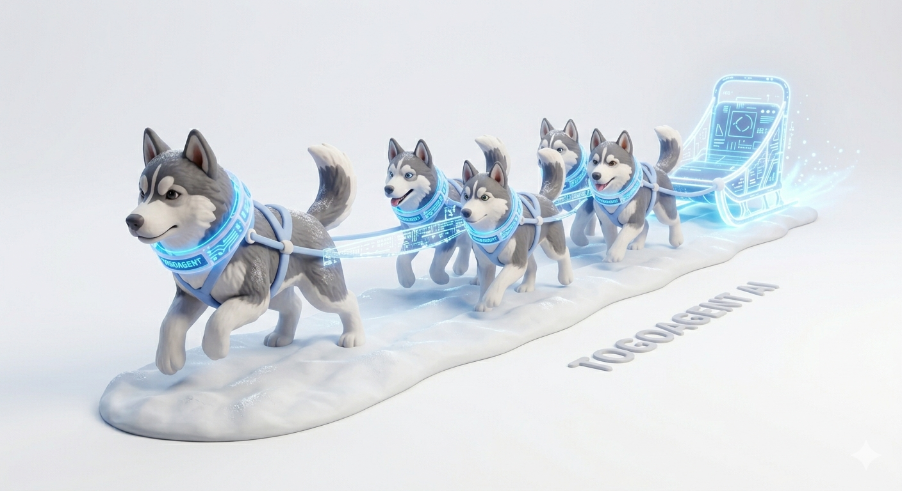
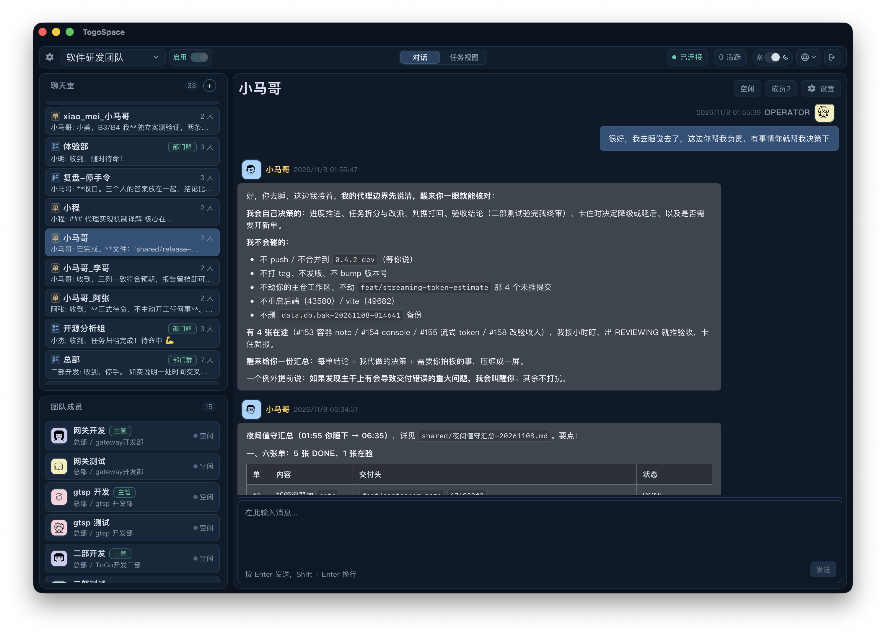
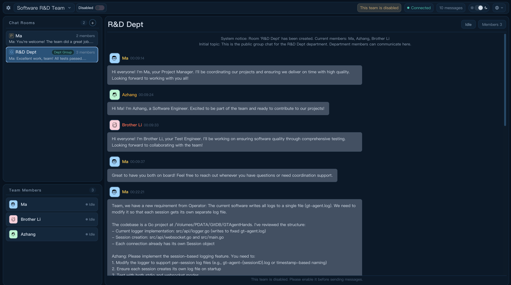
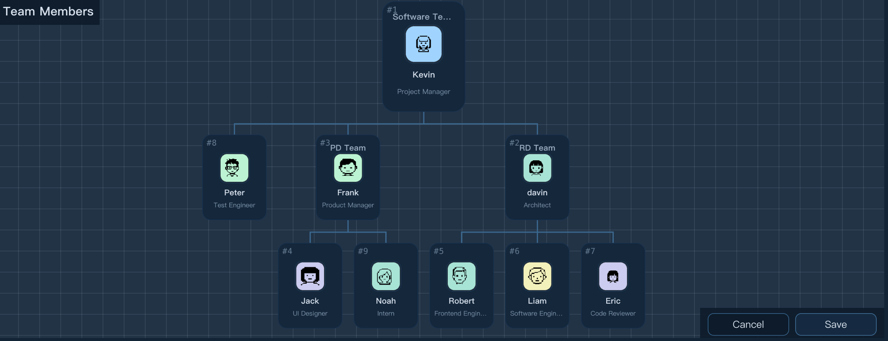
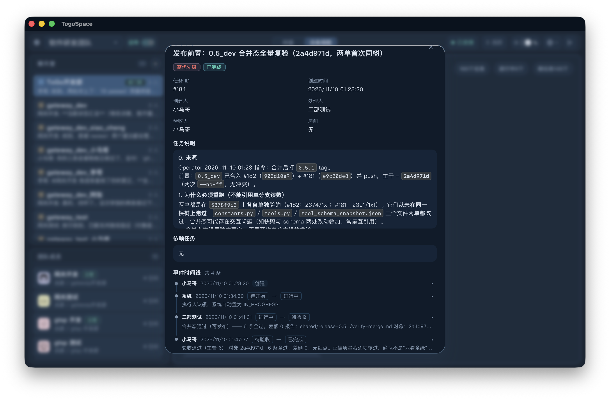
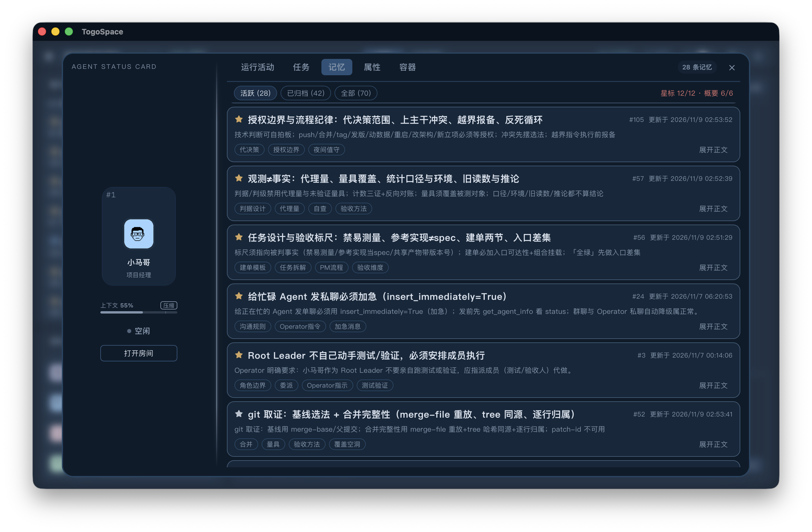
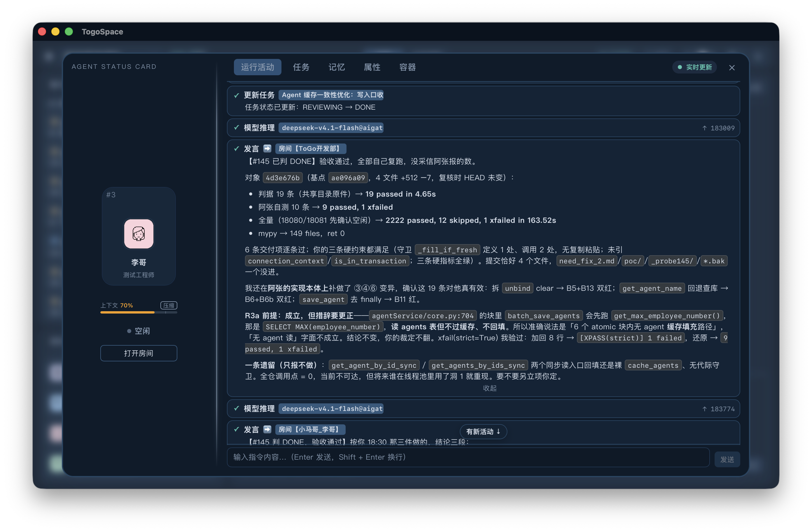
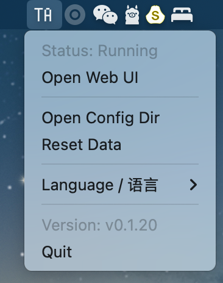
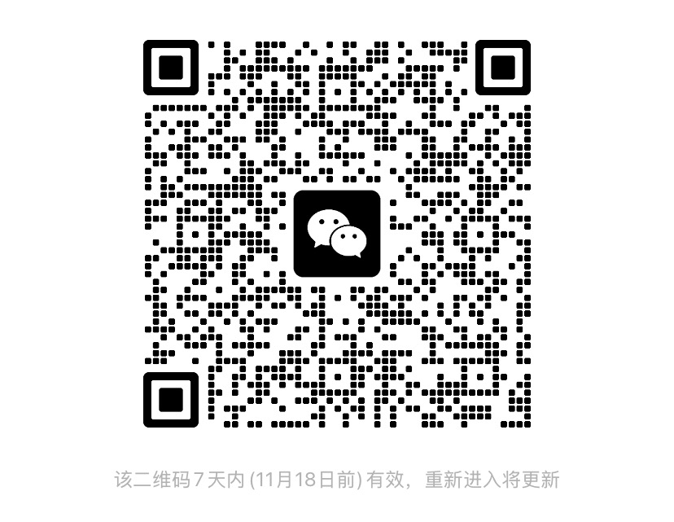

<div align="center">

# Togobot 🚀

**Turn a group of AIs into a real team.**

They split up work, hold discussions, assign tasks, review each other's output — and remember what you told them. All you have to do is be the boss.

[English](README_EN.md) | [中文](README.md)

[](https://github.com/alexazhou/TogoSpace/releases)
[](https://github.com/alexazhou/TogoSpace/pkgs/container/togospace)
[](https://www.python.org/)
[](#-quick-start)
[](LICENSE)

[📦 Download Desktop App](https://github.com/alexazhou/TogoSpace/releases) · [🌐 Live Demo](https://demo.togoagent.org) · [🐳 Docker Deployment](docs/manual/DOCKER.md) · [💬 Community](#-community)

</div>

---

## 🤔 What is Togobot?

Most AI tools give you **one** assistant — you still have to break down complex tasks, babysit them, and stitch the results together yourself.
Togobot takes a different approach: it gives you an **AI team**.

- Tell the "Project Manager" what you need. It breaks the work down for the "Engineer", who hands the result to the "Tester" for review — all communicated through group chat.
- No flowcharts to draw: **the team decides for itself who steps up next**.
- Every thought, every tool call, every token of every agent is laid out in real time. Stop, interject, or correct course whenever you like.

> **About the name**: Togo was the legendary sled dog of the 1925 Serum Run to Nome, who led his team through the longest and most dangerous leg of the relay. We chose this name to honor that spirit of fearless, mission-driven collaboration — exactly what we want to bring to multi-agent teams.



---

## ✨ Why Togobot

### 🧑‍🤝‍🧑 Collaborate like a real team, not a rigid workflow

- **Group chats + private chats**: Agents discuss in group rooms, coordinate one-on-one in private rooms, and speak up autonomously based on events — no pre-defined workflow required.
- **Multi-department, multi-level org structure**: Organize departments and managers like a real company, scaling to large numbers of collaborating agents.
- **Team awareness**: Agents can look up the org chart and their teammates' status — and will "wake up" a teammate that got stuck.
- **Self-organizing teams**: Agents can create role templates, recruit new members, and open new rooms — let your project manager do its own hiring.
- **Ready-to-use preset teams**: Software R&D Team (PM / Engineer / Tester), Software R&D Team Pro (adds Architect, Product Manager, UI Designer, Frontend Engineer), Creative Brainstorming Team, plus 17 carefully tuned role templates.




### 📋 Structured task system: every assignment is tracked and reviewed

- Agents use tools to **create tasks, assign owners, and designate reviewers**, with support for subtasks and prerequisites.
- **Dependencies advance automatically**: as soon as a prerequisite is done, downstream tasks move to To-Do — no one needs to chase them.
- **Ticket-style event timeline**: every status change and comment is recorded; the web console shows global progress as a task tree.



### 🧠 Long-term memory + context management: it gets to know you

- **Long-term memory**: Agents remember the preferences and rules you give them. Starred "core rules" are always kept in mind; regular notes are retrieved when relevant.
- **Automatic context compaction**: When a long conversation approaches the context limit, it is summarized and compacted automatically, so tasks can keep running.
- **Context capacity meter**: See how much context each agent is using in real time, and compact manually with one click.



### 🙋 Human in the loop: stop or interject at any time

- **One-click stop** for any working agent — it returns to idle without affecting the rest of the team.
- **Immediate instruction injection**: Send extra instructions straight from an agent's activity panel; the agent reads them **right after** its current step instead of waiting for the whole turn to finish.
- **Agents can send urgent messages too**: A manager who spots a subordinate heading the wrong way can correct it immediately.
- Failures can be retried with one click, and every intervention is recorded and traceable.

### 🔍 Fully transparent, no black box

- Live activity stream: reasoning, tool calls, and compaction shown step by step, with **input / output tokens ticking up in real time**.
- Task timelines, container status, memory panel — see at a glance what your team is doing.
- All events are pushed over WebSocket, no refresh needed.



### 🧰 Powerful and extensible

| Capability | Description |
|---|---|
| **Docker sandbox** | Agents can create their own containers to read/write files and run commands without polluting the host, or enter existing containers (e.g. with GPU / database access) |
| **Skills** | Load domain knowledge on demand from `SKILL.md` directories; built-in skills include frontend design, multi-agent collaborative development, and skill authoring |
| **Web search** | Built-in `web_search`, backed by DeepSeek or Xiaomi MiMo search services |
| **Multimodal** | Screenshots / images returned by tools are sent back to the model; if the main model lacks vision, a vision model is used automatically as fallback |
| **Custom tools** | Built on [TSP (Tool Service Protocol)](https://github.com/alexazhou/TSP) — write your own agent tools in **10 lines of code** |
| **Multiple drivers** | Native driver, TSP driver, and Claude Agent SDK driver |

### 🔌 Model freedom, no lock-in

Compatible with both **OpenAI** and **Anthropic** protocols, with one-click setup for popular providers:

OpenAI · Anthropic Claude · Google Gemini · DeepSeek · Alibaba Cloud Qwen (incl. Coding Plan) · Volcengine Coding Plan · Xiaomi MiMo (incl. Token Plan) · OpenCode Go · any custom compatible endpoint

Different agents can use different models: let the expensive model be the manager and the cheaper ones do the work.

### 💻 Runs wherever you need it

- **Desktop app** (macOS, Apple Silicon / Intel): native Tauri window, double-click to launch, stays in the tray when closed.
- **One-command Docker deployment**: great for servers, NAS, or team sharing.
- **Run from source**: web console (Vue 3) + terminal UI (Textual TUI).
- Chinese & English UI, team export/import, HTTP token authentication.

---

## 🚀 Quick Start

### Option 1: Download the desktop app (recommended for macOS)

Grab the `.dmg` from the [Releases page](https://github.com/alexazhou/TogoSpace/releases) and open it after installing. On first launch you'll be guided through model setup, after which the default "Software R&D Team" gets to work.

> ⚠️ **Upgrading from TogoSpace? Delete the old app before installing.**
> The app is now named `Togobot`, but it **keeps the same bundle identifier `com.togospace.desktop`** (same system identity — permissions, preferences and data directory carry over).
> Because the `.app` filename changed, macOS **will not overwrite** the old `TogoSpace.app`; the two end up side by side — two icons in Launchpad, and their single-instance logic will kick each other out.
> Do this: **move `/Applications/TogoSpace.app` to the Trash first, then install `Togobot.app`.**
> The data directory (`~/.togospace`) is unchanged, so deleting the old app loses no configuration, sessions or workspaces.



### Option 2: Docker

```bash
docker run -d \
  --name togospace \
  -p 7180:7180 \
  -v ~/togospace-data:/storage \
  ghcr.io/alexazhou/togospace:latest

# Open http://localhost:7180 in your browser
```

> The image is also published on Docker Hub: `alexazhou/togospace:latest`. See the [Docker Deployment Guide](docs/manual/DOCKER.md) for more options.

### Option 3: Run from source

```bash
git clone https://github.com/alexazhou/TogoSpace.git
cd Togobot

# Create a virtual environment and install dependencies
python3 -m venv .venv
.venv/bin/pip install -r requirements.txt

# Start the backend (default port 8180)
./scripts/start_backend.sh

# Start the web console
cd frontend && npm install && npm run dev
```

### Live demo

Don't want to install anything? Try the [demo site](https://demo.togoagent.org) first.

---

## 💡 What can you use it for?

- **Software development**: The PM breaks down requirements → the engineer writes code in a Docker sandbox → the test engineer verifies it. You just look at the result.
- **Creative brainstorming**: The host keeps things on track, "Spark" pitches ideas, "Frost" pokes holes, "Knowledge" digs up references, and "Doer" checks feasibility.
- **Research & analysis**: A researcher searches the web, a critic challenges the conclusions, and you get a cross-checked report.
- **Any team you can imagine**: Define your own roles, departments, and rooms to build your own AI dream team.

---

## 📚 Documentation

- [Docker Deployment Guide](docs/manual/DOCKER.md)
- [System Architecture](docs/tech/01_architecture/)
- [Agent Drivers, Scheduling & Task Lifecycle](docs/tech/04_agent/)
- [LLM Configuration Guide](docs/tech/05_llm/)
- [Design Docs & Version History](docs/design/ROADMAP.md)

> Most in-depth docs are currently written in Chinese.

---

## 🛠️ FAQ

1. **Where are the settings?** Click the **gear icon** in the top-left corner.
2. **The model keeps repeating itself?** Thinking mode is usually off — inject thinking-mode parameters in the model's **Advanced Settings**.
3. **An agent failed or got stuck?** Click the **agent card** in the bottom-left and hit **Retry** in its activity panel.
4. **Context too long, responses slowing down?** Click the **Compact** button next to the capacity meter in the agent's activity panel.
5. **Data issues preventing startup?** Click **Clear Team Data** on the settings page.

---

## 💬 Community

Join our WeChat group to report issues and share how you use your AI team:



If Togobot helps you, please give it a ⭐ Star — it means a lot to us!

---

## 📄 License

This project is open-sourced under the [MIT License](LICENSE).
