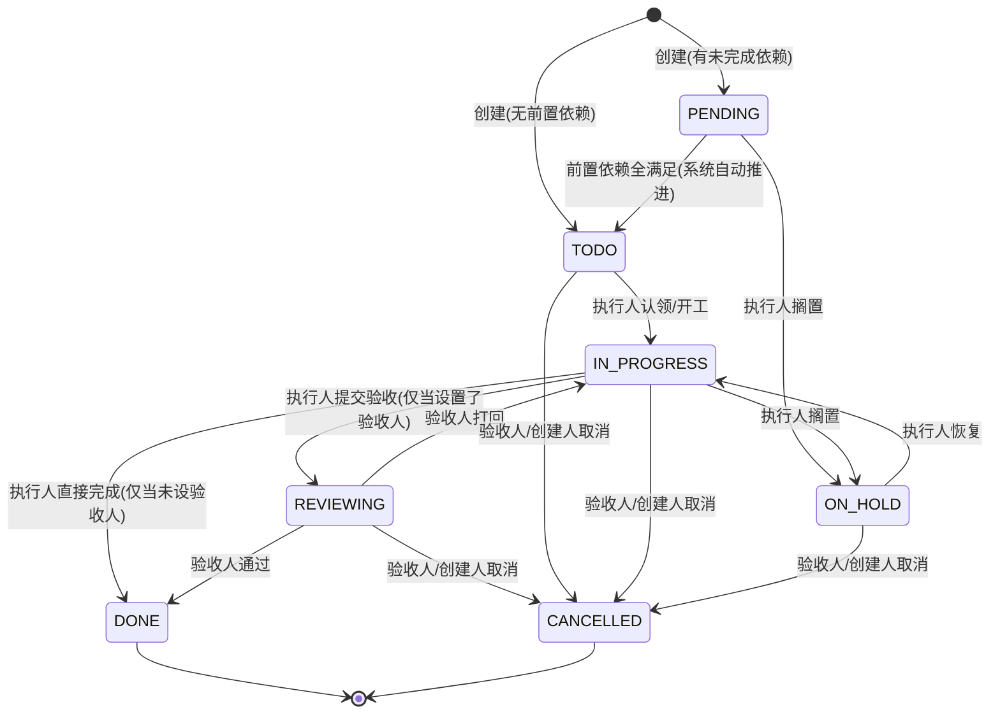

# Agent 任务系统 v2 - 产品文档

> **里程碑**：V27  
> **文档定位**：面向使用与维护任务系统的工程师及 Agent 编排人员，聚焦**外部可观察的系统行为、业务规则与工具用法**。  
> **关联文档**：[技术设计 (step2_technical.md)](./step2_technical.md) · [开发任务表 (step3_tasks.md)](./step3_tasks.md)

---

## 1. 背景与核心演进

在 V22 引入的基础任务系统（`create_task` / `update_task` / `get_task` / `list_tasks`）中，Agent 团队已具备结构化任务分工能力。然而在真实协作场景中，暴露出三大痛点：

1. **验收归属不明确**：未填验收人时系统逻辑冲突（一处将创建人当验收人、另一处不认），导致提交验收后死锁无人接盘。
2. **历史记录易丢失**：任务结果与搁置原因采用覆盖式单值存储，中途过程无法留痕，已完工任务无法追加结论或备注。
3. **依赖阻塞需人工催促**：前置任务完成后后续任务持续处于 `PENDING` 静默状态，需通过群聊喊人才能继续流转。

### v1 与 v2 特性演进对比

| 维度 | v1 现状 | v2 目标规范 |
|---|---|---|
| **协作模型** | 单表单值（仅保存最新状态与结果） | **工单模型**：状态机 + 不可变事件时间线（流转与评论全留痕） |
| **验收人定义** | `manager_id`（与部门主管重名，且有创建人隐式接管兜底） | **`reviewer_id`**（语义精准，明确单一口径；无验收人则无需验收） |
| **流转与评论** | 无独立评论能力；修改结果必须伴随状态流转 | **统一 `update_task`**：给 `new_status` 为流转，省略 `new_status` 为评论 |
| **工具自解释性** | `get_task`（名称不够清晰）、`update_task(status=...)`（参数容易与当前状态混淆） | **更名优化**：`get_task` $\rightarrow$ **`get_task_detail`**；`update_task` 状态参数定为 **`new_status`** |
| **终态可维护性** | 任务到达 `DONE` / `CANCELLED` 后只读，无法补充信息 | 终态下**状态冻结**，但允许团队成员**持续追加评论** |
| **依赖推进** | 前置完成后依赖方永久静默，需外部协调 | **依赖满足自动推进**：系统自动将 `PENDING` 推进为 `TODO` |
| **任务查询** | `list_tasks` 参数松散，无目标扫描易产生海量无关信息 | **收敛查询**：必须指定 `assignee` 或 `reviewer` 之一，默认过滤已完结任务 |

---

## 2. 状态机与生命周期

任务系统采用严格受控的状态机模型，所有状态流转与权限由底层统一保障。

### 2.1 状态迁移图



### 2.2 状态定义说明

| 状态 | 说明 | 是否允许追加评论 |
|---|---|:---:|
| `TODO` | 待处理（初始就绪态） | 是 |
| `PENDING` | 等待前置依赖完成 | 是 |
| `IN_PROGRESS` | 执行中（已认领并正在进行） | 是 |
| `ON_HOLD` | 中途搁置（因外部阻塞或等待决策暂停） | 是 |
| `REVIEWING` | 待验收（**仅存在于设置了验收人的任务**） | 是 |
| `DONE` | 已完成（终态，状态不可再更改） | 是 |
| `CANCELLED` | 已取消（终态，状态不可再更改） | 是 |

### 2.3 流转规则与授权

- **认领与推进**：由任务执行人（`assignee`）推进至 `IN_PROGRESS`，并在需要时置为 `ON_HOLD`。
- **提交验收机制**：
  - **设有验收人（`reviewer_id`）**：执行人完成后必须流转为 `REVIEWING`；系统严禁绕过验收直接转为 `DONE`。
  - **未设验收人**：无需验收环节，执行人完成后直接流转至 `DONE`；若尝试提交 `REVIEWING` 将被系统明确拒绝并提示直接完成。
- **验收与打回**：仅验收人（`reviewer`）有权执行 `REVIEWING → DONE`（通过）或 `REVIEWING → IN_PROGRESS`（打回）。
- **取消权限**：验收人与创建人（`creator`）有权取消任务。
- **全员评论**：团队内任意成员均可对任务追加评论，不改变当前状态。

---

## 3. 核心功能特性

### 一、工单式事件时间线（Timeline）
每个任务拥有专属的不可变事件流（Event Stream），完整记录两类行为：
1. **状态流转记录**：每一次状态变化（谁在何时从什么状态变为什么状态，并附带本次操作说明）。
2. **评论记录**：团队成员针对该任务发表的意见、补充说明或参考链接。

所有流转与评论按时间顺序汇聚成一条时间线，随时支持完整追溯与重放。

### 二、统一操作工具 `update_task`
为了简化 Agent 的心智模型，系统不再提供冗余工具，统一由 `update_task` 承载流转与评论：
- **流转状态**：传入 `new_status` 参数（且不等于当前状态）。
- **追加评论**：**省略 `new_status` 参数**（或传入与当前状态相同的值），并填写 `note`。
- **终态评论支持**：任务进入 `DONE` 或 `CANCELLED` 后，状态完全只读，但成员仍可通过省略 `new_status` 继续调用 `update_task` 追加后续结案分析或补充说明。

### 三、依赖满足自动推进
- 创建时若指定了 `depends_on` 任务列表，且存在尚未完成的前置任务，任务初始状态自动为 `PENDING`。
- 当所有前置依赖任务均流转至 `DONE` 时，**系统自动将该任务由 `PENDING` 推进为 `TODO`**，记录一条由 `SYSTEM` 触发的流转事件。
- **边界说明**：本阶段依赖满足仅负责任务状态推进，不向任何 Agent 发送额外唤醒或系统通知；Agent 按现有轮询与调度机制发现就绪任务。

### 四、目标收敛的任务查询
`list_tasks` 聚焦于“查我的待办”与“查我负责验收的工作”，收敛入参规则：
- **明确责任人**：调用时必须至少传入 `assignee`（查询执行工作）或 `reviewer`（查询验收工作）之一，否则接口直接报错拒绝。
- **默认过滤已完结**：参数 `open_only` 默认为 `True`，默认仅返回未完成任务；显式传 `open_only=False` 时才包含已完成与已取消任务。
- **优先级排序**：支持按 `priority` 优先级降序返回，保障高优先级任务优先被识别。

---

## 4. 工具使用规范

| 工具名称 | 核心用途 | 关键参数说明 | 行为要点 |
|---|---|---|---|
| `create_task` | 创建新任务 | `title`*、`assignee_id`*、`description`、`reviewer_id`、`priority`、`parent_id`、`depends_on`、`room_id` | 指定 `reviewer_id` 即开启验收环节；有未完成依赖时自动落为 `PENDING` |
| `update_task` | 流转状态 或 追加评论 | `task_id`*、`new_status`（可选）、`note` | **给 `new_status` = 流转**；<br>**省略 `new_status` = 评论**（此时 `note` 必填） |
| `get_task_detail` | 查询任务详情 | `task_id`* | 返回任务详情及依赖任务状态摘要（原 `get_task` 更名） |
| `list_tasks` | 检索任务列表 | `assignee`、`reviewer`、`status`、`open_only`（默认 `True`） | `assignee` 与 `reviewer` **至少提供一个**，传 Agent ID |
| `list_task_events` | 查看任务时间线 | `task_id`*、`limit`、`before_id` | 按游标读取该任务的完整流转与评论时间线 |

> **常见用法示例**：
> - 查自己待办：`list_tasks(assignee=我)`
> - 查自己待验收：`list_tasks(reviewer=我, status="REVIEWING")`
> - 查任务完整详情：`get_task_detail(task_id=1)`
> - 给任务写结论（不改状态）：`update_task(task_id=1, note="经复测无误，符合上线标准")`

---

## 5. 典型协作场景示例

### 场景一：流水线交付与系统依赖推进
```
1. PM 创建任务 1（前端重构）：assignee=阿张, reviewer=PM -> task_id=1
2. PM 创建任务 2（接口集成测试）：assignee=小测, depends_on=[1] -> task_id=2（自动进入 PENDING）

3. 阿张开始执行：
   update_task(task_id=1, new_status="IN_PROGRESS")
4. 阿张完成并提交验收：
   update_task(task_id=1, new_status="REVIEWING", note="重构已就绪，PR #42")
5. PM 验收通过：
   update_task(task_id=1, new_status="DONE", note="验收通过，符合交互规范")

6. 系统检测到 task 1 已 DONE，所有依赖满足：
   --> 系统自动执行：task 2 状态由 PENDING 变为 TODO（附带系统流转事件）
7. 小测查看自己待办，发现 task 2 已就绪并开工：
   update_task(task_id=2, new_status="IN_PROGRESS")
```

### 场景二：验收打回与返工修改
```
1. 阿张提交验收：
   update_task(task_id=1, new_status="REVIEWING", note="登录模块实现完毕")
2. PM 验收发现异常，打回任务：
   update_task(task_id=1, new_status="IN_PROGRESS", note="Safari 浏览器下存在重定向循环，请排查")
3. 团队架构师小李参与评论（不改变任务状态）：
   update_task(task_id=1, note="建议排查 SameSite Cookie 配置")
4. 阿张修复后再次提交：
   update_task(task_id=1, new_status="REVIEWING", note="已修复 Cookie 参数问题")
5. PM 最终验收通过：
   update_task(task_id=1, new_status="DONE", note="验证通过")
```

### 场景三：中途搁置与已完结任务追加说明
```
1. 阿张执行遇阻，中途搁置：
   update_task(task_id=3, new_status="ON_HOLD", note="依赖的三方授权系统尚未开通网关")
2. 外部依赖就绪后恢复：
   update_task(task_id=3, new_status="IN_PROGRESS", note="网关申请已批复，恢复开发")
3. 顺利完成无验收单：
   update_task(task_id=3, new_status="DONE", note="开发完成")
4. 结案后归档备忘（终态下追加评论）：
   update_task(task_id=3, note="生产上线单号：DEPLOY-20261025-01")
   --> 执行成功：返回 { action: "commented", status: "DONE" }，状态保持 DONE 不变
```

---

## 6. 产品功能边界

### 本次交付范围（In Scope）
- **工单化事件流**：流转与评论统一落入事件表，保留完整历史，终态可追加评论。
- **存量数据平滑升级**：老任务的历史结论（`result` / `block_reason`）**任一非空即结转**至事件时间线（终态、搁置、**在途**均不丢）。
- **权限与流转收敛**：统一验收入口与权限判定，消除无验收人时的死锁缺陷。
- **自动依赖推进**：依赖满足后系统自动将状态由 `PENDING` 置为 `TODO`。
- **查询与检索规范**：`list_tasks` 强制责任人过滤，支持按优先级排序。

### 本次非目标（Out of Scope）
- **定向唤醒与通知**：本次不新增或修改 Agent 唤醒机制，现有调度与轮询机制保持不变。
- **前端专属时间线 UI**：本阶段保证数据模型与 API 支持，前端时间线展示看板留作后续迭代。
- **复杂工作流**：暂不包含跨团队工单流转、循环依赖检测图或复杂审批流。

---

## 7. 验收标准清单

- [ ] **权限与流转严密性**：
  - 任务未设验收人时，调用 `new_status="REVIEWING"` 必须被拒绝并提示直接完成；
  - 任务设有验收人时，严禁从 `TODO`/`IN_PROGRESS` 直接跳到 `DONE`；
  - 非法流转必须明确拒绝并返回可理解的错误说明。
- [ ] **流转与事件原子性**：
  - 每次成功流转必须在同一事务中记录一条对应的流转事件，包含调用者、变更前状态、变更后状态及操作说明。
- [ ] **评论能力与终态保护**：
  - 团队内任意成员均可使用 `update_task(task_id, note=...)` 追加评论，状态保持不变；
  - 任务处于 `DONE` 或 `CANCELLED` 时，尝试传入 `new_status` 变更必须被拒绝；只传 `note` 评论必须成功。
- [ ] **工具更名自解释性**：
  - `get_task_detail` 工具正常返回任务完整详情；旧名 `get_task` 提示已废弃并指引新名称，**2026-10-26 决定彻底移除**（不再保留别名/注册，task #71）；
  - `update_task` 使用 `new_status` 参数承载目标状态。
- [ ] **依赖推进可靠性**：
  - 前置任务未全部完成时，任务保持 `PENDING`；所有前置 `DONE` 后，自动流转为 `TODO`，并生成系统操作记录。
- [ ] **查询约束生效**：
  - `list_tasks` 未传 `assignee` 且未传 `reviewer` 时直接返回参数错误；
  - `open_only=True` 严格排除 `DONE` 和 `CANCELLED` 任务。
- [ ] **存量历史兼容**：
  - 存量数据库中处于 `DONE` 或 `ON_HOLD` 的老任务，升级后其交付结论（`result`）与搁置原因（`block_reason`）无损结转至时间线中，可通过 `get_task_detail` 正常读取。
