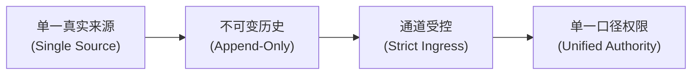
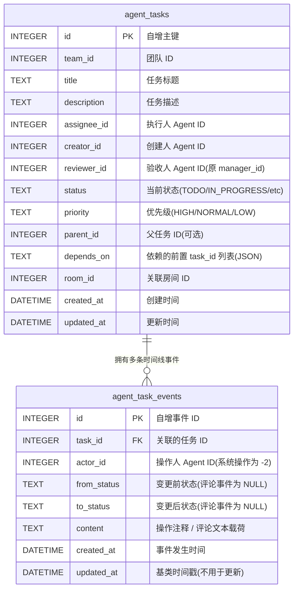
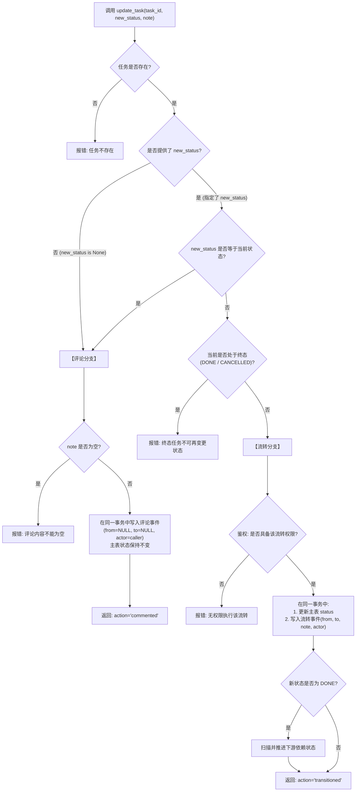
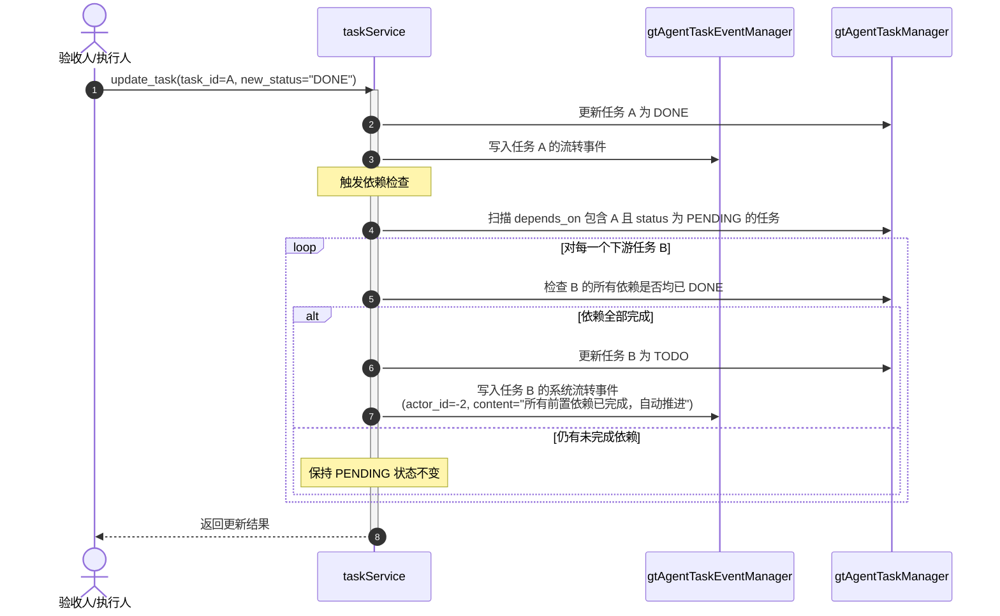

# Agent 任务系统 v2 - 技术设计

> **里程碑**：V27  
> **代码基线**：`/Volumes/PDATA/GitDB/TeamAgent` @ `30447b03` (`dev`)  
> **关联文档**：[产品文档 (step1_product.md)](./step1_product.md) · [开发任务表 (step3_tasks.md)](./step3_tasks.md)  
> **实施范围约束**：当前阶段为纯技术设计阶段；在此方案评审确认前，`src/` 与 `assets/migrate/` 保持零变更。

---

## 1. 架构目标与设计原则

### 1.1 核心目标
将任务系统从原有的「`agent_tasks` 单表覆盖写入」架构，全面重构升级为**「工单模型（状态机 + 不可变事件时间线）」**：
- 任务主表退化为仅维护当前状态（`status`）与基础元数据；
- 状态的每次流转与所有的交互评论，全部按时间顺序追加写入**不可变的事件流（Event Stream）**。

### 1.2 四项架构原则



1. **单一真实来源（Single Source of Truth）**：
   - 文本载荷仅由事件表的 `content` 承载；操作人由事件表的 `actor_id` 承载（主表不再需要 `updated_by`）；
   - 主表彻底废弃 `result`（交付结果）与 `block_reason`（搁置原因）两列，杜绝信息在两处不同步。
2. **严格受控的写入通道（Strict Ingress Channels）**：
   - 全局仅允许两个合法入口向事件流写入说明文本：
     - **入口 1**：工具 `update_task` 的入参 `note`（覆盖流转操作说明与日常评论）；
     - **入口 2**：系统依赖满足时自动推进的说明（由系统生成）。
   - 通过静态代码检查确保没有任何绕过上述通道的直接写入点。
3. **不可变事件历史（Append-Only Timeline）**：
   - 事件表 `agent_task_events` 仅允许 `INSERT` 与 `SELECT` 操作，**严禁任何 `UPDATE` 或 `DELETE` 路径**；
   - 历史信息的更正只能通过追加新评论或新流转事件来表达。
4. **单一口径的权限判定（Unified Authority）**：
   - 状态流转、验收人身份（`is_reviewer`）的判定逻辑**只允许在 `taskService` 一处定义**；
   - Controller、`tools.py`（如 `finish_action`）及前端必须直接复用此判定，彻底杜绝多处判定口径不一致带来的死锁或越权。

> **边界声明（非目标项）**：  
> 本轮重构**不新增、也不修改任何唤醒或通知逻辑**（包括 `TASK_ASSIGNED` 定向工单通知）；现有的调度表与 consumer 轮询机制完全保持原样，依赖满足时系统仅自动推进任务状态。

---

## 2. 数据架构与模型设计

### 2.1 整体数据关系（ER 模型）



### 2.2 新增事件表：`agent_task_events`
对应迁移文件：`assets/migrate/0014_add_agent_task_events_and_rename_reviewer.sql`（与主表列改名合并为同一文件，见 §2.3）

```sql
CREATE TABLE IF NOT EXISTS agent_task_events (
    id          INTEGER  PRIMARY KEY AUTOINCREMENT,
    task_id     INTEGER  NOT NULL,
    actor_id    INTEGER  NOT NULL,                   -- 操作人 ID；系统自动操作使用 -2 (SpecialAgent.SYSTEM)
    from_status TEXT,                                -- 变更前状态；日常评论事件恒为 NULL
    to_status   TEXT,                                -- 变更后状态；日常评论事件恒为 NULL
    content     TEXT     NOT NULL DEFAULT '',        -- 唯一文本载荷：操作注释或评论正文
    created_at  DATETIME NOT NULL DEFAULT (datetime('now')),
    updated_at  DATETIME NOT NULL DEFAULT (datetime('now'))  -- 继承自 DbModelBase
);

CREATE INDEX IF NOT EXISTS idx_agent_task_events_task  ON agent_task_events (task_id, id);
CREATE INDEX IF NOT EXISTS idx_agent_task_events_actor ON agent_task_events (actor_id);
```

#### ORM 模型定义（`src/model/dbModel/gtAgentTaskEvent.py`）
```python
import peewee
from src.constants import TaskStatus
from src.model.dbModel.base import DbModelBase, EnumField

class GtAgentTaskEvent(DbModelBase):
    task_id     = peewee.IntegerField()
    actor_id    = peewee.IntegerField()
    from_status = EnumField(TaskStatus, null=True)
    to_status   = EnumField(TaskStatus, null=True)
    content     = peewee.TextField(default="")

    class Meta:
        table_name = "agent_task_events"
        indexes = (
            (("task_id", "id"), False),
            (("actor_id",), False),
        )
```

### 2.3 主表 `agent_tasks` 的演进与重命名

1. **废弃冗余列**：
   - 彻底废弃 `result` 和 `block_reason`。实施策略采用**代码层停止读写**（ORM 移除字段映射，不对数据库执行破坏性的 `DROP COLUMN`，避免因 SQLite 版本差异引发的兼容性风险）。
2. **任务验收人字段改名（新 `0014` 的「改列段」）**：
   - 原字段 `manager_id` 在任务协作中极易与“部门主管”概念混淆，正式更名为 `reviewer_id`；
   - 对应迁移文件：`assets/migrate/0014_add_agent_task_events_and_rename_reviewer.sql`（改列段）：
     ```sql
     ALTER TABLE agent_tasks RENAME COLUMN manager_id TO reviewer_id;
     ```
   - **注意**：仅修改任务域字段；部门模型 `GtDept.manager_id`（部门主管）保持完全不变。

### 2.4 事件角色的四格组合判定矩阵

事件的业务性质由 `from_status` 与 `to_status` 的空值组合**天然决定**，无需额外冗余存储：

| `from_status` | `to_status` | 事件性质判定 | 系统处理逻辑 |
|---|---|---|---|
| `NULL` | 非 `NULL` | **任务创建 / 存量基线快照** | 正常创建时 `to_status ∈ {TODO, PENDING}`；存量结转（新 `0015` 结转段）时 `to_status ∈ 全部状态`（`from_status` 留空，记录历史状态快照与附带结论） |
| 非 `NULL` | 非 `NULL` | **状态流转事件** | 必须满足 `from_status ≠ to_status`；记录流转路径及本次操作说明 |
| `NULL` | `NULL` | **工单评论事件** | 不改变任务状态；用于记录过程讨论、备忘或终态补充说明 |
| **非 `NULL`** | **`NULL`** | **非法组合** | **系统严禁出现**；入库前执行前置断言校验，拦截非法调用 |

#### 状态流转与评论的归类规则
- **相同状态归为评论**：当调用方传入的 `new_status` 与当前任务状态相同时（例如对处于 `ON_HOLD` 的任务再次置为 `ON_HOLD`），系统不生成流转自环边，直接归类为**工单评论事件**（`from` 与 `to` 均置为 `NULL`，文本落入 `content`）。
- **终态追加评论**：任务进入 `DONE` 或 `CANCELLED` 后，状态禁止流转，但允许传入 `note` 记录评论事件。

### 2.5 派生属性的动态计算规则
为了保障单一真实来源，主表不再保存冗余文本，外部查询所需的关键信息统一从事件流按需计算：
1. **「最近一次说明」（Latest Note）**：
   - 查询该任务最后一条 `to_status` 非空且 `content` 非空的事件（状态流转或历史快照事件），返回其 `content`。
   - **注**：新 `0015` 结转段的历史快照 `content` 带固定前缀 `【系统迁移自动生成】` ⇒ 派生的「最近一次说明」**会连带该前缀、暂不剥离**（见 §7-6「已知边界」）。
2. **「当前搁置原因」（Current On-Hold Reason）**：
   - 仅当任务当前状态为 `ON_HOLD` 时有效；
   - 取最后一条 `to_status == ON_HOLD` 的事件中的 `content` 内容；状态离开 `ON_HOLD` 后该值自动失效。
   - **注**：存量 `ON_HOLD` 快照的 `content` = `【系统迁移自动生成】` + 原 `block_reason` ⇒ 该派生值**会连带前缀、暂不剥离**（见 §7-6「已知边界」）。

### 2.6 时间线读取与游标分页
```sql
-- 查询指定任务的时间线事件（基于自增 ID 游标分页）
SELECT * FROM agent_task_events 
WHERE task_id = ? AND id < ? 
ORDER BY id DESC 
LIMIT ?;
```

---

## 3. 核心工具与接口定义

### 3.1 统一流转与评论：`update_task`
为了降低 Agent 的工具选择负担，系统废弃新增独立评论工具的设想，统一由 `update_task` 承载：

```python
def update_task(
    task_id: int, 
    new_status: str | None = None, 
    note: str = ""
) -> dict: ...
```

#### 调用分发决策流



#### 关键参数与行为契约
- **入参命名规范**：目标状态参数使用 **`new_status`**，语义明确自解释，消除与当前状态的歧义；
- **参数变更**：彻底移除旧版 `result` 与 `block_reason` 参数，无兼容别名；
- **评论权限**：省略 `new_status` 时，团队内**所有 Agent 均可调用**；
- **回执格式**：明确返回行为类型：
  ```json
  {
    "success": true,
    "task_id": 101,
    "status": "IN_PROGRESS",
    "action": "commented",  // 或 "transitioned"
    "message": "已成功追加评论，任务状态保持不变"
  }
  ```

### 3.2 任务详情查询更名：`get_task_detail`
原 `get_task` 更名为 **`get_task_detail`**，使查询任务详情与列表查询 `list_tasks` 语义更加明确。

```python
def get_task_detail(task_id: int) -> dict: ...
```
- **返回内容**：返回任务详情（含关联的前置依赖任务完成状态摘要、以及当前最新说明/搁置原因）；
- **向后兼容**：旧名称 `get_task` 提示已废弃，直接重定向或引导调用 `get_task_detail`。

### 3.3 任务列表查询：`list_tasks`
```python
def list_tasks(
    assignee: int | None = None,
    reviewer: int | None = None,
    status: str | None = None,
    open_only: bool = True
) -> list[dict]: ...
```

- **目标责任人约束**：`assignee` 与 `reviewer` **必须至少传入一个**，否则直接报错拦截。
- **边界落点说明**：**该硬性校验仅施加在工具层（`tools.py`）**；底层服务层 `taskService.list_tasks` 保持入参可选，以向下兼容内部控制器（如 `GET /teams/<id>/tasks.json`）及存量系统单测。
- **默认过滤完结项**：`open_only` 默认为 `True`，仅返回未完成任务；传 `False` 时返回包含 `DONE` 和 `CANCELLED` 的完整列表。
- **排序规则**：结果强制按 `priority DESC, id ASC` 排序，确保高优先级任务排在最前。

### 3.4 任务时间线查询：`list_task_events`
为 Agent 与前端提供按时间线游标分页读取流转记录与评论历史的专用工具：

```python
def list_task_events(
    task_id: int,
    limit: int = 50,
    before_id: int | None = None
) -> list[dict]: ...
```
- **核心用途**：返回任务的完整流转过程与历史评论列表，支持 Agent 回溯上下文及前端时间线渲染；
- **游标分页**：基于 `before_id` 游标向前翻页（`id < before_id`），单次默认最多返回 50 条。

---

## 4. 权限体系与状态机流转

### 4.1 单一口径判定：`is_reviewer`
在 `src/service/taskService.py` 中集中定义，其他模块统一引用：

```python
def is_task_reviewer(task: GtAgentTask, caller_id: int) -> bool:
    """唯一合法的验收人身份判定 (去除了旧版由创建人隐式接管的逻辑)"""
    return task.reviewer_id is not None and caller_id == task.reviewer_id

def is_task_creator(task: GtAgentTask, caller_id: int) -> bool:
    return caller_id == task.creator_id

def is_task_assignee(task: GtAgentTask, caller_id: int) -> bool:
    return caller_id == task.assignee_id
```

### 4.2 流转授权矩阵

| 状态流转 | 前提约束 | 允许执行角色 | 规则说明 |
|---|---|---|---|
| `* → IN_PROGRESS` | 依赖已满足 | `assignee` | 执行人认领或恢复开工 |
| `IN_PROGRESS → ON_HOLD` | - | `assignee` | 中途因外部原因搁置 |
| `IN_PROGRESS → REVIEWING` | **必须设置了 `reviewer_id`** | `assignee` | 提交验收；若未设验收人则系统报错并提示直接完成 |
| `IN_PROGRESS → DONE` | **必须未设置 `reviewer_id`** | `assignee` | 无需验收的任务，执行人完成后直接结单 |
| `REVIEWING → DONE` | 当前状态为 `REVIEWING` | **仅 `reviewer`** | 验收通过 |
| `REVIEWING → IN_PROGRESS` | 当前状态为 `REVIEWING` | **仅 `reviewer`** | 验收打回返工 |
| `* → CANCELLED` | 任务未进入终态 | `reviewer` 或 `creator` | 取消任务（所有权管理动作，保留创建人权限） |
| **追加工单评论** | 任何状态（含终态） | **团队内全员** | 省略 `new_status`，只记录评论文本，状态不变更 |

> **认领置位（D5=(a)，本期）**：`TODO → IN_PROGRESS` 由**系统在执行人认领 / 开启执行回合时自动置位**（非手工传 `new_status`），语义由系统保证、不依赖提示词纪律；`IN_PROGRESS` **保留**，`TODO`=未认领 / `IN_PROGRESS`=已认领。落地见 step3 任务 5。

---

## 5. 依赖自动推进机制

当某任务流转至 `DONE` 状态时，系统自动触发下游依赖检测：



**关键设计边界**：
- 推进操作完全受事务保护，状态更新与系统流转事件强一致；
- **纯状态推进，不触发唤醒**：本次重构坚决不触发定向通知或唤醒，Agent 通过现有的轮询机制感知就绪任务。

---

## 6. 模块影响与改造清单

| 层次 | 目标文件 | 核心变动说明 |
|---|---|---|
| **数据库迁移** | `assets/migrate/0014_add_agent_task_events_and_rename_reviewer.sql` | 新增事件表 `agent_task_events`（具备幂等性）+ 主表列改名 `manager_id → reviewer_id`（改列段**仅限执行一次**） |
| **数据库迁移** | `assets/migrate/0015_backfill_events_and_fix_reviewing_tasks.sql` | ① **结转段**：对**任一列（`result`/`block_reason`）非空**的老任务结转一条基线快照事件到事件表（含在途状态；按状态取 `result` 或 `block_reason` 之一，两列皆空不插）；② **订正段（C-3）**：对「`status = REVIEWING` 且 `reviewer_id` 为空」的老任务 —— `reviewer_id := creator_id`（幂等；仅 `REVIEWING` 且验收人为空的行） |
| **数据模型** | `src/model/dbModel/gtAgentTaskEvent.py` | 新增事件持久化模型 |
| **数据模型** | `src/model/dbModel/gtAgentTask.py` | 字段更名 `reviewer_id`；停止对 `result`/`block_reason` 映射 |
| **DAL 访问层** | `src/dal/db/gtAgentTaskEventManager.py` | 新增 Manager，仅提供 `append_event` 与 `list_events`（只读/追加） |
| **DAL 访问层** | `src/dal/db/gtAgentTaskManager.py` | 适配 `reviewer_id`；更新可开工任务排序为 `priority DESC, id ASC` |
| **DAL 访问层** | `src/dal/db/__init__.py` | 导出新的 `gtAgentTaskEventManager` |
| **服务层** | `src/service/taskService.py` | 统一 `is_reviewer` 判定；流转与事件同事务写入；依赖推进逻辑；移除冗余字段写入 |
| **服务层** | `src/service/teamService.py` | 团队清理（`clear_team_data`）前需先级联删除关联的事件流 |
| **工具层** | `src/service/funcToolService/tools.py` | `update_task` 签名改造（入参 `new_status`、`note`，内联评论）；`get_task` 更名为 `get_task_detail`；`list_tasks` 入参强制责任人校验；新增 `list_task_events` 工具 |
| **工具注册** | `src/service/funcToolService/core.py` | 注册 `get_task_detail`（替换原 `get_task`）与 `list_task_events` |
| **工具提示** | `src/service/agentService/prompts.py` | 对齐工具提示文案 |
| **控制器/推送** | `src/controller/wsController.py` | 任务变动推送 payload 同步支持携带最新事件信息 |
| **前端类型** | `frontend/src/types.ts` / `api.ts` | 适配 `reviewer_id`，适配事件结构 |
| **测试套件** | `tests/integration/test_collaboration_task_flow/test.py` | 适配 `update_task(note=...)` 新调用方式，断言事件流原子性 |

---

## 7. 工程实现避坑与注意事项

> [!WARNING]
> 以下为底层实现中需特别注意的关键细节，实施阶段必须严格遵守：

> **迁移合并（Operator 2026-10-26）**：原 `0015`/`0016`/`0017` 三个迁移已并入 **新 `0014`**（建表 + 列改名）与 **新 `0015`**（存量结转 + C-3 订正）。下文按**逻辑段**表述：**「改列段」＝新 `0014`**；**「结转段」「订正段」＝新 `0015`**。

1. **迁移 0014（改列段）的执行约束**：
   - `ALTER TABLE agent_tasks RENAME COLUMN manager_id TO reviewer_id` 语法需要 SQLite ≥ 3.25。
   - 该语句**非幂等**（重跑会报错 `no such column`），确保迁移机制只执行一次，严禁直接修改历史迁移文件 `0009` 和 `0010`。
2. **严格隔离任务域与部门域命名**：
   - 部门模型 `GtDept.manager_id`（部门主管）、`deptService` 以及部门树前端组件属于**部门域**，其字段命名**绝对不可修改**；
   - **禁止在代码库中执行全局裸替换 `manager_id`**，必须仅针对任务域文件进行精准替换。
3. **模型与数据库建表的时间默认值差异**：
   - 数据库建表使用的是 `datetime('now')`（UTC 字符串），而 Peewee ORM 注入的是 Python 本地时间对象；
   - 业务逻辑均经由 ORM 写入，因此断言时间戳时应以应用层注入值为基准。
4. **团队数据清理顺序（`clear_team_data`）**：
   - `agent_task_events` 表本身没有 `team_id` 字段；
   - 在清除团队数据时，必须**先查出该团队的所有 `task_id`，删除对应的事件记录，最后再删除 `agent_tasks` 主表数据**，避免留下孤儿事件数据。
5. **前端静默降级风险**：
   - 前端代码在解析空字段时有缺省降级机制，若后端改名而前端漏改，页面可能不会报错但内容永久空白。因此前端字段重命名与事件流对接必须随同发布。
6. **存量历史任务数据结转（新 `0015` 的「结转段」）**：
   - **适用对象与目标**：仅对 v2 之前、且**尚无任何事件行**的老任务，一次性补一条**基线快照事件**（`from_status = NULL`、`to_status` = 该任务当前状态），使时间线首尾闭合、「创建 / 快照」格对其不留空。
   - **结转列范围（方案1 · Operator 2026-10-25 定调）**：**`result` / `block_reason` 任一列非空即结转** —— 覆盖终态、搁置**以及全部在途状态**（`TODO`/`PENDING`/`IN_PROGRESS`/`REVIEWING`）⇒ 在途任务的非空文本、以及「曾搁置后恢复」残留的 `block_reason` **均不丢**；**两列皆空则不插**。
   - **`content` 格式 = 前缀 + 逐档（Operator 2026-10-25 裁定 (A)；合并原「注明系统迁移自动生成」与「逐档」两条）**：`content` = **固定前缀 `【系统迁移自动生成】`** + **逐档原文**；**逐档只决定「取哪一列」**：① 终态（`DONE`/`CANCELLED`）→ 取 `result`，`result` 空则回退 `block_reason`；② `ON_HOLD` → 取 `block_reason`，空则回退 `result`；③ **在途**（`TODO`/`PENDING`/`IN_PROGRESS`/`REVIEWING`）→ 取非空的那一列，**两列都非空（罕见）默认 `result` 优先**（已登记）；④ 两列皆空 → **不插**。
   - **系统署名与时间**：`actor_id = -2`（`SpecialAgent.SYSTEM`）；`created_at` **显式写入迁移执行时刻（本地时区）**，**不得依赖 DDL 默认**（裸 SQL 会取 `datetime('now')` = UTC，与 ORM 本地时间形成同表两种时区，见本 §7 第 3 条）。
   - **已知边界（前缀暂不剥离）**：老任务派生的「最近一次说明」/「当前搁置原因」会连带该前缀（`【系统迁移自动生成】`）；本阶段不剥离。
   - **幂等判重**：以「该任务**是否已有任何事件行**」为判据，**只对无事件的老任务补快照**（前提：**首次迁移时库中尚无任何事件行**）⇒ 混合库（部分已结转 / 部分未结转）**不漏、不重**，迁移可安全重复执行。
   - **专测**：`tests/unit/migrate/test_migration_0015_backfill_events.py`（`up_to="15"` 造存量 → `up_to="16"` 触发合并后的 `0015` → 断言结转 / 其余不变 / 幂等 0 增量；两处**负对照** helper 自带 `assert hits==1` 自检）。
   - **说明**：本条仅描述**规则与字段格式**，**不贴完整 SQL**（SQL 属实施细节，开工后随 `assets/migrate/0015_backfill_events_and_fix_reviewing_tasks.sql` 落地）。
7. **存量「`REVIEWING` 无验收人」数据订正（新 `0015` 的「订正段」· C-3）**：
   - **背景**：任务 1 去掉「`creator` 隐式接管验收人」的兜底后，存量中「`status = REVIEWING` 且 `reviewer_id` 为空」的老任务会卡死 —— `assignee` 既不能通过、也不能打回，仅 `creator` 可取消。
   - **处置（Operator 2026-10-25 裁定 (b) 数据订正）**：把旧代码的「`creator` 兜底验收人」语义**落成显式数据** —— `reviewer_id := creator_id`。
   - **订正范围**：仅 `status = 'REVIEWING'` 且 `reviewer_id IS NULL` 且 `creator_id IS NOT NULL` 的行；其余行（`REVIEWING` 已有验收人 / 非 `REVIEWING` / 终态）**一律不动**。**⛔ 不涉及部门域 `manager_id`**（本迁移只碰 `agent_tasks.reviewer_id`）。
   - **幂等**：订正后 `reviewer_id` 非空 ⇒ 不再匹配，迁移可安全重复执行（0 增量）。
   - **残余边界（显式登记、不静默）**：`creator_id` 为 `NULL` 的行**不订正**（防御性条件）；`0009` 建表脚本中 `creator_id INTEGER NOT NULL` ⇒ 该情形**结构上不可能出现**。**另注（阿张 #69 复核 info，非回归）**：若 `creator_id == assignee_id` 且验收人为空，订正后 `reviewer_id` 即 `assignee` 自己 ⇒ 该单进入「自审」；与旧「`creator` 兜底」语义一致，**不加** `assignee_id <> creator_id` 过滤（否则该行退回卡死态）。
   - **专测**：`tests/unit/migrate/test_migration_0015_fix_reviewing.py`（`up_to` 分段造存量 → 断言订正 / 其余不变 / 幂等 0 增量；**负对照**：摘掉 `reviewer_id IS NULL` 条件 ⇒ 误改已验收任务 ⇒ 断言转红）。
   - **说明**：本条仅描述**规则**，**不贴完整 SQL**（SQL 随 `assets/migrate/0015_backfill_events_and_fix_reviewing_tasks.sql` 的订正段落地）。
8. **系统自动推进 / 认领置位的「静默性」边界（#68 · 显式登记、不静默）**：
   - 系统在**依赖满足自动推进（`PENDING → TODO`）**与**认领置位（`TODO → IN_PROGRESS`）**时，**仅更新任务状态并写入一条系统流转事件**（`actor_id = -2` / `SpecialAgent.SYSTEM`，**代码引用常量**），**不触发任何唤醒 / 通知**（唤醒链路行为不变）。
   - **由此产生的可见性边界**：上述两类**系统状态变更不触发前端实时刷新**，前端需**下次拉取**方可见；「实时刷新」能力归后续里程碑 **D4（通知）**，**本期明确不实现**（显式登记、不得静默）。
   - **可红判据**：① 幂等 —— 非 `TODO` 或 `caller ≠ assignee` 的认领 ⇒ `skipped` 且**不写事件**；② fail-safe —— 注入认领置位异常 ⇒ **consume 不中断、任务照常执行完成**（「不改唤醒链路」的判据）；③ 置位与事件**同事务**（`update_task_status_with_event`）。
   - **⚠️ 修订（Operator 2026-10-27 · 方案 B 定稿）**：本条原「**不 publish `TASK_CHANGED`**」需拆成两件独立的事——
     - **唤醒 / 通知**：仍然不发，唤醒链路零改动（原约束**不变**）；
     - **事件可见性**：改为**新增 `TASK_EVENT_APPENDED` 主题**，**只要往 `agent_task_events` 写了事件就推送一条**（含上述两类系统推进、以及**评论分支**）。该主题**不进调度表、不唤醒任何 Agent**，仅用于前端时间线实时刷新。
     - 因此原「上述两类系统状态变更不触发前端实时刷新，需下次拉取方可见」的边界**作废**。设计详见 [前端事件时间线专项设计 §2.3](./frontend_task_timeline_design.md)。
     - 落地要点：五个写入点（创建 / 流转 / 评论 / 自动推进 / 认领置位）全部推送；payload = `team_id` + `task` + 完整事件（`truncate_content=False`）；推送置于事务提交之后；`wsController` 中业务事件字段须与消息类型名 `payload["event"]` 错开（建议命名 `task_event`）。
     - **分层约束（Operator 2026-10-27）**：**`dal` 既不 publish，也不决定「记什么事件」**。`create_task` / `update_task_status_with_event` 把 actor / from / to / 系统文案写死在 DAL，属业务判断越层，应改为 DAL 只提供「保存原语 + 事务边界」（`atomic()` + `save_task()`），**事件的构造与 publish 全部由 `taskService` 负责**。`gtAgentTaskEventManager.append_event` 保持不变（纯插入、不含事务），正好对应 §8.3 要求的唯一写入点。

---

## 8. 附录：验收准则与质保体系

### 8.1 数据完整性四大准则
- **准则 1（流转原子性）**：每次成功的状态流转，必须在同一事务中写入**恰好一条**流转事件，绝不允许出现状态改了但事件未记、或事件记了状态未改的情况。
- **准则 2（过程可重放）**：事件流必须能够完整且唯一地重放任务从创建到终态的全部流转过程和每一步的操作说明。
- **准则 3（事件追加性）**：事件表只能执行 `INSERT` 与 `SELECT`，没有更新或删除接口。
- **准则 4（状态组合穷尽定义）**：四格状态组合全部明确，非法组合在落库前必须被严格拦截。

### 8.2 变异测试有效性验证（Mutation Tests）
通过故意引入缺陷，验证测试用例的拦截有效性：
- 故意拆分状态更新与事件写入为两个独立事务 $\rightarrow$ 必须被事务回滚测试捕获；
- 故意向事件表写入更新操作 $\rightarrow$ 必须被 DAL 接口限制捕获；
- 故意漏记操作说明 $\rightarrow$ 必须被重放断言捕获；
- 故意传入非法的 `from_status ≠ NULL, to_status = NULL` $\rightarrow$ 必须被前置校验捕获。

### 8.3 写入入口静态代码检查
通过静态分析用例验证全局针对 `agent_task_events` 的直接写入点数量：
- **正向验证**：确保工具入口 `update_task` 与系统依赖自动推进入口各命中一次；
- **负向验证**：在源码中人工注入第 3 处直接写入点时，静态检查必须能立刻报错拦截，确保写入通道不被暗中扩散。
