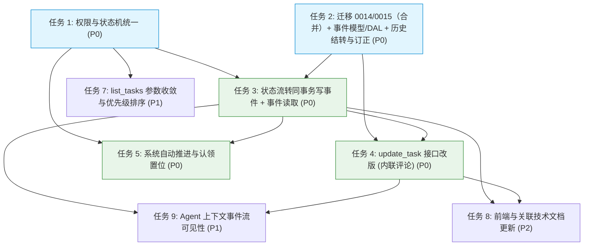

# Agent 任务系统 v2 - 开发任务表

> **里程碑**：V27  
> **文档定位**：指导开发实施的任务拆解与排期计划，包含执行依赖、核心代码点与验收检查清单。  
> **关联文档**：[产品文档 (step1_product.md)](./step1_product.md) · [技术设计 (step2_technical.md)](./step2_technical.md)  
> **当前状态**：进行中（文档设计阶段，代码尚未开工）

---

## 1. 任务依赖与执行规划

开发主链路分为两个并行打底工作（权限与状态机收敛、数据库迁移与事件模型），随后推进事件写入与工具接口改造，最后完成依赖自动推进、查询收敛与前端适配。

### 1.1 任务依赖 DAG

### 1.2 优先级阶段划分
- **第一阶段（P0 核心主链路，必须协同发布）**：
  - 任务 1：统一权限与状态机判定
  - 任务 2：数据库迁移 0014/0015（合并）、事件模型与 DAL
  - 任务 3：流转与事件同事务原子写入、时间线读取
  - 任务 4：`update_task` 入参改版（内联评论能力）
  - 任务 5：系统自动推进与认领置位（依赖满足 `PENDING → TODO`；认领时刻 `TODO → IN_PROGRESS`，D5=(a) 本期）
- **第二阶段（P1 体验与查询增强）**：
  - 任务 7：`list_tasks` 参数收敛与排序优化
  - 任务 9：Agent 上下文注入事件历史（解决 Agent 看不到过程注释问题）
- **第三阶段（P2 前端与文档收尾）**：
  - 任务 8：前端任务面板适配与历史设计文档口径同步
- **非目标范围（本次不执行）**：
  - 任务 6（占位）：`TASK_ASSIGNED` 定向唤醒通知机制（本次保持既有轮询机制原样，后续里程碑独立立项）

---

## 2. 开发任务明细

### 任务 1: 权限体系与状态机流转统一（P0）

- **目标**：将 `is_reviewer` 判定收敛到 `taskService` 一处定义；移除创建人隐式接管验收人的兜底逻辑；收紧验收出口；补齐缺失的状态边；统一任务域重命名（`manager_id → reviewer_id`）。
- **依赖**：无（可独立启动）
- **核心文件**：
  - `src/service/taskService.py`（流转表 `_VALID_TRANSITIONS`、权限判定、验收校验）
  - `src/service/funcToolService/tools.py`（`finish_action` 校验及旧版判定引用）
  - `src/controller/*`（复用统一判定）
- **子任务**：
  - [ ] 在 `taskService` 集中实现 `is_task_reviewer = (reviewer_id is not None and caller == reviewer_id)`，去除 creator 兜底接管逻辑；
  - [ ] 收紧 `IN_PROGRESS → REVIEWING`：仅当 `reviewer_id` 非空时允许；为空则报错拒绝，提示直接完成；
  - [ ] 封堵 `→ DONE` 绕过验收的旁路：当 `reviewer_id` 非空时，禁止从 `TODO` 或 `IN_PROGRESS` 直接完成，仅允许从 `REVIEWING` 进入 `DONE`；
  - [ ] 补齐状态边：新增 `PENDING → TODO`（系统推进）、`PENDING → ON_HOLD`、`REVIEWING → CANCELLED`；
  - [ ] 消除流转自环：当传入的 `new_status` 等于当前状态时，不走流转边，转入评论逻辑；
  - [ ] 评论权限开放：当未传 `new_status` 时，对团队内所有成员开放追加评论权限；
  - [ ] 推动 `tools.py` 的 `finish_action` 及各控制器直接复用 `taskService` 的判定。
- **验收标准**：
  - 权限判定在全仓仅存在唯一定义；
  - 未设验收人的任务无法提交 `REVIEWING`，且能顺利直接结单；
  - 设有验收人的任务无法跳过验收直接结单。

---

### 任务 2: 数据库迁移 0014/0015（合并后）+ 事件模型与 DAL + 历史数据结转与订正（P0）

- **迁移合并（Operator 2026-10-26 定调）**：原 `0014_add_agent_task_events.sql`（建表）+ `0015_rename_task_manager_to_reviewer.sql`（改名）**合并为新 `0014`**；原 `0016_backfill_historical_task_events.sql`（存量结转）+ `0017_fix_reviewing_tasks_reviewer.sql`（数据订正）**合并为新 `0015`**。合并**逐句语义等价**（纯拼接，顺序：建表→改列 / 结转→订正），**幂等性与负对照原样保留**。
- **目标**：新增不可变事件表 `agent_task_events`，实现对应模型与仅追加（Append-Only）DAL；实施任务表 `manager_id → reviewer_id` 列重命名迁移；针对存量已结束与搁置任务执行数据结转，无损保存历史 `result` 与 `block_reason`；对存量「`REVIEWING` 且无验收人」的老任务执行数据订正（C-3），把「`creator` 兜底验收人」语义落成显式数据；并为两个迁移分别建立**专用迁移测试**（现有通用测试链路验不了，见子任务）。
- **依赖**：无（可与任务 1 并行启动）
- **核心文件**：
  - `assets/migrate/0014_add_agent_task_events_and_rename_reviewer.sql`（新建，= 建 `agent_task_events` + 索引，`ALTER TABLE agent_tasks RENAME COLUMN manager_id TO reviewer_id`）
  - `assets/migrate/0015_backfill_events_and_fix_reviewing_tasks.sql`（新建，= 存量历史任务结转 + 存量「`REVIEWING` 无验收人」数据订正 · C-3）
  - `src/model/dbModel/gtAgentTaskEvent.py`（新建 ORM 模型）
  - `src/dal/db/gtAgentTaskEventManager.py`（新建 DAL 管理类）
  - `src/model/dbModel/gtAgentTask.py`（停止映射 `result`/`block_reason`，更新字段名为 `reviewer_id`）
- **子任务**：
  - [ ] 编写迁移 `0014`（合并 建表 + 改名）：① 创建 `agent_task_events` 表，包含 `task_id`、`actor_id`、`from_status`、`to_status`、`content`、时间戳，建立索引；② 执行 `ALTER TABLE agent_tasks RENAME COLUMN manager_id TO reviewer_id`（注意仅限执行一次）；
  - [ ] 编写迁移 `0015`（合并 结转 + 订正）：
    - ① **存量历史结转**：**仅对尚无任何事件行的老任务**（幂等判重）补一条基线快照事件 —— `from_status = NULL`、`to_status` = 当前状态、`actor_id = -2`（`SpecialAgent.SYSTEM`）、`created_at` = **迁移执行时刻（本地时区，显式写入、不依赖 DDL 默认 UTC）**；**范围（方案1）= `result`/`block_reason` 任一列非空即结转**（含**全部在途状态**：在途非空文本、以及「曾搁置后恢复」残留的 `block_reason` 均不丢）；**`content` 格式 = 固定前缀 `【系统迁移自动生成】` + 逐档原文**（逐档只决定「取哪一列」）：终态→`result`（空则回退 `block_reason`）、`ON_HOLD`→`block_reason`（空则回退 `result`）、**在途→取非空那一列（两列都非空时默认 `result` 优先，已登记）**；**两列皆空则不插**（老任务派生的「最近一次说明」/「当前搁置原因」会连带该前缀，**暂不剥离**，登记为已知边界）；
    - ② **C-3 数据订正**：对存量「`status = REVIEWING` 且 `reviewer_id` 为空」的老任务，把旧代码的「`creator` 兜底验收人」语义落成显式数据 —— **`reviewer_id := creator_id`**；**仅限 `status = 'REVIEWING'` 且 `reviewer_id IS NULL`（且 `creator_id IS NOT NULL`）的行**，其余行（`REVIEWING` 已有验收人 / 非 `REVIEWING` / 终态）**一律不动**；**幂等**（订正后 `reviewer_id` 非空 ⇒ 不再匹配，0 增量）；**⛔ 不涉及部门域 `manager_id`**；**残余边界**：`creator_id` 为 `NULL` 的行不订正（`0009` 中 `creator_id INTEGER NOT NULL` ⇒ 结构上不可能），显式登记；
    - **不贴完整 SQL 进设计文档**（规则如上，SQL 随迁移文件落地）；顺序 = 先结转 → 后订正；
  - [ ] 编写 **`0015` 专用迁移测试（历史结转部分）**（`tests/unit/migrate/test_migration_0015_backfill_events.py`，参照 `test_migration_0011.py`）：用 `src/db.py` 的 `migrate_database(..., up_to="15")` 先跑到 `0014` 造存量数据（分别造 `DONE`/`CANCELLED`/`ON_HOLD` 且带 `result`/`block_reason` 的任务、**在途状态带非空 `result` 的任务**、**曾搁置后恢复（残留 `block_reason`）的在途任务**、以及两列皆空的任务），再以 `up_to="16"`（或全量）触发 `0015`，断言快照事件的 `to_status`/`actor_id`/`content` 取值；**幂等必须真验、不能是空断言**：重复调 `migrate_database` 是 no-op（`_migrations` 已记账，`src/db.py:100-103/133/136`）⇒「重复执行为 0 增量」恒真不可能红，它验的是 runner 记账、不是 `0015` 结转 SQL 的 `WHERE NOT EXISTS`；故**须先删 `_migrations` 里的 0015 行后重跑**（或**直跑 0015 SQL 两次**）断言 0 增量，并补**摘掉 `WHERE NOT EXISTS` 判重守卫的负对照**（去掉守卫重跑应产生重复行 ⇒ 判据转红）；**⚠️ 注**：`tests/base.py` 每次删库重建（`cleanup_sqlite_files` + 空库全量迁移）⇒ **通用测试链路里 `0015` 结转部分恒 0 行、无法验证结转**，故**必须独立用例**；
  - [ ] 编写 **`0015` 专用迁移测试（数据订正部分）**（`tests/unit/migrate/test_migration_0015_fix_reviewing.py`）：用 `up_to="15"` 先跑到 `0014` 造存量（**含** `REVIEWING` 且 `reviewer_id` 为空 的行，**以及不应被改的行**：`REVIEWING` 已有验收人 / 非 `REVIEWING` / 终态），再以 `up_to="16"`（或全量）触发 `0015`，断言 `reviewer_id` 已置为 `creator_id`、其余行不受影响、**重复执行 0 增量**（**幂等须真验**：删 `_migrations` 里的 0015 行后重跑 / 直跑 SQL 两次，不能是空断言）；并补**摘掉 `reviewer_id IS NULL` 条件的负对照**（误改已验收任务 ⇒ 断言转红，带 `assert hits == 1` 自证）；**⚠️ 注**：同结转部分，`tests/base.py` 每次删库重建 ⇒ **通用测试链路里 `0015` 订正部分恒 0 行、必须独立用例**；
  - [ ] 创建模型 `GtAgentTaskEvent`，继承 `DbModelBase`；
  - [ ] 编写 DAL `GtAgentTaskEventManager`，仅开放 `append_event` 与 `list_events`，不提供任何修改或删除方法；
  - [ ] 在 `src/dal/db/__init__.py` 中正确导出新 Manager；
  - [ ] 修改 `GtAgentTask` 模型，将 `manager_id` 调整为 `reviewer_id`，停止映射 `result` 与 `block_reason`。
- **验收标准**：
  - 迁移脚本 0014/0015 在空库与存量库均可顺利执行；
  - 存量库升级后，**任一列非空**的老任务（终态 / 搁置 / **在途**）其非空文本成功沉淀至事件表（含「曾搁置后恢复」残留的 `block_reason`）；两列皆空者不产生快照；
  - **`0015`（历史结转部分）专用测试**通过（`up_to` 分段造存量 → 断言结转；**幂等须真验**：删 `_migrations` 0015 行后重跑 / 直跑 SQL 两次断言 0 增量，并附**摘掉判重守卫的负对照**应转红）；
  - **`0015`（数据订正部分）专用测试**通过（`up_to` 分段造存量 → 断言 `reviewer_id` 已置为 `creator_id`、其余行不受影响；**幂等须真验**：删 `_migrations` 0015 行后重跑 / 直跑 SQL 两次断言 0 增量，并附**摘掉 `reviewer_id IS NULL` 条件的负对照**应转红）；**残余边界**：`creator_id` 为 `NULL` 的行不订正（`0009` 中 `creator_id NOT NULL` ⇒ 结构上不可能），已在文档显式登记；**另注（非回归）**：`creator_id == assignee_id` 的行订正后为「自审」，与旧「`creator` 兜底」语义一致，不加 `assignee_id <> creator_id` 过滤；
  - 事件表具备只追加特性，模型单元测试覆盖正向插入与列表查询。

---

### 任务 3: 状态流转同事务写事件 + 事件读取（P0）

- **目标**：实现状态变更与流转事件写入的强一致事务绑定；支持从事件流按时间线回放任务历史。
- **依赖**：任务 1、任务 2
- **核心文件**：
  - `src/service/taskService.py`
  - `src/service/funcToolService/tools.py`
- **子任务**：
  - [ ] `create_task` 成功时，写入一条创建事件（`from = NULL`, `to ∈ {TODO, PENDING}` —— 无前置依赖取 `TODO`、有未完成依赖取 `PENDING`, `actor = creator`）；
  - [ ] `update_task` 执行状态变更时，在同一数据库事务内更新任务状态并写入流转事件（`from≠to`, `actor=caller`, `content=note`）；
  - [ ] 实现事件流读取服务，支持基于 `before_id` 的游标分页查询；
  - [ ] 实现派生属性算法：「最近一次说明」按最后一条非空流转事件计算；「当前搁置原因」在 `ON_HOLD` 状态下动态取值；
  - [ ] 任务详情响应中挂载最新的事件时间线摘要。
- **验收标准**：
  - 状态流转与事件记录原子生效，任何一边失败则整体回滚；
  - 任务的时间线能够准确回溯状态迁移轨迹及每一步的附带说明。

---

### 任务 4: `update_task` 统一接口改版（内联评论）与工具更名（P0）

- **目标**：废弃新增独立评论工具的方案，统一在 `update_task` 中支持“流转”与“评论”，将状态入参命名为 `new_status`；将详情查询工具 `get_task` 更名为 `get_task_detail`；清理旧入参；放开终态评论权限。
- **依赖**：任务 2、任务 3
- **核心文件**：
  - `src/service/funcToolService/tools.py`（改造 `update_task` 入参及分发逻辑；更名 `get_task_detail`；新增 `list_task_events` 工具）
  - `src/service/funcToolService/core.py`（注册 `get_task_detail` 与 `list_task_events` 工具）
  - `src/service/agentService/prompts.py`（更新工具使用提示词）
- **子任务**：
  - [ ] 调整 `update_task` 签名为 `(task_id: int, new_status: str | None = None, note: str = "")`，参数改用 `new_status` 消除歧义；
  - [ ] 将 `get_task` 工具重命名为 `get_task_detail`，旧名称保留废弃提示并平滑引导；
  - [ ] 新增 `list_task_events` 工具并在 `core.py` 中注册导出，支持游标分页读取任务时间线；
  - [ ] 移除 `result` 与 `block_reason` 参数，无兼容别名，传入未知参数直接报错；
  - [ ] 分支处理：当未传 `new_status` 或传入状态等于当前状态时，走向评论逻辑，校验 `note` 非空后记录评论事件（`from=NULL, to=NULL`）；
  - [ ] 分支处理：当传入新状态时，执行权限校验与状态流转；
  - [ ] 终态逻辑处理：对 `DONE`/`CANCELLED` 任务，若传入 `new_status` 则拒绝流转；若仅传 `note` 则允许追加评论；
  - [ ] 返回明确的回执信息（`action: "transitioned" | "commented"`）；
  - [ ] 同步修改 `create_task` 与 `list_tasks` 中的参数命名（`manager_id → reviewer_id / reviewer`）。
- **验收标准**：
  - 省略 `new_status` 成功生成评论事件，任务状态保持不变；
  - `get_task_detail` 成功返回任务详情及依赖摘要；
  - 终态任务能够正常追加评论；
  - 传入旧字段直接报错。

---

### 任务 5: 系统自动推进与认领置位（P0）

- **目标**：由系统在两个时机自动置位任务状态并记入事件流 —— ① **依赖推进**：任务完成为 `DONE` 时，自动识别下游依赖并推进状态；② **认领置位**：执行人认领/开启执行回合时，系统自动将 `TODO` 置为 `IN_PROGRESS`（**D5=(a) 本期落地**，`TODO`=未认领 / `IN_PROGRESS`=已认领）。
- **依赖**：任务 1、任务 3
- **核心文件**：
  - `src/service/taskService.py`
  - `src/dal/db/gtAgentTaskManager.py`
- **子任务**：
  - [ ] 在任务置为 `DONE` 的事务后，触发依赖扫描；
  - [ ] 检索所有 `depends_on` 包含当前任务且状态为 `PENDING` 的任务；
  - [ ] 对每个候选任务，检查其所有依赖项是否均已处于 `DONE` 状态；
  - [ ] 依赖全满足时，系统自动将其状态更新为 `TODO`，并写入一条系统操作事件（`actor_id = SpecialAgent.SYSTEM / -2`，记录说明文本）；
  - [ ] **认领置位（D5=(a)）**：执行人认领/开启执行回合时，系统在**同一事务**内将 `TODO → IN_PROGRESS` 并写入系统流转事件（`actor_id = -2`）；语义由系统保证，**不依赖提示词/纪律**；
  - [ ] **严守边界**：系统仅更新状态并记事件，不触发任何额外的消息唤醒或通知。
- **验收标准**：
  - 前置依赖全部完成后，处于 `PENDING` 的任务自动变为 `TODO`；
  - 尚有未完成依赖的任务保持 `PENDING` 不动；
  - 执行人认领后，任务状态由 `TODO` 自动变为 `IN_PROGRESS`，且时间线留有一条系统流转事件；
  - 自动推进 / 置位过程完整记录在时间线中。

---

### 任务 6: 任务分配定向唤醒通知（**本次非目标 · 占位**）

> [!NOTE]
> **本里程碑非目标（明确暂不实现）**  
> 保持该编号仅为保证各处设计文档引用一致性。本次改动不修改现有唤醒链路，依然依托既有的调度队列表与 Consumer 轮询机制。该功能将在后续里程碑中独立评估落地。

---

### 任务 7: `list_tasks` 查询参数收敛与排序优化（P1）

- **目标**：收敛工具层入参，强制指定责任人，默认过滤已完结任务，支持高优先级优先返回。
- **依赖**：任务 1
- **核心文件**：
  - `src/service/funcToolService/tools.py`
  - `src/dal/db/gtAgentTaskManager.py`
- **子任务**：
  - [ ] 工具层改造：`list_tasks(assignee=None, reviewer=None, status=None, open_only=True)`；
  - [ ] 在 `tools.py` 中增加校验：若 `assignee` 与 `reviewer` 均未提供，直接抛出参数错误；
  - [ ] **服务层解耦**：保持 `taskService.list_tasks` 的参数可选，确保团队级查询接口（如 `GET /teams/<id>/tasks.json`）及既有系统单测不受影响；
  - [ ] 落实 `open_only` 逻辑：默认过滤 `DONE` 与 `CANCELLED` 任务；
  - [ ] 优化 DAL 排序逻辑：优先按 `priority DESC, id ASC` 排序。
- **验收标准**：
  - Agent 不传责任人调用 `list_tasks` 会被拦截报错；
  - 默认查询结果不包含已完结任务；
  - 内部控制器直接调用 `taskService` 保持向下兼容。

---

### 任务 8: 前端与关联技术文档更新（P2）

- **目标**：保障前端平滑兼容新字段与事件结构，同步过时技术文档。
- **依赖**：任务 3、任务 4
- **核心文件**：
  - `frontend/src/api.ts` / `types.ts` / `components/agent/AgentTaskDetailModal.vue`
  - 存量技术文档（如 `task_driven_wakeup_design.md`）
- **子任务**：
  - [ ] 前端类型定义同步：将 `manager_id` 更新为 `reviewer_id`，适配新的事件模型字段；
  - [ ] 确保前端对去除 `result`/`block_reason` 具备向后兼容性，避免界面静默白屏；
  - [ ] 任务详情弹窗支持展示事件时间线记录；
  - [ ] 更新 `ROADMAP.md` 及系统设计文档，统一为 v2 工单时间线口径。
- **验收标准**：
  - 前端构建无 TypeScript 类型错误；
  - 任务查看与状态更新功能交互正常。

---

### 任务 9: Agent 上下文事件流可见性增强（P1）

- **目标**：让执行任务的 Agent 在 Prompt 上下文中能够看到关键的流转历史与讨论注释。
- **依赖**：任务 3、任务 4
- **核心文件**：
  - `src/service/agentService/agentTurnRunner.py`
  - `src/service/agentService/promptBuilder.py`
- **子任务**：
  - [ ] 确定上下文注入格式（如在任务上下文末尾附带「最近 5 条事件记录摘要」）；
  - [ ] 设置严格的字符上限与截断保护，防止大量历史评论撑爆上下文；
  - [ ] 时间展示统一对齐应用层本地时间。
- **验收标准**：
  - Agent 在执行轮次中能明确获知前序步骤的驳回理由或协作评论；
  - Prompt 长度增长受控。

---

## 3. 测试与验收检查清单

### 3.1 权限控制与状态机
- [ ] 任务未指定 `reviewer_id` 时，尝试推进到 `REVIEWING` 必须被明确拒绝；
- [ ] 任务未指定 `reviewer_id` 时，执行人直接流转到 `DONE` 成功；
- [ ] 任务指定了 `reviewer_id` 时，尝试从 `TODO` 或 `IN_PROGRESS` 直接推进到 `DONE` 必须被拦截；
- [ ] 处于 `REVIEWING` 的任务，仅验收人有权执行通过或打回；
- [ ] 非任务执行人尝试推进为 `IN_PROGRESS` 或 `ON_HOLD` 必须被拒绝；
- [ ] 部门模型 `GtDept.manager_id` 在全流程中保持未受任何改名影响。

### 3.2 数据原子性与事件流
- [ ] 每次成功的状态流转均恰好生成一条流转事件，且包含对应的操作人与附带说明；
- [ ] 故意在事务中途模拟异常，验证主表状态与事件表同时回滚；
- [ ] 事件表无任何更新（UPDATE）或删除（DELETE）代码入口；
- [ ] 派生属性测试：在 `ON_HOLD` 状态下能准确提取搁置原因，在非 `ON_HOLD` 状态下为空；
- [ ] 运行静态代码检查，确认全局针对事件内容仅有工具入参和系统推进两处合法写入入口。
- [ ] 创建 / 快照事件的 `to_status` 取值受控：正常创建 ∈ {`TODO`,`PENDING`}、**`0015`（历史结转部分）存量快照 ∈ 全部状态（方案1：任一列非空即结转、含在途）**；非法组合（`from` 非空 → `to` 为空）在落库前被断言拦截。

### 3.3 统一操作工具（`update_task`）与详情查询
- [ ] 仅传入 `task_id` 和 `note` 时，成功创建评论事件，主表状态未发生改变；
- [ ] 传入的 `new_status` 与当前任务状态相同时，自动作为评论处理，不产生多余流转记录；
- [ ] 对处于 `DONE` 或 `CANCELLED` 的任务，传入 `note` 能成功追加评论；
- [ ] 对处于 `DONE` 或 `CANCELLED` 的任务，传入 `new_status` 尝试流转被系统拒绝；
- [ ] 调用时传入旧的 `result` 或 `block_reason` 参数会立刻报错；
- [ ] `get_task_detail` 成功查询任务详情与依赖状态摘要。

### 3.4 依赖推进与查询过滤
- [ ] 多依赖场景：当下游任务依赖任务 A 和 B 时，仅 A 完成仍保持 `PENDING`，A 和 B 均完成则自动跃迁为 `TODO`；
- [ ] 自动推进生成的事件 `actor_id` 准确标记为系统（`-2`）；
- [ ] `list_tasks` 不传 `assignee` 也不传 `reviewer` 时直接抛错；
- [ ] `list_tasks` 默认只返回未完结任务，传 `open_only=False` 时返回全量。

### 3.5 回归与兼容性
- [ ] 验证迁移 `0015`（历史结转部分）效果：**由专用迁移测试覆盖**（`src/db.py` `up_to="15"` 跑到 `0014` 造存量 → `up_to="16"` 触发 `0015` 断言结转；测试文件 `tests/unit/migrate/test_migration_0015_backfill_events.py`）；**⚠️ 该 Python 级用例是唯一有效验证路径** —— `tests/base.py` 每次删库重建 ⇒ 通用测试链路里结转部分恒 0 行，无法在此处直接断言；
- [ ] 适配并跑通存量协作流程集成测试（`tests/integration/test_collaboration_task_flow/test.py`）；
- [ ] 团队清理（`clear_team_data`）能干净清理关联的事件流数据，无数据库孤儿记录；
- [ ] 运行 `./scripts/run_tests.sh` 全量测试套件保证全绿通过。

---

## 4. 后续规划（二期 Backlog）

> **口径更正（2026-10-25 / D5=(a) 定稿）**：原列于本节的「**系统自动认领（`TODO → IN_PROGRESS`）**」经 Operator 定为**本期**范围（`IN_PROGRESS` 保留、系统在认领时刻自动置位）⇒ 已**移入本期任务清单（任务 5「系统自动推进与认领置位」）**，不再属于二期。

- [ ] **依赖环形检测**：创建任务时静态校验 `depends_on` 是否存在闭环依赖；
- [ ] **前端甘特图与时间线看板**：提供可视化的任务看板及事件流互动时间轴。
