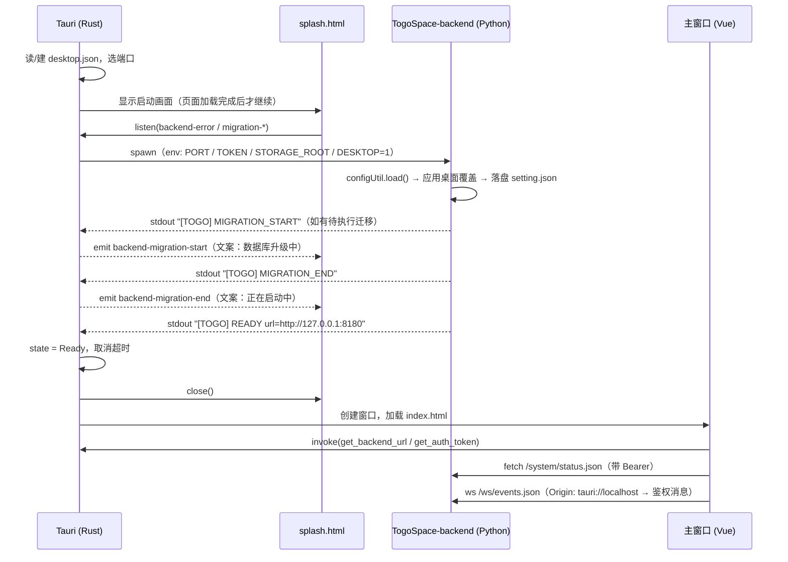

# Tauri 桌面外壳 - 技术文档

> 状态：方案设计（未开发）
> 参考实现：`/Volumes/PDATA/GitDB/serverless_ai_gateway`（Tauri v2 + Node sidecar，本方案把 Node 换成 Python）
> 前置阅读：`docs/tech/10_release/packaging_design.md`（现有 PyInstaller + pystray 方案）、[产品文档](./step1_product.md)

## 1. 总体架构

### 1.1 组成

最终产物是一个应用包，内部三个部分：

```text
TogoSpace.app/                                （macOS 示例，其他平台结构等价）
├── Contents/
│   ├── MacOS/
│   │   └── TogoSpace                         # Rust/Tauri 主程序（唯一的前台进程）
│   ├── Resources/
│   │   ├── frontend/                         # Tauri frontendDist（Vue 构建产物，含 splash.html）
│   │   ├── backend/                          # PyInstaller onedir：TogoSpace-backend + 依赖树
│   │   │   ├── TogoSpace-backend             # 后端可执行（sidecar 入口 = src/desktopEntry.py）
│   │   │   ├── assets/                       # preset / skills / migrate / frontend（浏览器访问用）
│   │   │   └── ...（Python 运行时、动态库）
│   │   └── icons/                            # 托盘图标（template png）
│   └── Info.plist
```

- **窗口、托盘、生命周期、进程管理、日志汇聚**全部由 Rust 负责
- **Python 只做后端**：无托盘、无 GUI、`bind_host` 固定 `127.0.0.1`，通过 stdout 行协议向 Rust 汇报启动状态
- 前端仍是一份 Vue 构建产物，但打两份进包：
  - Tauri 自己打包一份（`frontendDist`），窗口加载 `tauri://localhost/index.html`
  - 后端 `assets/frontend/` 一份，供「用浏览器打开」时由 Tornado 托管

> 两份产物由同一个构建脚本从同一次 `npm run build` 复制，避免版本漂移（见 §8.2）。

### 1.2 进程模型

```text
TogoSpace（Rust，主进程）
├── 主线程：Tauri 事件循环（窗口 / 托盘 / IPC）
├── 线程：backend stdout/stderr 读取循环 + 启动状态机
└── 子进程：TogoSpace-backend（PyInstaller onedir）
        ├── stdin  ← 父进程持有（存活探针：父进程死亡 → EOF → 优雅退出）
        ├── stdout → 行协议（READY / MIGRATION_START / MIGRATION_END / ERROR）
        └── stderr → 只落日志
```

与现有 `appEntry.py`（托盘与后端同进程多线程）的关键差异：**进程隔离**。托盘崩了不影响后端，后端卡死时托盘仍能给出反馈并强杀。

### 1.3 关键决策

| 决策点 | 选择 | 理由 |
|--------|------|------|
| Python 打包形态 | PyInstaller **onedir**，作为 resources 放进包内 | 无启动解压开销（litellm 体积大，onefile 每次启动要解压数百 MB）；签名时可逐个签内部 Mach-O |
| sidecar 是否用 Tauri `externalBin` | **不用** | `externalBin` 语义是「单个可执行文件」，onedir 需要整棵目录树 + 保留可执行位；用 `bundle.resources` 映射目录更直接 |
| 前端加载方式 | 打进 Tauri，`tauri://` 源 | 窗口与后端解耦，后端没起来时启动画面也能独立渲染；前端可用全部 Tauri API |
| 数据目录 | 沿用 `~/.togospace` | 复用 `appPaths` 现有逻辑（已支持 `STORAGE_ROOT` 环境变量覆盖），老用户零迁移 |
| 桌面端口 | `desktop.json` 记录，默认 8180，被占用时自动挑空闲端口 | 前端 URL 由 `invoke` 运行时获取，端口可变不侵入前端 |
| 鉴权 | 桌面模式**强制开启** token 鉴权 | 仅监听 127.0.0.1 仍挡不住本机其他进程/恶意页面直连端口 |
| 启动就绪判定 | 后端 stdout 显式 marker | 比轮询 `/system/status.json` 更早、更稳，且能区分「迁移中」 |

### 1.4 被否决的方案

| 方案 | 否决原因 |
|------|----------|
| onefile + `externalBin` | 每次启动解压到临时目录，litellm 量级下启动显著变慢；临时目录中的 `.so` 影响公证与签名校验 |
| Tauri 窗口直接加载 `http://127.0.0.1:<port>` | 同源、无 CORS，但 Tauri API（invoke）需要给远程 URL 开放 IPC 权限，安全面更大；启动画面与「后端未就绪」态无法自举 |
| Tauri 里嵌入 Python（pyo3） | 需要把整个后端编译进 Rust 进程，构建复杂度与崩溃隔离都不可接受 |

## 2. 仓库结构变更

```text
TogoSpace/
├── tauri/                                # 新增：桌面外壳
│   ├── package.json                      # @tauri-apps/cli
│   ├── src-tauri/
│   │   ├── Cargo.toml
│   │   ├── build.rs
│   │   ├── tauri.conf.json
│   │   ├── capabilities/default.json
│   │   ├── icons/                        # 应用图标 + 托盘图标
│   │   └── src/
│   │       ├── main.rs
│   │       ├── lib.rs                    # 状态机 / 窗口 / 托盘 / 进程管理
│   │       ├── backend.rs                # sidecar 启动、行协议解析、退出处理
│   │       ├── config.rs                 # desktop.json 读写、端口选择
│   │       ├── logger.rs                 # 外壳日志（含后端 stdout 转发）
│   │       ├── utils.rs                  # watch_piped_stdio / generate_client_url
│   │       └── sys/                      # 平台差异（macos / windows / linux / unix）
│   ├── scripts/
│   │   ├── build_backend.py              # PyInstaller onedir → tauri/build/backend/
│   │   ├── build_desktop.py              # 一键：前端 + 后端 + tauri build + 签名 + 公证 + dmg
│   │   └── entitlements.mac.plist
│   └── build/                            # 构建中间产物（.gitignore）
├── src/
│   ├── desktopEntry.py                   # 新增：桌面模式 Python 入口（sidecar）
│   ├── backend_main.py                   # 改动：抽出可复用的启动/停止编排
│   ├── appPaths.py                       # 改动：桌面模式路径与运行形态识别
│   └── controller/                       # 改动：CORS / WS origin / 桌面模式鉴权
├── scripts/
│   ├── togo_desktop.spec                 # 新增：PyInstaller spec（onedir, console=True）
│   └── build_release.py                  # 保留：legacy 托盘形态
└── frontend/
    └── src/
        ├── main.ts                       # 改动：桌面运行时注入 baseURL / token
        ├── api.ts                        # 改动：baseURL 可运行时设置、raw fetch 收敛
        ├── utils/platform.ts             # 新增：isTauri / openExternal / saveFile
        ├── splash.ts                     # 新增：启动画面逻辑
        └── router.ts                     # 改动：hash history
```

`tauri/` 与 `frontend/`、`src/` 平级，保持「后端 / Web 前端 / 终端前端 / 桌面外壳」并列，不把 Rust 代码塞进 `src/`。

## 3. Rust 外壳设计

### 3.1 启动状态机

```rust
enum BackendState {
    NotStarted,
    Starting,      // 已 spawn，等待 READY
    Migrating,     // 后端报告 MIGRATION_START
    Ready,
    Failed(BackendError),  // 启动超时 / spawn 失败 / 端口不可用
    Exited(i32),           // 运行期退出
}
```

状态机只由三类输入驱动：

1. **stdout 行**（`backend.rs::handle_stdout_line`）
2. **子进程退出**（`backend.rs::handle_exit`）
3. **启动超时定时器**（generation 计数防误触发，同参考实现）

合法迁移：

```text
NotStarted -> Starting -> (Migrating -> Starting)* -> Ready
     |            |                                      |
     +------------+--> Failed                            +--> Exited(code)
```

任何**非预期状态**收到的事件一律丢弃并打日志（例如 `Ready` 之后又收到 `MIGRATION_START`），避免日志重放导致窗口反复开关。

### 3.2 stdout 行协议

后端在关键节点打印单行 marker（stderr 不参与状态机）：

| Marker | 触发时机 | Rust 动作 |
|---|---|---|
| `[TOGO] READY url=http://127.0.0.1:<port>` | `web_server.listen()` 成功后 | 置 `Ready`，取消超时，`emit("backend-ready")`，关闭启动画面 + 打开主窗口 |
| `[TOGO] MIGRATION_START` | 检测到待执行迁移，开始迁移前 | `Starting → Migrating`，取消超时，`emit("backend-migration-start")` |
| `[TOGO] MIGRATION_END` | 迁移完成 | `Migrating → Starting`，`emit("backend-migration-end")`，重新计时 |
| `[TOGO] ERROR code=<n> message=<text>` | 可预期的启动失败（端口占用、配置非法） | 置 `Failed`，`emit("backend-error", {code, message})` |

约定：

- marker 必须带固定前缀 `[TOGO] `，且**只写一行、不换行拆分**，保证 Rust 侧按行匹配可靠
- marker 同时进入后端自己的日志（`logger.info`），便于排障时日志对齐
- 除 marker 外，stdout 的其它内容只做日志转发，不参与逻辑

### 3.3 子进程启动

```rust
// 伪代码，实际按平台分 sys::platform
let (mut cmd, backend_dir) = platform::backend_command(&resource_dir); // Resources/backend
cmd.env("TOGOSPACE_DESKTOP", "1")
   .env("STORAGE_ROOT", storage_root)                 // ~/.togospace
   .env("TOGOSPACE_DESKTOP_PORT", port.to_string())
   .env("TOGOSPACE_DESKTOP_TOKEN", token)             // 走 env，不走 argv（避免 ps 泄露）
   .env("TOGOSPACE_PARENT_PID", std::process::id().to_string());
platform::setup_stdio(&mut cmd);   // stdout/stderr piped，stdin piped
let mut child = cmd.spawn()?;
platform::post_spawn(&mut state, &mut child);  // 接管 stdin，随主进程存活
utils::watch_piped_stdio(child, on_event);
```

要点（全部继承自参考实现，必须保留）：

- **stdout 与 stderr 都必须有人读**，任一管道写满后子进程会阻塞（Windows 上约 64 KiB 就卡死）
- **stdin 由父进程持有**：父进程退出 / 被 `kill -9` → OS 关闭管道 → 子进程读 stdin 得 EOF → 自行优雅退出。这是跨平台不留孤儿进程的主机制
- Windows 上额外加 `CREATE_NO_WINDOW`（0x08000000），避免弹黑框
- 非 Windows 平台上 `stdin` 只作为存活探针；不要给后端接 TTY（避免 Ctrl+C 语义与终端回显问题）

### 3.4 端口与配置（`config.rs`）

`~/.togospace/desktop.json`（Rust 拥有，权限 0600）：

```json
{
  "port": 8180,
  "token": "6f4c…（uuid v4）",
  "last_ready_at": "2026-10-29T10:12:00Z"
}
```

规则：

1. 文件不存在 → 生成 `token`（uuid v4），`port` 取默认 8180 后落盘
2. 文件存在 → 读取并校验（port ∈ 1..65535，token 非空），非法项回落到默认值并重写
3. **端口选择**：先尝试 `desktop.json` 中的 port；若被占用，改用系统分配的空闲端口（`TcpListener::bind("127.0.0.1:0")` 拿端口后立即释放），并把新端口写回 `desktop.json`。只有「连空闲端口都拿不到」才判定失败
4. 端口与 token 每次启动通过 `invoke` 提供给前端，因此端口变动对前端透明

`setting.json`（Python 拥有）与 `desktop.json` **职责分离**：Rust 只碰 `desktop.json`，Python 只碰 `setting.json`，避免两个进程写同一文件。

### 3.5 窗口

| 窗口 | label | 说明 |
|------|-------|------|
| 启动画面 | `splashscreen` | `splash.html`，500×340，`decorations: false`，初始 `visible: false`，`alwaysOnTop`，不可缩放；内容加载完成（`on_page_load` Finished）后才允许开始拉起后端 |
| 主窗口 | `main` | 后端 `Ready` 后创建，1280×800，加载 `index.html` |

行为：

- 主窗口 `CloseRequested` → `api.prevent_close()` + `window.hide()` + Dock 图标隐藏（`ActivationPolicy::Accessory`）
- 托盘「显示窗口」/ 点击 Dock 图标（`RunEvent::Reopen`）→ `show_main_window()`：窗口存在则 `show()+set_focus()`，不存在则重建
- `RunEvent::ExitRequested` → `api.prevent_exit()`（关掉所有窗口不等于退出应用）

启动门控（splash 先显示，再启动后端）继承参考实现的两个条件：`setup_finished && splash_loaded`。好处是后端启动的日志与 UI 反馈严格对齐，不会出现「后端已经在跑但用户看不到任何东西」。

### 3.6 托盘

菜单：

```text
TogoSpace  v0.3.12
──────────
显示窗口
在浏览器中打开
复制访问 Token
──────────
打开配置目录
打开日志目录
──────────
退出
```

- macOS 用 template 图标（`icon_as_template(true)`），自动适配深浅色菜单栏
- 「退出」：先请求后端优雅停机（关闭 stdin → 等待 ≤5s → 必要时 `kill`），再 `app.exit(0)`
- 后端处于 `Failed`/`Exited` 时，托盘图标切换为告警样式，菜单追加「查看错误」

### 3.7 Tauri 命令（IPC）

| 命令 | 返回 | 用途 |
|------|------|------|
| `get_backend_url` | `String` | 前端设置 `apiBaseURL`（`http://127.0.0.1:<port>`） |
| `get_auth_token` | `String` | 前端自动登录（写入内存态 token，不落 localStorage） |
| `get_backend_state` | `String` | 主窗口健康检查（`ready / failed / exited`） |
| `restart_backend` | `Result<(), String>` | 托盘/主窗口「重试启动」 |
| `open_external` | `Result<(), String>` | 打开系统浏览器（替代 `target="_blank"`） |
| `save_text_file` | `Result<Option<String>, String>` | 保存导出文件（替代 Blob 下载） |
| `exit_app` | `()` | 启动画面「确认退出」 |
| `log_to_rust` | `()` | 前端日志转发到外壳日志（排障用） |

`capabilities/default.json` 只授予上述所需权限（`core:default`、`core:tray:default`、`dialog:allow-save`、`fs:allow-write-text-file`、`shell:allow-open`），窗口范围为 `["main", "splashscreen"]`。

### 3.8 日志

| 来源 | 去处 |
|------|------|
| 后端自身日志 | `~/.togospace/logs/backend/**`（不变） |
| 后端 stdout/stderr | 逐行转发到 `~/.togospace/logs/desktop/desktop.log`（10MB × 3 轮转），带 `[backend:out]` / `[backend:err]` 前缀 |
| 外壳自身日志 | 同上文件，带 `[shell]` 前缀 + 启动相对时间戳（`+123ms`） |
| 前端 `console.log` | 通过 `log_to_rust` 进入同一文件 |

排障时一个文件即可对齐「外壳启动 → 后端启动 → 前端初始化」的时间线。

## 4. Python 后端适配

### 4.1 新增入口 `src/desktopEntry.py`

职责只有四件事，业务代码零改动：

```python
def main() -> None:
    params = _read_desktop_params()      # 从 env 读取 desktop 参数，缺失则报错退出
    _apply_desktop_overrides(params)     # 内存里改 SettingConfig：bind_host / port / auth
    _install_stdin_probe()               # 起线程读 stdin，EOF 即 request_shutdown()
    asyncio.run(backend_main.main(port=params.port))   # 复用现有启动编排
```

必须与 `backend_main.py` 解耦的点：`desktopEntry` 不复制启动流程，只做「参数注入 + 生命周期钩子」，`backend_main.main()` 内部按需回调（见 4.3）。

### 4.2 桌面模式参数

| 环境变量 | 说明 |
|---|---|
| `TOGOSPACE_DESKTOP` | `"1"` 表示桌面模式 |
| `TOGOSPACE_DESKTOP_PORT` | 期望监听端口（已被 Rust 校验/挑选） |
| `TOGOSPACE_DESKTOP_TOKEN` | 桌面会话 token |
| `STORAGE_ROOT` | `~/.togospace`（已有支持） |
| `TOGOSPACE_PARENT_PID` | 仅用于日志与诊断 |

`appPaths` 增加：

```python
IS_DESKTOP_MODE = os.environ.get("TOGOSPACE_DESKTOP") == "1"
```

`_detect_run_env()` 增加 `desktop` 取值（现有 `docker / mac_app / source`），启动日志打印 `运行环境=desktop`。

### 4.3 `backend_main.py` 改动

只改三处，均为可选钩子（源码/测试路径行为不变）：

1. **迁移前后回调**：`ormService.startup()` 内部已有「需要迁移」判断，新增两个可选回调 `on_migration_start` / `on_migration_end`（或改为 `callbacks=StartupCallbacks(...)` 入参），供 desktop 模式打印 marker
2. **监听成功回调**：`web_server.listen()` 成功后调用 `on_ready(bind_host, bind_port)`，desktop 模式打印 `[TOGO] READY url=...`
3. **优雅停机**：`request_shutdown()` 已存在，desktop 模式由 stdin EOF 线程调用即可，无需新增接口

单实例 PID 文件：桌面模式**跳过**（`_check_single_instance` / `_write_pid` / `_remove_pid`）。原因有两个：单实例已由 Rust 的 `tauri-plugin-single-instance` 保证；且冻结后 `run/backend.pid` 落在只读的 `Resources` 目录中，写入会失败。

### 4.4 桌面模式下的配置覆盖

`_apply_desktop_overrides` 在 `configUtil.load()` 之后、`messageBus.startup()` 之前执行：

```python
setting = configUtil.get_app_config().setting
setting.bind_host = "127.0.0.1"          # 桌面模式强制只监听本机
setting.bind_port = params.port
setting.auth.enabled = True              # 桌面模式强制鉴权
setting.auth.token = params.token
configUtil.update_setting(lambda s: None)  # 触发一次原子落盘，浏览器访问也能带同一 token
```

注意事项：

- `update_setting` 走现有「读原文件 → 合并 → 临时文件 + `os.replace`」逻辑，保留用户手写的 `_comment` 等字段
- **只在值确实不同时才落盘**，避免每次启动都改文件时间、触发用户不必要的 diff
- 老版本用户 `auth.enabled=false` 时会被自动打开鉴权。这是刻意的：桌面模式端口暴露在本机，必须防其它本地程序直连。前端会自动注入 token，用户无感；浏览器访问需要从托盘菜单复制 token（产品文档 §4.5）
- `bind_host` 强制覆盖意味着**桌面模式下用户手改 setting.json 的 bind_host 不生效**，需在 `setting.README.md` 说明

### 4.5 后端 CORS 与 WebSocket origin

Tauri v2 的页面源是 `tauri://localhost`（macOS/Linux）或 `http://tauri.localhost`（Windows），与后端 `http://127.0.0.1:<port>` **跨源**，必须显式放开：

1. **HTTP**：`BaseHandler.set_default_headers()` 中按白名单回填
   - `Access-Control-Allow-Origin`: 回显 `Origin`（仅当命中白名单）
   - `Access-Control-Allow-Headers`: `Content-Type, Authorization`
   - `Access-Control-Allow-Methods`: `GET, POST, PUT, PATCH, DELETE, OPTIONS`
   - `Vary: Origin`
2. **预检**：新增 `OptionsHandler`，统一 204 返回；路由表最前面注册 `(r"/.*", OptionsHandler)` 的 `options` 方法（Tornado 需要按路径匹配到具体 Handler，因此更稳妥的做法是在基类里实现 `options()` 并在每个 Handler 上生效 —— 由 `RequestHandler.SUPPORTED_METHODS` 自动分发）
3. **WebSocket**：覆盖 `EventsWsHandler.check_origin()` 与 `_SPAHandler` 无关的默认实现。Tornado 默认**拒绝跨源 WS**，必须显式放行白名单，否则浏览器控制台会看到连接被 403 拒绝
4. 白名单常量收敛在 `src/constants.py`：

```python
DESKTOP_ALLOWED_ORIGINS = (
    "tauri://localhost",
    "http://tauri.localhost",
    "https://tauri.localhost",
)
```

浏览器形态（同源 / Vite 代理）不受影响：`Origin` 为 `http://127.0.0.1:<port>` 或 `http://localhost:8181` 时按「eloop 同源」或开发白名单处理。开发白名单只在 `development_mode` 下加入 `http://localhost:8181`。

> 安全提醒：CORS 白名单只是浏览器侧的访问控制；桌面模式真正的防线是「只绑 127.0.0.1 + 强制 token」。

## 5. 启动时序



失败分支：

- spawn 失败 / 15s 内无 `READY` / 后端打印 `[TOGO] ERROR` → `Failed`，启动画面显示错误 + 「确认退出」
- 运行期非零退出 → `Exited(code)`，`emit("backend-error")`，托盘图标告警

## 6. 前端适配

改动集中在「运行时配置注入」与「浏览器能力替换」两件事，UI 与业务逻辑不动。

### 6.1 运行时注入（`main.ts` + `api.ts` + `authStore.ts`）

现状：`api.ts` 的 `API_BASE_URL` 来自 `import.meta.env.VITE_API_BASE_URL`（编译期常量），`token` 只存在于 `localStorage`。

#### 6.1.1 与参考实现（`serverless_ai_gateway`）的异同

参考项目的桌面注入逻辑（`main.ts::loadDesktopRuntimeConfig` + `utils/request.ts::setBaseURL` + `utils/authSession.ts`）可以照抄骨架，但**不能整段复制**，原因如下：

| 项 | 参考实现 | TogoSpace | 是否可直接复用 |
|---|---|---|---|
| 取后端地址 | `invoke('get_backend_url')` | 同 | ✅ 直接复用 |
| 取 token | `invoke('get_auth_token')` | 同 | ✅ 直接复用 |
| 注入时机 | 挂载前 `await`，`isTauri()` 为假则回退 localStorage | 同 | ✅ 直接复用 |
| 前端日志转发 | 覆写 `console.log` → `invoke('log_to_rust')` | 同（§3.8） | ✅ 直接复用 |
| HTTP base 可变性 | axios `instance.defaults.baseURL`，天然可写 | `api.ts` 是模块级 `const API_BASE_URL`，编译期常量 | ❌ 需改为 `let` + setter |
| 实时通道 | **无 WebSocket**，只有 SSE（`fetchEventSource` 拼 `${API_BASE_URL}`） | 有 WS：`createEventsSocket()` → `makeWsUrl('/ws/events.json')` | ❌ **参考实现无此能力，必须自己补** |
| token 存取 | `authSession.ts` = memory-first + localStorage fallback，`{persist:false}` 天然生效 | `authStore.ts` 只有 localStorage 读写 | ❌ 需先补 memory 层 |
| 未授权处理 | 独立 `/login` 路由；`isTauri()` 时 `tryAutoLogin()` + `listen('backend-ready')` 重试 | 无登录页；`App.vue` 检测 `auth_enabled && !getToken()` 弹 `showTokenDialog` | ❌ 机制不同，改为「抑制弹窗」 |
| 跨源 | 后端 CORS 白名单 | 同（§4.5） | ✅ 直接复用思路 |

**最关键的一条是实时通道**：参考项目前端完全没有 WebSocket，所以它 `setBaseURL` 一处改动就覆盖了全部网络出口。TogoSpace 有一条独立的 WS 链路，且 `makeWsUrl` 在 `API_BASE_URL` 为空时会退化成 `window.location.host`（桌面模式下是 `tauri.localhost`）。若照抄参考实现只改 HTTP 的 base，**WS 会连到不存在的地址，实时消息整条链路静默失效**（表现是界面能开、数据能拉，但新消息不刷新）。

#### 6.1.2 HTTP base 改为运行时可变

```ts
// api.ts
let runtimeBaseUrl = (import.meta.env.VITE_API_BASE_URL || '').replace(/\/$/, '');

export function setApiBaseUrl(url: string): void {
  runtimeBaseUrl = (url || '').replace(/\/$/, '');
}

function makeUrl(path: string): string {
  return runtimeBaseUrl ? `${runtimeBaseUrl}${path}` : path;
}
```

`makeDisplayUrl` 无需改动（它基于 `makeUrl` 的结果）。

#### 6.1.3 WS URL 必须跟着运行时 base 走

现有实现（`api.ts::makeWsUrl`）：

```ts
function makeWsUrl(path: string): string {
  if (API_BASE_URL) { /* 从 API_BASE_URL 派生 ws:// */ }
  const protocol = window.location.protocol === 'https:' ? 'wss:' : 'ws:';
  return `${protocol}//${window.location.host}${path}`;
}
```

改为始终以运行时 base 为准，仅在完全没有 base 时才回落到 `window.location`：

```ts
function makeWsUrl(path: string): string {
  if (runtimeBaseUrl) {
    const url = new URL(runtimeBaseUrl);
    url.protocol = url.protocol === 'https:' ? 'wss:' : 'ws:';
    url.pathname = path;
    return url.toString();
  }
  const protocol = window.location.protocol === 'https:' ? 'wss:' : 'ws:';
  return `${protocol}//${window.location.host}${path}`;
}
```

判定条件从「编译期常量非空」改成「运行时 base 非空」，桌面模式下一定会走到第一分支。

#### 6.1.4 token 增加内存层

`authStore.ts` 现状是纯 localStorage。桌面模式不能落盘（明文 token 进 WebView 存储），因此需要补一个 memory-first 层，语义与参考实现的 `authSession.ts` 一致：

```ts
let memoryToken: string | null = null;

export function getToken(): string | null {
  if (memoryToken) return memoryToken;
  return localStorage.getItem(TOKEN_KEY);
}

export function setToken(token: string, options: { persist?: boolean } = {}): void {
  memoryToken = token;
  if (options.persist !== false) {
    localStorage.setItem(TOKEN_KEY, token);
  }
}

export function clearToken(): void {
  memoryToken = null;
  localStorage.removeItem(TOKEN_KEY);
}
```

> 若不做这一步，`setToken(token, { persist: false })` 会**静默失效**（参数被忽略、token 仍写 localStorage），桌面端看似能用，实际明文 token 已落盘。

#### 6.1.5 未授权处理：抑制弹窗而非跳过登录页

参考项目有独立登录页，桌面模式靠 `tryAutoLogin()` 自动通过。TogoSpace 没有登录路由，两处会弹 `showTokenDialog`：

| 位置 | 触发条件 | 桌面模式处置 |
|---|---|---|
| `App.vue::checkSystemStatus` | `auth_enabled && !getToken()` | token 已注入，条件天然不成立；但需保证注入**早于**首次 `checkSystemStatus`，否则会闪一下弹窗 |
| `api.ts` 401 拦截 | `auth_required` / `auth_invalid` | 保留（说明注入的 token 与后端不一致，属真实异常，应让用户看到） |
| `realtime/wsClient.ts` `open` 且 `authEnabled && !token` | 无 token 时 | 同上，token 已注入则不会触发 |

顺序要求：`main.ts` 的 `loadDesktopRuntime()` 必须在 `app.mount()` **之前** `await` 完成，且 `syncLanguageFromBackend()`（内部会打 `/system/status.json`）也要在其之后。当前 `main.ts` 的结构是「`syncLanguageFromBackend().finally(() => mount())`」，改造后应变为：

```ts
async function bootstrap(): Promise<void> {
  if (isTauri()) {
    await loadDesktopRuntime();        // 先注入 base + token
  } else {
    loadBrowserStoredConfig();
  }
  await syncLanguageFromBackend();     // 此时 base 已就绪
  createApp(App).use(router).use(i18n).mount('#app');
}
```

#### 6.1.6 `main.ts` 注入实现

```ts
async function loadDesktopRuntime(): Promise<void> {
  const { invoke } = await import('@tauri-apps/api/core');
  const [url, token] = await Promise.all([
    invoke<string>('get_backend_url'),
    invoke<string>('get_auth_token'),
  ]);
  if (url) setApiBaseUrl(url);
  if (token) setToken(token, { persist: false });
}
```

> 与参考实现的差异：参考实现有 `loadBrowserStoredConfig()`（从 localStorage 读远端网关地址），我们的浏览器形态是同源访问，不需要远程 base 覆盖，因此浏览器分支只保留 token 读取。

#### 6.1.7 其它连带改动

- `i18n.ts::syncLanguageFromBackend` 现在用相对 `fetch('/system/status.json')`，桌面模式下相对路径会打到 `tauri://localhost`，必须改为走 `api.ts` 的 `getSystemStatus()`（顺带消掉唯一一处裸 fetch）
- `authEnabled` 仍按 `/system/status.json` 返回值为准，不做桌面模式特判（后端在桌面模式下强制开启鉴权，返回值恒为 `true`）
- 参考实现里 `request.ts` 的动态 `import('@tauri-apps/api/core')` 写法可沿用，避免浏览器形态把 Tauri 包打进主 chunk

### 6.2 路由

`router.ts` 从 `createWebHistory()` 改为 `createWebHashHistory()`：

- Tauri 自定义协议下对「非入口路径」的刷新/重新加载不可靠（协议处理器按路径找静态文件），hash 路由可彻底规避
- 代价：桌面端 URL 形如 `index.html#/teams/1/rooms/2`；浏览器形态仍是同一份代码，`#` 路由由 Tornado 的 SPA fallback 正常承接（`assets/frontend/index.html` 仍会被命中）

### 6.3 浏览器能力替换（`utils/platform.ts`）

| 能力 | 浏览器形态 | 桌面形态 |
|------|-----------|----------|
| 打开外链（`<a target="_blank">`、更新 Release 页） | `window.open` | `invoke('open_external', { url })` |
| 导出 JSON（`Blob` + `<a download>`，仅 `SettingsPage.vue` 一处） | 现状 | `invoke('save_text_file', { defaultName, content })`，走原生保存对话框 |
| 剪贴板（Markdown 代码块复制） | `navigator.clipboard` | 同左（WKWebView 支持；失败时静默降级） |
| 头像等静态资源 `/avatars/xxx.png` | 后端同源 | `tauri://localhost/avatars/xxx.png`（随 frontendDist 打包，天然可用） |

### 6.4 启动画面（`splash.html` + `splash.ts`）

- 与参考实现同构：静态 HTML（内联样式，无框架依赖）、spinner + 状态文案 + 错误态 + 「确认退出」
- 纯靠 `listen('backend-migration-start' | 'backend-migration-end' | 'backend-error')` 驱动，不轮询
- 作为第二个 Vite 入口构建（`build.rollupOptions.input = { main, splash }`）

### 6.5 构建产物处理

- `vite.config.ts` 增加 `remove-crossorigin` 插件：去掉 `index.html` / `splash.html` 中的 `crossorigin` 属性（Tauri v2 自定义协议下会导致资源加载失败）
- `modulePreload: false`（同上原因）
- 两份产物：`frontend/dist` → Tauri `frontendDist`；同一份 → 后端 `assets/frontend/`

## 7. `tauri.conf.json` 关键配置

```json
{
  "productName": "TogoSpace",
  "identifier": "com.togospace.desktop",
  "build": {
    "frontendDist": "../../frontend/dist",
    "devUrl": "http://127.0.0.1:8181",
    "beforeDevCommand": "cd ../frontend && npm run dev",
    "beforeBuildCommand": "cd .. && python3 tauri/scripts/build_backend.py"
  },
  "app": {
    "windows": [
      {
        "label": "splashscreen",
        "url": "splash.html",
        "width": 500, "height": 340,
        "decorations": false, "resizable": false,
        "center": true, "alwaysOnTop": true, "visible": false,
        "devtools": true
      }
    ],
    "security": {
      "csp": "default-src 'self'; connect-src 'self' http://127.0.0.1:* ws://127.0.0.1:*; img-src 'self' data: blob:; style-src 'self' 'unsafe-inline'; script-src 'self'"
    }
  },
  "bundle": {
    "active": true,
    "targets": ["dmg", "app", "nsis", "appimage"],
    "resources": {
      "../build/backend": "backend",
      "icons/tray-icon@2x.png": "icons/tray-icon@2x.png"
    },
    "icon": ["icons/32x32.png", "icons/128x128.png", "icons/128x128@2x.png", "icons/icon.icns", "icons/icon.ico"]
  }
}
```

注意点：

- **`beforeBuildCommand` 只负责后端构建，不负责前端**：前端由 `build_desktop.py` 先构建并同步，Tauri 直接吃现成 `frontend/dist`，避免 Tauri 与脚本各构建一次
- CSP 里 `connect-src` 用通配端口（`http://127.0.0.1:*`）：桌面端口是运行时决定的
- `script-src` 不能用 `'unsafe-eval'`（Vue 运行时不走 eval；若某依赖需要，在实现时再评估）
- `resources` 的源路径相对 `src-tauri`

## 8. 构建与发布

### 8.1 完整链路

```bash
python3 tauri/scripts/build_desktop.py            # 默认：arm64 当前机器架构，全流程
python3 tauri/scripts/build_desktop.py --arch x86_64
python3 tauri/scripts/build_desktop.py --action backend,app     # 分步执行
```

步骤：

1. **前端**：`frontend/` → `npm run build` → 产物同步到 `assets/frontend/`（后端浏览器形态用）
2. **后端**：`scripts/togo_desktop.spec` 走 PyInstaller **onedir** → `dist/TogoSpace-backend/`，再整体复制到 `tauri/build/backend/`
3. **Tauri**：`npm run tauri build`（`frontendDist` 吃 `frontend/dist`，`resources` 吃 `tauri/build/backend`）
4. **签名（macOS）**：
   1. 逐个签 `Resources/backend/**` 里的 Mach-O（主可执行 + `.so`/`.dylib`），`--options=runtime` + entitlements
   2. 签 `Contents/MacOS/TogoSpace`
   3. `codesign --deep --force` 签整个 `.app` → `codesign --verify --deep --strict` 校验
5. **打包与公证**：`hdiutil` 生成 dmg → 签 dmg → `notarytool submit --wait` → `stapler staple`

### 8.2 PyInstaller spec（`scripts/togo_desktop.spec`）

相对现有 `togo_agent.spec` 的差异：

| 项 | legacy（托盘形态） | desktop（本方案） |
|---|---|---|
| 入口 | `src/appEntry.py` | `src/desktopEntry.py` |
| 模式 | `onedir` + `BUNDLE`（自己产 `.app`） | `onedir`，**不产 BUNDLE**（`.app` 由 Tauri 产） |
| `console` | `False` | `True`（stdout 就是状态机通道；窗口隐藏由 Tauri 负责，Windows 上由 `CREATE_NO_WINDOW` 处理） |
| `datas` | `assets/`（含 `frontend/`） | 同左（浏览器形态需要） |
| `hiddenimports` | 保持清单 | 去掉 `pystray` / `AppKit` / `PyObjCTools` / `PIL` |
| `excludes` | `textual` / `mypy` | 同上，另可加 `tkinter`（端口占用提示改由启动画面承担） |

产物内部结构（与 `appPaths` 的假设对齐）：

```text
TogoSpace-backend/
├── TogoSpace-backend            # 可执行
├── _internal/                   # onedir 依赖（PyInstaller 6.x）
└── assets/                      # datas 映射的目标目录
    ├── frontend/
    ├── migrate/
    ├── preset/
    ├── skills/
    ├── i18n/
    └── execute/
```

> `appPaths` 依赖 `sys._MEIPASS` 定位 `assets/`。PyInstaller 6 onedir 下 `_MEIPASS` 指向 `_internal`，因此 `datas` 目标要写成 `_internal/assets`（或 `appPaths` 增加「优先找可执行文件同级 `assets/`」的兜底）。**这是实现阶段必须先验证的第一件事**，写成任务表里的 P0 验收项。

### 8.3 架构策略

- PyInstaller **不支持交叉编译**，且 universal2 需要 Python 本体与全部 wheel 都是 universal2（litellm 依赖链不满足）
- 结论：**分架构出包**（`aarch64-apple-darwin` / `x86_64-apple-darwin`），文件名带架构后缀，与现有 `build_release.py` 的命名约定一致
- Rust 侧不需要 universal 构建（避免与后端架构语义混淆）

### 8.4 Windows / Linux 预留

| 平台 | sidecar 路径 | 子进程处理 | 打包目标 |
|------|--------------|-----------|----------|
| Windows | `Resources/backend/TogoSpace-backend.exe` | `CREATE_NO_WINDOW`；`stdin` 探针同 Unix | `nsis` → `.exe` |
| Linux | `Resources/backend/TogoSpace-backend` | 同 Unix | `appimage` / `deb`（依赖 `webkit2gtk-4.1`） |

本期只完成 macOS；Windows/Linux 保留 `sys/` 分支与构建脚本入口，不作为发布门槛。

## 9. 安全

| 面 | 措施 |
|---|---|
| 网络暴露 | 桌面模式强制 `bind_host=127.0.0.1`，不随 `setting.json` 变化 |
| 未授权访问 | 桌面模式强制 `auth.enabled=true`，token 每次安装首次启动随机生成，存 `desktop.json`（0600） |
| token 泄露 | 通过环境变量传给子进程（不经 argv）；前端只在内存持有；日志只打印前 8 位 |
| 跨源 | CORS / WS origin 白名单只放行 `tauri://` 与 `tauri.localhost`；不上 `*` |
| 本地恶意页面 | 即便页面能连上端口，无 token 也无法调用业务接口；`/system/status.json` 属既有豁免路径，仅返回非敏感状态 |
| 子进程残留 | `stdin` 探针 + 退出前显式停机 |
| 数据目录 | `~/.togospace` 沿用现有权限；`desktop.json` 单独收紧 0600 |
| 更新 | 本期仅「检查更新 + 打开 Release 页」，不做后台自动升级（避免未签名的替换链路） |

## 10. 测试

### 10.1 Rust 单测（`tauri/src-tauri/tests/`）

- `utils::generate_client_url`：`0.0.0.0 → 127.0.0.1` 映射（同参考实现）
- `watch_piped_stdio`：子进程灌满 stderr，验证管道被完整消费、进程正常退出（参考实现的 `stdio_test.rs` 可直接复用）
- 行协议解析：`[TOGO] READY/MIGRATION_*/ERROR` 各种畸形输入的容错
- `desktop.json` 读写与非法值回落

### 10.2 Python 单测（`tests/unit`）

- `_read_desktop_params`：缺参 / 非法端口 / token 为空的报错
- `_apply_desktop_overrides`：强制 `127.0.0.1`、强制鉴权、值相同不落盘
- marker 输出函数格式稳定（防止 Rust 侧正则失效）
- stdin EOF → `request_shutdown()` 被调用（用 fake stdin）

### 10.3 集成 / API 测试（`tests/api`）

- 跨源请求：带 `Origin: tauri://localhost` 的 `GET /agents/list.json` 返回 ACAO 头；`OPTIONS` 预检 204
- WS：`Origin: tauri://localhost` 可连、`Origin: http://evil.example` 被 403
- 桌面模式鉴权：无 token 401、带 `desktop.json` token 200

### 10.4 手工验收（每个发布候选）

按 [产品文档 §5](./step1_product.md#5-验收标准) 逐条走一遍，另加：

- 干净机器（无 Python / 未装过 app）冷启动安装 → 启动 → 完成 Quick Init → 退出
- `kill -9` 主程序 → `pgrep -f TogoSpace-backend` 为空
- 从老版本 `~/.togospace` 升级 → 数据完整、迁移提示可见
- 断网启动（LLM 不可达）→ 主窗口仍可打开并给出可读错误

## 11. 风险与待定项

| # | 风险 | 影响 | 处置 |
|---|------|------|------|
| R1 | `_MEIPASS` 与 onedir `assets/` 路径不匹配 | 后端启动即失败（找不到 preset / migrate） | 实现第一天验证；必要时给 `appPaths` 加可执行文件同级 `assets/` 兜底 |
| R2 | 包体偏大（Python + litellm + 双份前端） | 下载/安装体验 | 沿用现有 spec 的 excludes；必要时后端 `assets/frontend` 改为压缩包（先不做） |
| R3 | 冷启动耗时（PyInstaller 导入 + litellm） | 启动画面停留过久 | 实测基线；必要时对 litellm 做懒加载（属后端优化，另立任务） |
| R4 | `codesign --deep` 对嵌套 sidecar 目录的可靠性 | 公证失败 / Gatekeeper 拦截 | 显式从内到外逐个签名，再签外层；用 `codesign --verify --deep --strict` 兜底 |
| R5 | WKWebView 对 `Blob` 下载支持不稳定 | 导出团队预设失败 | 桌面形态走原生保存对话框（§6.3） |
| R6 | 桌面模式强制开启鉴权改变老用户行为 | 浏览器访问需输 token | 托盘提供「复制访问 Token」；`setting.README.md` 与发布说明中明确 |
| R7 | 端口动态变化 | 用户书签的浏览器地址失效 | 托盘菜单展示当前实际 URL；`desktop.json` 记录最近端口，优先复用 |
| R8 | 双份前端产物版本漂移 | 桌面窗口与浏览器界面不一致 | 构建脚本单源复制；CI 校验两份产物哈希一致 |

### 待定项

- **D1**：是否在本期就把 legacy 托盘形态（`appEntry.py` + `togo_agent.spec`）标记为弃用？建议：桌面形态稳定一个版本后再弃用，本期二者并存。
- **D2**：桌面端口是否允许用户指定？建议：`desktop.json` 手改即可，不提供 UI（避免与 `setting.json` 的 `bind_port` 概念冲突）。
- **D3**：是否引入 `tauri-plugin-single-instance`？建议：引入（避免二次启动拉起第二个后端）。
- **D4**：桌面模式是否仍需要 `data/` 目录锁（SQLite 单实例）？建议：依赖 D3，不额外加锁。
