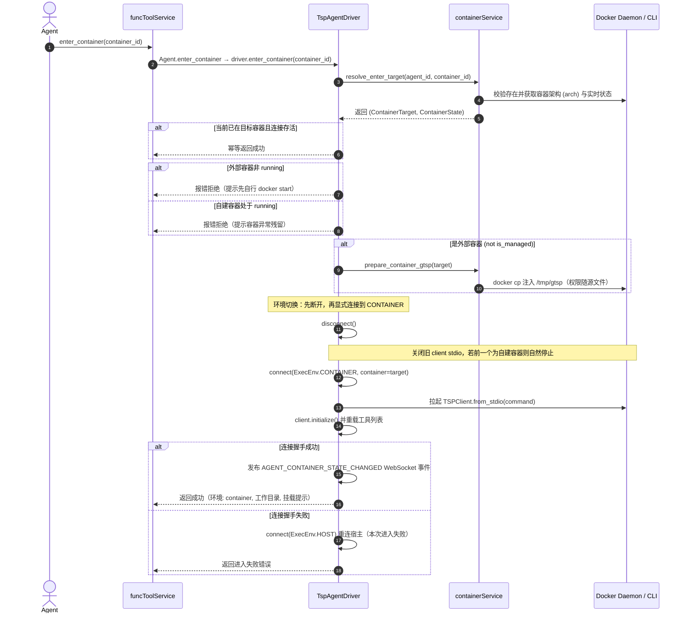

# Docker 执行环境 - 技术文档

> 状态：方案设计（未开发） · 前置阅读：[产品文档](./step1_product.md)

## 1. 方案概览

### 1.1 核心思路

**不重写文件 / 命令工具，而是把 gtsp 搬进容器。** 现有 TSP driver 通过 stdio 连接宿主 gtsp 执行 `read_file` / `execute_bash` / `process_*`。「进入容器」= 断开宿主 gtsp，把同一个 `_client` 连到容器内的 gtsp。

```text
Agent turn
├─ create/delete/list ──► containerService（docker CLI）
├─ enter/exit ──────────► TspAgentDriver（切换 _client）
└─ TSP 工具 ────────────► 当前 _client：宿主 gtsp 或 容器内 gtsp
```

### 1.2 容器内 gtsp 的拉起形态

所有形态最终都走 `TSPClient.from_stdio(command)`，仅 `command` 与前置动作不同：

| 容器来源与状态 | 容器主进程 | gtsp 拉起方式 | 退出方式 |
|---|---|---|---|
| **自建容器**（`create_container` 创建，初始 `created`） | tini（PID 1）+ gtsp（主子进程） | `docker start -a -i <id>` 直接拉起 | 关 stdin → gtsp 退出 → 容器转为 `exited`（0.2s，不需调用 `docker stop`） |
| **外部 / 他人容器（必须处于 running）** | 容器原主进程 | `docker cp` 注入二进制 + `docker exec -i <id> <gtsp>` | 关 stdin → gtsp 退出，容器继续运行（不需调用 `docker stop`） |
| **外部 / 他人容器（非 `running`）** | — | **不支持直接进入**。报错并带上实际状态（`created` / `exited` / `paused` / `dead` / `restarting` / `unknown` 等），由 Agent 自行启动 / 恢复后再重试 | — |
| **宿主环境** | — | 现有 `build_gtsp_command`，直接拉起宿主二进制 | — |

- **自建容器 `--init` 与自动退出机制（为什么不需 `docker stop`）**：
  - 自建容器使用 `--init` 参数启动，PID 1 为 Docker 内置的 `docker-init`（tini），`gtsp` 作为其主子进程运行；
  - **`--init` 不会阻碍容器自动退出**：tini 的默认行为是将主子进程（`gtsp`）的生命周期等同于容器生命周期。当驱动端关闭 stdio 时，`gtsp` 收到 EOF 退出；tini 捕获到主子进程退出事件后，**会立即以 `gtsp` 的退出码自身退出**，绝不会因容器内残留后台进程而挂起等待；
  - **Linux PID 1 内核机制保障**：在 Linux PID 命名空间中，一旦 PID 1（tini）退出，内核会立即向该命名空间内的所有其他存活进程广播 `SIGKILL` 并销毁命名空间。因此即便 Agent 在容器内后台启动了其他任务（如 `nohup`、编译守护进程等），只要 `gtsp` 退出，容器也必定在 0.1~0.2s 内自然停止转为 `exited` 状态。
- **外部容器简化**：外部容器进入前必须处于 `running`；其他任何状态（`created` / `exited` / `paused` / `dead` / `restarting` / `unknown` 等）一律拒绝，不做逐状态分支，报错中带实际状态，由 Agent 自行启动 / 恢复后再重试。退出时仅关闭 exec 的 stdio，不影响容器主进程，同样不涉及 `docker stop`。
- **自建容器进入状态**：只有 `created` / `exited` 允许拉起；`running` 返回 `container_already_running`；`paused` / `dead` / `restarting` / `removing` 等其他异常状态统一按失败处理，返回 `container_enter_failed`，message 带实际状态与 Docker 原始错误，不自动 unpause / restart。

### 1.3 关键决策

| 决策 | 理由 |
|---|---|
| 进入容器 = 切换 TSP client | 工具语义零改动 |
| 单 client，切换时关闭旧环境 gtsp | 后台进程本就不该跨环境存活 |
| `image` 默认 `ubuntu:24.04`，只做参数默认值 | 不引入配置面 |
| `enter_container` 不校验属主、不挂载 | 产品要求；Docker 也无法给已有容器加 mount |
| `list_containers` 只返回 DB 记录 | 不枚举宿主其他容器 |
| 进入状态只存内存，重启一律回宿主 | 外部容器无法可靠恢复；避免「DB 说在容器、实际不在」 |
| 自建容器进入前已 running → 报错 `container_already_running` | 空闲 running 是异常残留，隐式 stop 会抹掉线索 |
| 删除正在使用的容器 → 报错 `container_in_use` | 删除不隐含环境切换 |
| 退出机制：关 stdin 等 gtsp 自动退出 | 实测 EOF 后 gtsp 立即退出（0.2s 内）；不引入级联 stop/kill |
| 只有 TSP driver 暴露容器工具 | Native / Claude SDK 的工具不经过 gtsp |

## 2. 数据模型与持久化

### 2.1 表 `agent_containers`（迁移 `0017_agent_containers.sql`）

只记录 `create_container` 创建的容器。直接使用容器的 12 位短 ID（Docker ID 前 12 位），不生成额外的系统 ID。外部容器不进 DB。

| 字段 | 类型 | 说明 |
|---|---|---|
| `id` | `int` | 主键，自增；工具层对外作为 `record_id`，API 中位于 `record.id` |
| `agent_id` | `int` | 所属 Agent ID（建立索引） |
| `container_id` | `str \| null` | 唯一，Docker 容器 12 位短 ID；创建流程先插入空值，`docker create` 成功后回填 |
| `container_name` | `str` | 容器名称（`agent-t<team_id>-<name>-<record_id>`）；不建唯一索引，唯一性由 `record_id` 保证，team 段与 Agent 名仅用于辨认归属，见 §3.5（依据 Operator 2026-11-01 指令修订） |
| `image` | `str` | 创建时实际使用的镜像（默认 `ubuntu:24.04`） |
| `note` | `str \| null` | 容器说明，创建时由 Agent 填写（迁移 `0021_add_note_to_agent_containers.sql`）。**可空**：存量行升级后为 `NULL`；创建时未填（含空串 / 纯空白）也存 `NULL`，不存空串。上限 200 字符，超长报错不截断（见 §6.2） |
| `deleted` | `int` | 软删除标记（默认 `0`，删除后置为时间戳或 `1`），便于链路排查与执行回溯 |
| `created_at` | `int` | 创建时间戳 |

- **不存运行状态**：运行状态实时 `docker inspect`，避免缓存漂移；
- **不存当前进入状态**：执行环境只存在于内存中，重启后一律回到宿主；
- **架构 `arch`**：无需存库，创建或注入时通过 `docker inspect` 镜像/容器动态解析；
- **名称后缀用自增主键**：容器名最后一段直接使用 `agent_containers.id`（全局唯一），无需额外的序号列，也无需在创建时扫描活跃容器名挑编号；删除后新建不会复用旧名；
- **`note` 只创建时写**：没有修改说明的工具/接口（Operator 2026-11-08 明确「只创建时写」）。它是描述性字段，不参与配额、命名、状态判定，也不进 `docker` 参数（不进容器 label）。
- **`note` 的「未填写」只有一种形态**：`NULL`。`None` / 空串 / 纯空白在 `containerService.normalize_container_note` 里统一归一成 `NULL`，首尾空白 strip 后存。口径是「用 `NULL` 表示没写」而不是空串：存量行升级后必然是 `NULL`，再让新数据用空串表示同一种状态，前端与模型就要处理两种「空」。
- **软删除设计**：`delete_container` 执行 `docker rm -f` 后，不物理删除 DB 行，而是更新 `deleted = 1`；配额统计与容器列表都统计 `deleted == 0` 的活跃记录（含创建中的预记录）。
- **统一使用 12 位短 ID**：`docker create` 输出完整 ID 后截取前 12 位作为 `container_id`；DB、对外 `container_id`、Docker CLI 参数统一使用该值，不再保存完整 ID，也不做短 ID → 全 ID 解析。
- **先落预记录再回填 ID**：创建时先在 DB 插入一条 `container_id = NULL` 的预记录（同时占用配额），拿到自增 ID 后在**同一事务内**回填容器名（`set_container_name`），`docker create` 成功后回填 12 位短 ID；配额校验与预记录插入在同一互斥区内完成（按 agent 加锁），创建中记录计入配额并出现在 `list_containers`，避免并发创建绕过上限。
- **预记录可见性**：`list_containers` 返回全部 `deleted == 0` 的记录；`container_id IS NULL` 的预记录使用 `container_name` 执行 `docker inspect` 获取状态，并校验 `com.togospace.container_record_id` label；容器不存在或 label 不匹配时为 `missing`，不把外部同名容器当作自己的。
- **按名清理的归属校验**：预记录清理前按 `container_name` inspect 并校验 label；label 不匹配时只处理 DB 记录，绝不 `docker rm -f` 外部同名容器。
- **短 ID 唯一性**：`container_id` 保留唯一索引（NULL 不冲突）；回填时若与已有记录（含软删除）冲突（概率极低），删除本次新建容器、物理删除预记录并返回 `container_create_failed`。宿主上存在同前缀其他容器时，Docker CLI 会报 `multiple IDs with prefix`，直接透传该错误。
- **失败清理**：`docker create` / `docker cp` / 回填任一步失败，均删除本次新建容器（若已创建）并物理删除预记录，不留下残留数据。
- **`record_id` 工具层标识**：表主键 `id` 通过 `list_containers` 以 `record_id` 暴露；预记录没有 Docker ID 时，Agent 用 `record_id` 删除。HTTP 接口直接返回 `ContainerRuntimeInfo.record`，主键为 `record.id`。
- **DAL `gtAgentContainerManager`**：提供 `create`（`container_id` 可空）、`set_container_name`（按自增 ID 回填名称）、`set_container_id`（回填）、`hard_delete`（创建失败清理）、软删除 `mark_deleted`、`list_active_by_agent`、`count_active_by_agent`、按 `id` / 名 / container_id 反查。

---

## 3. ContainerService 服务层设计

### 3.1 运行参数与常量（代码硬编码）

本版暂不支持用户配置文件，运行参数全部在代码中硬编码为常量：

| 常量 / 参数 | 硬编码值 | 说明 |
|---|---|---|
| `DEFAULT_CONTAINER_IMAGE` | `ubuntu:24.04` | 自建容器默认镜像 |
| `MAX_CONTAINERS_PER_AGENT` | `3` | 单 Agent 自建容器上限 |
| 容器网络 (`network`) | `bridge` | 默认开启宿主桥接网络 |
| `create_timeout_sec` | `60` | 创建容器超时时间 |
| `enter_timeout_sec` | `60` | 进入容器与 gtsp 握手超时时间 |
| `inspect_timeout_sec` | `3` | Docker inspect 状态查询超时（防阻塞） |
| `--init` | 恒开 | 由 docker-init（tini）回收孤儿僵尸进程 |
| gtsp 注入路径 | `/tmp/gtsp` | 容器内固定二进制注入路径 |

### 3.2 容器内 gtsp 二进制管理与注入

#### 二进制规格与分发
- **预置路径**：存放于静态资源目录 `assets/execute/gtsp/`（`gtsp-linux-amd64`、`gtsp-linux-arm64`），桌面打包时由 `scripts/togo_desktop.spec` 打入安装包。
- **静态编译**：通过 `CGO_ENABLED=0 go build -ldflags="-s -w"` 编译，无动态链接库依赖，兼容所有 Linux 发行版（含 Alpine 等 musl libc 镜像）。
- **架构匹配**：镜像用 `docker image inspect <image> --format '{{.Architecture}}'`；已存在容器先 `docker inspect <container> --format '{{.Image}}'` 取 image ID，再 `docker image inspect <imageID> --format '{{.Architecture}}'`。容器 inspect 的 `.Platform` 只有 OS（如 `linux`），不提供架构。按 `amd64` / `arm64` 选择匹配的二进制。

#### 统一注入流程（`docker cp`）
容器内固定使用 `/tmp/gtsp` 作为二进制路径，日志输出至 `/tmp/gtsp-logs`（不能是 `/tmp/gtsp/logs`：`/tmp/gtsp` 是文件，gtsp 对日志目录 `MkdirAll` 会失败）。统一通过 `docker cp` 注入：

| 容器类型 | 注入时机 | 启动方式 |
|---|---|---|
| **自建容器** | `create_container` 成功后立即注入 | `docker create` 指定 `--entrypoint /tmp/gtsp`，进入时 `docker start -a -i` |
| **外部容器** | `enter_container` 建立连接前注入 | `docker exec -i <container_id> /tmp/gtsp --mode stdio ...` |

- **可执行权限由资源文件本身保证**：`assets/execute/gtsp/gtsp-linux-{amd64,arm64}` 入库即为 `0755`，`docker cp` 原样保留权限位；**不做容器内 `chmod`**（自建容器在 `created` / `exited` 状态也无法 `exec`）；
- 权限由测试保障：单元测试断言源文件模式为 `0o755`，集成测试断言 `docker cp` 后容器内 `/tmp/gtsp` 仍可执行；
- 注入不依赖宿主机与 Docker Desktop 之间的目录共享（File sharing）配置。
- **`/tmp` 必须已存在且可写**：`docker cp` 不会补父目录；自建容器在 `created` 状态无法 `exec` 补目录，distroless / scratch 也没有 shell / mkdir，因此不提供统一补齐逻辑。`/tmp` 缺失或不可写时按失败处理：注入阶段失败返回 `container_not_executable`，gtsp 启动 / 握手失败返回 `container_enter_failed`，message 均附 Docker 原始错误，由 Agent 自行处理（换镜像或自行准备 `/tmp`）；本版不做 staging 兜底。

### 3.3 模块结构与职责

- `containerService/core.py`：容器生命周期编排、配额管理、命名规则、目标元数据解析、二进制 `docker cp` 注入。
- `containerService/dockerCli.py`：Docker 路径自动探测（`which` → 常见默认安装路径）、argv 执行（禁止 `shell=True`）、超时控制与错误分类。
- `util/containerUtil.py`：纯 argv 构造（`start -a -i` / `exec -i`）与 docker 可执行文件探测；`agentService` 的 driver 直接用这里拼命令，无需依赖 `containerService`。

### 3.4 提供的核心接口

| 接口 | 说明 |
|---|---|
| `create_container(agent_id, image=None) -> GtAgentContainer` | 校验配额（≤3）、先插入 `container_id=NULL` 的预记录并回填按自增 ID 生成的名称、执行 `docker create` 挂载目录、截取 12 位短 ID 并回填、`docker cp` 注入 gtsp、失败补偿清理 |
| `delete_container(agent_id, container_id: str \| None = None, record_id: int \| None = None) -> bool` | `container_id` / `record_id` 二选一；按 `agent_id + container_id / id(deleted=0)` 精确校验为当前 Agent 的活跃记录，且不是当前使用中容器；有 `container_id` 时执行 `docker rm -f <container_id>`，预记录按 `container_name` + label 校验后 best-effort 清理；标记 DB 软删除 (`deleted=1`) |
| `delete_agent_containers(agent_id: int) -> int` | Agent 离职/改名时，批量强制删除该 Agent 的所有自建容器并标记软删除；`container_id IS NULL` 的预记录按 `container_name` + label 校验后清理，label 不匹配仅处理 DB 记录 |
| `delete_agent_containers_safely(agent_id: int) -> int` | 同上，异常不外抛；供 Agent 改名/离职等目录与 DB 主流程调用 |
| `delete_team_containers(team_id: int) -> int` | Team 删除/改名/工作目录迁移时，批量强制删除该 Team 下所有自建容器并标记软删除；`container_id IS NULL` 的预记录按 `container_name` + label 校验后清理，label 不匹配仅处理 DB 记录 |
| `delete_team_containers_safely(team_id: int) -> int` | 同上，异常不外抛；供 Team 改名/删除等目录与 DB 主流程调用 |
| `list_agent_containers(agent_id) -> list[ContainerRuntimeInfo]` | 查询该 Agent 全部未删除的自建容器（含 `container_id IS NULL` 的预记录）；每条直接持有 `record: GtAgentContainer` 并附加 `state` / `is_entered`；已回填 ID 的按 `container_id` inspect，预记录按 `container_name` inspect，并行获取实时状态 |
| `get_container_target(agent_id, container_id: str) -> ContainerTarget` | 校验 `container_id` 为 12 位十六进制短 ID；按 `agent_id + container_id(deleted=0)` 精确查 DB，命中即自建容器（`is_managed=True`）；未命中则 `docker inspect <container_id>` 取原始状态，并按容器 `.Image` → `docker image inspect` 取 arch，按外部容器处理（`is_managed=False`）；组装 ContainerTarget |
| `resolve_enter_target(agent_id, container_id: str) -> tuple[ContainerTarget, ContainerState]` | 与 `get_container_target` 同一套解析规则，但复用同一次 `docker inspect` 的结果返回实时状态；进入流程用它避免目标解析与状态查询各 inspect 一次 |
| `util.containerUtil.build_container_attach_argv(container_id: str, *, is_managed: bool) -> list[str]` | 按 `is_managed` 选择 gtsp 拉起形态：自建容器 `docker start -a -i`，外部容器 `docker exec -i`（不包含 docker 可执行文件路径，由调用方前置探测） |
| `prepare_container_gtsp(container: ContainerTarget)` | 执行 `docker cp` 将 Linux gtsp 注入到 `/tmp/gtsp`（权限由源文件 `0755` 保留，不做容器内 `chmod`；自建容器在 create 时注入，外部容器在 enter 前注入） |

### 3.5 容器创建与命名规范

- **命名**：`agent-t<team_id>-<name>-<record_id>`（最后一段为 `agent_containers.id`，全局唯一），Agent 名非法字符（中文、空格等）回退为 `agent-t<team_id>-<agent_id>-<record_id>`。
  > 依据 Operator 2026-11-01 指令修订（原文为 `agent-<name>-<index>` / `agent-t<team_id>-<name>-<index>`）：末尾改用记录 ID 后，同名 Agent（含同一团队内的同名 Agent）天然得到不同容器名，不再需要在 1..3 中挑空闲编号；`team_id` 与可读名保留仅用于 `docker ps` 辨认归属。
- **Label 标识**：只打 `com.togospace.container_record_id=<record_id>`，用于按容器名清理预记录时校验归属，避免误删外部同名容器。
- **创建参数**：
  ```text
  docker create --name agent-t<team_id>-<name>-<record_id>
    --label com.togospace.container_record_id=<record_id>
    -i --init --entrypoint /tmp/gtsp
    --mount type=bind,src=<agent_workdir>,dst=/workspace/self
    --mount type=bind,src=<shared_workdir>,dst=/workspace/team_shared,readonly
    --env HOME=/tmp --network bridge --security-opt no-new-privileges
    <image> --mode stdio --log-path /tmp/gtsp-logs
  ```
  > 依据 Operator 2026-11-01 指令修订：`--name` 由 `agent-<name>-<index>` 改为 `agent-t<team_id>-<name>-<record_id>`（理由见上条「命名」）。
- **关键约束**：
  - 必须带 `-i`，绝不带 `-t`（保持原始流传输，不分配伪终端）；
  - `--entrypoint` 必须置于镜像名之前；显式传容器内可写的 `--log-path`；
  - 不传 `--workdir`（跟随镜像默认 `WORKDIR`）；创建后立即通过 `docker cp` 注入 `/tmp/gtsp`；
  - `docker create` 成功后截取输出完整 ID 的前 12 位作为 `container_id`；后续 DB、API、CLI 统一使用该短 ID；
  - 创建或注入失败（如容器内无 `/tmp`）时，`docker rm -f` 清理刚创建的容器、物理删除预记录，并分别返回 `container_create_failed` / `container_not_executable`；
  - **开启 `--init` 的双重保障**：
    1. **回收孤儿僵尸进程**：Agent 执行命令或复杂脚本派生的子进程若先于孙子进程退出，孙子孤儿进程会被内核自动 reparent 到 PID 1（tini），由 tini 自动 `waitpid` 收割，防止 PID 资源耗尽；
    2. **不影响自动退出**：tini 默认将 `gtsp` 视为主进程，`gtsp` 退出时 tini 立即同步退出，触发内核清理所有残留进程并使容器转为 `exited` 停止状态。

### 3.6 错误码分类

统一返回 `{"success": false, "error_code": ..., "message": ...}`：
- Docker 环境类：`docker_cli_not_found`、`docker_daemon_unavailable`、`container_mount_denied`；
- 镜像类：`container_image_missing`（提示手动 `docker pull`）、`container_image_not_linux`、`container_arch_unsupported`；
- 容器状态类：`container_not_found`、`container_lost`、`container_already_running`、`container_in_use`、`container_stopped`（外部容器非 `running` 提示，message 带实际状态）；
- 执行类：`container_create_failed`、`container_enter_failed`、`container_not_executable`（无 `/tmp`、架构不匹配、gtsp 无法执行等）、`container_limit_reached`、`container_delete_failed`、`container_invalid_params`（`container_id` / `record_id` 二选一校验失败）、`container_note_too_long`（说明超过 200 字符，缩短后重试即可）；
- 能力类：`driver_not_support_container`（非 TSP 驱动不支持容器沙箱）。

---

## 4. TspAgentDriver 执行环境管理

### 4.1 运行态变量（内存维护，不落库）

`TspAgentDriver` 维护当前执行环境，重启一律回到宿主：

| 变量 | 类型 | 说明 |
|---|---|---|
| `_current_container` | `Optional[ContainerTarget]` | 当前连接的目标容器；唯一状态源：`None` = 宿主，非 `None` = 容器 |
| `_client` | `Optional[TSPClient]` | 活跃 TSP client 实例（同一时刻只连宿主或容器之一） |

- `exec_env` / `current_container_id` 由 `_current_container` 派生，不单独存储，避免两个字段不同步。
- `ExecEnv`：`host` / `container`。
- `ContainerState`：直接使用 Docker inspect 的 `State.Status` 原值（`created` / `running` / `exited` / `paused` / `restarting` / `removing` / `dead` 等），不做归一化；容器不存在记 `missing`，inspect 失败记 `unknown`。
- **外部容器进入判定**：只认 `running`；其他状态一律拒绝，返回 `container_stopped` 并在 message 中带原始状态；inspect 失败返回 `container_enter_failed`，不视为 `missing`，不触发软删除。自建容器进入判定见 §1.2：`created` / `exited` 拉起，`running` 报 `container_already_running`，其余异常状态统一返回 `container_enter_failed`（message 带实际状态与 Docker 原始错误，不自动恢复）。
- **核心不变量**：自建容器稳态仅为 `created` / `exited`；空闲时 `running` 视为异常。外部容器 `running` 属正常。

### 4.2 连接目标 `ContainerTarget`

纯粹的底层连接结构体，去除了与连接无关的展示字段：

| 字段 | 类型 | 说明 |
|---|---|---|
| `container_id` | `str` | Docker 容器 12 位短 ID（用于 DB 查询与 CLI 参数） |
| `is_managed` | `bool` | True: 当前 Agent 的 DB 记录（形态 A）；False: 外部/他人容器（形态 B） |
| `arch` | `ContainerArch` | 架构（`amd64` / `arm64`），用于外部容器注入匹配的 gtsp 二进制 |

- `is_managed=True` 即当前 Agent 自建容器；运行中重连发现容器不存在时据此决定是否软删除，不再单独维护 `owned_by_current_agent`。

### 4.3 Driver 执行环境接口

`AgentDriver` 统一暴露执行环境接口，基类提供默认实现，上层不需要再做驱动能力探测：

| 接口 | 基类默认行为 | TspAgentDriver |
|---|---|---|
| `get_exec_env() -> ExecEnvState` | 返回宿主环境（`ExecEnvState()`） | 返回当前环境快照 |
| `enter_container(container_id)` | 抛 `driver_not_support_container` | 执行完整进入编排（§5.1） |
| `exit_to_host() -> bool` | 返回 `True`（本就在宿主） | 执行退出编排（§5.2），成功返回 `True` |

清理路径的 best-effort 语义不再单独提供 `switch_to_host`：由 `agentService.switch_agent_to_host` 包装 `exit_to_host` 并吞掉异常，避免重复实现环境切换。

Agent / funcToolService 只调用上述高层接口。`TspAgentDriver` 内部仍使用下面两个底层 stdio 连接接口；它们不暴露给上层编排：

#### 1. `disconnect() -> None`
- **动作**：若当前 `_client` 存在，调用 `await self._client.disconnect()` 关闭 stdio 连接，并置 `_client = None`；
- **清理工具**：清空 `_tsp_tools`；
- **环境收敛**：若原处于容器内，stdio 关闭后容器内 gtsp 收到 EOF 自然退出（自建容器随之停回 exited，外部容器仅 exec 退出、主进程保持运行）；
- **不清理连接状态**：`disconnect()` 只关闭连接、清空 `_client` / `_tsp_tools`，**不修改** `_current_container`；环境状态由后续 `connect()` 成功时更新。需要回宿主时必须显式 `connect(ExecEnv.HOST)`。

#### 2. `connect(env: ExecEnv = ExecEnv.HOST, container: Optional[ContainerTarget] = None) -> bool`
- **入参定义**：
  - `env`：目标环境枚举（`ExecEnv.HOST` 或 `ExecEnv.CONTAINER`），显式控制连接环境；
  - `container`：当 `env == ExecEnv.CONTAINER` 时必传，传入容器连接描述体；`env == ExecEnv.HOST` 时忽略；
- **命令构造**：
  - 若 `env == ExecEnv.HOST`：使用 `build_gtsp_command` 生成宿主机 gtsp 命令；
  - 若 `env == ExecEnv.CONTAINER`：使用 Driver 内部 `_build_container_command(container)` 生成容器启动命令（自建为 `docker start -a -i <container_id>`，外部为 `docker exec -i <container_id> /tmp/gtsp --mode stdio ...`）；
- **拉起与初始化**：
  - 通过 `client = await TSPClient.from_stdio(command, request_timeout_sec).start()` 建立 stdio 连接；`request_timeout_sec` 沿用连接参数（默认 190s），**不能传 `enter_timeout_sec`**，否则容器内所有工具请求都会被压到 60s；
  - 再用 `client.initialize(client_info=..., include=..., exclude=...)` 应用工具过滤（与现有驱动一致）；
  - 整段「拉起 + 握手」用 `asyncio.wait_for(..., enter_timeout_sec)` 包裹；超时 / 失败时先关闭已创建的 client（`disconnect()` 只清连接，不改环境状态），再返回 `False`；
- **加载工具**：调用 `self._load_tsp_tools(client.tools)` 加载容器内/宿主工具，并在宿主 Driver 上重新注册；
- **更新状态**：更新 `_client = client` 与 `_current_container = container`（`exec_env` 随之派生）；
- **返回值**：成功返回 `True`；失败返回 `False`。

#### 3. 断连重试与容器丢失

`_ensure_connected()` **只重连当前环境，不跨环境自动回落**：

```text
_ensure_connected():
1. _client 存活 → 直接返回
2. 按当前环境重连（由 _current_container 是否为空推导）
   ├─ HOST      → connect(ExecEnv.HOST)
   └─ CONTAINER → connect(ExecEnv.CONTAINER, container=_current_container)
3. 重连失败 → 本次工具调用直接返回错误，_current_container 保持非空
   ├─ Docker 不可用          → docker_daemon_unavailable，保留 DB 记录
   ├─ inspect 显示容器不存在  → container_lost；is_managed=True 时标记软删除（幂等）
   └─ 其他（握手失败 / 超时） → container_enter_failed，保留记录
4. 需要回宿主时，由 Agent 显式调用 exit_to_host；系统不自动切换
```

- 清理失效 client 时只置 `_client = None`、清空工具列表，**不重置** `_current_container`；`disconnect()` 同样不重置，环境状态只由 `connect()` 成功时更新；
- 上述 `container_lost` 自动软删除只发生在运行中重连；`enter_container` 首次校验发现容器不存在时只返回错误，不改 DB（见 §5.1）；
- `enter_container` 握手失败属于该操作自身的失败处理：在本次调用内重连宿主并返回进入失败，不属于运行中的自动回落；
- 提示处理：共享目录只读提示（`read-only file system`）、镜像无 bash 提示（`executable file not found` + `bash`，只提示一次）。

---

## 5. 端到端执行流程串联

从 Agent 发起 Tool 调用开始，系统各层（`funcToolService`、`containerService`、`TspAgentDriver`）的协同执行逻辑如下：

### 5.1 进入容器流程（`enter_container(container_id)`）



- 若 `get_container_target` 发现容器不存在：自建记录（DB 有记录）返回 `container_lost`，无记录返回 `container_not_found`；两种都直接结束本次进入，**不自动软删除 DB 记录**。inspect 失败按 `container_enter_failed` 返回，不当作 `missing`。Agent 可调用 `delete_container(container_id=...)` 或 `delete_container(record_id=...)` 清理自建记录（该接口对已不存在的容器仍会标记软删除）。

### 5.2 退出容器流程（`exit_to_host()`）

1. **Agent 发起**：调用 `exit_to_host()`，由 `Agent` 转交 `driver.exit_to_host()`；
2. **断开当前环境**：Driver 调用 `disconnect()`，关闭当前容器的 stdio 连接；
   - 自建容器：内部 `gtsp` 收到 EOF 退出，Docker 自动将容器停回 `exited`；
   - 外部容器：内部 `gtsp` 退出，`docker exec` 会话结束，外部容器原主进程保持 `running`；
   - `disconnect()` 返回时容器可能仍在停止过程中（实测约 0.2s 内收敛），退出流程不做轮询等待；
   - `disconnect()` 不修改 `_current_container`，此时逻辑环境仍为容器；
3. **恢复宿主连接**：Driver 调用 `connect(ExecEnv.HOST)`，重新拉起宿主 `gtsp` 并恢复宿主工具列表；成功后清空 `_current_container`，`exec_env` 随之为 `HOST`；若失败，本次退出返回错误，环境状态保持 `CONTAINER`（下一次工具调用会重连容器），由调用方重试 `exit_to_host`；
4. **发布事件与返回**：发布 WebSocket 环境变更事件，向 Agent 返回退出成功消息（提示宿主已就绪，`/workspace/self` 等路径已失效）。

### 5.3 容器创建流程（`create_container(image)`）

1. **Agent 发起**：调用 `create_container(image="...")`；
2. **配额与命名**：`containerService` 校验该 Agent 当前活跃自建容器数（`deleted=0` 且 `< 3`），先插入预记录拿到自增 `record_id`，再生成容器名 `agent-t<team_id>-<name>-<record_id>`（依据 Operator 2026-11-01 指令修订，原为 `agent-<name>-<index>`）；
3. **预插记录**：先在 `agent_containers` 表中插入一条预记录（`agent_id`, `container_id=NULL`, `container_name` 占位, `image`, `deleted=0`, `created_at`），提前占用配额；拿到自增 ID 后在同一事务内回填最终容器名；
4. **执行创建**：调用 `docker create` 绑定个人工作目录读写、团队共享目录只读，设置 `--entrypoint /tmp/gtsp`；从输出完整 ID 截取前 12 位作为 `container_id`（短 ID）；创建失败则物理删除预记录并返回 `container_create_failed`；
5. **回填 ID**：将 12 位短 ID 更新到预记录；若与已有记录冲突，`docker rm -f` 删除新建容器、物理删除预记录并返回 `container_create_failed`；
6. **立即注入**：调用 `docker cp` 将对应架构的 Linux `gtsp` 二进制注入到容器内部 `/tmp/gtsp`；失败则 `docker rm -f` 删除容器、物理删除预记录并返回 `container_not_executable`；
7. **返回结果**：返回 `container_id` 与提示信息，**当前执行环境保持在宿主不变**。

### 5.4 容器删除流程（`delete_container(container_id | record_id)`）

1. **Agent 发起**：调用 `delete_container(container_id="...")` 或 `delete_container(record_id=123)`；
2. **参数校验**：`container_id` / `record_id` 必须二选一，同时传或都不传返回 `container_invalid_params`；
3. **记录校验**：按 `agent_id + container_id(deleted=0)` 或 `agent_id + id(deleted=0)` 精确查记录，未命中返回 `container_not_found`；若记录是当前正在使用的容器，返回 `container_in_use`（提示必须先 `exit_to_host`）；
4. **执行删除**：
   - 记录有 `container_id`：执行 `docker rm -f <container_id>`；Docker 报容器不存在时视为已删除，其他失败返回 `container_delete_failed`，不改 DB；
   - 记录是预记录（`container_id IS NULL`）：先 `docker inspect <container_name>` 并校验 `com.togospace.container_record_id` label；匹配才执行 `docker rm -f`（best-effort，失败记 warning），容器不存在或 label 不匹配则跳过，绝不删除外部同名容器；
5. **标记软删除**：更新 `agent_containers` 对应行的 `deleted = 1`；
6. **返回结果**：返回 `deleted_record_id` 与 `deleted_container_id`（预记录为 null）。

---

## 6. Agent 容器工具契约与参数规范

### 6.1 注册与权限控制

- **实现与注册**：统一在 `funcToolService/tools.py` 编写 5 个容器工具函数，在 `funcToolService/core.py` 中注册；
- **导入与调用约定**：`containerService` 在 `tools.py` 顶层导入（容器服务不依赖 `funcToolService`，无循环）；`agentService` 仍在函数体内动态导入（`agentService` 依赖 `funcToolService`，顶层互导会成环）。工具通过 `_context.agent_id` 取得当前 `Agent`，调用其公开的执行环境 API（`enter_container` / `exit_to_host` / `get_exec_env_state` / `agent_workdir`）完成环境切换；**工具层不持有、不访问 Driver**，`Agent` 将进入 / 退出转交 Driver，能力默认拒绝由 `AgentDriver` 基类统一提供；
- **权限分类**：全部归入 `ToolCategory.EXECUTE`（角色无 Execute 权限则不可见）；
- **生效范围**：仅对 `TspAgentDriver` 开放（`get_tools(include_container_tools=False)` 控制），Native / Claude SDK 等其他 Driver 不暴露；
- **寻址原则**：**进入容器只接受 12 位短 ID（`container_id`，即 Docker ID 前 12 位）；删除容器接受 `container_id` 或 `record_id`（`agent_containers.id`）二选一**，不接受容器名称。`record_id` 用于预记录尚无 Docker ID 的场景；普通容器两种方式均可。Docker CLI 按唯一前缀解析短 ID；若本机存在前缀相同的其他容器，Docker 会报 `multiple IDs with prefix`，该错误原样透传给 Agent。

### 6.2 工具参数与返回定义

#### 1. `create_container`（创建自建沙箱容器）

- **功能**：创建配置好工作目录挂载的沙箱容器。**仅创建，不切换执行环境**。
- **参数列表**：

| 参数名 | 类型 | 必填 | 默认值 | 说明 |
|---|---|---|---|---|
| `image` | `str` | 否 | `"ubuntu:24.04"` | Docker 镜像名称（如 `"python:3.11"`、`"ubuntu:24.04"`），必须为本地已存在的 Linux 镜像 |
| `note` | `str \| null` | 否 | `null` | 容器用途说明（如「跑前端构建」）。**上限 200 字符**，超长直接报 `container_note_too_long`，**不截断**；省略 / 空串 / 纯空白一律存 `null`。创建后不可修改，可在 `list_containers` 中看到 |

- **返回字段**：

| 字段 | 类型 | 说明 |
|---|---|---|
| `success` | `bool` | 是否创建成功 |
| `container_id` | `str` | 容器的 12 位短 ID |
| `container_name` | `str` | 容器名称（`agent-t<team_id>-<name>-<record_id>`；依据 Operator 2026-11-01 指令修订，原为 `agent-<name>-<1..3>`） |
| `image` | `str` | 实际使用的镜像名称 |
| `note` | `str \| null` | 实际写入的说明；未填写为 `null`（与 `list_containers` 里的取值一致） |
| `state` | `str` | 容器初始状态（固定为 `"created"`） |
| `mounts` | `dict` | 挂载映射（`/workspace/self` 读写，`/workspace/team_shared` 只读） |
| `message` | `str` | 提示说明（提醒当前仍处于宿主环境，如需使用需调用 `enter_container`） |

#### 2. `enter_container`（切换执行环境至指定容器）

- **功能**：将 Agent 执行环境切换进入指定的容器（自建容器或已在运行的外部容器）。
- **参数列表**：

| 参数名 | 类型 | 必填 | 默认值 | 说明 |
|---|---|---|---|---|
| `container_id` | `str` | 是 | — | 目标容器的 12 位短 ID |

- **返回字段**：

| 字段 | 类型 | 说明 |
|---|---|---|
| `success` | `bool` | 是否进入成功 |
| `exec_env` | `str` | 切换后的执行环境（固定为 `"container"`） |
| `container_id` | `str` | 当前容器的 12 位短 ID |
| `container_name` | `str` | 容器名称 |
| `mounted` | `bool` | 是否挂载了个人工作目录（自建容器为 true，外部容器为 false） |
| `workdir` | `str` | 当前所在工作目录 |
| `message` | `str` | 提示说明（说明当前所在容器、工作目录、挂载读写性与退出后的容器生命周期表现） |

#### 3. `exit_to_host`（退出容器返回宿主机）

- **功能**：断开容器环境连接，切换回宿主机执行环境。
- **参数列表**：无参数。
- **返回字段**：

| 字段 | 类型 | 说明 |
|---|---|---|
| `success` | `bool` | 是否退出成功 |
| `exec_env` | `str` | 切换后的执行环境（固定为 `"host"`） |
| `workdir` | `str` | 恢复后的宿主工作目录 |
| `message` | `str` | 提示说明（明确已恢复至宿主环境，`/workspace/self` 等容器路径已不可用） |

#### 4. `list_containers`（查看自建容器列表与当前环境）

- **功能**：查询当前 Agent 自己创建的容器列表及实时运行态，并返回当前执行环境。
- **参数列表**：无参数。
- **返回字段**：

| 字段 | 类型 | 说明 |
|---|---|---|
| `success` | `bool` | 是否查询成功 |
| `docker_available` | `bool` | 本地 Docker 服务是否可用 |
| `exec_env` | `str` | 当前 Agent 执行环境（`"host"` 或 `"container"`） |
| `current_container_id` | `str \| null` | 当前若在容器内，为该容器的 12 位短 ID；宿主下为 null |
| `containers` | `list[object]` | 当前 Agent 的自建容器列表（含创建中的预记录），每一项包含：`record_id`、`container_id`（12 位短 ID；预记录尚未回填时为 null）、`container_name`、`state`（Docker 原始状态，如 `created`/`running`/`exited`/`paused`/`restarting`/`dead`；预记录按 `container_name` inspect，不存在为 `missing`，inspect 失败为 `unknown`）、`is_entered`、`image`、`note`（未填写为 `null`）、`created_at` |

#### 5. `delete_container`（删除指定自建容器）

- **功能**：删除指定的自建容器（执行 `docker rm -f` 并标记软删除）。
- **参数列表**：

| 参数名 | 类型 | 必填 | 默认值 | 说明 |
|---|---|---|---|---|
| `container_id` | `str \| null` | 否 | null | 要删除的自建容器 12 位短 ID；与 `record_id` 二选一 |
| `record_id` | `int \| null` | 否 | null | 要删除的记录 ID（`agent_containers.id`），可用于预记录或普通记录；与 `container_id` 二选一 |

- **返回字段**：

| 字段 | 类型 | 说明 |
|---|---|---|
| `success` | `bool` | 是否删除成功 |
| `deleted_record_id` | `int` | 被删除的记录 ID |
| `deleted_container_id` | `str \| null` | 被删除的容器 12 位短 ID；预记录为 null |
| `message` | `str` | 删除成功提示说明 |

### 6.3 契约与 Schema 规范

- **严格 ID 传参**：`enter_container` 只接受 `container_id`（12 位十六进制短 ID）；`delete_container` 接受 `container_id` / `record_id` 二选一，`container_id` 校验为 12 位十六进制短 ID，`record_id` 校验为正整数；
- **Docstring 规范**：面向 Agent 友好描述，不出现 `attach` / `exec` / `client` / `stdio` 等底层实现词；
- **Schema 快照与分类**：
  - `image` 默认值写在 Python 函数签名，不写入 tool schema 的 `default`（避免部分模型省略传参）；
  - 更新快照 `scripts/tool_schema_snapshot.py --update`；
  - `EXPECTED_TOOL_CATEGORIES` 工具总数由 37 调整为 42（EXECUTE 分类 4 → 9）。

## 7. 生命周期与清理

自建容器以 `gtsp` 作为主进程运行在交互式 stdio 模式下，**生命周期与底层 stdio 连接严格绑定**：
- 连接断开（正常退出、后端停机、进程崩溃、kill 等导致 stdin 收到 EOF），`gtsp` 在 0.2s 内自然退出，容器随之自动停回 `exited`；
- 因此**后端启动与停机时无需主动扫描或批量停止容器**，零启动延迟，也不会阻塞停机。

| 时机 | 行为 |
|---|---|
| 后端启动 | 无需扫描或停止 Docker 容器，零等待直接就绪 |
| 后端停机 | `agentService` 销毁时关闭各 Driver 的 stdio 连接，自建容器自然停止退出 |
| Team 停用 / 清空 | `unload_team` 销毁各 Driver 断开 stdio 连接，自建容器自然停止退出 |
| 单 Agent 热更新 | 旧 Driver `shutdown` 断开 stdio，旧容器自然退出停回，新 Driver 起在宿主 |
| 后端崩溃 | 宿主进程退出导致 stdio 破裂，`gtsp` 收到 EOF 退出，Docker 自动将容器停回 |

**目录变更时的清理**：bind mount 在创建时固化路径，目录移动后旧容器失效，必须在移动前清理。

| 操作 | 处理 |
|---|---|
| Agent 改名 / 离职（`overwrite_team_agents`） | 调用 `agentService.switch_agent_to_host` 切回宿主，再调用 `containerService.delete_agent_containers_safely` |
| Agent 改名（`save_agent` 工具） | 移动目录前同样先 `agentService.switch_agent_to_host`，再 `containerService.delete_agent_containers_safely` |
| Team 改名 / 工作目录变更（目录实际移动时） | 移动目录前先 `agentService.switch_team_agents_to_host` 切回宿主，再调用 `containerService.delete_team_containers_safely` |
| Team 删除 | 销毁 runtime（Agent 已卸载、连接已断开）后直接调用 `containerService.delete_team_containers_safely` |
| 部门同步导致的离职 | 不删目录，也不清理容器 |

`delete_*_containers` 是 best-effort：先 `rm -f` 再标记 DB 软删除 (`deleted=1`)；`rm` 失败也标记软删除，并记录 warning；内部吞掉所有异常，不阻塞目录操作。

## 8. 接口与 Web

- **Agent 列表**：增加 `exec_env_state`（`ExecEnvState`）与 `container_count`（`count_map_by_agent_ids` 只查 DB）。未加载的 Agent 恒为 host。
- **Agent 详情**：只返回 Agent 自身与运行时信息（含 `container_count`），不内嵌容器列表或失败信息。
- **Agent 容器列表**：独立接口 `GET /agents/<id>/containers.json`，返回 `list[ContainerRuntimeInfo]`（`list_agent_containers` 实时查询），用 `ContainerRuntimeInfo.model_dump(mode="json")`；每条形如 `{ record: {...DB 字段...}, state, is_entered }`，前端容器表以 `record.id` 作为行 key。
- **Agent 失败信息**：独立接口 `GET /agents/<id>/error_message.json`，返回 `{"error_message": str | null}`（最早未完成任务的失败信息）。
- **WebSocket**：新 topic `AGENT_CONTAINER_STATE_CHANGED`，事件名 `agent_container`，payload 为 `gt_agent`、`exec_env`、`current_container_id`。只由 driver 在环境实际变化时发布（进入、退出、改名回落）。
- **活动记录**：`AgentActivityMeta` 增加 `exec_env` / `current_container_id` / `container_name`，开始时写入，结束时 patch 为最终环境。
- **前端**：`types.ts` / `api.ts` / `eventNormalizer.ts` / `runtimeStore.ts` 增加字段与事件；Agent 卡片显示容器徽标；活动条目显示环境徽标，失败原因通过独立接口加载；属性面板增加「执行环境」区块，容器表通过独立接口加载（需兼容 `container_id` 为 null 的预记录，用容器名展示）；i18n 增加 `agent.execEnv.*` / `agent.containers.*`，容器状态直接展示 Docker 原始值，不做翻译，不增加 `agent.containerState.*`。
- TUI 本次不改。

## 9. 安全

- 自建容器只挂个人目录、只读共享目录，gtsp 通过 `docker cp` 注入而不依赖宿主目录挂载；不挂 `docker.sock`，不使用 privileged，默认开启 `no-new-privileges`。
- LLM 唯一的创建自由度是 `image`，不影响挂载、网络、entrypoint 等参数；不自动 pull，避免被诱导拉取远端镜像。
- 所有 docker 命令走 argv，注入路径和参数均为常量；`container_id` 严格校验为 12 位十六进制短 ID，`record_id` 校验为正整数。
- 只传 `HOME` 环境变量，API key 不进容器；日志与 stderr 脱敏、截断。
- `enter_container` 有意放宽（见产品文档的已知风险）。
- 容器只做环境隔离，不是强安全沙箱（默认 root、共享内核）。不可信代码应配置 `network=none`、资源限制，必要时使用 rootless Docker 或 VM。

## 10. 改动文件

| 范围 | 文件 |
|---|---|
| 常量 / 路径 | `constants.py`、`appPaths.py`（`get_gtsp_linux_binary_path`）、`util/logUtil.py`（`containerService` 日志拆分） |
| 模型 / DAL / 迁移 | `model/dbModel/gtAgentContainer.py`、`model/coreModel/containerModel.py`、`dal/db/gtAgentContainerManager.py`、`assets/migrate/0017_agent_containers.sql` |
| Service | `service/containerService/{__init__,core,dockerCli}.py`、`funcToolService/{core,tools}.py`、`agentService/toolRegistry.py` |
| Agent | `driver/tspDriver.py`、`driver/base.py`、`agent.py`、`agentService/core.py`、`agentTurnRunner.py`、`agentTaskConsumer.py`（透传 `shared_workdir`）、`agentActivityService.py` |
| 生命周期 | `backend_main.py`、`teamService.py` |
| Controller | `agentController.py`、`wsController.py` |
| 资源 / 打包 | `assets/execute/gtsp/gtsp-linux-{amd64,arm64}`、`scripts/togo_desktop.spec` |
| 前端 | `types.ts`、`api.ts`、`realtime/{eventNormalizer,runtimeStore}.ts`、`AgentListSection.vue`、`AgentActivityItem.vue`、`AgentPropertiesPanel.vue`、`locales/*.json` |

## 11. 测试

| 层 | 范围 |
|---|---|
| 单元 `tests/unit/service/containerService/` | CLI 路径解析；错误分类；创建 argv（`-i` 存在、`--entrypoint` 下标 < image 下标、无 `-t` / `--workdir` / `--read-only`、含 `--log-path` 与 `--init`）；中文名回退且长名不截断；image 参数（空值走默认、自定义值原样、非 linux / 架构不支持 / 缺失均不落库）；并发创建不超过 3；创建时先插入 `container_id=NULL` 预记录、成功后回填 12 位短 ID，并计入配额 / 名称占用；`list_agent_containers` 包含 `container_id IS NULL` 预记录（`record.container_id=null`，按 `container_name` + label 校验；外部同名容器不显示为本记录）；回填冲突或注入失败时删除新容器并物理删除预记录；`get_container_target`（12 位十六进制短 ID 格式校验、镜像名拒绝、按 `agent_id + container_id` 精确命中自建容器、未命中走外部 `docker inspect`）；arch 按容器 `.Image` → `docker image inspect` 获取（容器 inspect 无 `Architecture`）；形态 A / B 命令构造；容器无 `/tmp` 时注入失败返回 `container_not_executable`、删除容器并清理预记录 / 不做兜底；二进制可执行权限（资源文件模式 `0o755`、`docker cp` 后仍可执行）；工作目录继承；`delete_container` 的 `container_id` / `record_id` 二选一校验、非本人记录拒绝、预记录按 `container_name` + label 校验后 best-effort 清理、外部同名容器不误删；删除时 `container_in_use`；目录变更清理 |
| 单元 `test_tsp_driver_container.py` | 自建 created / exited 进入；自建 running 报错且不调用 stop / start；外部 running 进入与退出；外部非 running（exited / paused 等）报错拒绝且 message 含实际状态；同容器幂等；A → B 切换；握手失败重连宿主；超时；关 stdin 容器自动退出；退出必回宿主；enter 时容器不存在返回错误且不改 DB；inspect 失败按 `container_enter_failed` 且不软删除；运行中重连丢失且为自建容器时标记软删除；Docker 不可用保留记录；单 client 切换；Cancelled 清理；启动不恢复；只读 / 无 bash 提示（仅一次） |
| 集成 | fake `docker` 脚本（JSON 状态），`start -a -i` / `exec -i` 挂真实宿主 gtsp 子进程，走 `run_tool_call` 跑完整链路 |
| 生命周期 | 迁移 0017 幂等；`backend_main` 启停顺序 |
| schema | 快照、参数顺序、分类契约；`get_tools()` 默认不含容器工具 |
| 真实 Docker e2e（`TOGOSPACE_TEST_DOCKER=1`） | 覆盖产品验收清单：形态 A 关 stdin 停止、形态 B 保持运行、漏 `-i` 负向用例、alpine 无 bash 负向用例、`windows/nanoserver` 拒绝、外部容器进出状态、重启回宿主等 |

## 12. 风险与待定

| 风险 | 对策 |
|---|---|
| 镜像无 bash，看似正常但 `execute_bash` 失败 | 按需提示一次；不静默回退 `sh` |
| Docker Desktop 未共享目录 | `container_mount_denied` 并提示添加 File sharing |
| Linux 宿主上 root 容器写出的文件属主为 root | 已知限制，本版不做 `--user` |
| 将来支持非 root 用户 | `--log-path` 需指向可写 bind 目录 |
| 纯 Go DNS resolver 行为差异 | e2e 验证短域名解析，必要时用 `GODEBUG=netdns=cgo` |
| 升级后旧容器使用的是旧版 gtsp | 握手失败或版本不一致时重新注入或提示删除重建 |
| 同一 `STORAGE_ROOT` 运行多个后端 | 假设单实例 |
| Windows / WSL2、Podman 未验证 | 只针对 macOS + Docker Desktop 验证过 |

待定：Web 容器表布局；残留容器一键清理入口；TUI 展示；gtsp 结构化错误码（替代文本匹配，属协议层改动，本版不做）。

## 13. 实施顺序

1. ~~gtsp 静态化 + 进入 / 退出行为实测~~（已完成）
2. 常量 / 配置 / 迁移 / model / DAL
3. dockerCli + containerService（fake docker 单测）
4. TSP driver 环境切换与进入 / 退出
5. 容器工具注册 + schema 快照（同一 commit）
6. 生命周期与目录变更清理
7. controller / WS / 前端
8. 打包（Linux gtsp 随包分发，验证 file sharing）
9. 真实 Docker e2e + 产品验收
