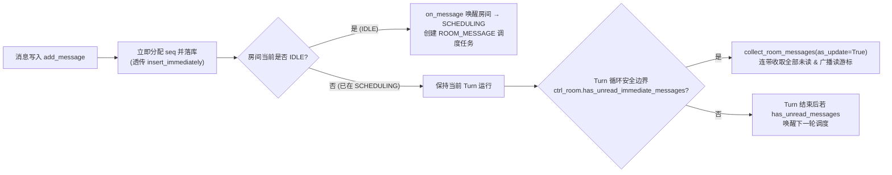

# 私聊消息立即注入与顺序简化 - 技术文档

> 关联文档：[产品文档](./step1_product.md)

## 1. 方案概览

原实现让 `room_messages.seq`（可空）同时承担「显示顺序」与「是否待注入（`NULL` = 未注入）」两个职责，由此派生出 `append_pending`、`flush_pending_immediate`、`flush_queued`、`_sort` 以及升级时清空 `seq` 等一整套复杂状态机。

新方案将三个正交职责彻底解耦，并复用现有 `immediate` / `unread` 命名体系：

1. **顺序（`seq`）**：插入即分配，严格按写入顺序单调递增（`0, 1, 2, ...`），取消 `seq=NULL` 中间态。
2. **是否未读（`_agent_seq_read`）**：由每个 Agent 的读游标 `next_seq` 唯一决定：
   - **判定谓词**（`has_unread_messages` / `has_unread_immediate_messages`）：仅统计**他人发送**的未读消息（`msg.seq >= next_seq and msg.sender_id != agent_id`），避免 Agent 自己刚发出的消息触发空转；
   - **收取推进**（`get_unread`）：拉取游标后 `msg.seq >= next_seq` 的全部消息（含自身消息）并将游标推进至末尾，再由调用方 `collect_room_messages` 过滤掉自身消息，防止游标被自身发言卡住。
3. **立即注入触发（`insert_immediately`）**：仅用于在安全边界判断是否存在未读的立即注入消息（`has_unread_immediate_messages`）；触发时通过统一收取入口一次性拉取游标后的**全部未读消息**（无论排在立即注入消息之前还是之后的未读普通消息，均按 `seq` 顺序一并收走）。



---

## 2. 数据模型与迁移

### 2.1 `room_messages` 表（`GtRoomMessage`）

| 字段 | 类型 | 调整说明 |
|---|---|---|
| `seq` | `int`（DB 列保留 nullable，业务层恒有值） | 插入即分配递增序号，不再写入 `NULL`；SQLite 不做重建表收紧 `NOT NULL` |
| `insert_immediately` | `bool` | 字段名不变；仅控制安全边界触发与前端标记，不再影响 `seq` 分配 |

### 2.2 数据库迁移（`assets/migrate/0019_backfill_room_message_seq.sql`）

存量数据库中可能残留 `seq IS NULL` 的历史消息，迁移时按房间以 `COALESCE(MAX(seq), -1)` 为基数，按 `insert_immediately DESC, id ASC` 顺序补齐 `seq`（用 `MAX(seq)` 而非 `COUNT`，避免因历史消息升级留下的 `seq` 空洞造成撞号）：

```sql
BEGIN;

WITH base AS (
    SELECT room_id, COALESCE(MAX(seq), -1) AS max_seq
    FROM room_messages
    GROUP BY room_id
),
ranked AS (
    SELECT
        m.id,
        b.max_seq + ROW_NUMBER() OVER (
            PARTITION BY m.room_id
            ORDER BY m.insert_immediately DESC, m.id ASC
        ) AS new_seq
    FROM room_messages AS m
    JOIN base AS b ON b.room_id = m.room_id
    WHERE m.seq IS NULL
)
UPDATE room_messages
SET seq = (SELECT new_seq FROM ranked WHERE ranked.id = room_messages.id)
WHERE seq IS NULL;

COMMIT;
```

---

## 3. 后端核心设计

### 3.1 存储层：`RoomMessageStore`（`src/service/roomService/messageStore.py`）

**退役方法/属性**：
- `append_pending`、`pending_messages`、`_flush`、`flush_pending_immediate`、`flush_queued`、`_sort`

**保留并简化**：

1. **`append_and_assign_seq(msg, *, publish=False)`**：
   - 收编为唯一写入路径：分配 `msg.seq = self._next_seq` 并递增 `_next_seq`。
   - 写库时**透传 `insert_immediately=msg.insert_immediately`**（修复原硬编码 `False` 导致重启丢失 `insert_immediately` 标志的问题）。
   - 直接 `self._messages.append(msg)`。
2. **未读判断与收取（区分「拉取推进游标」与「待处理谓词」）**：
   - `get_unread(agent_id) -> List[GtRoomMessage]`：取 `m.seq >= next_seq` 的全部消息（**不过滤 `m.sender_id == agent_id`**，确保游标能越过自身发言）；若有，将 `self._agent_seq_read[agent_id]` 推进至 `new_msgs[-1].seq + 1` 并返回，由上层 `collect_room_messages` 过滤自身消息。
   - `has_unread_messages(agent_id) -> bool`：只读不推进游标，判断是否存在 `m.seq >= next_seq and m.sender_id != agent_id`（必须排除 `agent_id` 自己发的消息，避免 AI 自己发言后误判为还有待处理未读）。
   - `has_unread_immediate_messages(agent_id) -> bool`（替代原 `has_pending_immediate_messages`）：只读不推进游标，判断是否存在 `m.seq >= next_seq and m.sender_id != agent_id and m.insert_immediately`。
3. **升级为立即注入 `escalate_to_immediate(db_id) -> GtRoomMessage`**（保持原方法名不变）：
   - 定位 `m.id == db_id`，不存在抛 `ValueError`。
   - 仅允许升级 `OPERATOR` 消息（`m.sender_id == SpecialAgent.OPERATOR.value`）。
   - 已读校验：遍历房间内非特殊成员（排除 `SpecialAgent.OPERATOR` / `SpecialAgent.SYSTEM`），若任一 AI Agent 的 `_agent_seq_read.get(aid, 0) > msg.seq`，抛 `RuntimeError("message already read")`。
   - 仅置 `msg.insert_immediately = True`，**不清空 `msg.seq`、不调用 `_sort()`**。
4. **恢复注入 `inject(messages, agent_read_index)`**：
   - 在 `inject` 内部显式执行 `self._messages.sort(key=lambda m: (m.seq if m.seq is not None else -1, m.id or 0))`（不静默依赖外部传入顺序），随后取 `self._next_seq = self._messages[-1].seq + 1 if self._messages else 0`。

### 3.2 房间门面与调度：`ChatRoom` & `RoomScheduler`

1. **`ChatRoom._append_message` 统一写入与唤醒**：
   - 校验：仅 `RoomType.PRIVATE` 支持 `insert_immediately=True`（非私聊房间降级为 `False`；**私聊房间无论处于 `IDLE` 还是 `SCHEDULING` 均保留 `insert_immediately=True`，不再因 `state == IDLE` 降级**）。
   - 统一调用 `await self._store.append_and_assign_seq(message, publish=(state != RoomState.INIT))`。
   - 调度推进无需区分 `insert_immediately` 或 `is_queued`，直接复用 `RoomScheduler.on_message(sender_id)`：
     - 当房间处于 `IDLE` 时：无论普通消息还是立即注入消息，`on_message` 均将房间切为 `SCHEDULING` 并返回 AI Agent ID，触发 `persist_state()` 与 `publish_status(next_agent_id, need_scheduling=True)` 创建调度任务（解决 Agent 空闲时收到立即注入消息不唤醒的问题）。
     - 当房间已处于 `SCHEDULING` 且当前发言人是 AI 时：`on_message(OPERATOR)` 天然返回 `None`，不会打断或重入当前 Turn。
     - 删除原 `chatRoom.py:229-230`（`if sender_id == OPERATOR and next_agent_id is None: await self.handle_finish_request(OPERATOR)`）以及 `roomController.py:241-242`、`superviseController.py:60-61` 中残留的 `if room.get_current_turn_agent_id() == room.OPERATOR_MEMBER_ID: await room.handle_finish_request(...)` 死代码（`RoomScheduler._should_skip` 始终跳过 `OPERATOR`，且旧版 `chatRoom.py:230` 未检查当前发言人会在群聊 `SCHEDULING` 下误触 `caller != current_id` 告警）。
2. **升级接口 `ChatRoom.escalate_message_to_immediate(db_id)`**（保持原方法名与 Controller 调用不变）：
   - 调用 `self._store.escalate_to_immediate(db_id)`；
   - 调用 DAL `gtRoomMessageManager.escalate_message_to_immediate(db_id)`（**内部改为仅 `update(insert_immediately=True)`，不再写 `seq=None`**）；
   - 发布 `MessageBusTopic.ROOM_MSG_CHANGED`。
3. **读游标暴露与广播**：
   - `ChatRoom.to_dict()` 与 `RoomController.RoomApiResponse` 增加 `agent_read_index: dict[str, int]`（key 统一为 `str(agent_id)`；`runtime_room is None` 时回退取 `gt_room.agent_read_index or {}`）。
   - `RoomScheduler.publish_status` 在 `ROOM_STATUS_CHANGED` 事件 payload 中附带 `agent_read_index={str(k): v for k, v in self._get_read_index().items()}`。
   - `ChatRoom` 新增辅助方法 `publish_read_status()`：调用 `self._scheduler.publish_status(self._build_current_turn_agent_id(), need_scheduling=False)`，保证广播读游标时保留当前的 `current_turn_agent_id`，不会把前端正在工作的指示器冲掉。

### 3.3 Agent 收取与 Turn 循环：`AgentTurnRunner`（`src/service/agentService/agentTurnRunner.py`）

1. **合并收取入口 `async def collect_room_messages(self, room: ChatRoom, *, as_update: bool) -> int`**：
   - 调用 `new_msgs = await room.get_unread_messages(self.gt_agent.id)`（内部已推进游标并持久化）。
   - 若 `new_msgs` 非空，调用 `room.publish_read_status()` 实时广播最新读游标。
   - 过滤掉自身消息 `others = [m for m in new_msgs if m.sender_id != self.gt_agent.id]`；若 `others` 为空返回 `0`。
   - `as_update=False`（Turn 开始）：用 `build_turn_begin_prompt_from_messages` 构造 prompt，带 `AgentHistoryTag.ROOM_TURN_BEGIN` 写入 history。
   - `as_update=True`（安全边界插话）：用 `build_turn_update_prompt` 构造 prompt，不带 turn tag 写入 history。
   - 记录 1 条 `AgentActivityType.MESSAGE_RECEIVED` 活动并返回 `1`。
2. **两处触发点**：
   - **Turn 开始**：
     - `host_managed_turn_loop == True` 分支：调用 `synced_count = await self.collect_room_messages(room, as_update=False)`；若 `synced_count == 0`，调用 `await room.handle_finish_request(self.gt_agent.id)` 自动跳过本轮（随后走下方的私聊尾唤醒检查）。
     - `else`（外部 driver 分支，如 `claude_sdk` / `tsp`）：保持原有契约，仅将 `pull_room_messages_to_history(room)` 替换为 `synced_count = 1 if is_todo_task else await self.collect_room_messages(room, as_update=False)`，再将 `synced_count` 原样传给 `await self.driver.run_task_turn(job, synced_count)`（由各外部 driver 内部按原逻辑处理 `synced_count == 0`）。
   - **Turn 循环安全边界**（`_run_turn_loop`）：
     ```python
     if self._history.is_safe_for_immediate_insert():
         ctrl_room = await roomService.get_control_room_for_agent(self.gt_agent.team_id, self.gt_agent.id)
         if ctrl_room is not None and ctrl_room.has_unread_immediate_messages(self.gt_agent.id):
             await self.collect_room_messages(ctrl_room, as_update=True)
     ```
3. **Turn 结束后的私聊未读尾唤醒**（替代原 `flush_queued_messages`）：
   - 仅针对**已切回 `IDLE` 的私聊房间**：当 `_run_turn_loop(room)` 正常结束（或 `synced_count == 0` 跳过结束）后，若满足：
     ```python
     if (
         room is not None
         and room.room_type == RoomType.PRIVATE
         and room.state == RoomState.IDLE
         and room.has_unread_messages(self.gt_agent.id)
     ):
         await room.handle_finish_request(room.OPERATOR_MEMBER_ID)
     ```
   - 限定 `RoomType.PRIVATE` 且 `room.state == RoomState.IDLE` 的原因：群聊房间在一轮结束后会推进到下一位 AI（状态仍为 `SCHEDULING`，`current_turn_agent_id` 为下一位 AI），若在群聊上调用 `handle_finish_request(OPERATOR_MEMBER_ID)` 会触发 `caller != current_id` 的告警噪声；而私聊房间单 AI 结束发言后会切回 `IDLE`，此时由 `OPERATOR` 唤醒正好进入下一轮调度。

### 3.4 DAL 层：`gtRoomMessageManager`（`src/dal/db/gtRoomMessageManager.py`）

- 删除 `update_room_message_seq`。
- `escalate_message_to_immediate(message_id)` 保持函数名不变，内部改为仅执行 `.update(insert_immediately=True)`，**不再将 `seq` 置为 `None`**。
- `get_room_messages` 与 `get_last_messages_by_room_ids` 去掉 `nulls='first'` / `nulls='last'` 特判，直接按 `seq` 与 `id` 排序。

---

## 4. 前端核心设计

### 4.1 类型与状态同步

1. **类型定义（`frontend/src/types.ts`、`frontend/src/api.ts`）**：
   - `MessageInfo.seq` 与 `RawMessageInfo.seq` 由 `number | null` 收紧为 `number`。
   - `RoomInfo` / `RawRoomInfo` / `WsRoomStatusEvent` 增加 `agent_read_index?: Record<string, number>`。
2. **归一化与 Store（`api.ts`、`eventNormalizer.ts`、`runtimeStore.ts`）**：
   - `api.ts` 的 `normalizeRoom` 透传 `agent_read_index`。
   - `eventNormalizer.ts` 的 `room_status` 事件增加 `agentReadIndex: Record<string, number>`；`room_added` 初始化 `agent_read_index: {}`。
   - `runtimeStore.ts`：
     - `compareMessages` 直接按 `left.seq - right.seq` 排序（兜底 `db_id` / `time`）。
     - `seedTeamRooms` / `loadTeamRooms` 与 `applyRealtimeEvent('room_status')` 维护每个房间的 `agent_read_index`。

### 4.2 消息状态判定与分流（`ChatPanel.vue` & `MessageStream.vue`）

1. **`ChatPanel.vue`** 向 `MessageStream.vue` 传入当前房间的私聊标识与目标 AI 的读游标（例如 `:is-private="currentRoom?.room_type === 'private'"` 与 `:agent-read-seq="targetAgentReadSeq"`，其中 `targetAgentReadSeq` 取私聊房间中非 Operator 成员在 `currentRoom.agent_read_index` 中的游标值，缺省为 `0`）。
2. **`MessageStream.vue` 判定函数**：
   - **仅私聊房间中由 Operator 发送的消息（`props.isPrivate && message.sender_id === -1`）** 才根据 `message.seq >= props.agentReadSeq` 判定为「未读（`unread`）」：
     ```ts
     function isUnreadOperatorMessage(message: MessageInfo): boolean {
       if (!props.isPrivate || message.sender_id !== -1) {
         return false;
       }
       return message.seq >= (props.agentReadSeq ?? 0);
     }

     function resolveMessageStatus(message: MessageInfo): MessageStatus {
       if (!props.isPrivate || message.sender_id !== -1) {
         return 'published';
       }
       const unread = isUnreadOperatorMessage(message);
       if (unread) {
         return message.insert_immediately ? 'pending-immediate' : 'queued';
       }
       return message.insert_immediately ? 'immediate' : 'published';
     }
     ```
   - 主消息流与底部浮动区切分：
     - `streamMessages`：`props.messages.filter((m) => !isUnreadOperatorMessage(m))`
     - `floatingMessages`：`props.messages.filter((m) => isUnreadOperatorMessage(m))`
     - `shouldDockWorkingIndicator`：`Boolean(props.workingAgent) && floatingMessages.value.length === 0`

---

## 5. 代码改动范围

| 文件 | 变更内容 |
|---|---|
| `assets/migrate/0019_backfill_room_message_seq.sql` | 存量 `seq IS NULL` 消息补齐 `seq`（显式事务） |
| `src/dal/db/gtRoomMessageManager.py` | 退役 `update_room_message_seq`；`escalate_message_to_immediate` 改为只置 `insert_immediately=True`；查询去掉 NULL 排序特判 |
| `src/service/roomService/messageStore.py` | 退役 pending/flush/sort；`append_and_assign_seq` 透传 `insert_immediately`；`has_unread_messages` / `has_unread_immediate_messages` 过滤自身消息；`escalate_to_immediate` 只置 flag |
| `src/service/roomService/chatRoom.py` | 简化 `_append_message`；退役 `flush_*`；`has_pending_immediate_messages` 改名为 `has_unread_immediate_messages`；新增 `publish_read_status`；`to_dict` 增加 `agent_read_index` |
| `src/service/roomService/roomScheduler.py` | `publish_status` 附带 `agent_read_index` |
| `src/controller/roomController.py` | `RoomApiResponse` 增加 `agent_read_index`；清理 `post` 中残留的 `OPERATOR` `handle_finish_request` 死代码 |
| `src/controller/superviseController.py` | 清理 `post` 中残留的 `OPERATOR` `handle_finish_request` 死代码 |
| `src/service/agentService/agentTurnRunner.py` | 合并为 `collect_room_messages(room, as_update=...)`；安全边界改用 `has_unread_immediate_messages`；Turn 结束检查 `has_unread_messages` 唤醒下一轮 |
| `frontend/src/types.ts`、`frontend/src/api.ts` | `seq: number`；`RoomInfo` / `normalizeRoom` 增加 `agent_read_index` |
| `frontend/src/realtime/eventNormalizer.ts` | `room_status` 归一化透传 `agent_read_index` |
| `frontend/src/realtime/runtimeStore.ts` | 维护房间 `agent_read_index`；简化 `compareMessages` |
| `frontend/src/components/chat/ChatPanel.vue` | 计算私聊 AI 读游标并传给 `MessageStream.vue` |
| `frontend/src/components/chat/MessageStream.vue` | 基于 `isUnreadOperatorMessage` 驱动四态标签与 `streamMessages` / `floatingMessages` 切分 |

---

## 6. 测试要点

- **数据库迁移单测（`tests/unit/test_migration_0019.py`）**：参照 `test_migration_0018.py`，覆盖房间纯 `seq=NULL`、`NULL` 与非空混合、存在历史升级留下的 `seq` 空洞三种场景，验证 `MAX(seq) + 1` 起号不撞号且 `insert_immediately=1` 排在前面。
- **写入与持久化**：连续发送普通与立即注入消息，`seq` 严格按写入顺序递增，DB 中 `seq` 均非空且 `insert_immediately` 正确落库。
- **连带收取**：私聊 `SCHEDULING` 期间先发普通消息 M1、再发立即注入消息 M2，安全边界触发后 `collect_room_messages` 按 `[M1, M2]` 顺序一次收齐并推进读游标。
- **普通排队尾唤醒**：私聊 `SCHEDULING` 期间仅发普通消息，安全边界不提前收取；当前 Turn 结束时自动唤醒房间开启下一轮收取。
- **中途升级**：`escalate_to_immediate` 仅置 `insert_immediately=True` 且不改 `seq`；对已读消息或非 Operator 消息升级抛错拒绝。
- **跨房间与空闲督导**：
  - Agent 在跑群聊或 `TODO_TASK` 时（`ctrl_room` 为 `IDLE`），向 `ctrl_room` 发立即注入消息不降级，能在群聊/任务的安全边界被提前收走，后续 `ctrl_room` 调度任务因 `synced_count == 0` 自动跳过收尾；
  - Agent 完全 `IDLE` 时向 `ctrl_room` 发立即注入消息，正常唤醒 `ctrl_room` 并启动消费。
- **前端展示**：
  - 私聊中 AI 自己的回复与 `SYSTEM` 消息直接进 `streamMessages`（状态 `published`），绝不进入 `floatingMessages`；
  - 私聊中 Operator 未读消息进 `floatingMessages`，AI 收取并广播 `room_status` 后立即移入 `streamMessages`，且 `workingAgent` 指示器不丢失；
  - 群聊消息全部为 `published`。
