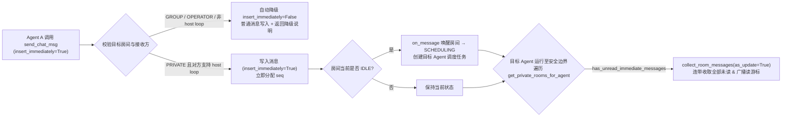

# Agent 单聊加急消息（立即注入） - 技术文档

> 关联文档：[产品文档](./step1_product.md) | 前置设计：[私聊消息立即注入与顺序简化](../2026-11-04-immediate-inject-simplify/step2_technical.md)

## 1. 方案概览

前置重构已将 `RoomMessageStore` 解耦为 `seq`（顺序）、`_agent_seq_read`（读游标）、`insert_immediately`（安全边界触发标志）三个正交职责，且底层 `has_unread_messages` 与 `has_unread_immediate_messages` 的判定条件均为 `m.sender_id != agent_id`，天然支持房间内任意非自身的发送者（含其他 AI Agent）。

因此，将「立即注入」能力从操作者扩展至 Agent 单聊，无需改动数据库表结构或新增状态机，只需打通以下四个环节：

1. **工具入口（`send_chat_msg`）**：暴露 `insert_immediately: bool = False` 参数；对群聊、发往操作者、或接收方驱动不支持 `host_managed_turn_loop` 的情况自动降级为 `False` 并返回说明。
2. **安全边界扫描范围（`AgentTurnRunner._run_turn_loop`）**：从「仅检查操作者控制房 `get_control_room_for_agent`」扩展为「遍历该 Agent 所在的所有已激活单聊房间 `get_private_rooms_for_agent`」（操作者控制房排在首位优先处理，且改为内存 `_rooms` 过滤，消除每步安全边界的 SQLite 查询）。
3. **双 AI 单聊尾唤醒与中途升级（`RoomScheduler` & `RoomMessageStore`）**：
   - 修复双 AI 单聊在 `IDLE` 尾唤醒时 `_last_speaker_id = None` 总是从 `agent_ids[0]` 开始调度的问题，确保精准唤醒有未读消息的接收方 AI；
   - 放宽 `escalate_to_immediate` 对 `sender_id == OPERATOR` 的硬编码限制，允许升级单聊中由 Agent 发送、且尚未被接收方 AI 读取的普通消息。
4. **前端单聊未读判定（`ChatPanel.vue` & `MessageStream.vue`）**：将硬编码的 `message.sender_id === -1` 泛化为「查找单聊房间内非发送者的 AI 接收方，比对其读游标 `agent_read_index[String(receiverId)]`」，一条规则同时覆盖 `Operator ↔ AI` 与 `AI ↔ AI` 两种单聊。



---

## 2. 数据模型与迁移

本次改动**不涉及数据库表结构变更，无需新增 SQL 迁移**，直接复用 `room_messages` 表的 `seq` 与 `insert_immediately` 字段。

---

## 3. 后端核心设计

### 3.1 工具层：`send_chat_msg`（`src/service/funcToolService/tools.py`）

扩展 `send_chat_msg` 签名，增加 `insert_immediately: bool = False`：

```python
async def send_chat_msg(
    room_name: str,
    msg: str,
    insert_immediately: bool = False,
    _context: ToolCallContext = None,
) -> dict:
    """向房间发送消息，消息对房间内所有成员可见。

    Args:
        room_name: 目标房间名，必须是本团队已存在的房间名
        msg: 要发送的消息正文
        insert_immediately: 是否作为加急消息立即插入对方当前工作上下文，默认 false。仅在与另一名 Agent 的单聊房间（PRIVATE）、且遇到紧急叫停、重大纠偏等必须让对方在当前行动中立刻看到的场景下设为 true；群聊、与 Operator 私聊或日常沟通请保持 false。
    """
```

**降级与写入流程**：
1. 完成既存の目标房间查找与 `target_room.can_post_message(_context.agent_id)` 校验。
2. 计算实际生效的 `effective_immediate` 与附加说明 `downgrade_note`：
   - 若 `not insert_immediately`：`effective_immediate = False`，`downgrade_note = ""`。
   - 若 `target_room.room_type != RoomType.PRIVATE`：`effective_immediate = False`，`downgrade_note = "（注：群聊不支持加急注入，已按普通消息送达）"`。
   - 若 `target_room.room_type == RoomType.PRIVATE`：
     - 取房间内除发送者外的另一成员 `other_ids = [aid for aid in target_room.get_agent_ids() if aid != _context.agent_id]`。
     - 若不存在 AI 接收方（如另一方为 `SpecialAgent.OPERATOR.value`）：`effective_immediate = False`，`downgrade_note = ""`。
     - 若另一方为 AI（`other_id > 0`）：通过 `agentService.get_agent_or_none(other_id)` 检查 `target_agent is not None and target_agent.host_managed_turn_loop`；若不满足，则 `effective_immediate = False`，`downgrade_note = "（注：对方当前驱动不支持运行中加急注入，已按普通消息送达）"`；否则 `effective_immediate = True`。
3. 调用 `await target_room.add_message(_context.agent_id, msg, insert_immediately=effective_immediate)`，并将 `downgrade_note` 拼接到成功返回文案中。

### 3.2 房间服务层：`roomService`（`src/service/roomService/`）

#### 3.2.1 新增 `get_private_rooms_for_agent`（`src/service/roomService/core.py` & `__init__.py`）

新增纯内存查找方法，返回该 Agent 所在的所有非 `INIT` 状态的 `PRIVATE` 房间，并将包含 `OPERATOR` 的控制房间排在首位：

```python
def get_private_rooms_for_agent(team_id: int, agent_id: int) -> List[ChatRoom]:
    """返回指定 Agent 所在的所有已激活 PRIVATE 房间（Operator 控制房优先，其余按 room_id 升序）。"""
    rooms = [
        room for room in _rooms.values()
        if room.team_id == team_id
        and room.room_type == RoomType.PRIVATE
        and room.state != RoomState.INIT
        and agent_id in room._agent_ids
    ]
    rooms.sort(key=lambda r: (0 if ChatRoom.OPERATOR_MEMBER_ID in r._agent_ids else 1, r.room_id))
    return rooms
```

#### 3.2.2 放宽中途升级校验：`RoomMessageStore.escalate_to_immediate`（`src/service/roomService/messageStore.py`）

将原「仅允许 `OPERATOR` 消息升级」调整为「允许单聊中任意发往 AI 接收方且尚未被其读取的消息升级」：
- 定位 `m.id == db_id`，不存在抛 `ValueError`。
- 若 `msg.sender_id == int(SpecialAgent.SYSTEM.value)`，抛 `ValueError("SYSTEM messages cannot be escalated")`。
- 查找房间内的 AI 接收方 `ai_receivers = [aid for aid in self._agent_ids if aid > 0 and aid != msg.sender_id]`：
  - 若 `not ai_receivers`（例如在 Operator 控制房中 AI 发给 Operator 的消息），抛 `ValueError("message has no AI recipient to escalate for")`。
  - 若 `msg.seq is not None` 且任一 `aid in ai_receivers` 满足 `self._agent_seq_read.get(aid, 0) > msg.seq`，抛 `RuntimeError(f"message db_id={db_id} already read by agent_id={aid}")`。
- 置 `msg.insert_immediately = True` 并返回 `msg`。

#### 3.2.3 双 AI 单聊尾唤醒定位（`src/service/roomService/roomScheduler.py` & `chatRoom.py`）

- **背景**：在 `[Agent A, Agent B]` 单聊中，两端均为正整数 Agent ID，不含 `OPERATOR_MEMBER_ID`。若 Agent B（位于 `agent_ids[1]`）在执行本轮期间收到 Agent A 发来的普通未读消息，当 B 结束本轮使房间切回 `IDLE` 后，`_wake_next_turn_if_unread` 需唤醒房间继续由 B 处理未读消息。若直接走 `handle_finish_request` 的 `_last_speaker_id = None`，`_advance_to_first_dispatchable` 会从 `index = 0`（Agent A）开始调度，导致误唤醒发送方 A。
- **方案**：
  - 在 `ChatRoom` / `RoomScheduler` 中，当从 `IDLE` 唤醒且存在待读取消息的接收方时（或由 `_wake_next_turn_if_unread` 调用 `room.handle_finish_request(caller_agent_id)` 时），若 `caller_agent_id != OPERATOR_MEMBER_ID`，将 `self._last_speaker_id` 设为 `caller_agent_id`（与 `on_message(sender_id)` 唤醒行为保持一致：唤醒触发者即上一位发言方，跳过触发者自身后自然落到另一位成员）。
  - 在 `AgentTurnRunner._wake_next_turn_if_unread(room)` 中，传入房间内除 `self.gt_agent.id` 外的另一成员 ID（找不到时回退 `room.OPERATOR_MEMBER_ID`），确保跳过另一成员后精准调度到 `self.gt_agent.id`。

### 3.3 Agent 收取与提示词层（`src/service/agentService/`）

#### 3.3.1 安全边界扫描所有单聊房间（`src/service/agentService/agentTurnRunner.py`）

`_run_turn_loop` 中的安全边界检查改为遍历 `roomService.get_private_rooms_for_agent`：

```python
if self._history.is_safe_for_immediate_insert():
    for priv_room in roomService.get_private_rooms_for_agent(self.gt_agent.team_id, self.gt_agent.id):
        if priv_room.has_unread_immediate_messages(self.gt_agent.id):
            await self._inject_immediate_messages(priv_room)
```

#### 3.3.2 提示词模板调整

1. **`src/service/agentService/templates/turn_update.j2`**：
   在提示语中显式带上 `room_name`，让正在处理其他房间或协作任务的 Agent 清楚知晓补充消息来自哪个单聊房间：
   ```jinja2
   收到来自私聊房间【{{ room_name }}】的补充消息，请在当前工作过程中参考（如需在该私聊房间回复，可指定 room_name="{{ room_name }}" 调用 send_chat_msg）：

   ```yaml
   
   {{ yaml_block }}
   
   {{ {"roomName": room_name, "messages": messages | default([])} | to_yaml }}
   
   ```
   ```
2. **`src/service/agentService/templates/system_prompt.j2`**：
   在「发言规则」与「部门主管职责 - 统筹与纠偏」中补充 `insert_immediately` 的使用说明：仅在单聊房间遇到紧急叫停、重大纠偏等必须让对方在当前行动中立即看到的场景下设为 `true`，日常沟通与群聊保持默认 `false`。

---

## 4. 前端核心设计

### 4.1 单聊接收方游标判定（`ChatPanel.vue` & `MessageStream.vue`）

1. **`ChatPanel.vue`**：
   - 向 `MessageStream.vue` 传递 `:room-agents="currentRoom?.agents"` 与 `:agent-read-index="currentRoom?.agent_read_index"`（保留 `:agent-read-seq="targetAgentReadSeq"` 兼容存量单测）。
2. **`MessageStream.vue`**：
   - 新增 props：`roomAgents?: number[]`、`agentReadIndex?: Record<string, number>`。
   - 将原 `isUnreadOperatorMessage` 泛化为 `isUnreadPrivateMessage`：
     ```ts
     const SYSTEM_ID = -2;

     function resolveReceiverReadSeq(message: MessageInfo): number | null {
       if (!props.isPrivate || message.sender_id === SYSTEM_ID) {
         return null;
       }
       if (props.roomAgents && props.roomAgents.length > 0) {
         const receiverId = props.roomAgents.find((id) => id > 0 && id !== message.sender_id);
         if (receiverId === undefined) {
           // 如 Operator+AI 单聊中 AI 发给 Operator(-1) 的消息，无 AI 接收方，恒视为已读
           return null;
         }
         const seq = props.agentReadIndex?.[String(receiverId)];
         return typeof seq === 'number' && Number.isFinite(seq) ? seq : 0;
       }
       // 兼容仅传入 agentReadSeq 的存量调用/测试
       if (message.sender_id === OPERATOR_ID) {
         return props.agentReadSeq ?? 0;
       }
       return null;
     }

     function isUnreadPrivateMessage(message: MessageInfo): boolean {
       const readSeq = resolveReceiverReadSeq(message);
       if (readSeq === null) {
         return false;
       }
       return message.seq >= readSeq;
     }

     function resolveMessageStatus(message: MessageInfo): MessageStatus {
       if (!props.isPrivate || message.sender_id === SYSTEM_ID) {
         return 'published';
       }
       if (isUnreadPrivateMessage(message)) {
         return message.insert_immediately ? 'pending-immediate' : 'queued';
       }
       return message.insert_immediately ? 'immediate' : 'published';
     }
     ```
   - `streamMessages` 与 `floatingMessages` 统一改为按 `isUnreadPrivateMessage(message)` 切分。

---

## 5. 代码改动范围

| 文件 | 变更内容 |
|---|---|
| `src/service/funcToolService/tools.py` | `send_chat_msg` 增加 `insert_immediately: bool = False`，支持单聊加急与非单聊/不支持驱动的自动降级 |
| `src/service/roomService/core.py`、`src/service/roomService/__init__.py` | 新增并导出 `get_private_rooms_for_agent(team_id, agent_id)` |
| `src/service/roomService/messageStore.py` | `escalate_to_immediate` 支持单聊中发往 AI 接收方的未读消息升级 |
| `src/service/roomService/roomScheduler.py` | `handle_finish_request` 从 `IDLE` 唤醒时记录非 Operator 的 `caller_agent_id` 为 `_last_speaker_id` |
| `src/service/agentService/agentTurnRunner.py` | `_run_turn_loop` 安全边界遍历 `get_private_rooms_for_agent`；`_wake_next_turn_if_unread` 传入另一成员 ID 精准唤醒当前 AI |
| `src/service/agentService/templates/turn_update.j2`、`system_prompt.j2` | 补充插话来源房间名提示与 `insert_immediately` 使用规范 |
| `frontend/src/components/chat/ChatPanel.vue` | 向 `MessageStream.vue` 传入 `roomAgents` 与 `agentReadIndex` |
| `frontend/src/components/chat/MessageStream.vue` | 基于单聊 AI 接收方读游标驱动四态标签与 `streamMessages` / `floatingMessages` 切分 |

---

## 6. 测试要点

- **工具层单测**：
  - 双 AI 单聊且对方支持 `host_managed_turn_loop` 时传 `insert_immediately=True`，消息以 `insert_immediately=True` 写入房间；
  - 群聊、Operator 单聊、或对方驱动不支持 `host_managed_turn_loop` 时传 `insert_immediately=True`，自动降级为 `False` 写入并返回提示，不抛错。
- **Agent 间跨房间安全边界注入集成测试**：
  - Agent B 在跑群聊或 `TODO_TASK` 期间，Agent A 在 `alice_bob` 单聊房间发送 `insert_immediately=True` 消息，B 在安全边界按序收取该房间的全部未读消息并推进游标；后续 `alice_bob` 的 `ROOM_MESSAGE` 调度任务因 `synced_count == 0` 自动跳过收尾。
- **双 AI 单聊尾唤醒单测**：
  - `[Agent A, Agent B]` 单聊中，B（位于 `agent_ids[1]`）结束轮次切回 `IDLE` 时若仍有 A 发来的未读消息，`_wake_next_turn_if_unread` 唤醒后 `current_turn_agent_id` 为 B 而非 A。
- **中途升级单测（`test_room_message_store.py`）**：
  - 双 AI 单聊中，Agent A 发给 Agent B 的未读消息可调用 `escalate_to_immediate` 置 `insert_immediately=True`；B 已读后或系统消息升级抛错拒绝。
- **前端组件单测（`MessageStream.test.ts`）**：
  - 双 AI 单聊（`roomAgents: [1, 2]`）下，Agent 1 发给 Agent 2 的未读消息进入 `floatingMessages`，Agent 2 读游标推进后移入 `streamMessages` 且加急消息展示 `⚡` 标记；
  - Operator + AI 单聊（`roomAgents: [-1, 1]`）下，AI 发给 Operator 的消息始终在 `streamMessages`，不进 `floatingMessages`。
