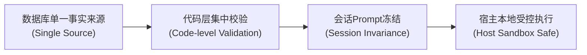
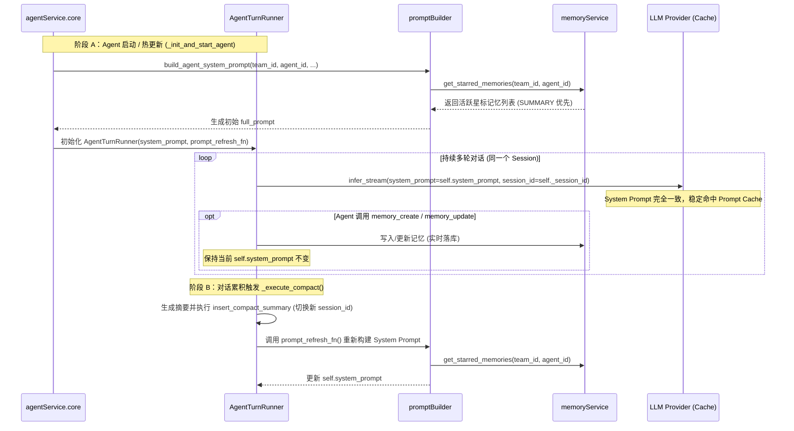

# Agent 长期记忆系统 - 技术设计

> **代码基线**：`/Volumes/PDATA/GitDB/TeamAgent` @ `0.4.2_dev`  
> **关联文档**：[产品文档 (step1_product.md)](./step1_product.md)  
> **实施范围约束**：当前阶段为纯技术设计阶段；在此方案评审确认前，`src/`、`frontend/` 与 `assets/migrate/` 保持零变更。

---

## 1. 架构目标与设计原则

### 1.1 核心目标
构建以 **SQLite 数据库为持久化载体**、**Service 业务层集中校验**、**会话级 Prompt 记忆快照冻结**，并配套 **前端 Agent 个人卡片页只读查阅** 的 Agent 长期记忆系统。

### 1.2 四大设计原则



1. **数据库单一事实来源（Single Source of Truth）**：
   - 记忆统一收敛至 SQLite 数据表 `agent_memories`，不在 Agent 工作目录中散落文件；
   - 强绑定 `team_id` 与 `agent_id`，保障多团队与多 Agent 间的严格数据隔离。
2. **代码层集中校验，解耦数据库约束（Code-Level Validation）**：
   - 数据库文本列统一采用 `TEXT`（`TextField`），不施加数据库层面的列长度约束；
   - 标题 80 字符、单句概要 120 字符、正文 1000 字符、同名标题防重及星标配额等规则，一律在 Python `memoryService` 层集中拦截，后续调整配额无需迁移表结构。
3. **会话级 Prompt 冻结与压缩后刷新（Session Invariance for Prompt Caching）**：
   - 单次会话周期内（Session 建立到触发下一次 Compact 期间），System Prompt 中的星标记忆快照保持静态不变；
   - 会话中途的记忆写入实时落库，但不修改当前运行中的 `system_prompt`，最大化大模型 **Prompt Cache** 命中率；
   - 仅在上下文压缩（`AgentTurnRunner._execute_compact`）切换新 Session、或 Agent 重载/热更新时，才从数据库拉取最新星标快照重建 System Prompt。
4. **宿主受控执行，防沙箱越权篡改（Host Execution & Sandbox Safety）**：
   - `AgentTurnRunner` 始终在宿主 Python 进程内运行，`memory_*` 工具通过 `funcToolService` 注册为宿主本地工具；
   - 即使 `TspAgentDriver` 处于 Docker 容器环境（容器内仅运行 `gtsp` 处理 `execute_bash`/`read_file` 等指令），`memory_*` 工具仍在宿主进程直接读写宿主 SQLite，且容器未挂载 `STORAGE_ROOT/data/`，天然杜绝容器内脚本直接篡改数据库。

---

## 2. 数据架构与校验规则

### 2.1 数据库表设计（`agent_memories`）

通过迁移脚本 `assets/migrate/0020_add_agent_memories.sql` 建表，对应 ORM 模型 `GtAgentMemory`（继承 `DbModelBase`，复用内置 `id`、`created_at`、`updated_at` 与 `AutoTimestampMixin`）：

| 字段名 | SQLite 类型 | ORM 字段类型 | 约束与默认值 | 说明 |
|---|---|---|---|---|
| `id` | `INTEGER` | `AutoField` | `PRIMARY KEY AUTOINCREMENT` | 记忆唯一自增 ID |
| `team_id` | `INTEGER` | `IntegerField` | `NOT NULL` | 所属团队 ID |
| `agent_id` | `INTEGER` | `IntegerField` | `NOT NULL` | 所属 Agent ID |
| `title` | `TEXT` | `TextField` | `NOT NULL` | 唯一主题标题（单行，≤ 80 字符） |
| `summary` | `TEXT` | `TextField` | `NOT NULL` | 单句结论概要（单行，≤ 120 字符） |
| `content` | `TEXT` | `TextField` | `NOT NULL` | 可执行完整正文（≤ 1000 字符） |
| `star_level` | `TEXT` | `EnumField(MemoryStarLevel)` | `NOT NULL DEFAULT 'NONE'` | 星标级别（DB 存枚举 `name`） |
| `status` | `TEXT` | `EnumField(MemoryStatus)` | `NOT NULL DEFAULT 'ACTIVE'` | 状态（DB 存枚举 `name`） |
| `tags` | `TEXT` | `JsonField(default=list)` | `NOT NULL DEFAULT '[]'` | 标签字符串数组（最多 5 个） |
| `created_at` | `DATETIME` | `DateTimeField` | `NOT NULL DEFAULT (datetime('now'))` | 创建时间 |
| `updated_at` | `DATETIME` | `DateTimeField` | `NOT NULL DEFAULT (datetime('now'))` | 最后更新时间 |

**索引设计**：
- `idx_agent_memories_agent_status`: `(team_id, agent_id, status)` — 加速日常列表、检索与同名防重查询；
- `idx_agent_memories_agent_star`: `(team_id, agent_id, star_level)` — 加速星标快照装配与配额统计。

### 2.2 核心枚举与数据模型

1. **枚举定义（`src/constants.py`）**：
   遵循 [枚举使用规范](../../code_rule/enum_conventions.md)，统一继承 `EnhanceEnum`，对外工具参数保留固定小写字符串 `value`（注明不使用 `auto()`）：
   - `MemoryStarLevel`：`NONE = "none"`、`TITLE = "title"`、`SUMMARY = "summary"`
   - `MemoryStatus`：`ACTIVE = "active"`、`ARCHIVED = "archived"`
2. **三层认知视图模型（`src/model/coreModel/memoryModel.py`）**：
   供工具层返回时自动序列化，避免手动拼装零散字典：
   - `MemoryListItem`（L1 目录层）：`id`、`title`、`star_level`、`tags`、`updated_at`
   - `MemorySearchItem`（L2 候选层）：`id`、`title`、`summary`、`snippet`、`star_level`、`tags`、`updated_at`
   - `MemoryDetail`（L3 正文层）：完整字段（含 `content`、`status`、`created_at`）
3. **HTTP 接口返回模型**：
   直接复用 `GtAgentMemory`（`DbModelBase.to_json()` 自动序列化），不额外定义冗余 Web DTO。

### 2.3 代码层校验与星标配额规则

在 `constants.py` 中统一定义配额常量，并在 `memoryService` 写入/更新时集中校验：

- **字符与格式限制**：
  - `title`：去首尾空白后非空、不含换行符、长度 `<= 80`（`MEMORY_TITLE_MAX_CHARS`）；
  - `summary`：去首尾空白后非空、不含换行符、长度 `<= 120`（`MEMORY_SUMMARY_MAX_CHARS`）；
  - `content`：去首尾空白后非空、长度 `<= 1000`（`MEMORY_CONTENT_MAX_CHARS`，面向 AI 的上限）；存储侧额外宽限 `100`（`MEMORY_CONTENT_GRACE_CHARS`）——AI 对长度感知不强，轻微超长仍允许落库，实际存储上限 `<= 1100`；
  - `tags`：最多 `5` 个（`MEMORY_TAGS_MAX_COUNT`），单个标签长度 `<= 24`。
- **同名标题防重**：
  - 同一 `(team_id, agent_id)` 下处于 `ACTIVE` 状态的记忆中，不允许存在相同 `title`（更新时排除自身 `id`）。若冲突则报错并返回已有记忆 `#id`，引导 Agent 调用 `memory_update`。
- **L2/L3 同步更新约束**：
  - 调用 `memory_update` 修改 `content` 时，必须同步传入非空的 `summary`，防止正文变更后概要滞后。
- **状态与星标配额双重校验（防 `title -> summary` 绕过）**：
  1. 若目标状态为 `ARCHIVED`，系统强制将 `star_level` 重置为 `NONE`（自动释放星标槽位）；
  2. 若目标状态为 `ACTIVE` 且目标 `star_level` 为 `TITLE` 或 `SUMMARY`，统计当前 Agent **除本条记录外**（`id != current_id`）所有 `ACTIVE` 星标记忆数量：
     - 若 `other_starred_count + 1 > 12`（`MEMORY_STAR_TOTAL_LIMIT`），拒绝并报 `star_limit_exceeded`；
     - 若目标为 `SUMMARY` 且 `other_summary_starred_count + 1 > 6`（`MEMORY_STAR_SUMMARY_LIMIT`），拒绝并报 `summary_star_limit_exceeded`。

---

## 3. 运行时上下文装配与会话生命周期

### 3.1 会话周期（Session）Prompt 冻结与 Compact 刷新



**核心衔接点**：
1. **`promptBuilder.build_agent_system_prompt`**：当 `team_id > 0 and agent_id > 0` 时，调用 `memoryService.get_starred_memories(team_id, agent_id)` 获取活跃星标记忆（按 `SUMMARY` 优先、`updated_at` 倒序排列），传入 `system_prompt.j2`。
2. **`AgentTurnRunner._execute_compact` 刷新机制**：
   - 在 `agentService._init_and_start_agent` 中构造无参异步闭包 `prompt_refresh_fn`（内部封装当前 Agent 调用 `build_agent_system_prompt` 所需的模板与目录参数），经 `Agent` → `JobConsumer` 传给 `AgentTurnRunner`；
   - 当 `_execute_compact` 完成 `insert_compact_summary` 开启新 Session 后，立即调用 `prompt_refresh_fn()` 刷新 `self.system_prompt`，使后续 Token 估算与新 Session 首次推理直接搭载最新星标快照。

### 3.2 System Prompt 模板要点（`system_prompt.j2`）

在 `system_prompt.j2` 末尾新增 `# 长期记忆机制` 章节，包含两部分：
1. **使用规则**：
   - 说明 L1/L2/L3 按需查阅方式、字数上限、单主题防重原则及星标配额（12 条总上限 / 6 条概要上限）；
   - **快照消歧提示**：明确告知模型下方星标清单为当前会话起点（启动或上次压缩时）的快照，本会话中途通过 `memory_create` / `memory_update` 的修改已实时落库，切勿因快照未即时变化而重复调用；
   - 严禁记录密码、私钥、Token 等敏感信息。
2. **星标记忆注入格式**：
   - 携带 `#id`（便于 Agent 直接按 ID 更新或归档，省去额外查询），并使用 `mem.star_level.value` 读取枚举值：
   - `summary` 级：`- [#12][SUMMARY] 方案输出规范：所有技术方案先给选型结论与权衡，再展开实现细节`
   - `title` 级：`- [#15][TITLE] 存储层选型约束`

---

## 4. 后端服务、工具与 HTTP 接口设计

### 4.1 模块职责划分

1. **DAL 层（`src/dal/db/gtAgentMemoryManager.py`）**：
   - 遵循 DAL 模块规范，提供模块级异步函数，输入输出严格为 `GtAgentMemory`；
   - 提供按 ID 归属查询、按标题查活跃记录、查询 Agent 活跃/全量记忆列表、查询星标记忆列表、`save_memory` 统一保存入口，以及 `delete_memories_by_agent` / `delete_memories_by_team` 清理方法。
2. **Service 层（`src/service/memoryService.py`）**：
   - 遵循 Service 模块规范，采用模块级函数封装校验、CRUD、多关键词检索与片段提取：
   - **多关键词检索与 `extract_snippet` 算法**：
     - 将查询词 `query` 按空白字符切分为关键词列表 `tokens`，在 `ACTIVE` 记忆中按字段权重打分（`title` +4、`tags` +3、`summary` +2、`content` +1），按总分与更新时间倒序返回前 `limit` 条；
     - 定位首个命中关键词在 `content` 中的位置，向前约 40 字符、向后约 80 字符截取窗口，并向最近的中英文断句标点或换行符对齐，首尾补充 `…` 省略号。
3. **数据清理联动（`src/service/teamService.py`）**：
   - `clear_team_data(team_id)`：同步调用 `gtAgentMemoryManager.delete_memories_by_team(team_id)`；
   - `clear_agent_data(agent_id)`：同步调用 `gtAgentMemoryManager.delete_memories_by_agent(agent_id)`，随后触发热重载使 Agent 回归空白初始态。

### 4.2 Agent 工具定义（`src/service/funcToolService/tools.py`）

5 个工具均归属 `ToolCategory.BASIC`，通过 `_context: ToolCallContext = None` 自动注入调用方身份（不向 LLM 暴露 `team_id` / `agent_id`），统一返回含 `"success": bool` 的字典：

| 工具名 | 参数（面向 LLM） | 返回核心字段 | 行为说明 |
|---|---|---|---|
| `memory_list` | 无 | `count`, `memories` (`list[MemoryListItem]`) | 返回当前 Agent 所有 `active` 记忆的 L1 目录 |
| `memory_read` | `memory_id: int` | `memory` (`MemoryDetail`) | 校验归属后返回单条记忆的 L3 完整详情（支持读取已归档记忆） |
| `memory_search` | `query: str`, `limit: int = 5` | `count`, `memories` (`list[MemorySearchItem]`) | 多关键词加权匹配，返回带 `summary` 与 `snippet` 的 L2 候选列表 |
| `memory_create` | `title`, `summary`, `content`, `star_level="none"`, `tags=None` | `id`, `title` | 校验长度、同名防重与星标配额后落库；不回显正文（避免占用上下文） |
| `memory_update` | `memory_id: int`, 可选 `title`, `summary`, `content`, `star_level`, `status`, `tags` | `id`, `title` | 校验配额与 `summary` 同步规则后更新；`status="archived"` 时自动将 `star_level` 置为 `"none"`；不回显正文 |

### 4.3 后端 HTTP 查询接口（供前端卡片页使用）

遵循 [Controller 开发指南](../../tech/02_mvc/controller_development.md) 与开发约定，在 `agentController.py` 中新增只读列表 Handler，直接返回 `GtAgentMemory` 列表并复用 `return_json` 自动序列化：

- **路由注册（`src/route.py`）**：
  - `GET /agents/(\d+)/memories.json` → `agentController.AgentMemoriesHandler`
- **查询参数**：
  - `include_archived`：可选，默认 `"false"`（为 `"true"` 时一并返回 `ARCHIVED` 状态的记忆）。
- **处理流程**：
  1. 校验 `agent_id` 对应 `GtAgent` 存在（不存在则 `assertNotNull` 报 `agent_not_found`）；
  2. 调用 `memoryService.get_agent_memories_for_view(agent.team_id, agent.id, include_archived=...)`，按星标优先级（`SUMMARY` > `TITLE` > `NONE`）及 `updated_at` 倒序返回 `list[GtAgentMemory]`；
  3. 调用 `self.return_json({"memories": memories})` 输出 JSON。

---

## 5. Web 前端设计（Agent 个人卡片「记忆」Tab）

### 5.1 交互定位与布局

在 Agent 个人卡片弹窗（`AgentActivityDialog.vue` / `AgentActivityDialogShell.vue`）顶部导航栏新增 **「记忆」（Memories）Tab**，定位为**纯只读查阅面板**（不提供新建、编辑、删除按钮）：

```text
┌────────────────────────────────────────────────────────────────────────────┐
│ Agent Status Card   [活动] [任务] [记忆] [属性] [容器]          共 8 条  × │
├──────────────────┬─────────────────────────────────────────────────────────┤
│                  │ [活跃 (8)]  [已归档 (2)]  [全部 (10)]    星标: 3/12     │
│   [Agent 头像]   │ ─────────────────────────────────────────────────────── │
│    架构师小明     │ ┌─────────────────────────────────────────────────────┐ │
│   #1 · 在线      │ │ ★ 方案输出规范                          #12 · 10:24 │ │
│                  │ │ 概要：所有技术方案先给选型结论与权衡，再展开细节    │ │
│  [ 打开房间 ]    │ │ 标签：输出风格  交付规范                [展开正文 ▾]│ │
│                  │ └─────────────────────────────────────────────────────┘ │
│                  │ ┌─────────────────────────────────────────────────────┐ │
│                  │ │ ☆ 存储层选型约束                        #15 · 昨天  │ │
│                  │ │ 概要：第一阶段统一使用 SQLite，不引入外部向量库     │ │
│                  │ │ ─────────────────────────────────────────────────── │ │
│                  │ │ 正文：经团队讨论确认，为保证桌面端打包与部署轻量…   │ │
│                  │ └─────────────────────────────────────────────────────┘ │
└──────────────────┴─────────────────────────────────────────────────────────┘
```

### 5.2 前端组件与状态设计

1. **API 与类型定义（`frontend/src/types.ts` & `frontend/src/api.ts`）**：
   - 新增 `AgentMemory` 接口（对应后端 `GtAgentMemory` 序列化字段：`id`, `team_id`, `agent_id`, `title`, `summary`, `content`, `star_level`, `status`, `tags`, `created_at`, `updated_at`）；
   - 新增 `getAgentMemories(agentId: number, includeArchived = true): Promise<AgentMemory[]>`，请求 `/agents/${agentId}/memories.json?include_archived=...`。
2. **弹窗骨架扩展（`AgentActivityDialogShell.vue` & `AgentActivityDialog.vue`）**：
   - `activeTab` 联合类型扩展为 `'activities' | 'tasks' | 'memories' | 'properties' | 'container'`；
   - 顶部栏右侧徽标：当 `activeTab === 'memories'` 时展示当前筛选下的记忆条数 `memoryCountLabel`（与任务 Tab 的 `taskCountLabel` 风格一致）。
3. **新增记忆只读面板（`frontend/src/components/agent/AgentMemoryPanel.vue`）**：
   - **顶部过滤栏与星标统计**：
     - 复用 `AgentTaskPanel.vue` 的胶囊过滤按钮样式，提供 `活跃 (Active)` / `已归档 (Archived)` / `全部 (All)` 三个筛选项（默认选中 `活跃`）；
     - 右侧展示当前活跃星标占用情况（如 `星标 3/12 · 概要 1/6`）。
   - **记忆列表与卡片展示**：
     - 空状态提示（无记忆时居中显示“暂无长期记忆”）；
     - 每张记忆卡片默认展示：`#id`、`title`、星标图标（`SUMMARY` 概要级为金色星 / `TITLE` 标题级为白银星 / 普通记忆不显示；悬停提示与 `aria-label` 说明 Agent 已加星，以及会注入标题或标题+概要）、`ARCHIVED` 归档标签（若已归档）、`summary`（单句概要）、`tags` 标签组及 `updated_at` 时间；
     - **点击展开/收起正文（L3）**：点击卡片（或“展开正文”按钮）在卡片内原地展开/折叠完整 `content` 文本（保留换行与代码块格式），操作简单直观，无需再套一层二级 Modal。
   - **数据刷新时机**：
     - 当弹窗打开、`agentId` 变化或用户切换到 `memories` Tab 时拉取最新数据。
4. **国际化词条（`frontend/src/locales/zh-CN.json` & `en.json`）**：
   - 补充 `agent.memories`（记忆 / Memories）、`agent.memoryCount`、`agent.memoryFilterActive`、`agent.memoryFilterArchived`、`agent.memoryFilterAll`、`agent.memoryStarSummary`、`agent.memoryStarTitle`、`agent.noMemories` 等词条。

---

## 6. 代码模块变更规划

严格按照仓库 `controller -> service -> dal -> model -> util` 四层架构与前端目录组织：

```text
assets/
└── migrate/
    └── 0020_add_agent_memories.sql                 # 新增 agent_memories 表与索引
src/
├── constants.py                                    # 新增 MemoryStarLevel, MemoryStatus 及 MEMORY_* 配额常量
├── route.py                                        # 注册 GET /agents/(\d+)/memories.json
├── controller/
│   └── agentController.py                          # 新增 AgentMemoriesHandler
├── model/
│   ├── coreModel/
│   │   └── memoryModel.py                          # MemoryListItem, MemorySearchItem, MemoryDetail
│   └── dbModel/
│       └── gtAgentMemory.py                        # GtAgentMemory ORM 模型
├── dal/
│   └── db/
│       └── gtAgentMemoryManager.py                 # 记忆表 CRUD、星标查询、按 Agent/Team 清理
└── service/
    ├── memoryService.py                            # 长度/防重/配额校验、多词搜索与 Snippet 提取
    ├── teamService.py                              # clear_team_data / clear_agent_data 联动清理记忆
    ├── funcToolService/
    │   ├── tools.py                                # 新增 5 个 memory_* 工具函数
    │   └── core.py                                 # load_func_tools 注册 5 个 memory_* 工具
    └── agentService/
        ├── core.py                                 # _init_and_start_agent 注入 prompt_refresh_fn
        ├── agent.py                                # 透传 prompt_refresh_fn
        ├── jobConsumer.py                          # 透传 prompt_refresh_fn 至 AgentTurnRunner
        ├── agentTurnRunner.py                      # _execute_compact 成功后刷新 system_prompt
        ├── toolRegistry.py                         # CATEGORY_CONFIG 将 memory_* 归为 BASIC
        ├── promptBuilder.py                        # build_agent_system_prompt 注入 starred_memories
        └── templates/
            └── system_prompt.j2                    # 增加长期记忆规则与星标快照区块
frontend/
└── src/
    ├── types.ts                                    # 新增 AgentMemory 类型定义
    ├── api.ts                                      # 新增 getAgentMemories 接口调用
    ├── locales/
    │   ├── zh-CN.json                              # 新增记忆 Tab 相关中文词条
    │   └── en.json                                 # 新增记忆 Tab 相关英文词条
    └── components/
        └── agent/
            ├── AgentActivityDialog.vue             # 挂载 AgentMemoryPanel 与 memoryCount 状态
            ├── AgentActivityDialogShell.vue        # 顶部导航栏增加「记忆」Tab
            └── AgentMemoryPanel.vue                # 新增：记忆列表筛选、星标配额与正文展开查看面板
```

---

## 7. 异常码与测试验证清单

### 7.1 业务校验错误码

所有校验异常统一通过 `TogoException(error_message, error_code)` 抛出：

| 异常场景 | `error_code` | 处理与自纠引导策略 |
|---|---|---|
| 标题为空、超长（>80）或含换行 | `invalid_memory_title` | 提示修正标题格式与长度 |
| 活跃记忆中已存在同名标题 | `duplicate_memory_title` | 返回已有记忆 `#id`，引导调用 `memory_update` 更新 |
| 概要为空、超长（>120）或含换行 | `invalid_memory_summary` | 提示精简为单句概要 |
| 修改正文 `content` 未传 `summary` | `summary_required` | 拒绝更新，强制要求同步传入最新 `summary` |
| 正文为空或超出 1000 字符 | `content_too_long` | 提示精简内容或拆分为多个独立主题 |
| 标签数 >5 或单标签 >24 字符 | `invalid_memory_tags` | 提示精简标签 |
| 活跃星标总数超出 12 条上限 | `star_limit_exceeded` | 提示先将低频星标降级为 `none` 或归档失效记忆 |
| 概要级星标超出 6 条上限 | `summary_star_limit_exceeded` | 提示降级为 `title` 星标或释放旧 `summary` 星标 |
| 记忆 ID 不存在或不属于当前 Agent | `memory_not_found` | 统一报不存在，防止跨权限探测 |

### 7.2 关键测试清单

1. **后端单元测试（`tests/unit/test_memory_service.py`）**：
   - `MemoryStarLevel` 与 `MemoryStatus` 枚举解析；
   - 标题/概要/正文/标签边界校验、同名活跃标题拦截（已归档同名允许新建）、修改正文必传概要校验；
   - 星标配额双重拦截（覆盖 `none -> summary`、`title -> summary` 升级超限及自身原级别更新不误报）；
   - 归档自动剥离星标、多关键词加权检索排序与 `extract_snippet` 断句截取。
2. **后端集成测试（`tests/integration/test_memory_turn_runner.py`）**：
   - 同 Session 内写入星标记忆后 `Runner.system_prompt` 保持冻结；
   - 触发 `_execute_compact()` 后 `Runner.system_prompt` 自动刷新为最新星标快照（含 `[#id]`）；
   - `GET /agents/<id>/memories.json` 接口返回与 `clear_agent_data` / `clear_team_data` 清理联动验证。
3. **前端组件测试（`frontend/src/components/agent/__tests__/`）**：
   - `AgentActivityDialog` 切换至「记忆」Tab 正常加载并展示活跃/归档记忆列表、星标标识与点击展开正文。
