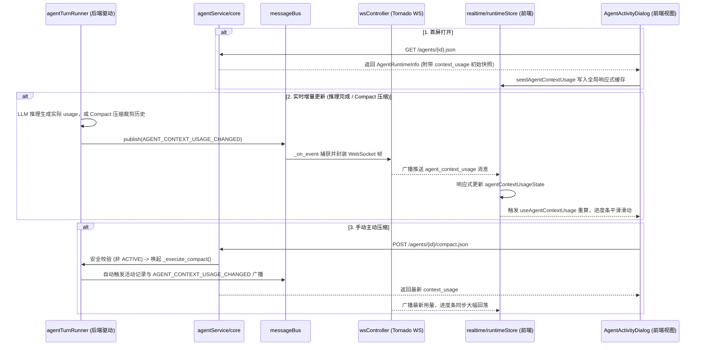

# Agent 上下文容量实时进度条 - 技术设计

> 关联文档：[产品设计](./step1_product.md) | 规范依循：[系统四层架构规则](../../tech/01_architecture/README.md)、[Token Compaction 技术规范](../../tech/04_agent/token_compaction.md)

## 1. 总体架构与数据流向

为满足「纯实时推送更新、无需前端手动刷新」的设计原则，系统采用 **静态快照 + 动态增量推送** 双通道设计：
1. **首屏就绪通道**：用户打开 Agent 活动卡片时，通过 `GET /agents/{id}.json` 详情接口随 `AgentRuntimeInfo` 直接获取静态上下文快照，确保首屏零延迟渲染；
2. **实时增量通道**：后端在推理产生新用量或 Compact 释放空间时，通过系统 MessageBus 经由 WebSocket 广播事件，前端响应式 Store 实时吸收并驱动进度条动效。



---

## 2. 数据契约定义

遵循「后端复用已有对象、不为前端拼凑临时字段」原则，用量信息统一定义为 `AgentContextUsage` 领域对象。

### 2.1 上下文用量模型 (`AgentContextUsage`)

| 字段 | 类型 | 说明 |
|---|---|---|
| `used_tokens` | `int` | 当前活跃上下文实际占用的 Token 数（分子） |
| `total_tokens` | `int` | 模型上下文窗口总容量 `context_window_tokens`（分母） |
| `compact_trigger_tokens` | `int` | 触发 Compact 智能压缩的 Token 阈值（警戒线） |
| `ratio` | `float` | 计算属性：已用比例 `used_tokens / total_tokens`（范围 `[0.0, 1.0]`） |

- **后端承载**：在 `src/model/coreModel/agentModel.py` 中定义，并作为可选字段挂载在 `AgentRuntimeInfo` 下；
- **前端承载**：在 `frontend/src/types.ts` 中声明对应接口，扩充 `AgentDetail.context_usage`。

### 2.2 WebSocket 广播事件

- **MessageBus 主题**：`MessageBusTopic.AGENT_CONTEXT_USAGE_CHANGED`
- **WS 消息格式**：
  ```json
  {
    "event": "agent_context_usage",
    "team_id": 1,
    "agent_id": 10,
    "context_usage": {
      "used_tokens": 36420,
      "total_tokens": 128000,
      "compact_trigger_tokens": 108800
    }
  }
  ```

---

## 3. 后端核心逻辑与计算

### 3.1 上下文容量计算规则
在 `src/service/agentService/` 统一收敛用量计算逻辑：
1. **分母与阈值**：通过模型解析器解析 Agent 当前生效的模型配置：
   - `total_tokens`：优先使用用户配置的 `context_window_tokens`，未配置时兜底使用系统内置模型映射表；
   - `compact_trigger_tokens`：根据系统 `compact_trigger_ratio`（默认 0.85）计算得出。
2. **分子计算**：
   - 处于当前 Turn 时，优先取最近一次推理返回的真实 `usage.prompt_tokens`；
   - 静止态或无真实 Usage 时，获取最后一次 Compact 至今的未压缩消息序列（`get_agent_history_after_compact`），调用 `compact.estimate_tokens` 准确估算。

### 3.2 自动广播触发节点
在 `AgentTurnRunner` 执行生命周期中，关键时刻主动触发广播：
- **推理成功收尾**：获得大模型真实的 `prompt_tokens` 与 `completion_tokens` 时；
- **Compact 压缩完成**：历史生成摘要并裁剪旧记录后，Token 大幅释放时；
- **新会话/轮次装载完成**：上下文初始组装时。

### 3.3 手动 Compact 接口设计与并发安全控制
- **接口路径**：`POST /agents/{agent_id}/compact.json`
- **分层处理逻辑**：
  1. **接口层（Controller）**：校验 Agent 存在性与活跃状态。**若 Agent 处于 `ACTIVE`（正在执行推理或工具），强制拦截并拒绝请求**（返回 `agent_is_active`），杜绝在活跃 Turn 循环内并发修改 `_history`；
  2. **服务层（Service）**：
     - 若 Agent 位于内存装载态，直接调用当前 Runner 的 `_execute_compact()`；若未处于内存，按同等规则装配历史后执行；
     - `_execute_compact()` 执行旧会话摘要、插入 `COMPACT_SUMMARY` 标签记录，并裁剪内存与 DB 历史；
     - 记录一条 `COMPACT` 类型的 `AgentActivity`（活动面板可见）；
     - 重新计算新用量，并通过总线自动触发 `AGENT_CONTEXT_USAGE_CHANGED` 广播；
  3. **容错与空保护**：若当前仅有系统提示或首条消息，`build_compact_plan()` 返回 `None`，接口捕获后返回业务提示「当前无可压缩历史」，不中断系统。

---

## 4. 前端实时流转与组件集成

### 4.1 全局响应式状态管理
采用全局 Store 集中响应，与现有的 `agentStatus`、`roomStatus` 保持同构设计：
1. **事件解析（`eventNormalizer.ts`）**：将 WS 报文标准化为 `agent_context_usage` 内部事件；
2. **状态存储（`runtimeStore.ts`）**：
   - 维护响应式状态字典 `agentContextUsageState = ref<Record<number, AgentContextUsage>>({})`；
   - 接收 WS 事件直接增量覆写对应 `agentId`；
   - 弹窗通过 `getAgentDetail` 拿到数据后，调用 `seedAgentContextUsage` 初始化该缓存；
3. **选择器（`selectors.ts`）**：导出 `useAgentContextUsage(() => props.agentId)` 响应式 Hook，为任意组件按需消费。

### 4.2 视图层设计（`AgentActivityDialog.vue`）
1. **排版与尺寸约束**：
   - 放置于左侧舞台区域，严格约束在 `AgentCardBase` 宽度内（`132px`）；
   - 上行放置「上下文」标签、百分比数值、微型「压缩」按钮；下行放置 `4px` 胶囊轨道；
2. **状态色温映射**：
   - `ratio < 0.70`：主题正常色（`var(--accent)`）；
   - `0.70 <= ratio < 0.85`：琥珀警戒色（接近 Compact 阈值）；
   - `ratio >= 0.85`：橙红高危色（即将触发压缩）；
3. **按钮交互状态机**：
   - `compacting = true`：按钮变为 `...` 禁用态；
   - `currentStatus === 'active'`：按钮禁用，避免并发冲突；
   - 压缩成功：调用 `compactAgentContext(id)` 成功后弹出 Success Toast，进度条由 WebSocket 推送自动驱动平滑过渡，无需组件手动拉取。

---

## 5. 测试与验证策略

1. **单元测试（Unit Test）**：
   - `test_agent_context_usage.py`：测试不同模型级/全局配置下的窗口分母与阈值计算准确性，验证消息裁剪后的分子计算逻辑；
   - 测试手动 Compact 在 Agent 处于 `ACTIVE` 状态时的安全拦截保护，以及无可压缩历史时的友好防御。
2. **集成与生命周期测试（Integration / Lifecycle Test）**：
   - 验证推理成功与 Compact 成功后，`MessageBus` 与 WebSocket 广播帧正确发出且字段合法；
   - 验证 `POST /agents/{id}/compact.json` 触发后，数据库新插入 `COMPACT_SUMMARY` 且生成成功活动记录。
3. **前端组件测试（Frontend Component Test）**：
   - `AgentActivityDialog.test.ts`：验证初始详情下发的快照正确渲染；
   - 模拟推送 `agent_context_usage` WS 事件，验证进度条宽度与文字无刷新自动变更；
   - 测试三级阈值样式类名动态切换。
