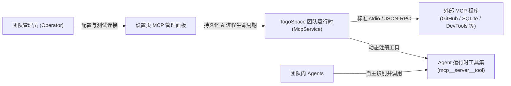

# Agent 自定义 MCP 服务接入（Model Context Protocol）- 产品文档

> **文档定位**：面向使用 TogoSpace 的操作者（Operator）、团队管理员及 Agent 编排人员，聚焦**用户痛点、产品交互体验、核心业务规则与实际预期效果**。  
> **关联文档**：[技术设计 (step2_technical.md)](./step2_technical.md)

---

## 1. 背景与用户痛点

在 TogoSpace 现有的多 Agent 协作体系中，Agent 拥有两类核心工具能力：
1. **宿主内置本地工具**（`web_search`, `memory_*`, `send_chat_msg`, `task_*` 等）：在后端 Python 进程中直接执行；
2. **环境执行工具**（`read_file`, `write_file`, `execute_bash` 等）：由 `gtsp` 提供的基础系统级操作。

然而，随着开源生态中 **MCP（Model Context Protocol，模型上下文协议）** 的迅速普及，用户面临以下显著瓶颈：

1. **生态工具接入成本极高**：
   开源社区已经涌现出海量高质量的现成 MCP Server（例如 GitHub、PostgreSQL、Puppeteer 浏览器自动化、Slack、Sentry、Jira 等）。以往要在 TogoSpace 中扩展这些能力，必须由后端工程师手写 Python 函数、更新注册表并重启服务，无法即插即用利用社区成果。
2. **缺乏统一的企业/团队外部程序扩展规范**：
   不同团队对外部数据的需求各异（如研发团队需要 Git/CI 接口，运营团队需要数仓查询与飞书集成）。缺乏针对团队隔离的自定义程序扩展机制，使得定制化需求难以优雅落地。
3. **外部脚本与命令执行的安全不可控**：
   用户自行挂载脚本或工具时，缺乏统一的管理面板、进程生命周期守护、超时控制和权限收敛，容易造成孤儿进程滞留或命令执行越权。

---

## 2. 产品目标与预期效果

我们希望为 TogoSpace 引入**原生 MCP 接入能力**，允许团队管理员在 Web 界面以配置化的方式添加任意符合 MCP 标准的程序（stdio/远程），使团队内的 Agent 能够无缝发现并调用这些工具。

### 2.1 预期的产品效果

* **免写代码，配置即接入**：
  管理员只需在界面填写标准 MCP 启动命令（如 `npx -y @modelcontextprotocol/server-postgres ...`）或可执行文件路径，系统即可自动拉起、协商协议并导入工具清单。
* **团队级协作共享与隔离**：
  * **团队内共享**：每个启用的 MCP Server 在团队运行时中按 Team 拉起一份独立进程实例，团队内所有被授权的 Agent 共享访问（有状态 MCP 进程对团队内成员协作全局可见）；
  * **跨团队隔离**：团队 A 与团队 B 的 MCP 进程和配置互不干扰，团队 A 重载或关闭不影响团队 B。
* **所见即所得的工具预览与连通性自检**：
  配置面板提供 **「测试连接」** 功能，在保存前即可拉起服务并预览所导出的所有工具名称、描述及参数 Schema，快速排查命令配置或环境错误。
* **Agent 无感调用与命名空间隔离**：
  所有 MCP 工具自动赋予命名空间前缀（`mcp__{server_name}__{tool_name}`），杜绝与本地内置工具或系统工具重名冲突。Agent 在对话与任务执行中像调用内置工具一样自然调用 MCP 能力。
* **安全受控与透明审计**：
  * stdio 命令执行权限严格收敛至 Root / 团队 Admin 管理员；
  * 环境变量（API Token、密码）前端自动脱敏掩码显示；
  * Agent 对 MCP 工具的每一次调用均沉淀至活动日志（Agent Activity）供事后回溯。

### 2.2 本期范围与非目标（Non-Goals）

* **P1（本期交付范围）**：
  * 团队级 MCP Server 配置持久化（CRUD、启停开关）；
  * **stdio transport**（标准输入输出管道子进程拉起与 JSON-RPC 2.0 握手交互）；
  * Web 前端「团队设置」新增 **「MCP 服务」** 分区与配置编辑对话框；
  * 连通性测试接口（Test Connection & Tools Preview）；
  * **TSP Agent Driver 场景下的工具注入与分派调用**（Native Driver 共享同一机制）；
  * 权限分类控制（新增 `Category:Mcp` 类别，支持按角色/前缀配置授权）；
  * 团队运行时生命周期集成（随 `restore_team` / `stop_team_runtime` 自动拉起与优雅回收，进程防孤儿保护）。
* **P2 / P3（后续演进目标）**：
  * **P2**：HTTP / SSE 远程 MCP Server 传输支持及自定义 Request Header 鉴权；
  * **P2**：本地 `.mcp.json`（如 Claude Code / Cursor 配置）一键导入导出；
  * **P2**：Server 内部工具级的细粒度黑白名单勾选（`tool_allowlist`）；
  * **P3**：MCP Resources（只读上下文资源）与 Prompts（预置提示词模板）协议特性支持；
  * **P3**：Agent 专属独立私有实例（`scope = agent`）。

---

## 3. 核心功能与用户交互流程

### 3.1 前端管理面板（设置页 MCP 服务）

在团队设置界面新增 **「MCP 服务」** 分区（位置紧随 Skills 之后）：

1. **服务卡片列表**：
   * 展示已配置的 MCP Server 列表；
   * 每项包含：服务名称、Transport 类型（stdio）、命令概要、当前运行状态徽章（`Running` / `Failed` / `Disabled`）、导出的工具数量标签、操作按钮（测试连接、编辑、启停切换、删除）。
2. **新建 / 编辑 MCP Server 对话框**：
   * **服务标识（Name）**：英文小写、数字、下划线（1-32 字符，作为工具前缀，例如 `github`、`sqlite`）；
   * **传输类型（Transport）**：本期固定为 `stdio`；
   * **启动命令（Command）**：可执行命令或脚本（如 `npx`、`python3`、`/usr/local/bin/my-mcp`）；
   * **运行参数（Args）**：以列表形式添加，支持多行或数组输入（如 `-y @modelcontextprotocol/server-sqlite --db /path/to/db.sqlite`）；
   * **环境变量（Env）**：键值对列表（如 `GITHUB_PERSONAL_ACCESS_TOKEN`），UI 对 Value 提供“小眼睛”密码掩码查看开关；
   * **超时设置（高级）**：
     * 启动握手超时（默认 30s，允许首次 npx 下载耗时）；
     * 单次调用执行超时（默认 60s）；
   * **连通性测试按钮（Test Connection）**：
     * 点击后在后台进行沙盒环境预拉起与 `initialize` + `tools/list`；
     * 测试成功后即时展开展示提取出的工具清单（工具名、描述、参数列表）；
     * 测试失败则高亮提示具体标准错误输出（stderr）或超时原因，便于调试。
3. **团队热重载提示**：
   * 保存或启停配置后，界面浮现“配置已更新，需重新加载团队生效”提示栏，一键触发 Team 热重载。

### 3.2 权限控制与角色分配

* **管理权限**：仅系统管理员（Root）和所属团队 Admin 角色有权进入 MCP 设置页及进行增删改操作；
* **Agent 使用权限**：
  * 在角色模板（Role Template）或 Agent 配置的 `tool_allow_specs` 中：
    * 支持整体勾选类别 `Category:Mcp`（分配全部 MCP 工具）；
    * 支持按命名空间前缀分配（例如 `mcp__github__*`、`mcp__sqlite__*`）；
  * 默认策略：为了保障系统安全，未特别授权的默认通用 Agent **不默认开启** MCP 工具权限，需显式授权。

### 3.3 运行时交互与异常处理

1. **启动降级机制**：
   若某个 MCP Server 配置错误（命令不存在、依赖缺失或启动超时），系统自动将该 Server 标记为 `Failed` 状态并记录告警日志，**团队中其他 Agent 和服务的正常恢复不被中断**。
2. **调用超时与异常回传**：
   当 Agent 发起 MCP 工具调用时：
   * 若进程崩溃或调用超时，系统向 Agent 返回标准格式错误（`{"success": false, "error_code": "MCP_TIMEOUT", "message": "..."}`）；
   * Agent 在理解错误原因后，可在对话中主动向人类解释“外部数据库连接超时，是否需要检查网络配置”，避免假死卡顿。
3. **大结果安全截断**：
   若 MCP 工具返回超大文本响应（如大文本 dump 或大量日志），系统在分派层自动截断并附带省略提示，防止 Agent 单次对话将 Token 上限瞬间撑爆。

---

## 4. 验收标准（Acceptance Criteria）

1. **配置管理与持久化**：
   * 管理员可在 Web 设置页成功创建、修改、启用/停用、删除 stdio 类型的 MCP Server，且数据在重启后完整保留；
   * 同一团队内禁止重名 Server，不同团队允许存在同名 Server。
2. **连通性测试体验**：
   * 点击「测试连接」能准确拉起子进程握手并返回 tools 列表预览；对于非法命令能在前端准确吐出 stderr 诊断信息。
3. **Agent 自动发现与执行**：
   * 团队恢复（`restore_team`）后，TSP Driver 的 Agent 能够看到授权的前缀为 `mcp__{server}__{tool}` 的工具；
   * Agent 发起工具调用时，调用能准确投递到对应的 MCP 进程并拿到标准 JSON 结果；
   * 对话记录与 Agent Activity 中能够清晰看到该 MCP 工具调用的入参、耗时和执行结果。
4. **生命周期与进程安全**：
   * 执行 `stop_team_runtime` 或热重载后，原有的 MCP stdio 子进程被优雅杀死（SIGTERM → SIGKILL），无残留孤儿进程；
   * 某个 MCP Server 启动崩溃不影响团队内其他服务的正常启动运行。
