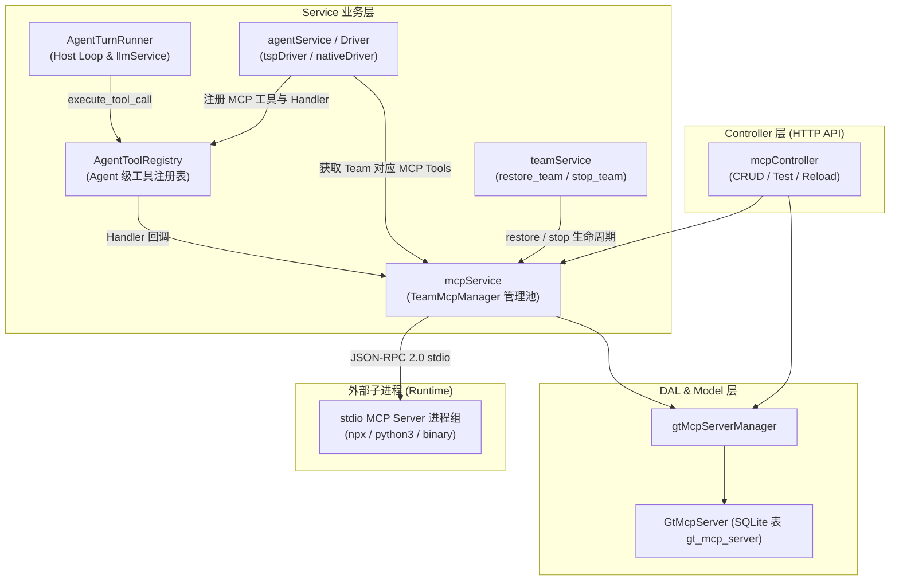

# Agent 自定义 MCP 服务接入（Model Context Protocol）- 技术设计

> **代码基线**：`/Volumes/PDATA/GitDB/TeamAgent`  
> **关联文档**：[产品文档 (step1_product.md)](./step1_product.md)  
> **设计原则**：严格遵循四层架构（Controller → Service → DAL → Model），进程/运行时按 Team 严格隔离，工具动态绑定至 Agent ToolRegistry。

---

> #### 现状（2026-11-16 核对）：本文是**技术设计意图**，实现阶段已整条改向，**不要照本文做实现**
>
> 事实基线 `0.5_dev` @ `158c02f2`。逐条依据见 `shared/docs-align/report.md`「MCP」§2（#283）。**与本文的核心差别一句话**：今天没有「按 Team 托管的 MCP 进程池」，而是**全局注册表 + 单工具入口 `mcp_call` + mcp2cli 进程内执行**。
>
> | 本文设计 | 今天的实现（依据） |
> |---|---|
> | `mcpService` / `TeamMcpManager` 进程池，按 Team 起停 | **不存在**（`grep -rln "TeamMcpManager" --include=*.py src/` 空）。业务全在 `src/service/mcpRegistryService.py`（纯 CRUD + name 解析，不管进程） |
> | 表 `gt_mcp_server`，迁移 `0021_add_gt_mcp_servers.sql`，17 列（含 `team_id`/`scope`/`transport`/`command`/`args`/`env`/`url`/`headers`/`tool_allowlist`/超时两列） | 表 **`mcp_servers`**，迁移 **`0023_add_mcp_servers.sql`**，11 列：`id,name,kind,protocol,target,note,config,enable,created_by,created_at,updated_at`（`0023_add_mcp_servers.sql:23-35`）；`tool_allowlist`/超时列在 `src/` 全无） |
> | `UNIQUE(team_id, name)` + `(team_id, enabled)` 查询索引 | `ux_mcp_servers_name(name)` **全局唯一**；无查询索引（`mcpRegistryService.py:321` 全表读） |
> | `restore_team` 先起 MCP、并发降级、SIGTERM→SIGKILL 孤儿治理（§4 全节） | **无对应实现**：`grep -n "mcp" src/service/teamService.py` 空；`mcp_stdio` 的子进程只在单次调用内由 mcp2cli 起落（`mcpTool.py:17-18`），无常驻进程即无孤儿问题 |
> | `mcp__{server}__{tool}` 命名 + 动态注册进 `tool_registry`（§5.1/5.2） | Agent 侧**只有一个**工具 `mcp_call`；注册项在它内部解析（`tools.py:166-179`），无命名空间前缀 |
> | `ToolCategory.MCP` 与 `__*` 前缀授权（§5.3） | 无该类别（`grep -n "MCP" src/constants.py` 空） |
> | 截断 16384 + `MCP_TOOL_EXECUTION_TIMEOUT` 式错误码 | 截断 **20000 字符**（`mcpTool.py:130`）；错误码为小写族 `mcp_call_timeout` / `mcp_name_not_found` / `mcp_name_kind_conflict` / `mcp_server_disabled` / `mcp2cli_*`（`tools.py:139-151`） |
> | HTTP `/teams/{team_id}/mcp_servers…` 6 条（含 test / reload） | 4 条：`/mcp/servers.json` `/save.json` `/delete.json` `/enable.json`（`src/route.py:70-73`），**无 team 段、无 test、无 reload** |
>
> **本文仍然成立、可直接引用的部分**：§1.2-①「MCP 与 gtsp 无关，调用不经 gtsp」；§5.1「MCP 工具本身已带标准 JSON Schema，不必包装成 `FuncTool`」；§6.1「大输出必须截断」的问题判断（阈值另定）；§8「新增独立表、不动既有链路即零回归」的结论。

> **console 文案（#281）与 `mcpTool` 判成败（#282）已合入 `0.5_dev`**（#281 `cba1e886`、#282 `7c24a536`）。本文涉及的 `mcp add/rm/ls/call/enable/disable` 文案与 `mcp call` 成败判定，**现状以主干为准**（原口径已过期，#284 订正）。

---


## 1. 架构目标与关键修正

### 1.1 核心设计定位

构建以 **Team 为隔离边界**、**宿主进程直接管控 stdio 子进程生命周期**、**直接向 Agent 实例的 `tool_registry` 动态注入** 的 MCP 运行时接入体系。

### 1.2 纠正此前设计草案（`draft_mcp.md`）中的架构误区

在初始评估中，方案草案曾存在以下两项严重的设计偏差，在本次技术设计中予以彻底修正：

1. **纠正“gtsp 内部运行模型并回传工具”的错误假设**：
   * 实际代码实现中，`gtsp` 仅为外部系统工具提供者（提供 `execute_bash`/`read_file` 等）。真正的 LLM 推理循环位于宿主侧的 [`agentTurnRunner.py`](file:///Volumes/PDATA/GitDB/TeamAgent/src/service/agentService/agentTurnRunner.py#L752)（调用 `llmService.infer_stream`）。
   * 工具调用直接由宿主侧的 `self.tool_registry.execute_tool_call` 分发执行。因此，**MCP 工具与 gtsp 无关，无需经过 gtsp**，由宿主直接向 MCP 进程发起调用。
2. **纠正“将 MCP 工具挂入全局 `funcToolService`”的设计**：
   * [`funcToolService`](file:///Volumes/PDATA/GitDB/TeamAgent/src/service/funcToolService/core.py) 是整个 Python 进程共享的全局单例，且无 `team_id` 参数。系统同时并发运行多个 Team（见 [`backend_main.py:211`](file:///Volumes/PDATA/GitDB/TeamAgent/src/backend_main.py#L211)）。若挂入全局注册表，会导致跨 Team 污染和同名冲突。
   * [`funcToolType.py`](file:///Volumes/PDATA/GitDB/TeamAgent/src/service/funcToolService/funcToolType.py#L223) 通过 Python 函数反射生成 Schema，而 MCP 工具本身已是标准 JSON Schema，无需强行打包为 `FuncTool`。
   * **正确做法**：对齐 TSP 工具模式，MCP 工具由 Team 级 `mcpService` 管理，在 Agent 初始化与环境刷新时，直接将带有 `mcp__{server}__{tool}` 命名的 `OpenAITool` 注册进该 Agent 专属的 [`AgentToolRegistry`](file:///Volumes/PDATA/GitDB/TeamAgent/src/service/agentService/toolRegistry.py#L121)。

---

## 2. 总体架构与模块分层

> 现状（2026-11-16）：下图与 §2.1 表中除 `mcpController` / `gtMcpServerManager` / `GtMcpServer` 三个名字仍在，其余（`mcpService`、`TeamMcpManager`、`AgentToolRegistry` 的 MCP 扩展、`gt_mcp_server` 表）**均无对应实现**。实际分层见文首现状块。



### 2.1 四层职责边界

| 模块 / 类 | 所在层 | 核心职责 |
|---|---|---|
| `mcpController.py` | `controller` | 负责 MCP 配置的 RESTful HTTP 接口、连通性测试请求编排与权限校验 |
| `mcpService` | `service` | 管理所有 Team 的 `TeamMcpManager`；负责 stdio 进程启动/握手/调用/超时熔断/优雅关闭 |
| `TeamMcpManager` | `service` | 维护单 Team 内部所有启用的 MCP Server 实例与 client 连接；对外输出 `list[OpenAITool]` |
| `gtMcpServerManager.py` | `dal` | 数据访问层，封装 `gt_mcp_server` 表的增删改查与唯一性约束处理 |
| `gtMcpServer.py` | `model` | 数据库 ORM 模型定义 |
| `toolRegistry.py` | `service/agentService` | 扩展权限匹配规则，支持 `Category:Mcp` 与命名空间前缀过滤 |

---

## 3. 数据模型与持久化设计

### 3.1 数据库表：`gt_mcp_server`

> 现状（2026-11-16）：表名、迁移编号、全部字段均已不同 —— 实际为 `mcp_servers` / `0023_add_mcp_servers.sql` / 11 列（`name,kind,protocol,target,note,config,enable,created_by`），唯一约束改为**全局唯一 name**。完整对照见文首现状块与 report.md T4/T5。

通过迁移脚本 `assets/migrate/0021_add_gt_mcp_servers.sql` 创建，对应模型类 `GtMcpServer`（继承自 `DbModelBase`，复用 `AutoTimestampMixin`）：

| 字段名 | 类型 | 约束与默认值 | 说明 |
|---|---|---|---|
| `id` | `INTEGER` | `PRIMARY KEY AUTOINCREMENT` | 自增主键 ID |
| `team_id` | `INTEGER` | `NOT NULL` | 所属 Team ID（外键关联 `gt_team.id`） |
| `name` | `TEXT` | `NOT NULL` | 服务标识（命名空间，如 `github`、`sqlite`） |
| `scope` | `TEXT` | `NOT NULL DEFAULT 'team'` | 作用域：`team`（一期），预留 `agent` |
| `transport` | `TEXT` | `NOT NULL DEFAULT 'stdio'` | 传输方式：`stdio`（一期），预留 `http`, `sse` |
| `command` | `TEXT` | `NOT NULL` | 启动命令（如 `npx`, `python3`, `/bin/server`） |
| `args` | `TEXT` | `NOT NULL DEFAULT '[]'` | 命令行参数（JSON 数组） |
| `env` | `TEXT` | `NOT NULL DEFAULT '{}'` | 环境变量字典（JSON 对象） |
| `url` | `TEXT` | `NULL` | 远端服务 URL（预留） |
| `headers` | `TEXT` | `NOT NULL DEFAULT '{}'` | 请求头字典（预留） |
| `enabled` | `INTEGER` | `NOT NULL DEFAULT 1` | 是否启用：`1` 启用，`0` 停用 |
| `tool_allowlist` | `TEXT` | `NULL` | 工具白名单（JSON 数组，为 NULL 时导出全部工具） |
| `timeout_sec` | `INTEGER` | `NOT NULL DEFAULT 60` | 单次工具调用超时时间（秒） |
| `startup_timeout_sec` | `INTEGER` | `NOT NULL DEFAULT 30` | 启动握手超时时间（秒） |
| `created_at` | `DATETIME` | `NOT NULL DEFAULT (datetime('now'))` | 创建时间 |
| `updated_at` | `DATETIME` | `NOT NULL DEFAULT (datetime('now'))` | 更新时间 |

**索引与唯一键约束**：
* **复合唯一索引**：`UNIQUE(team_id, name)` —— 团队内 Server 名称唯一，不同 Team 允许同名；
* **查询索引**：`idx_gt_mcp_server_team_enabled (team_id, enabled)` —— 加速运行时恢复。

---

## 4. 运行时生命周期与进程治理

> 现状（2026-11-16）：**整节未实现**，且其前提在当前架构下不存在 —— 没有常驻 MCP 进程池，`mcp_stdio` 的子进程由 mcp2cli 在单次调用内起落（`mcpTool.py:17-18`）。本节保留作为「若将来改回常驻进程」的参考。

### 4.1 Team 恢复时序（与 `teamService.restore_team` 集成）

在 [`teamService.py:restore_team`](file:///Volumes/PDATA/GitDB/TeamAgent/src/service/teamService.py#L37-L62) 中，MCP 服务的启动必须位于 Agent 实例创建之前，确保 Agent Driver 初始化时能同步读取到可用的 MCP 工具列表：

```python
# teamService.py
async def restore_team(team_id: int, ...):
    ...
    # 1. 先启动本团队启用的 MCP Server 进程并完成握手缓存
    await mcpService.start_team_mcp_servers(team.id)

    # 2. 恢复 Agent 与 Driver（此时 Driver 读取 mcpService 工具列表）
    await agentService.load_team_agents(team.id, workspace_root=workspace_root)
    await roomService.load_team_rooms(team.id)
    ...
```

### 4.2 并发启动与启动降级（防止阻塞整队恢复）

stdio 程序（尤其是使用 `npx` 的临时下载环境）冷启动可能耗时较长。为避免单个异常 Server 拖死整支团队，采用**异步并发拉起 + 单服务隔离超时 + 异常降级**：

```python
async def start_team_mcp_servers(self, team_id: int) -> None:
    servers = await gtMcpServerManager.get_enabled_servers_by_team(team_id)
    tasks = [self._start_single_server_safe(team_id, server) for server in servers]
    # 并发拉起，单个失败不抛异常中断
    await asyncio.gather(*tasks, return_exceptions=True)

async def _start_single_server_safe(self, team_id: int, server: GtMcpServer) -> None:
    try:
        await asyncio.wait_for(
            self._start_single_server(team_id, server),
            timeout=server.startup_timeout_sec
        )
    except Exception as e:
        logger.error(f"Team {team_id} MCP Server {server.name} 启动失败，已降级: {e}")
        # 记录内存态为 FAILED，不阻断其他服务
```

### 4.3 进程安全与孤儿进程治理

stdio 子进程必须严格防范孤儿进程滞留（尤其是在热重载或崩溃时）：
1. **独立进程组创建**：
   在启动子进程时，传递 `start_new_session=True`（Unix 系统下相当于 `os.setsid()`），使子进程成为独立进程组的组长。
2. **两段式优雅退出**：
   * **第一阶段**：向进程组发送 `SIGTERM`（`os.killpg(os.getpgid(proc.pid), signal.SIGTERM)`），等待子进程正常清理释放资源（最多等待 3 秒）；
   * **第二阶段**：若超时仍未退出，向进程组强制发送 `SIGKILL` 彻底清除。
3. **关闭钩子与热重载保障**：
   * 在 `teamService.stop_team_runtime(team_id)` 中显式调用 `await mcpService.stop_team_mcp_servers(team_id)`；
   * 后端进程退出钩子中统一对所有存活子进程执行清理。

---

## 5. 桥接层与 Agent 工具集成

### 5.1 命名规范与 Schema 转换

> 现状（2026-11-16）：`mcp__{server}__{tool}` 命名**不存在**（`grep -rn 'mcp__' --include=*.py src/` 空），工具统一由 `mcp_call(name, tool, args, extra, kind)` 调用；「不必包装成 FuncTool」这一判断仍成立。

* **命名空间格式**：`mcp__{server_name}__{tool_name}`
  * 例如：Server 命名为 `sqlite`，工具为 `read_query`，则全局工具名为 `mcp__sqlite__read_query`；
  * 正则保证：`server_name` 限制为 `^[a-z0-9_]{1,32}$`，避免命名非法。
* **Schema 转换**：
  MCP 协议标准工具响应结构包含：
  ```json
  {
    "name": "read_query",
    "description": "Execute a SELECT query",
    "inputSchema": {
      "type": "object",
      "properties": { "query": { "type": "string" } },
      "required": ["query"]
    }
  }
  ```
  直接将其转换为系统统一的 `llmApiUtil.OpenAITool`：
  ```python
  OpenAITool(
      function=OpenAIFunction(
          name=f"mcp__{server_name}__{tool['name']}",
          description=tool.get("description", ""),
          parameters=OpenAIFunctionParameter(**tool["inputSchema"])
      ),
      category=ToolCategory.MCP
  )
  ```

### 5.2 挂载到 Agent Driver 与 ToolRegistry

无论使用 `TspAgentDriver` 还是 `NativeAgentDriver`，都在其工具装配环节（`_register_host_tools` 或 `startup`）注入：

```python
# 获取本团队可用的 MCP 工具列表
mcp_tools = mcpService.get_team_mcp_tools(self.host.gt_agent.team_id)

for tool in mcp_tools:
    self.host.tool_registry.register(
        tool,
        handler=self._execute_mcp_tool_dispatch,
    )
```

调用分发处理器 `_execute_mcp_tool_dispatch`：
```python
async def _execute_mcp_tool_dispatch(
    function_args: str,
    context: Optional[ToolCallContext] = None
) -> dict[str, Any]:
    # 从 context.tool_name 解析出 server_name 与 real_tool_name
    # 格式：mcp__{server_name}__{real_tool_name}
    _, server_name, tool_name = context.tool_name.split("__", 2)
    return await mcpService.execute_tool(
        team_id=context.team_id,
        server_name=server_name,
        tool_name=tool_name,
        arguments_json=function_args,
        context=context,
    )
```

### 5.3 权限解析扩展（`toolRegistry.py`）

> 现状（2026-11-16）：**未实现** —— `ToolCategory` 无 MCP 成员，`toolRegistry` 无 MCP 分支；当前 `mcp_call` 对所有人可用。本节是设计意图，需另立单（见 report.md T8）。

在 [`toolRegistry.py`](file:///Volumes/PDATA/GitDB/TeamAgent/src/service/agentService/toolRegistry.py) 中做两处扩展：
1. **新增类别枚举**：
   在 `constants.py` 的 `ToolCategory` 中增加 `MCP = "Category:Mcp"`；
2. **支持前缀模式匹配**：
   升级 `AgentToolRegistry.resolve_enabled_tool_names` 方法：
   ```python
   for spec in allow_specs:
       category = ToolCategory.from_spec(spec)
       if category is not None:
           categories.add(category)
           continue
       if spec.endswith("__*") or spec.endswith("/*"):
           # 支持前缀模糊匹配，如 mcp__github__*
           prefix = spec[:-3] if spec.endswith("__*") else spec[:-2]
           for name in ordered_names:
               if name.startswith(prefix):
                   explicit_names.add(name)
           continue
       if spec in ordered_names:
           explicit_names.add(spec)
   ```
3. **默认策略安全防护**：
   `build_runtime_allow_specs` 在 `allowed_tools is None` 时，**不包含 `Category:Mcp`**。未显式赋予 MCP 权限的普通 Agent 不会自动获得执行外部命令的权限。

---

## 6. 数据处理与调用健壮性

### 6.1 超大输出安全截断

> 现状（2026-11-16）：机制有、**阈值不同** —— 上限 `MAX_OUTPUT_CHARS = 20000` 字符（`mcpTool.py:130`），返回体置 `truncated=True`；不是 16384，提示语形态也不同。

MCP 工具（如文件搜索、日志提取、网页抓取）可能返回数十万字符的输出，直接塞给 LLM 会导致上下文溢出（Context Overflow）。
在 `mcpService.execute_tool` 返回层设置阈值保护：
* 单次返回文本限制：最大 16,384 字符（约 4,000 Tokens）；
* 超过部分截断，并追加：`\n\n[Warning: Tool output exceeded limit (16KB) and was truncated by host]`。

### 6.2 多模态返回降级

MCP 标准允许返回 `ImageContent`。一期以纯文本会话为主，当检测到返回内容包含图像数据时，提取其中的文本并附带结构化说明：
`"[Image content returned by tool; binary image rendering is currently unsupported in this turn]"`，避免解析器抛出未捕获异常。

### 6.3 异常与错误码规范

所有 MCP 内部异常统一包装为标准结构字典，支持模型自我纠偏：
```json
{
  "success": false,
  "error_code": "MCP_TOOL_EXECUTION_TIMEOUT",
  "message": "MCP server 'sqlite' timed out after 60s while executing 'read_query'"
}
```

---

## 7. HTTP API 接口设计

> 现状（2026-11-16）：实际只有 4 条、且**不带 team 段**：`/mcp/servers.json`（列表）、`/mcp/servers/save.json`、`/mcp/servers/delete.json`、`/mcp/servers/enable.json`（`src/route.py:70-73`，`src/controller/mcpController.py`）；**无** test / reload 接口。

所有接口挂载于 `/teams/{team_id}/mcp_servers` 路径下，复用系统统一的鉴权与权限拦截：

| Method | Path | 说明 | 权限 |
|---|---|---|---|
| `GET` | `/teams/{team_id}/mcp_servers.json` | 获取指定团队的所有 MCP Server 配置及实时状态 | 团队成员 |
| `POST` | `/teams/{team_id}/mcp_servers.json` | 新增 MCP Server 配置 | 仅 Admin / Root |
| `PUT` | `/teams/{team_id}/mcp_servers/{server_id}.json` | 修改 MCP Server 配置 | 仅 Admin / Root |
| `DELETE` | `/teams/{team_id}/mcp_servers/{server_id}.json` | 删除 MCP Server | 仅 Admin / Root |
| `POST` | `/teams/{team_id}/mcp_servers/test.json` | 临时测试连接并预览工具列表（传参未持久化的配置） | 仅 Admin / Root |
| `POST` | `/teams/{team_id}/mcp_servers/{server_id}/reload.json` | 单个 MCP Server 运行时重载与工具刷新 | 仅 Admin / Root |

### 连通性测试接口（Test Connection）入参与返回示例

* **Request**: `POST /teams/1/mcp_servers/test.json`
  ```json
  {
    "command": "npx",
    "args": ["-y", "@modelcontextprotocol/server-sqlite", "--db", "/tmp/test.db"],
    "env": {},
    "timeout_sec": 30
  }
  ```
* **Response (Success)**:
  ```json
  {
    "success": true,
    "tools": [
      {
        "name": "read_query",
        "description": "Execute a SELECT query against the SQLite database",
        "parameters": {
          "type": "object",
          "properties": {
            "query": { "type": "string", "description": "SQL query" }
          },
          "required": ["query"]
        }
      }
    ]
  }
  ```
* **Response (Error)**:
  ```json
  {
    "success": false,
    "error_code": "MCP_HANDSHAKE_FAILED",
    "message": "Process exited with code 1: Cannot find module '@modelcontextprotocol/server-sqlite'"
  }
  ```

---

## 8. 实施影响评估与零回归保证

1. **对原生内置工具零影响**：
   内置工具与容器工具依然走 `funcToolService`，调用链与分派逻辑完全未动；
2. **对现有 TSP 机制零破坏**：
   `gtsp` 的基础通信协议（`client.initialize`、`_tsp_tools`）原样保留，MCP 工具作为额外的 `OpenAITool` 注册进 `tool_registry`，与 TSP 工具并行互不影响；
3. **数据库兼容性**：
   新增独立表 `gt_mcp_server`，不修改已有表的 schema，向下完全兼容。

---

## 9. `mcp2cli` 接入层（#202 实现说明）

> 本节是 `src/service/funcToolService/mcpTool.py` 模块 docstring 的原文搬迁（2026-11-25，#359 压缩注释：模块头从 84 行压到 5 行，论证全部移到这里）。代码里只留「超时后变慢不是随机故障」这一条现象与本文指针。

### 9.1 为什么要这一层

平台原来的外呼形态是「每接一个外部 API 就把整套 tool schema 喂给模型」。`mcp2cli` 在运行时把任意 MCP server / OpenAPI spec / GraphQL endpoint 转成 CLI，模型只需要记住 `mcp_call` 一个工具 + `--list` 一次拿命令清单，schema 开销从「N 套」降到「1 套」。

### 9.2 执行方式：库调用；openapi / mcp / graphql 三态零子进程，`mcp_stdio` 起子进程

`mcp2cli` 是 CLI 优先的项目，但它把分派逻辑抽成了 `_main_impl(argv)` —— **读的是入参而不是 `sys.argv`**，因此可以在进程内直接调，不必 `Popen(sys.executable, ...)`。这躲开了 PyInstaller onedir 下「打包后的可执行文件当 python 解释器」的坑（方案 §4：只有 `--session-start` daemon 会用 `sys.executable -c`，本单不用 session 模式）。

**「零子进程」只对 openapi / mcp / graphql 三态成立**：它们走 HTTP，进程内完成。`mcp_stdio` 例外 —— 它按 Operator 要求保留，上游 `mcp.client.stdio.stdio_client` 会真的拉起本地子进程（这是该 kind 的定义，不是本层引入的开销）。

### 9.3 为什么依赖 `_main_impl`：代价与退路

调 `_main_impl` 而不是逐个拼公开函数（`load_openapi_spec` / `handle_mcp` / `execute_openapi` …）的原因：OpenAPI 的 `call` 分支要先用 `_build_main_parser()` 建全局 parser、再 `build_argparse()` 出子命令 parser、再 `execute_openapi(args, …)`，自己拼等于把 `mcp2cli` 的分派逻辑抄一遍，抄完就与上游版本漂移。

代价是**依赖了一个下划线开头的函数**：升级 `mcp2cli` 时必须复跑 `tests/unit/service/funcToolService/test_mcp_call.py` 的实跑用例。公开函数链（`load_openapi_spec → extract_openapi_commands → list_openapi_commands(json_output=True)`）已单独复验可用，作为届时改写的退路。

### 9.4 三个必须处理的点（都是「不跑崩」的技术必需，不是安全加固）

1. `mcp2cli` 靠 `print` 出结果、**不 return** ⇒ 必须捕获 stdout/stderr；
2. 错误路径会 `sys.exit(1)` ⇒ 必须 `try/except SystemExit` 兜住，**绝不让它杀掉后端进程**；
3. 函数是**同步阻塞**的（起 HTTP 请求 / 本地 stdio 子进程）⇒ 必须 `asyncio.to_thread` 丢线程池，别卡事件循环。

### 9.5 全局锁：代价与实测读数

第 1 点的捕获手段是替换**进程级** `sys.stdout`，而 `to_thread` 让多个调用真并发 ⇒ 两个调用会互相截获对方的输出（实测 2 路并发 40 批：19 次拿到**另一个 target** 的结果）。所以模块级加一把 `threading.Lock`，把「替换 stdout → 跑 → 取回」整段串行化：同时只有一次 `mcp2cli` 在写那个全局流。

**代价（必须知情，不许当白送）**：串行化意味着一次慢调用会把进程内其余 `mcp_call` 挡在门外。实测读数见实现报告 §5.3（1 个慢 target 在飞时另一快 target 的耗时）。

### 9.6 超时到点不释放锁（已知限制）

**已知限制：`timeout` 到点不释放锁**（不是 bug，是取舍，但必须写下来）。`call_mcp` 用 `asyncio.wait_for` 包 `asyncio.to_thread`，超时只是**不再等结果**：那个 worker 线程仍在跑、**仍持着 `_STDOUT_LOCK`**，直到 `mcp2cli` 那次调用真正结束才释放。实测（慢 target 服务端 sleep=3s、`timeout=1`）：

- 超时返回瞬间 `_STDOUT_LOCK.locked() = True`，约 +2.0s 后才变 False；
- 连发 3 个 `timeout=1` 打同一慢 target，随后快 target 等了 **6.03s**（3 个孤儿 worker 依次持锁）；
- 更严重的一层（**改前形态下实测**，无锁 + `io.StringIO`）：孤儿 worker 结束时 `redirect_stdout` 恢复**全局** `sys.stdout`，会把**在飞调用**自己的捕获流一起打掉 ⇒ 后续调用**拿到的是别人的结果**（实测快调用返回 `{'marker': 'SLOW'}`，应为 `MID`）。当前实现（线程隔离 + 锁）已消掉这一层，用例 `test_call_after_timeout_still_succeeds` 钉住它。

**所以「锁最多被持有 N 秒」这种说法不成立**，正确的表述是：锁被持有到上游那次调用真正结束为止，而这个时长**没有硬上界** —— 上游 `httpx.Client(timeout=30/60)` 是**单次操作**超时（connect/read 各自计时，不是总时长；见 `mcp2cli` `__init__.py:3493` `execute_openapi`），服务端慢速滴流即可让总时长任意长。实测：滴流 target 每 1.5s 发 1 字节、总时长约 78s，`timeout=2` 的调用 2.01s 就返回了，但随后快 target 被堵 **74.92s**（>60s，证明无 60s 封顶）。

⇒ 一次超时后，锁可能还被占几十秒，这段时间内**所有** `mcp_call` 都在排队，而调用方看到的是 `success=False, mcp_call_timeout`，下一个调用却莫名变慢 —— 别把它当随机故障。

收窄这个代价的两条路各自的问题：

- 「每次调用独立捕获」做不到：`print` 写的是 `sys.stdout` 这个**全局名字**，不是可注入的句柄，除非改上游或每调用开子进程；
- 「走上游公开函数链」代价更大：OpenAPI 的 call 分支要先 `_build_main_parser()` 再 `build_argparse()` 再 `execute_openapi()`，自己拼 = 抄一遍上游分派逻辑（见 §9.3），且公开函数链同样 `print` 到 `sys.stdout`，**串味问题一模一样**。

所以串行化是当前形态下「不串味」的最小代价方案，**不是因为它没有代价**。

### 9.7 残余风险

已处理一部分：持锁期间 `sys.stdout` / `sys.stderr` 仍是我们的捕获流，但捕获流按**线程**过滤（`_ThreadIsolatedStream`）—— 只有跑 `mcp2cli` 的那个 worker 线程的写入进结果，其它线程的 `print` / 日志原样转发到真实流。因此「别的协程日志被吞」与「日志污染 JSON 输出」两个问题都已消除（实测读数见实现报告 §5.4）。

仍存在的残余：`redirect_stdout` 期间 `sys.stdout` 这个**对象**确实被换掉了（若别处缓存了 `sys.stdout` 的旧引用、或依赖 `isinstance(sys.stdout, TextIOWrapper)` 判断，会看到替身）。要彻底消除得改上游或每调用开子进程，超出本单范围。

回调给模型的 `truncated` / `result_type` 都按真实行为给，不按注释里的意图给。
