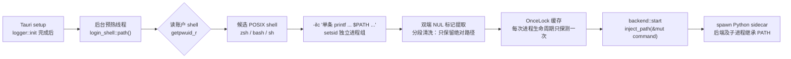

# 桌面端登录 shell PATH 读取 - 技术文档

> 关联文档：[产品文档](./step1_product.md) | 详细算法与 DSH 对照：[专项设计](../2026-10-29-tauri-desktop-shell/login-shell-environment_design.md)

## 1. 方案概览

### 1.1 问题链路

```text
Finder / Dock 启动
  └─ launchd 只提供最小环境 → Tauri（Rust）PATH 最小
       └─ Command::spawn 拉起 Python sidecar → sidecar 继承同一份最小 PATH
            └─ shutil.which / asyncio.create_subprocess_exec / Agent 工具调用全部受影响
```

从终端启动时 shell 已经执行过 rc 文件，`PATH` 正常；因此修复点放在**唯一能区分「GUI 启动」与「终端启动」的 Tauri Rust 外壳**，Python 业务代码不改。

### 1.2 总体流程



### 1.3 关键决策

| 决策点 | 选择 | 理由 |
|--------|------|------|
| 同步范围 | **只同步 `PATH`** | 不需要维护环境变量黑名单，天然不覆盖 `STORAGE_ROOT`、`TOGOSPACE_*` 等启动器变量；能覆盖可执行文件定位问题 |
| 实现位置 | Rust 外壳 | GUI 启动的唯一入口；注入一次，后端全部子进程继承；Python 从终端运行不受影响 |
| 候选 shell | 仅 POSIX（`zsh` / `bash` / `sh`） | `fish` / `tcsh` 等对 `$PATH` 的展开语义不同，会产生截断或空格分隔的「假成功」 |
| 探针输出 | **单条 `printf` + NUL 定界符** | 一次写出首尾标记与 `$PATH`，缩小 rc 后台进程并发写 stdout 的插入窗口；NUL 不会出现在环境变量值中 |
| 进程隔离 | `setsid()` + 进程组回收 | 脱离控制终端，避免 rc 访问 `/dev/tty` 触发 `SIGTTIN` / `SIGTTOU`；超时可整组 `SIGKILL` |
| 读取完成条件 | 读到第二个定界符即返回 | rc 启动的后台进程可能长期持有 stdout，等 EOF 会每次超时 |
| 探测次数 | 每进程一次（`OnceLock`） | 探测开销只发生在启动阶段；成功/失败都缓存，避免反复试探 |
| 开发模式 | `debug_assertions` 默认跳过 | 保留 `tauri dev` 终端会话的临时 `PATH`（direnv / nix / conda） |

### 1.4 被否决的方案

| 方案 | 否决原因 |
|------|----------|
| 同步完整环境表 | 需要维护 `PWD`、`SHLVL`、`TOGOSPACE_*` 等排除规则，容易覆盖启动器变量 |
| 在 Python sidecar 内探测 | 无法区分「GUI 启动」与「终端启动」，终端场景会重复探测并可能覆盖用户当前环境 |
| 运行时定时刷新 `PATH` | 子进程环境在 `spawn` 时已固定，刷新对已运行后端无意义；改 rc 后重启应用即可 |
| 依赖用户 `launchctl setenv` | 需要用户手工配置，且对 Linux 不适用 |

## 2. 模块与接口

### 2.1 新增模块

新增 `tauri/src-tauri/src/login_shell.rs`，在 `lib.rs` 中声明 `mod login_shell;`。非 Unix 平台提供空实现（`path()` 返回 `None`）。

### 2.2 对外接口

```rust
/// 返回登录 shell 的 PATH；未探测成功（或非 Unix）返回 None。
/// 允许阻塞调用线程：首次调用会同步完成探测（受总预算约束）。
pub fn path() -> Option<&'static OsStr>

/// 若 path() 为 Some，注入 command.env("PATH", ...)。
pub fn inject_path(command: &mut std::process::Command)
```

### 2.3 内部结构与测试 seam

| 函数 | 职责 |
|------|------|
| `cached_path(cache, init)` | 接收 `&OnceLock<Option<OsString>>` 与初始化闭包；供单测用局部 `OnceLock` 验证只执行一次 |
| `should_probe(raw_env, is_debug)` | 纯函数：release 默认开启；debug 默认跳过，`raw_env` 为 `1` / `true` 时强制开启 |
| `resolve_path()` | 生产入口：读环境变量、账户 shell，调用 `resolve_path_from` |
| `resolve_path_from(candidates, total_budget)` | 可注入候选列表与预算，供单测直接调用 |
| `login_shell_candidates()` | 生产入口：调用 `login_shell_candidates_for(account_shell())` |
| `login_shell_candidates_for(account_shell)` | 纯函数：POSIX 账户 shell 优先 + 系统 shell 追加并按完整路径去重 |
| `account_shell()` | `getpwuid_r` 读取账户 shell（处理 `ERANGE` 扩容与空路径） |
| `probe_shell(shell, timeout)` | 单候选探测：`setsid` spawn、轮询、超时/退出后的进程组回收 |
| `spawn_stdout_reader(stdout)` | detached 读取线程：双端标记匹配、256 KiB 上限、忽略 `send` 错误并持续排水 |
| `extract_framed_path(raw)` | 提取两个 `\0<DELIMITER>\0` 之间的片段 |
| `sanitize_path_bytes(raw)` | 校验无 `\0` / `\r` / `\n`，按 `:` 过滤相对路径并统计保留/丢弃条目数 |
| `resolve_timeout_budget()` / `parse_timeout_budget(raw)` | 生产读取环境变量；纯函数解析 500–30000ms，非法值回退默认 |
| `candidate_timeout(total, remaining)` | 纯函数：剩余 < 1000ms 返回 `None`，否则 `min(remaining, max(3000ms, total / 2))` |
| `kill_group(pid)` | `libc::kill(-pid, SIGKILL)` + `wait` 回收 |

> 所有核心逻辑都通过上述纯函数 / 可注入 seam 测试，不在单测中读写进程全局环境变量，也不依赖宿主真实账户配置。

### 2.4 集成点

| 位置 | 改动 |
|------|------|
| `tauri/src-tauri/src/lib.rs` | `mod login_shell;`；`setup` 中 `logger::init`（约 340 行）之后 spawn 预热线程 |
| `tauri/src-tauri/src/backend.rs::start` | 构造 `command`、设置完 `TOGOSPACE_*` 环境变量后，`spawn()` 之前调用 `login_shell::inject_path(&mut command)` |
| 托盘「重试启动」 | 走 `backend::restart` → `launch_backend` → `backend::start`，自动复用缓存并再次注入，无需额外改动 |

注入示例：

```rust
let mut command = sys::platform::get_command(&resource_dir, &repo_root)?;
command
    .env("TOGOSPACE_DESKTOP", "1")
    // ... 其余 TOGOSPACE_* / STORAGE_ROOT / PYTHONUNBUFFERED
    ;
login_shell::inject_path(&mut command); // 若探测成功则 command.env("PATH", p)
let mut child = command.spawn()?;
```

### 2.5 缓存与阻塞契约

- `path()` 内部通过 `cached_path(&CACHE, resolve_path)` 保证每个应用进程最多探测一次；成功或失败均缓存，失败后需重启应用才会重试。
- `backend::start` 运行在独立后台线程（`lib.rs::launch_backend` 中 `std::thread::spawn`），首次调用 `path()` 可能同步等待预热线程完成，**最多等待总预算**，绝不阻塞 Tauri 主线程。
- 预热与 `splashscreen` 加载并行；最坏情况下 sidecar 启动推迟不超过总预算。
- 后端就绪超时 `START_TIMEOUT_MS = 15_000` 在 `command.spawn()` **之后**才开始计时，因此探测等待不占用这 15s 预算。
- 不调用 `std::env::set_var` 修改外壳进程环境，只通过 `Command::env` 注入 sidecar。

## 3. 探测流程

### 3.1 候选 shell

1. **账户 shell**：通过 POSIX `getpwuid_r` 的 `pw_shell` 获取（不读 `$SHELL`）；仅当 basename 属于 `zsh` / `bash` / `sh` 时纳入第一候选，非 POSIX shell 记录日志后跳过。
2. **系统 shell**：依次追加 `/bin/zsh`、`/bin/bash`、`/bin/sh`，按完整路径去重。
3. 账户记录不可读时只使用系统 shell。部分 Linux 发行版 `/bin/sh` 为 `dash`，可能不支持 `-l` 或只读 `~/.profile`，作为兜底快速失败或返回基础路径属预期行为。

### 3.2 探针命令与定界符

```text
printf '\0__TOGOSPACE_LOGIN_SHELL_PATH__\0%s\0__TOGOSPACE_LOGIN_SHELL_PATH__\0' "$PATH"; exit
```

- 参数：`<shell> -ilc <dump>`，`-i` 读取 `~/.zshrc` 等交互式配置，`-l` 读取 `~/.zprofile` / `~/.profile`；
- 必须使用**单条 `printf`** 同时输出首尾定界符与 `$PATH`，不要拆成两次 `printf`；
- 定界符不能以八进制数字 `0`–`7` 开头，否则 `\0` 会与后续数字组成 `\0ddd` 转义吞掉字节；
- 完整字节标记：`b"\0__TOGOSPACE_LOGIN_SHELL_PATH__\0"`，匹配完整标记而不是纯子串，防止 rc 杂音误触发。

### 3.3 子进程与进程组

- `cwd` 取用户 home（优先 `HOME`，缺失时用 `pw_dir`）；
- `stdin` 使用 `Stdio::null()`，避免 rc 中的交互提示等待输入；
- `stdout` 接管道，`stderr` 丢弃；
- 通过 `CommandExt::pre_exec` 调用 `libc::setsid()`：脱离控制终端，且 `PGID == PID`，超时或中止时用 `libc::kill(-(pid as i32), SIGKILL)` 清理整个进程组；
- 为探针设置 `DISABLE_AUTO_UPDATE=true`、`ZSH_TMUX_AUTOSTARTED=true`、`ZSH_TMUX_AUTOSTART=false`，避免常见插件在无 TTY 下阻塞。

### 3.4 流式读取与提前完成

- 读取线程通过 `mpsc::sync_channel(1)` 向主流程汇报结果；
- 在累积缓冲区中查找两次完整字节标记；
- 匹配成功前缓冲区上限 256 KiB，超出仍未集齐两个标记则上报错误并停止累积，防止死循环 rc 刷屏；
- 出现第二个标记后立即发送两个标记之间的字节切片；
- `let _ = tx.send(...)`：主流程超时/退出后 receiver 已 drop，读取线程必须忽略发送错误、丢弃累积缓冲后继续排水直至 EOF，不能 `unwrap` panic；
- 主流程**不 `join`** 读取线程：rc 启动的后台任务可能拥有独立进程组并长期持有 stdout，join 会永久阻塞；最坏在进程生命周期内滞留一个阻塞在 `read` 上的排水线程。

### 3.5 子进程回收

- 收到第二个定界符后，shell 通常很快执行 `; exit`；
- 调用方在 100ms 宽限期（不超过剩余预算）内轮询 `child.try_wait()`；
- 宽限期内未退出（如 `zshexit` / `EXIT` trap 阻塞）则 `kill_group(pid)` 强杀并 `child.wait()` 回收，不残留僵尸进程；
- 超时、读取失败或应用退出（`crate::is_quitting()`）时同样走 `kill_group` + `wait`。

### 3.6 超时预算

| 参数 | 规则 / 默认值 |
|------|---------------|
| 默认总预算 `total` | 5000ms，所有候选共享 |
| 单候选预算 `per` | `min(remaining, max(3000ms, total / 2))`；默认 5000ms 时首候选 3000ms、后备 2000ms |
| 最低剩余阈值 | 进入下一个候选前 `remaining < 1000ms` 则不再启动新候选 |
| 调试超时变量 | `TOGOSPACE_LOGIN_SHELL_TIMEOUT_MS`，合法范围 500–30000，非法值回退默认并记录警告 |

等待子进程输出的轮询循环每 50ms 检查一次 `crate::is_quitting()`；应用正在退出时立即终止探针进程组并返回 `None`。`backend::start` 在 `spawn()` 前也会检查一次，避免退出期间误拉起子进程。

### 3.7 PATH 提取与分段清洗

截取两个完整标记之间的字节序列后：

1. 原始片段不得为空，且不得包含 `\0`、`\r`、`\n`；含换行或 NUL 直接判定该候选输出被污染，回退下一个候选；
2. 按 `:` 切分：
   - 忽略空片段（兼容首尾或连续 `:`）；
   - 丢弃非 `/` 开头的相对路径片段（如 `.`、`./node_modules/.bin`、未展开的 `~/bin`）：sidecar 工作目录与用户终端不同，相对路径本身无意义；
   - 保留以 `/` 开头的绝对路径片段（允许路径内含空格）；
3. 过滤后至少保留 1 个绝对路径片段，按 `:` 重新拼接并通过 `OsStringExt::from_vec` 转换为 `OsString`；过滤后为空则判定当前候选失败，尝试下一个候选。

## 4. 启动时序与失败回退

```text
Tauri 启动
  ├─ setup：logger::init → create_dir_all(storage_root) → 读/建 desktop.json
  ├─ setup：spawn 预热线程 → login_shell::path()
  ├─ splash 加载完成 && setup 完成
  ├─ launch_backend（独立线程）→ backend::start
  │    ├─ get_command + 设置 TOGOSPACE_* 环境变量
  │    ├─ inject_path：等待缓存就绪（≤ 总预算）→ command.env("PATH", ...)
  │    ├─ spawn → schedule_start_timeout(15s)
  │    └─ watch_piped_stdio → READY 后打开主窗口
  └─ 应用退出：is_quitting() → 探针提前终止 → 正常退出
```

失败回退：

- 单个候选失败（spawn 失败 / 非零退出 / 超时 / 输出非法）→ 记录原因，尝试下一个候选；
- 全部候选失败 → 记录 `all candidates failed, falling back to inherited PATH`，sidecar 使用继承的最小 `PATH` 正常启动；
- 探测失败不阻塞、不改变启动状态机，`backend` 的 `Failed` / `Exited` 语义不受影响。

## 5. 日志与可观测性

统一写入 `~/.togospace/logs/desktop/desktop.log`（`logger::log("shell", ...)`）：

| 场景 | 日志示例 |
|------|----------|
| 成功 | `desktop login shell: resolved PATH from "/bin/zsh" (kept 12 entries, dropped 1 non-absolute)` |
| 跳过非 POSIX 账户 shell | `desktop login shell: skipping non-POSIX account shell "/opt/homebrew/bin/fish"` |
| 单候选失败 | shell 路径 + 原因：`spawn error` / `exit code` / `signal` / `timeout` / `invalid or unframed PATH` / `output exceeded limit` |
| 全部失败 | `desktop login shell: all candidates failed, falling back to inherited PATH` |

## 6. 测试策略

### 6.1 Rust 单元测试（`login_shell.rs` 内 `#[cfg(test)]`）

| 组 | 覆盖点 |
|---|---|
| 超时预算 | 默认 5000ms / 首候选 3000ms；`Some("10000")` → 10000ms / 5000ms；`remaining < 1000ms` 返回 `None`；越界、非数字、空串回退默认 |
| 探测开关 | release 始终开启；debug 默认关闭，`1` / `true` 强制开启 |
| 候选构造 | POSIX 账户 shell 优先且去重；非 POSIX 被过滤；`None` / 空路径只返回系统 shell |
| 提取与清洗 | 忽略杂音；单侧标记、空输出、含换行/`\r`/`\0` 判失败；相对与绝对混合时只保留绝对；全相对判失败；单个绝对路径与含空格路径通过 |
| 单候选成功/回退 | 模拟 rc 导出自定义 `PATH`；候选不存在、非零退出、输出非法时依次回退 |
| 提前完成与排水 | 子进程输出第二个标记后启动独立会话的长进程持有 stdout，验证 `probe_shell` 仍在 100ms 宽限期内返回且无僵尸进程 |
| 超时与进程组清理 | 候选超时返回 `timeout`；reader 在 receiver drop 后 `send` 失败不 panic；探针进程组被清理，耗时有界 |
| 缓存与注入 | 局部 `OnceLock` 验证初始化闭包只执行一次；`inject_path` 后 `cmd.get_envs()` 中 `PATH` 符合预期 |
| 非 Unix | `#[cfg(not(unix))]` 下 `path()` 返回 `None`（在 macOS/Linux 的 `cargo test` 中不参与编译，属 Windows target 检查项） |

### 6.2 手工验收

按 [产品文档 §3](./step1_product.md#3-验收标准) 逐条执行。重点：

1. Dock 启动后检查日志中的 `resolved PATH`；
2. 桌面端 Agent 工具调用 `which docker` / `which node` / `which git` 与终端一致；
3. 在 `~/.zshrc` 中加入 `sleep 6`，确认探测在 5s 预算内超时返回、应用正常启动；
4. `tauri dev` 默认跳过、强制开关生效。

> 默认 `./scripts/run_tests.sh` 只跑 Python 测试；Rust 测试需在 `tauri/src-tauri` 下单独执行 `cargo test`，桌面构建检查清单应包含这一步。

## 7. 风险与已知限制

| # | 风险 / 限制 | 影响 | 处置 |
|---|-------------|------|------|
| R1 | 仅同步 `PATH` | `JAVA_HOME`、`NVM_DIR`、`PNPM_HOME`、`GOPATH`、代理变量仍缺失 | 本期接受；后续按白名单扩展 |
| R2 | 冷启动执行用户交互式 rc 的副作用 | rc 中的网络拉取、自动更新、写缓存会被触发一次 | 常见插件用环境变量抑制；其余靠总预算兜底 |
| R3 | 非 POSIX 账户 shell | 只在 `config.fish` / `config.nu` 维护的路径读不到 | 回退系统 shell；日志明确记录 |
| R4 | 相对路径条目被丢弃 | 依赖当前目录的条目失效 | sidecar 工作目录与终端不同，本身无意义；日志记录丢弃数量 |
| R5 | 后台进程持有 stdout | detached 排水线程可能滞留到进程结束 | 主流程不 join；仅占一个后台线程 |
| R6 | 结果缓存到进程结束 | 修改 rc 或修复卡死后需重启应用 | 文档说明；托盘重启后端不重新探测 |
| R7 | Windows 不支持 | Windows 桌面端行为不变 | `#[cfg(not(unix))]` 返回 `None` |
