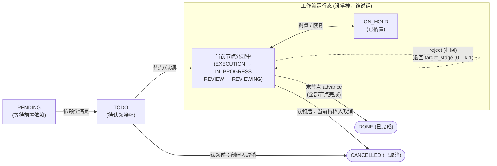

# Agent 任务系统 v3（多级审核工作流） - 产品文档

> **里程碑**：待定（进行中）  
> **文档定位**：面向使用与维护任务系统的产品、工程及 Agent 编排人员，定义基于“单棒接力工作流”的任务系统外部行为、业务规则、工具契约与交互示例。  
> **前置基线**：[Agent 任务系统 v2 产品文档](../2026-10-25-agent-task-system-v2/step1_product.md)

---

## 1. 背景与核心演进

在任务系统 v2 中，一个任务仅支持配置**一名执行人（`assignee_id`）**与**一名审核人（`reviewer_id`）**，在多级把关与复杂协作场景下存在明显局限：

1. **多级把关缺失**：常见流程往往是「开发完成 $\rightarrow$ 直属领导初审 $\rightarrow$ 更上级负责人终审」。v2 只能通过手动改人或拆分任务变通，流程割裂。
2. **打回粒度粗糙**：当高阶审核人发现前置把关遗漏时，除了打回给开发外，有时需要**打回给前序的某一审核节点**重新把关。
3. **权限与动作割裂**：若简单叠加多层审核，容易产生“执行人/初审人/终审人”多套重复的权限与操作逻辑。

### v2 与 v3 核心演进对比

| 维度 | v2 现状 | v3 目标规范（单棒接力模型） |
|---|---|---|
| **流程模型** | 固定「1 执行人 + 0/1 审核人」 | **有序节点链**：任意数量有序节点，节点分 `EXECUTION`（执行）与 `REVIEW`（审核）两类 |
| **控制权公理** | 区分执行人、验收人两套权限 | **谁拿棒，谁说话**：任意时刻仅 1 个当前节点（`current_stage`），仅当前持棒人可推动流转 |
| **推进动作** | 需区分 `REVIEWING` 与 `DONE` | **统一交棒前进（`advance`）**：当前节点完成即交棒给下一节点；末节点推进即 `DONE` |
| **打回机制** | 固定打回至 `IN_PROGRESS` | **任意前序节点打回（`reject`）**：可退回至 `0 .. current_stage - 1` 中的任意节点 |
| **流程调整** | 仅支持修改/撤销单个 `reviewer_id` | **按类型受控调整**：`EXECUTION` 节点可灵活增删；`REVIEW` 节点**不可删除**（防绕过），仅支持加签与换人 |
| **兼容性** | 单 `reviewer_id` | **完全兼容 v2**：`0` 个审核节点直接 `DONE`；`1` 个审核节点等价于原单审核任务 |

---

## 2. 核心概念：单棒接力模型

v3 将每个任务抽象为一条**有序节点链** `[节点 0, 节点 1, ..., 节点 N]`（至少包含 1 个节点）。

### 2.1 节点定义（Stage）

每个节点包含以下核心属性：

| 属性 | 说明 |
|---|---|
| `stage_index` | 节点序号（`0, 1, ..., N`），按顺序接力推进 |
| `node_type` | **节点类型**：<br>- **`EXECUTION`（执行节点）**：承担实际产出/执行任务（默认节点 `0` 为 `EXECUTION`）。<br>- **`REVIEW`（审核节点）**：承担把关/验收职责。 |
| `owner_id` | 该节点的负责人 Agent ID（即“持棒人”） |
| `name` | 可选节点名称（如 `后端开发`、`组长初审`、`总监终审`），提升可读性 |
| `stage_status` | 节点局部状态：`WAITING`（未轮到）/ `ACTIVE`（当前持棒中）/ `APPROVED`（本轮已交棒通过） |

### 2.2 宏观状态与节点映射

为保持看板与 Agent 对任务主状态的直观认知，**顶层 `TaskStatus` 枚举保持不变**，状态直接由工作流阶段映射得出：

| 顶层状态 (`TaskStatus`) | 含义与触发条件 |
|---|---|
| `PENDING` | 前置依赖任务（`depends_on`）尚未全部 `DONE`，接力棒尚未发出（依赖满足后系统自动转为 `TODO`） |
| `TODO` | 任务就绪，等待节点 `0` 负责人认领接棒（**认领前创建人可取消或自由编排**） |
| `IN_PROGRESS` | 接力棒当前停留在 **`EXECUTION` 类型节点**且已开工 |
| `REVIEWING` | 接力棒当前停留在 **`REVIEW` 类型节点** |
| `ON_HOLD` | 当前持棒人因外部阻塞暂停接力（恢复后回到原节点原状态） |
| `DONE` | 最后一个节点交棒完成，工作流结束（终态） |
| `CANCELLED` | 任务被取消，工作流终止（终态） |

#### 状态判定规则（顶层 `status` 与节点 `stage_status`）

1. **每次操作后，任务 `status` 如何更新**：
   - **创建 / 依赖满足**：有未完成依赖 $\rightarrow$ `PENDING`；否则 $\rightarrow$ `TODO`。
   - **节点 `0` 认领开工**：$\rightarrow$ `IN_PROGRESS`。
   - **搁置**：$\rightarrow$ `ON_HOLD`。
   - **取消**：$\rightarrow$ `CANCELLED`。
   - **前进（`advance`）/ 打回（`reject`）/ 从搁置恢复**：
     - 若从最后一个节点完成 `advance` $\rightarrow$ `DONE`；
     - 否则看**接力棒最终落脚的那个节点类型**：落到 `EXECUTION` 节点 $\rightarrow$ `IN_PROGRESS`；落到 `REVIEW` 节点 $\rightarrow$ `REVIEWING`。
2. **节点局部 `stage_status` 如何联动**：
   - 处于当前游标之前的节点（`< current_stage`）：`APPROVED`
   - 当前持棒节点（`== current_stage`）：`ACTIVE`（当任务流转至 `DONE` 时，所有节点均变为 `APPROVED`）
   - 尚未轮到的后续节点（`> current_stage`）：`WAITING`（发生打回至节点 $t$ 时，区间 `[t+1 .. 原节点]` 重置为 `WAITING`，确保必须重新逐级推进）

---

## 3. 状态机与权限规则

### 3.1 流转图



### 3.2 流转与节点保护规则

1. **认领接棒（`TODO → IN_PROGRESS`）**：
   - 仅节点 `0` 的负责人可认领开工。认领后工作流正式启动，控制权移交至当前持棒人。
2. **交棒前进（`advance`）**：
   - 仅**当前持棒人**可执行。
   - 若 `current_stage < N`：游标推进至 `current_stage + 1`，任务根据下一节点的 `node_type` 自动呈现为 `IN_PROGRESS` 或 `REVIEWING`。
   - 若 `current_stage == N`（最后一个节点）：任务进入终态 `DONE`。
3. **打回到任意前序节点（`reject`）**：
   - 仅**当前持棒人**可执行，且需满足 `current_stage >= 1`（节点 `0` 无前序节点，不可打回），打回时**必须填写 `note`**。
   - 可指定目标节点 `target_stage`（$0 \le t < \text{current\_stage}$，未指定时默认退回节点 `0`）。
   - **防跳过重审**：退回至节点 $t$ 后，必须从节点 $t$ 开始**按顺序逐级重新推进**，不允许跳过中间节点。
4. **搁置与取消**：
   - **搁置（`ON_HOLD`）**：当前持棒人遇到外部阻塞时可暂停；恢复时仍由该节点继续。
   - **取消（`CANCELLED`）**：
     - **任务被认领之前**（`PENDING` / `TODO`）：仅**创建人**有权取消。
     - **任务被认领之后**（`IN_PROGRESS` / `REVIEWING` / `ON_HOLD`）：创建人不可再直接取消，仅**当前持棒人**有权取消。
5. **节点动态调整规则（基于 `node_type` 防作弊）**：
   - **认领之前（`PENDING` / `TODO`）**：创建人可自由增、删、改未开始的节点。
   - **认领之后**：
     - **`EXECUTION` 节点**：当前持棒人可在当前节点之后**新增、修改或删除**尚未开始的 `EXECUTION` 节点（例如拆解或合并后续执行步骤）。
     - **`REVIEW` 节点（核心红线）**：**任何人均不可删除已设定的 `REVIEW` 节点**（防止绕过审批把关）。仅允许：
       1. **后置加签**：在当前节点之后追加新的 `REVIEW` 节点（如完成后交由更上级审核）；
       2. **交接换人**：当前持棒人或创建人可更换当前/后续未完成节点的 `owner_id`。

### 3.3 极简角色权限矩阵

剥离“执行人/初审人/终审人”的多重角色区分后，权限收敛为 **3 类角色**：

| 操作 | 当前持棒人 (`current_stage` 负责人) | 创建人 (`creator`) | 其他成员（含其他节点负责人） |
|---|:---:|:---:|:---:|
| 认领接棒（`TODO → IN_PROGRESS`） | **允许**（仅节点 `0`） | 拒绝 | 拒绝 |
| 交棒前进（`advance`） | **允许** | 拒绝 | 拒绝 |
| 退回前序节点（`reject` 至 $0 \dots k-1$） | **允许**（`current_stage >= 1`） | 拒绝 | 拒绝 |
| 搁置 / 恢复（`ON_HOLD`） | **允许** | 拒绝 | 拒绝 |
| 取消任务（`CANCELLED`） | **允许**（仅认领后） | **允许**（仅认领前） | 拒绝 |
| 增/删后续 `EXECUTION` 节点 | **允许** | **允许**（仅认领前） | 拒绝 |
| 追加 `REVIEW` 节点（加签）/ 换人 | **允许**（仅后续加签/交接） | **允许**（仅换人/认领前加签） | 拒绝 |
| 删除 `REVIEW` 节点 | **禁止** | **仅认领前允许** | **禁止** |
| 追加评论（`note`，含终态） | **允许** | **允许** | **允许** |

---

## 4. 核心功能特性

### 一、支持混合编排的线性工作流

- **典型研发审批流**：`[开发(EXECUTION), 组长初审(REVIEW), 总监终审(REVIEW)]`。
- **多段接力流**：支持配置多个执行节点接力（如 `[后端开发(EXECUTION), 前端联调(EXECUTION), 测试验收(REVIEW), PM终审(REVIEW)]`），且未开始的执行节点可按需动态增删。
- **向下兼容**：创建任务时若只传 `assignee_id` 和单个 `reviewer_id`，系统自动生成 `[执行(EXECUTION), 审核(REVIEW)]` 两节点工作流；若不传 `reviewer_id`，则仅生成 `[执行(EXECUTION)]` 单节点，行为与 v2 完全一致。

### 二、精准的任意前序节点打回

- 当节点 $k$ 发现问题时，可指定退回给 $0 \dots k-1$ 中的任意节点：
  - 退回给执行节点（如开发修复缺陷）；
  - 退回给前序审核节点（如终审要求初审重新核查某项指标）。
- 退回后，被退回节点及其之后的所有节点局部状态重置，必须重新按顺序 `advance` 通过每一级把关。

### 三、无噪音的待办与待审查询

- `list_tasks` 按**当前持棒人**精准收敛：
  - 只有当接力棒正好停留在自己负责的节点时，任务才会出现在自己的“当前待办/待审核”列表中。
  - 提供可选参数 `include_upcoming=True`，允许后续节点的负责人提前查看“即将流转到自己”的在途任务。

### 四、节点感知的工单时间线

- 沿用 v2 的不可变事件流（Timeline），每条流转事件记录 `actor`、节点变更（`from_stage → to_stage`）、动作类型（`advance` / `reject` / `add_stage` / `remove_stage` / `reassign` / `comment`）与 `note`。
- 任务详情同时返回完整节点列表与各自局部状态，方便 Web 前端与 TUI 渲染工作流进度条。

---

## 5. 工具使用规范（Agent Tooling）

### 5.1 `create_task`

| 参数 | 类型 | 必填 | 说明 |
|---|---|:---:|---|
| `title` | string | 是 | 任务标题 |
| `assignee_id` | int | 是 | 节点 `0`（`EXECUTION`）负责人 ID |
| `description` | string | 否 | 任务描述 |
| `reviewer_id` | int | 否 | v2 兼容参数：单级 `REVIEW` 节点负责人 ID |
| `stages` | list | 否 | **新增**：后续有序节点列表，每项为 `{owner_id, node_type="REVIEW"\|"EXECUTION", name?}`（也可简写为 `owner_id` 整数，默认为 `REVIEW`）。不可与 `reviewer_id` 同时传入 |
| `priority` / `parent_id` / `depends_on` / `room_id` | - | 否 | 与 v2 一致 |

### 5.2 `update_task`

| 场景 | 调用方式 | 系统行为 |
|---|---|---|
| **认领开工 / 搁置 / 恢复 / 取消** | `new_status="IN_PROGRESS" \| "ON_HOLD" \| "CANCELLED"` | 按 3.3 权限矩阵校验并执行 |
| **交棒前进** | `workflow_action="advance"`, `note="..."` | 推进至 `current_stage + 1`；若已为末节点则自动进入 `DONE`。<br>*（兼容：在只有 1 个节点或末节点时传 `new_status="DONE"`、或在节点 0 传 `new_status="REVIEWING"` 等价于 `advance`）* |
| **退回前序节点** | `workflow_action="reject"`, `target_stage=t`, `note="..."` | `note` 必填，$0 \le t < \text{current\_stage}$（默认 `0`）。退回至节点 $t$ 并更新状态。<br>*（兼容：在 `REVIEWING` 时传 `new_status="IN_PROGRESS"` 等价于 `reject` 且 `target_stage=0`）* |
| **动态调整后续节点** | `append_stages=[...]` / `remove_stage_index=i` / `reassign_stage={stage_index, owner_id}` | `remove_stage_index` 仅允许删除未开始的 `EXECUTION` 节点（认领后禁止删除 `REVIEW` 节点） |
| **追加评论** | 仅传 `note="..."` | 全员随时可用（含终态），不改变状态与游标 |

> 现状（2026-11-16）：本节漏了**第五类用法** —— **验收人变更/撤销**（v2 参数 `reviewer_id=` / `clear_fields=["reviewer_id"]`，实现 `taskService._handle_reviewer_change`）。当前实现把 `update_task` 的意图分为**四类互斥**：状态流转 / `workflow_action` / 节点调整 / 验收人变更，同时给多类直接报 `ambiguous_task_update`（`src/service/funcToolService/tools.py:2122-2132`、`taskService.py:1455`）。单审核/无审核任务走 `reviewer_id` 会同步节点链；多级任务会被拒绝并引导用 `reassign_stage`（review_notes S-1 的口径，已落地）。

### 5.3 `get_task_detail` & `list_tasks`

- **`get_task_detail(task_id)`**：除基础字段与最近事件外，返回 `current_stage`、`current_owner_id` 及完整 `stages` 列表（含 `stage_index`、`node_type`、`name`、`owner_id`、`owner_name`、`stage_status`）。
- **`list_tasks`**：
  - 保留 `assignee` / `reviewer` 参数（语义上分别对应“我作为 `EXECUTION` 节点负责人的任务”与“我作为 `REVIEW` 节点负责人的任务”，或直接按当前持棒人过滤）。
  - 默认仅返回**当前正轮到自己处理**（`current_owner_id == 我`）的未完结任务；传 `include_upcoming=True` 可查看后续节点包含自己的在途任务。
  - 现状（2026-11-16）：`include_upcoming=True` **必须配合 `mine=True`**，单独使用报 `invalid_filter_combo`（`tools.py:2246,2261,2292`）。

---

## 6. 典型协作场景示例

### 场景一：多级顺序审核通过（开发 $\rightarrow$ 组长初审 $\rightarrow$ 总监终审）

```text
1. PM 创建任务：
   create_task(
     title="支付回调验签改造",
     assignee_id=阿张,
     stages=[
       {"name": "组长初审", "owner_id": 组长小李, "node_type": "REVIEW"},
       {"name": "总监终审", "owner_id": 技术总监老王, "node_type": "REVIEW"}
     ]
   )
   --> 节点链：[0: 阿张(EXECUTION), 1: 小李(REVIEW), 2: 老王(REVIEW)]
   --> status=TODO, current_stage=0

2. 阿张认领开工，完成后交棒前进：
   update_task(task_id=10, new_status="IN_PROGRESS")
   update_task(task_id=10, workflow_action="advance", note="完成验签改造，单测全绿")
   --> current_stage=1 (持棒人: 小李), status=REVIEWING

3. 小李初审通过并交棒：
   update_task(task_id=10, workflow_action="advance", note="代码规范与覆盖率符合要求")
   --> current_stage=2 (持棒人: 老王), status=REVIEWING

4. 老王终审通过并交棒（已是末节点）：
   update_task(task_id=10, workflow_action="advance", note="安全基线通过，准予合入")
   --> status=DONE
```

### 场景二：高阶审核人打回到指定前序审核节点（$2 \rightarrow 1$）

```text
接上例，当前持棒人为节点 2（老王）：

1. 老王发现初审遗漏了风控口径核对，打回给节点 1（小李）：
   update_task(
     task_id=10,
     workflow_action="reject",
     target_stage=1,
     note="请先核对风控最新限额文档，确认初审口径后再报终审"
   )
   --> current_stage=1 (持棒人: 小李), status=REVIEWING

2. 小李核对完毕后再次交棒前进：
   update_task(task_id=10, workflow_action="advance", note="已对齐风控，限额校验无误")
   --> current_stage=2 (持棒人: 老王), status=REVIEWING
```

### 场景三：多执行节点接力与灵活增删（`EXECUTION` 可删，`REVIEW` 不可删）

```text
1. PM 创建任务：
   节点链：[0: 后端阿张(EXECUTION), 1: 前端小陈(EXECUTION), 2: 组长小李(REVIEW)]
2. 阿张开发完后发现前端接口可直接复用旧字段，无需小陈再改，经沟通后删除未开始的执行节点 1：
   update_task(task_id=12, remove_stage_index=1, note="复用现有接口字段，无需前端改动")
   --> 删除成功，节点链变为：[0: 阿张(EXECUTION), 1: 小李(REVIEW)]
3. 若阿张尝试删除节点 2（REVIEW 类型）：
   --> 系统直接拒绝：不允许删除审核节点！
```

### 场景四：认领前取消 vs 认领后取消

```text
1. PM 创建任务 15，status=TODO（尚未被阿张认领）。
2. PM 发现需求取消，调用 update_task(task_id=15, new_status="CANCELLED") -> 成功取消。
3. 若阿张已认领任务进入 IN_PROGRESS，PM 再调用取消 -> 系统拒绝（认领后仅当前持棒人有权取消）。
```

---

## 7. 产品边界与验收标准

### 7.1 本次交付范围（In Scope）

- **单棒接力线性工作流**：支持 `EXECUTION` 与 `REVIEW` 两类节点的混合有序编排与按序推进。
- **任意前序节点打回**：支持退回至 `0 .. current_stage - 1` 任意节点，返工后严禁跳过中间节点。
- **差异化节点保护**：认领后允许持棒人增删未开始的 `EXECUTION` 节点，严格禁止删除任何 `REVIEW` 节点（仅允许追加加签与换人）。
- **认领前后取消权限收敛**：认领前仅创建人可取消，认领后仅当前持棒人可取消。
- **待办精确隔离与 v2 平滑兼容**：默认仅展示当前持棒人为自己的任务；兼容 v2 单审核人及无审核人用法。

### 7.2 本次非目标（Out of Scope）

- **并行会签 / 或签**：暂不支持同一节点多人并行审批。
- **条件分支路由**：暂不支持基于规则引擎的自动分支跳转。
- **强通知/自动唤醒机制**：仍沿用现有调度与轮询机制发现任务。

### 7.3 验收标准清单

> 现状（2026-11-16）：下列 5 条**均已落地**（清单保持原样未勾选，它是当时的验收约定）—— ①状态映射：`constants.py:304-319` + `taskService._resolve_status_for_stage`；②打回/防跳过：`invalid_reject_target`(`taskService.py:412`)、`reject_note_required`(`:1176`)；③`REVIEW` 不可删：`cannot_remove_review_stage`(`:1343`)；④权限：`not_current_stage_owner`(`:1143`)、`creator_cannot_cancel_after_claim`(`:1730`)；⑤待办无噪音：`gtAgentTaskManager.get_first_active_task` 已按 `current_owner_id` 收紧（review_notes S-5）。逐条依据见 `shared/docs-align/report.md` §3（V1-V6）。

- [ ] **单棒推进与状态映射**：处于 `EXECUTION` 节点时状态为 `IN_PROGRESS`（未认领为 `TODO`/`PENDING`），处于 `REVIEW` 节点时为 `REVIEWING`；末节点 `advance` 进入 `DONE`。
- [ ] **任意节点打回与防跳过**：节点 $k$ 可成功打回至 $0 \dots k-1$ 任意节点，打回至 $\ge k$ 或在节点 `0` 打回必须被拒绝；返工后必须逐级 `advance`，不可跳过中间节点。
- [ ] **节点类型保护**：认领后删除未开始的 `EXECUTION` 节点成功；删除任何 `REVIEW` 节点必须被拒绝。
- [ ] **极简权限隔离**：非当前持棒人调用 `advance` / `reject` / `ON_HOLD` 必须被拒绝；创建人仅在 `PENDING` / `TODO` 状态可取消，认领后取消必须被拒绝。
- [ ] **待办查询无噪音**：接力棒未到达某节点时，该节点负责人默认 `list_tasks` 不得返回该任务。
