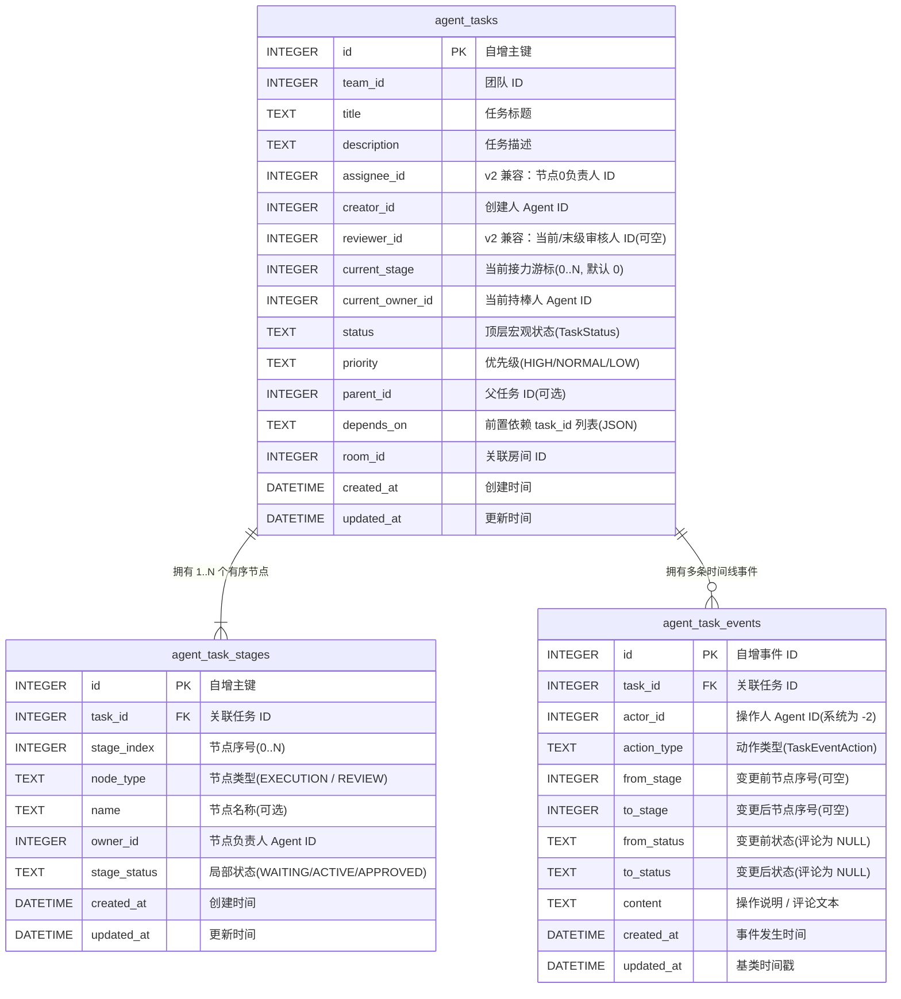
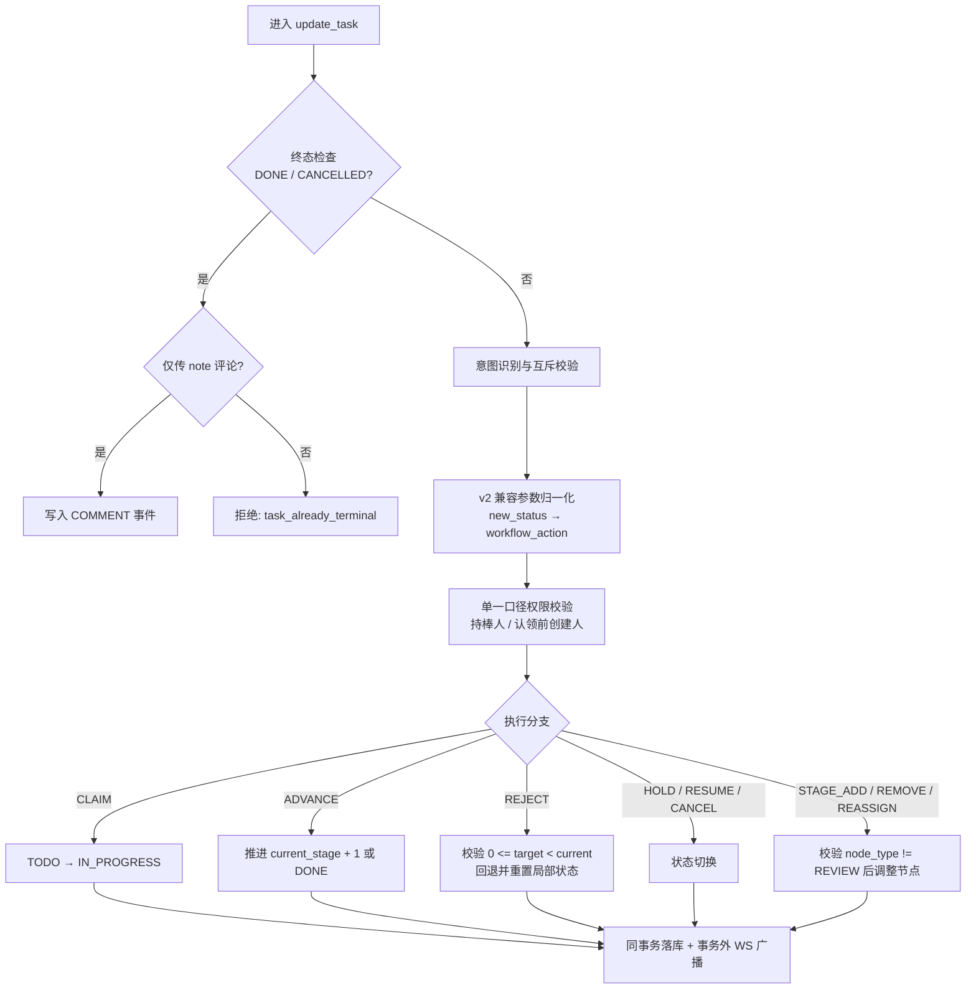

# Agent 任务系统 v3（多级审核工作流） - 技术设计

> **里程碑**：待定（进行中）  
> **关联文档**：[产品文档 (step1_product.md)](./step1_product.md)  
> **实施范围约束**：当前阶段为纯技术设计阶段；在评审确认前，`src/` 与 `assets/migrate/` 保持零变更。

> **现状（2026-11-16 核对）**：v3 **已实现并合入主干**，本文 §1–§6 与实现逐条一致（枚举 `constants.py:304-340`、模型与索引 `gtAgentTask.py:33-38`/`gtAgentTaskStage.py:26-30`、九条错误码、DAL 方法、按任务锁、`MAX_TASK_STAGES=20`、WS 事件），逐条依据见 `shared/docs-align/report.md` §4（T1-T10）。两处补正：①§2.4「配套 Python 回填迁移」不存在（回填写在 `0022` 的 SQL 内）；②`list_tasks.include_upcoming` 需与 `mine=True` 搭配。上文「`src/` 保持零变更」是**当时的阶段约束**，现已过期。

---

## 1. 架构目标与设计原则

### 1.1 核心目标
在 v2「状态机 + 不可变事件时间线」基础上，将任务系统升级为**「单棒接力线性工作流引擎」**：
- 支持由 `EXECUTION`（执行）与 `REVIEW`（审核）两类有序节点组成的工作流；
- 保持顶层 `TaskStatus` 枚举稳定，以 `current_stage` + `current_owner_id` 驱动单棒流转与精确待办查询；
- 保证 v2 存量数据与既有接口/工具调用习惯的完全平滑兼容。

### 1.2 架构约束与原则

1. **四层架构边界**：严格遵循 `controller -> service -> dal -> model -> util`，所有工作流校验、权限判定与状态计算全部收口在 `taskService`（单一口径）。
2. **关系表承载节点 + 主表冗余游标**：节点链采用独立表 `agent_task_stages` 存储以支持 SQL 索引查询与结构化调整；主表 `agent_tasks` 冗余 `current_stage` 与 `current_owner_id`，确保列表检索无须多表复杂计算即可走索引。
3. **不可变事件流（Append-Only）**：`agent_task_events` 仅追加不修改，新增 `action_type`、`from_stage`、`to_stage` 字段以消除同态流转（如 `REVIEWING → REVIEWING`）的语义歧义。
4. **事务原子性与事件总线后置**：状态变更、节点局部状态更新、事件写入必须在同一数据库事务内完成；WebSocket 广播（`TASK_EVENT_APPENDED`、`TASK_CHANGED`）必须在事务提交后发布。

---

## 2. 数据模型与数据库设计

### 2.1 ER 关系图



### 2.2 新增枚举定义（`src/constants.py`）

顶层 `TaskStatus` 保持不变，新增以下 3 个枚举（继承 `EnhanceEnum`）：

```python
class StageNodeType(EnhanceEnum):
    """工作流节点类型。"""
    EXECUTION = "EXECUTION"  # 执行节点（映射状态 IN_PROGRESS）
    REVIEW    = "REVIEW"     # 审核节点（映射状态 REVIEWING，认领后不可删）


class StageStatus(EnhanceEnum):
    """工作流节点局部状态。"""
    WAITING  = "WAITING"   # 尚未轮到（stage_index > current_stage）
    ACTIVE   = "ACTIVE"    # 当前持棒中（stage_index == current_stage）
    APPROVED = "APPROVED"  # 本轮已交棒通过（stage_index < current_stage，或全部 DONE）


class TaskEventAction(EnhanceEnum):
    """任务事件动作类型。"""
    CREATED        = "CREATED"
    CLAIM          = "CLAIM"
    ADVANCE        = "ADVANCE"
    REJECT         = "REJECT"
    HOLD           = "HOLD"
    RESUME         = "RESUME"
    CANCEL         = "CANCEL"
    AUTO_TODO      = "AUTO_TODO"
    STAGE_ADD      = "STAGE_ADD"
    STAGE_REMOVE   = "STAGE_REMOVE"
    STAGE_REASSIGN = "STAGE_REASSIGN"
    COMMENT        = "COMMENT"
```

### 2.3 数据库模型与索引（`src/model/dbModel/`）

1. **`GtAgentTask`（`gtAgentTask.py`）**：
   - 新增 `current_stage: int = peewee.IntegerField(default=0)`
   - 新增 `current_owner_id: int | None = peewee.IntegerField(null=True)`（迁移回填后逻辑非空）
   - 新增索引：`(("team_id", "current_owner_id", "status"), False)`，直接服务于 `list_tasks` 的“当前持棒人待办/待审”高频查询。
   - **兼容字段同步策略**：
     - `assignee_id` 始终同步为 `stages[0].owner_id`；
     - `reviewer_id` 同步为：若当前处于 `REVIEW` 节点则等于 `current_owner_id`，否则等于第一个（或最后一个）`REVIEW` 节点的 `owner_id`（无审核节点时为 `None`）。这样既不破坏存量展示与只读查询，又无需改写所有历史引用点。

2. **`GtAgentTaskStage`（新增 `gtAgentTaskStage.py`）**：
   - 表名：`agent_task_stages`
   - 唯一索引：`(("task_id", "stage_index"), True)`
   - 普通索引：`(("owner_id", "stage_status"), False)`，用于支持 `include_upcoming=True` 时快速反查“后续节点包含我的任务”。

3. **`GtAgentTaskEvent`（`gtAgentTaskEvent.py`）**：
   - 新增 `action_type: TaskEventAction | None = EnumField(TaskEventAction, null=True)`（历史事件为 `None`）
   - 新增 `from_stage: int | None = peewee.IntegerField(null=True)`
   - 新增 `to_stage: int | None = peewee.IntegerField(null=True)`

### 2.4 数据库迁移与存量回填（`assets/migrate/`）

新增迁移脚本 `0022_add_agent_task_stages.sql`（及配套 Python 回填迁移，参考 `0015`/`0016` 模式）：

> 现状（2026-11-16）：实际只有 `assets/migrate/0022_add_agent_task_stages.sql` **一个文件**，存量回填写在该 SQL 内（`0022:50-116`），**没有配套 Python 回填脚本**；整份脚本已用 `BEGIN;`…`COMMIT;` 包裹（review_notes M-1 已落地，见 `src/db.py:243-252` 兜底）。

1. **DDL 变更**：
   - 创建 `agent_task_stages` 表及索引；
   - `agent_tasks` 添加 `current_stage`（`DEFAULT 0`）与 `current_owner_id`；
   - `agent_task_events` 添加 `action_type`、`from_stage`、`to_stage`。
2. **存量数据幂等回填规则**：
   - 对每条 `agent_tasks` 记录（若 `agent_task_stages` 尚无对应记录）：
     - 插入节点 `0`：`node_type = 'EXECUTION'`，`owner_id = task.assignee_id`。
     - 若 `task.reviewer_id IS NOT NULL`，插入节点 `1`：`node_type = 'REVIEW'`，`owner_id = task.reviewer_id`。
     - 根据 `task.status` 计算并回填游标与局部状态：
       - `DONE`：`current_stage = max_stage`，`current_owner_id = stages[max_stage].owner_id`，所有节点 `stage_status = 'APPROVED'`。
       - `REVIEWING`（且存在节点 `1`）：`current_stage = 1`，`current_owner_id = reviewer_id`，节点 `0` 为 `'APPROVED'`，节点 `1` 为 `'ACTIVE'`。
       - 其余状态（`PENDING`/`TODO`/`IN_PROGRESS`/`ON_HOLD`/`CANCELLED`）：`current_stage = 0`，`current_owner_id = assignee_id`，节点 `0` 为 `'ACTIVE'`，节点 `1`（如有）为 `'WAITING'`。

---

## 3. DAL 层设计（`src/dal/db/`）

新增 `gtAgentTaskStageManager.py`，负责 `agent_task_stages` 的标准数据访问（严禁包含业务权限逻辑）：

- `create_stages(task_id: int, stages: list[dict]) -> list[GtAgentTaskStage]`：批量创建初始节点链。
- `get_stages_by_task(task_id: int) -> list[GtAgentTaskStage]`：按 `stage_index` 升序返回全部节点。
- `get_stages_by_task_ids(task_ids: list[int]) -> dict[int, list[GtAgentTaskStage]]`：批量查询，避免 `get_task` / `list_tasks` 出现 N+1 查询。
- `update_stage_statuses(task_id: int, updates: dict[int, StageStatus]) -> None`：按 `(task_id, stage_index)` 批量更新局部状态。
- `insert_stages_after(task_id: int, after_index: int, new_stages: list[dict]) -> list[GtAgentTaskStage]`：在指定位置后插入新节点，并顺移后续节点的 `stage_index`（先从大到小更新避免唯一索引冲突）。
- `delete_stage_and_reindex(task_id: int, stage_index: int) -> None`：删除指定节点，并将 `> stage_index` 的节点序号减 1。
- `update_stage_owner(task_id: int, stage_index: int, new_owner_id: int) -> None`：更换节点负责人。
- `get_task_ids_by_upcoming_owner(owner_id: int) -> list[int]`：查询 `stage_status == 'WAITING'` 且 `owner_id == owner_id` 的 `task_id` 列表。

`gtAgentTaskManager.py` 扩展：
- `list_tasks` 支持按 `current_owner_id` 过滤，并支持与 `upcoming_task_ids`（来自 `gtAgentTaskStageManager`）做 `OR` 合并查询。

---

## 4. 核心工作流引擎设计（`src/service/taskService.py`）

### 4.1 宏观状态映射函数

引入纯函数 `_resolve_status_for_stage(node_type: StageNodeType) -> TaskStatus`：
- `StageNodeType.EXECUTION` $\rightarrow$ `TaskStatus.IN_PROGRESS`
- `StageNodeType.REVIEW` $\rightarrow$ `TaskStatus.REVIEWING`

### 4.2 `update_task` 统一调度管线



#### 关键校验规则与错误码

| 场景 | 校验条件 | 错误码 (`error_code`) |
|---|---|---|
| 非法动作组合 | 同时传入多个互斥动作（如 `new_status` 与 `workflow_action`、或同时传 `append_stages` 与 `remove_stage_index`） | `ambiguous_task_update` |
| 认领前操作限制 | `TODO`/`PENDING` 时非 `creator_id` 尝试取消或改流程 | `permission_denied` |
| 认领后越权 | 任务已认领后，非 `current_owner_id` 尝试 `advance` / `reject` / `ON_HOLD` / `CANCELLED` | `not_current_stage_owner` |
| 创建人认领后取消 | `creator_id`（非当前持棒人）在 `IN_PROGRESS` 及之后尝试 `CANCELLED` | `creator_cannot_cancel_after_claim` |
| 非末节点强行置 DONE | 兼容传 `new_status="DONE"` 但 `current_stage < N` | `non_final_stage_cannot_done` |
| 非法打回目标 | `current_stage == 0` 时调用 `reject`；或 `target_stage < 0` / `target_stage >= current_stage` | `invalid_reject_target` |
| 打回缺少说明 | `reject` 时 `note` 为空 | `reject_note_required` |
| 删除审核节点 | 认领后尝试删除 `node_type == REVIEW` 的节点 | `cannot_remove_review_stage` |
| 删除已过/当前节点 | 尝试删除 `stage_index <= current_stage` 的节点 | `cannot_remove_active_or_past_stage` |

### 4.3 `advance` 与 `reject` 的节点状态同步逻辑

1. **执行 `advance`（从 `k` 推进）**：
   - 将节点 `k` 的 `stage_status` 置为 `APPROVED`。
   - 若 `k < N`：
     - 节点 `k + 1` 的 `stage_status` 置为 `ACTIVE`；
     - `task.current_stage = k + 1`；
     - `task.current_owner_id = stages[k + 1].owner_id`；
     - `task.status = _resolve_status_for_stage(stages[k + 1].node_type)`。
   - 若 `k == N`（末节点）：
     - `task.status = TaskStatus.DONE`；
     - 触发 `auto_progress_dependents(team_id, task.id)` 自动推进下游依赖任务。

2. **执行 `reject`（从 `k` 退回至 `t`，`0 <= t < k`）**：
   - 将节点 `t` 的 `stage_status` 置为 `ACTIVE`；
   - 将区间 `[t + 1 .. k]` 内所有节点的 `stage_status` 重置为 `WAITING`（确保后续必须重新按顺序 `advance`，严禁跳过）；
   - `task.current_stage = t`；
   - `task.current_owner_id = stages[t].owner_id`；
   - `task.status = _resolve_status_for_stage(stages[t].node_type)`。

3. **执行 `remove_stage_index`（删除索引 `i`）**：
   - 仅当：
     - 任务未认领（`PENDING`/`TODO`）且 `caller == creator_id` 且 `i > 0`（节点 `0` 为任务主执行人不可整节点删除，可通过换人替换）；或
     - 任务已认领且 `caller == current_owner_id` 且 `i > current_stage` 且 `stages[i].node_type == EXECUTION`。
   - 删除后重排 `> i` 的节点 `stage_index -= 1`。

---

## 5. 工具层与 HTTP 接口设计

### 5.1 Agent 工具层（`src/service/funcToolService/tools.py` & `toolArgsValidation.py`）

1. **`create_task`**：
   - 新增可选参数 `stages: Optional[list[dict | int]] = None`。
   - 校验：`reviewer_id` 与 `stages` 不可同时非空；未传 `stages` 时按 `reviewer_id` 构造 `[0: EXECUTION(assignee_id)]` 或 `[0: EXECUTION(assignee_id), 1: REVIEW(reviewer_id)]`。
   - 校验所有 `owner_id` 均属于当前 `team_id` 的有效 Agent。

2. **`update_task`**：
   - 新增可选参数：
     - `workflow_action: Optional[Literal["advance", "reject"]] = None`
     - `target_stage: Optional[int] = None`
     - `append_stages: Optional[list[dict | int]] = None`
     - `remove_stage_index: Optional[int] = None`
     - `reassign_stage: Optional[dict] = None`（`{stage_index, owner_id}`）
   - 保留旧参数 `new_status`、`reviewer_id`、`clear_fields` 做平滑兼容映射。

3. **`get_task_detail` & `list_tasks`**：
   - `get_task_detail` 返回体新增 `current_stage`、`current_owner_id`、`stages` 数组。
   - `list_tasks` 新增 `include_upcoming: bool = False`：
     - `False`（默认）：过滤 `current_owner_id == target_agent_id`；
     - `True`：过滤 `current_owner_id == target_agent_id OR id IN upcoming_task_ids`。
     - 现状（2026-11-16）：`include_upcoming=True` **必须配合 `mine=True`**，单独使用报 `invalid_filter_combo`（`src/service/funcToolService/tools.py:2246,2261,2292`）。

### 5.2 HTTP / WebSocket 接口（`controller/`）

- `GET /tasks/<task_id>.json`、`GET /agents/<agent_id>/tasks.json`、`GET /teams/<team_id>/tasks.json`：直接复用 `taskService.get_task` 与 `taskService.list_tasks` 返回的数据对象，自动携带 `current_stage`、`current_owner_id` 与 `stages`，遵守“不在 Controller 手动拼装额外字段”的约定。
- WebSocket 事件 `TASK_EVENT_APPENDED` 与 `TASK_CHANGED` 自动携带扩展后的事件字段（`action_type`、`from_stage`、`to_stage`）与任务状态字段，前端据此实时刷新工作流进度条。

---

## 6. 并发与边界处理

1. **单任务互斥加锁与事务串行化**：
   - 在 `taskService` 内部按 `task_id` 维护进程内异步互斥锁（`asyncio.Lock`），所有对同一任务的写操作（`update_task`、依赖自动推进 `auto_progress_dependents`）必须先获取该 `task_id` 对应的锁再进入处理；不同 `task_id` 之间互不阻塞。
   - 持锁进入后，在单个数据库事务内重新读取最新的 `task` 与 `stages` 快照，完成权限/状态校验、主表与节点表更新、事件追加并原子提交；WebSocket 广播在释放事务后执行。通过“按任务加锁 + 数据库事务”双重保障，确保同一时刻对单个 `task` 的操作严格唯一、串行且不发生双倍推进或状态覆盖。
2. **节点数上限保护**：单任务最大节点数建议限制在合理上限（如 `MAX_TASK_STAGES = 20`），防止 Agent 异常循环加签导致工作流无限膨胀。
3. **事件时间线可读性**：`taskService` 序列化事件时保留结构化 `action_type`、`from_stage`、`to_stage`，供前端与 TUI 渲染清晰的流转路径标签（如 `[节点 2 → 节点 1] 打回`）。

---

## 7. 测试策略

1. **单元测试（`tests/unit/`）**：
   - `taskService` 状态机全路径覆盖：`TODO → IN_PROGRESS → REVIEWING(1) → REVIEWING(2) → DONE`；
   - `reject` 边界测试：打回到 `0`（变 `IN_PROGRESS`）、打回到 `1..k-1`（保持 `REVIEWING`）、打回至 `>= k` 报错、节点 `0` 打回报错、打回后尝试跳过中间节点验证；
   - 权限矩阵测试：认领前/后创建人取消权限差异、非持棒人越权拒绝、删除 `EXECUTION` 节点成功 vs 删除 `REVIEW` 节点被拒；
   - v2 兼容参数映射测试（`new_status="REVIEWING"` / `"DONE"` / `"IN_PROGRESS"`、`reviewer_id`）。
2. **集成与迁移测试（`tests/integration/` & `tests/lifecycle/`）**：
   - `0022` 迁移脚本对存量 `TODO`/`IN_PROGRESS`/`REVIEWING`/`DONE` 任务的幂等回填验证；
   - `list_tasks` 默认精准过滤 vs `include_upcoming=True` 联合查询验证；
   - 依赖任务 `depends_on` 在多级工作流末节点 `advance` 至 `DONE` 后的自动推进验证。
