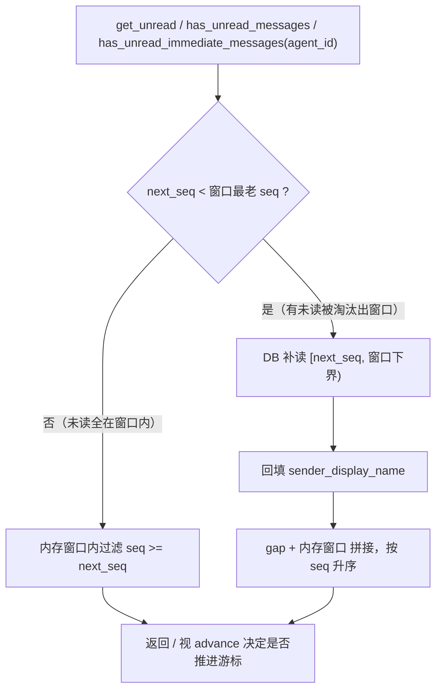

# 房间消息部分加载（固定窗口 + 越界补读）设计

## 1. 背景与问题

### 1.1 现状：启动恢复全量加载

`_restore_room_runtime_state`（`src/service/roomService/core.py:116`）在服务启动 / 房间重建时，无上限地把房间全部消息灌入内存：

```python
gt_room_messages, _ = await gtRoomMessageManager.get_room_messages(room.room_id)  # 无 limit，全量
```

随后对每条消息做一次 `get_agent_by_id` 回填 `sender_display_name`（`core.py:128-133`，N+1 查询），再 `room.inject_runtime_state(...)` 灌入 `RoomMessageStore._messages`。消息随聊天持续累积，内存占用与历史长度线性增长、无上界。

### 1.2 为什么现在必须全量：未读游标机制

`RoomMessageStore`（`src/service/roomService/messageStore.py`）在内存列表上按 seq 游标判未读：

- `get_unread(agent_id)`（`messageStore.py:74`）：过滤 `m.seq >= next_seq`，并推进游标；
- `has_unread_messages` / `has_unread_immediate_messages`（`:87` / `:99`）：只读不推进，判断是否有他人未读 / 他人立即注入消息。

这是内存全量列表存在的**唯一**理由——只要列表覆盖「所有可能被读到的 seq」，未读判定就正确。

### 1.3 已解耦、无需全量的部分

以下三点已与「消息历史全量」无关，是部分加载可行的前提：

1. **调度 / 轮次进度独立持久化**：`RoomScheduler.persist_state()` 单独持久化 `speaker_index` 与读游标；`ChatRoom.rebuild_state_from_history`（`chatRoom.py:281`）只 `set_current_speaker_index(persisted)`，不遍历消息。
2. **Agent 的 LLM 上下文历史独立且已部分加载**：对话历史在 `agent_history` 表，启动用 `get_agent_history_after_compact` 按 compact 裁剪恢复（`persistenceService.py`），与本问题无关，也证明「部分加载」在本项目有成熟先例。
3. **前端拉历史已分页**：`get_room_messages_from_db(before_id, limit)` 不走内存。

---

## 2. 方案概览

**内存只保留最近 `WINDOW_SIZE` 条消息（默认 100），取未读时若某 Agent 的读游标落在窗口之外，从数据库补读缺口。** 与「按最小读游标动态收缩窗口」相比，窗口大小固定、淘汰逻辑机械（追加后截断），无需维护动态下界。



- 未读判定正确性：任何 Agent 的 `next_seq` 若 `>=` 窗口下界，其未读必在窗口内；若 `<` 窗口下界，走 DB 补读补全缺口，不丢。
- 窗口淘汰正确性：`inject` 时 `_next_seq = max(seq) + 1`，窗口必然包含最新消息，`_next_seq` 恒为全局 `max(seq)+1`，不受窗口化影响。

---

## 3. 关键设计决策

| 编号 | 决策 | 说明 |
|---|---|---|
| D1 | 固定窗口（默认 100 条），而非按最小读游标动态收缩 | 淘汰是机械 `del`，无需维护动态下界，最好测 |
| D2 | 越界时只补读缺口 `[next_seq, 窗口下界)`，窗口内复用内存对象 | 内存对象已有 `sender_display_name`，避免重复查询与「同一消息两个对象」 |
| D3 | `escalate_to_immediate` 走 DB fallback（**必做**，非可选优化） | 否则窗口外的未读消息无法升级，是真实功能回退，详见 §5 |
| D4 | 三个取/判未读方法同步 → async | 越界补读要查 DB，是唯一隐性成本；调用方均在 async 上下文，波及小 |

---

## 4. 后端核心设计

### 4.1 DAL 层：`gtRoomMessageManager`（`src/dal/db/gtRoomMessageManager.py`）

**复用现有**：`get_room_messages(room_id, limit=N)` 已是「取最近 N 条」——`order_by(seq.desc(), id.desc()).limit(N+1)` 后 `reverse()` 成升序返回（`gtRoomMessageManager.py:55-66`），加载窗口直接传 `limit=WINDOW_SIZE`，无需改动。

**新增两个方法**：

```python
async def get_room_messages_by_seq_range(
    room_id: int, min_seq: int, max_seq: int,
) -> list[GtRoomMessage]:
    """取 min_seq <= seq < max_seq 的消息（升序），用于窗口越界补读缺口。"""
    return await (
        GtRoomMessage.select()
        .where(
            GtRoomMessage.room_id == room_id,
            GtRoomMessage.seq >= min_seq,
            GtRoomMessage.seq < max_seq,
        )
        .order_by(GtRoomMessage.seq.asc(), GtRoomMessage.id.asc())
        .aio_execute()
    )


async def get_room_message_by_id(message_id: int) -> GtRoomMessage | None:
    """按主键查单条消息，用于 escalate 的 DB fallback。"""
    rows = await (
        GtRoomMessage.select()
        .where(GtRoomMessage.id == message_id)
        .limit(1)
        .aio_execute()
    )
    return rows[0] if rows else None
```

### 4.2 存储层：`RoomMessageStore`（`src/service/roomService/messageStore.py`）

**1. 窗口淘汰**：`append_and_assign_seq`（`:48`）末尾追加：

```python
WINDOW_SIZE = 100

self._messages.append(msg)
if len(self._messages) > WINDOW_SIZE:
    del self._messages[:len(self._messages) - WINDOW_SIZE]
```

窗口下界即 `self._messages[0].seq`（窗口非空时）。

**2. 抽取统一的取未读内核**，三个方法共用一份越界判断，避免逻辑三处重复：

```python
async def _collect_unread(self, agent_id: int, *, advance: bool) -> list[GtRoomMessage]:
    next_seq = self._agent_seq_read.get(agent_id, 0)
    if self._messages and next_seq < self._messages[0].seq:
        # 游标落后超过窗口：DB 补读缺口 + 窗口内复用内存对象
        gap = await gtRoomMessageManager.get_room_messages_by_seq_range(
            self._gt_room.id, next_seq, self._messages[0].seq,
        )
        await self._backfill_display_names(gap)
        rows = gap + list(self._messages)
    else:
        rows = [m for m in self._messages if m.seq is not None and m.seq >= next_seq]
    if advance and rows:
        self._agent_seq_read[agent_id] = rows[-1].seq + 1
    return rows
```

三个对外方法改写为：

- `async def get_unread(agent_id)`：`return await self._collect_unread(agent_id, advance=True)`（语义不变：推进游标、不过滤自身消息）。
- `async def has_unread_messages(agent_id)`：`rows = await self._collect_unread(agent_id, advance=False)`，返回 `any(m.sender_id != agent_id for m in rows)`。
- `async def has_unread_immediate_messages(agent_id)`：同上，返回 `any(m.sender_id != agent_id and m.insert_immediately for m in rows)`。

**3. `_backfill_display_names`**：补读出的 DB 消息不含 `sender_display_name`，需按 `sender_id` 回填（复用 `core.py:128-133` 的 N+1 方式，或新增批量 `get_agents_by_ids` 一次性回填）。窗口内复用内存对象，天然带 `display_name`，无需回填。

**4. `escalate_to_immediate`（`:144`）改 async + DB fallback**：

```python
async def escalate_to_immediate(self, db_id: int) -> GtRoomMessage:
    msg = next((m for m in self._messages if m.id == db_id), None)
    if msg is None:
        msg = await gtRoomMessageManager.get_room_message_by_id(db_id)
        if msg is None or msg.room_id != self._gt_room.id:
            raise ValueError(f"message db_id={db_id} not found")
    # —— 以下校验不变：msg.sender_id / msg.seq 均来自查出的对象 ——
    # SYSTEM 判断、ai_receivers（来自内存 _agent_ids）、
    # 已读判断（内存 _agent_seq_read 对比 msg.seq）
    ...
    msg.insert_immediately = True
    return msg
```

要点：

- **`room_id` 校验必须加**：按 id 查单条不带 room 条件，防越权升级别的房间的消息。
- **fallback 查出的 msg 不塞回窗口**：escalate 只置 `insert_immediately` 位，不参与 seq / 顺序 / 未读判定，置位后落库 + 广播即丢弃临时对象。

### 4.3 房间门面：`ChatRoom`（`src/service/roomService/chatRoom.py`）

| 方法 | 改动 |
|---|---|
| `get_unread_messages`（`:166`） | 已 async，`self._store.get_unread(...)` 加 `await` |
| `has_unread_immediate_messages`（`:172`） | 同步 → async，内部加 `await` |
| `has_unread_messages`（`:175`） | 同步 → async，内部加 `await` |
| `escalate_message_to_immediate`（`:235`） | 已 async，`self._store.escalate_to_immediate(...)` 加 `await` |

Controller 层 `EscalateMessageToImmediateHandler`（`roomController.py:261`）await 的是 `room.escalate_message_to_immediate`（async），无感。

### 4.4 加载与房间管理：`roomService/core.py`

**1. `_restore_room_runtime_state`（`:116`）**：第 118 行改为

```python
gt_room_messages, _ = await gtRoomMessageManager.get_room_messages(room.room_id, limit=RoomMessageStore.WINDOW_SIZE)
```

display_name 回填范围随之从「全部消息」降到「窗口内 100 条」，N+1 顺带缓解。

**2. `update_room_agents`（`:313`）**：全量查询只为算新成员游标 `max(seq)+1`，改为 `get_room_messages(room_id, limit=1)` 取最后一条（`join_read_index = last.seq + 1`），顺带消掉一次全量查询。`_resolve_join_read_index`（`:260`）保留签名或改为直接接收最后一条 seq。

### 4.5 Agent 收取：`AgentTurnRunner`（`src/service/agentService/agentTurnRunner.py`）

三处调用加 `await`（均在 async 方法内，无同步调用方）：

| 行 | 调用 | 改动 |
|---|---|---|
| `:436` | `await room.get_unread_messages(...)` | 已是 `await`，无改动 |
| `:493` | `room.has_unread_messages(...)` | 加 `await` |
| `:524` | `priv_room.has_unread_immediate_messages(...)` | 加 `await` |

---

## 5. 配套闭环：escalate DB fallback 与补读缺一不可

`escalate_to_immediate` 的 DB fallback 不是孤立改动，它依赖 `has_unread_immediate_messages` 的越界补读分支才能**真正生效**：

1. Operator 对一条已被淘汰出窗口、但 AI 尚未读取的消息点「升级」→ store 走 DB fallback 查到该消息、置位 `insert_immediately=True`、落库、广播。
2. AI 在 Turn 安全边界调 `has_unread_immediate_messages`：其游标落后（`next_seq < 窗口下界`），走越界补读分支，从 DB 补读的缺口中能查到这条 `insert_immediately=True` 的消息 → 返回 True → 触发 `_inject_immediate_messages` → `collect_room_messages` 经 `get_unread` 越界补读读到它。

因此 **D3 必做**：若只做「接受 ValueError」，即使强行把 DB 位置位，`has_unread_immediate_messages` 不补读，AI 依然收不到，升级形同失效。

---

## 6. 代码改动范围

| 文件 | 变更内容 |
|---|---|
| `src/dal/db/gtRoomMessageManager.py` | 新增 `get_room_messages_by_seq_range`、`get_room_message_by_id` |
| `src/service/roomService/messageStore.py` | 新增 `WINDOW_SIZE` 与窗口淘汰；抽取 `_collect_unread` / `_backfill_display_names`；`get_unread` / `has_unread_messages` / `has_unread_immediate_messages` / `escalate_to_immediate` 改 async + 越界分支 / DB fallback |
| `src/service/roomService/chatRoom.py` | `get_unread_messages` / `has_unread_*` / `escalate_message_to_immediate` 内部加 `await`，`has_unread_*` 同步 → async |
| `src/service/roomService/core.py` | `_restore_room_runtime_state` 加载改 `limit=WINDOW_SIZE`；`update_room_agents` 用 `limit=1` 取最后一条算 join 游标 |
| `src/service/agentService/agentTurnRunner.py` | `:493` / `:524` 加 `await` |
| `src/service/funcToolService/tools.py`（约 `:783`） | `len(room.messages)` 统计改 DB `count`（或维护 total 计数），不再等于窗口大小 |

---

## 7. 边界与风险

1. **游标落后超过窗口 → 触发 DB 补读**：频次极低（仅在「某 Agent 落后 100+ 条」时发生），单次补读量为落后条数，可接受；补读结果不回填进内存窗口，读一次推进游标后不再读，不重复。
2. **`len(room.messages)` 语义变化**：窗口化后不再等于真实总数，任何依赖「消息总数」的地方（如统计展示）需改 DB `count`。
3. **`format_log`（`chatRoom.py:288`）**：日志遍历内存窗口，仅打印最近 100 条，需在日志标注「仅最近 N 条」，历史记录仍可经 DB 分页查看。
4. **补读消息必须回填 `sender_display_name`**：`collect_room_messages` 用其构造 prompt 与活动记录，漏回填会产出空 sender；建议用批量查询替代 N+1。
5. **长期离线 Agent 不再是窗口风险**：固定窗口下不随最小游标退化（这点优于动态窗口方案），代价是「落后 Agent 恢复时一次性补读大量消息」——与当前全量加载行为等价，不引入新问题。

---

## 8. 测试要点

- **窗口淘汰**：连续写入超过 `WINDOW_SIZE` 条消息，断言内存仅保留最近 100 条、`_next_seq` 仍为全局 `max(seq)+1`。
- **未读不丢（窗口内）**：游标在窗口下界之上时，`get_unread` 结果与全量加载时一致，游标推进正确。
- **越界补读（窗口外）**：构造某 Agent 游标落后 100+ 条，`get_unread` 能补读缺口并拼接窗口，结果 seq 连续、无重复、无遗漏；推进游标后再次调用不重复返回。
- **补读 display_name 回填**：越界补读出的消息 `sender_display_name` 非空且正确。
- **escalate DB fallback**：对窗口外未读消息点升级，DB 置位成功、广播正常；对窗口内消息仍走内存快路径；对不存在 / 跨房间的 `db_id` 抛 `ValueError`。
- **配套闭环**：窗口外消息升级后，AI 的 `has_unread_immediate_messages` 经补读分支返回 True，触发立即注入并读到该消息。
- **join 游标**：`update_room_agents` 用 `limit=1` 取最后一条 seq 计算的 `join_read_index`，与旧全量 `max(seq)+1` 结果一致。
- **统计与日志**：`len(messages)` 统计改为 DB count 后数值正确；`format_log` 只打窗口且不抛错。
