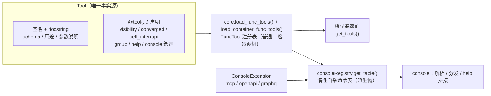

# Console CLI 重构：工具元数据收归 Tool，console 只做收集与拼接

> 状态：设计已确认，待实施（P0 未开始）

## 1. 现状问题：同一个工具的事实散在多处

以 `delete_dept` 为例，要弄清它「能不能被看到 / console 怎么调 / help 写什么」，需要翻这些地方：

| 信息 | 当前位置 | 性质 |
| --- | --- | --- |
| 参数 schema、用途、参数说明 | `tools.py` 签名 + docstring | ✅ 已经在 Tool 上 |
| console 命令名、verb、locator、arity | [consoleCommands.py `COMMAND_SPECS`](../../../src/service/funcToolService/consoleCommands.py) | ❌ console 自建映射 |
| 选项别名（`--kw`、`--tz`…） | `consoleCommands._OPTION_ALIASES` | ❌ 另一张按命令 key 索引的表 |
| help 补充说明 | [consoleTool.py `_HELP_OVERLAY`](../../../src/service/funcToolService/consoleTool.py) | ❌ 手写文档副本 |
| 可见性 | [core.py `_declared_visibility`](../../../src/service/funcToolService/core.py)：**由「console 是否转发它」反推** + `_EXPLICIT_VISIBILITY` + `_CONTAINER_TOOL_VISIBILITY` | ❌ 方向反了：工具可见性依赖 console |
| D2 收敛开关 | `consoleCommands.LEGACY_CONVERGED_TOOLS` | ❌ console 模块里放工具属性 |
| mcp / openapi 转发目标 | `consoleMcp.FORWARD_TOOL_NAMES`、`consoleSpec.FORWARD_TOOL_NAMES`（只为喂给可见性推导） | ❌ |
| 自中断 | 三个 driver 里各写一次 `fn_name == "reload_team"` + `CommandSpec.self_interrupt` | ❌ 4 份 |
| 权限类目 | [toolRegistry.py `CATEGORY_CONFIG`](../../../src/service/agentService/toolRegistry.py) | ⏸ 同类问题，**本期不改**（见 §7） |

此外 console 内部还有零散的硬编码：

- `_build_help_summary` 手写 mcp / openapi / graphql 两行；`console()` 里 `if tokens[0] == "mcp"` 硬分支；
- `console` 自身 docstring 写死资源清单 `dept / agent / room / role / task / container`；
- `_handle_list` 的提示文案写死 `--assignee / --reviewer / --scope / --kw`（本应由 `filter_options` 派生）；
- `_MECHANISM_OPTIONS = {"overwrite"}`、`patch_by_name` 补 `overwrite=True`：工具参数语义写在 console 处理器里；
- `resolve_command_spec` 对 `reload` 特判；`TOP_LEVEL_COMMANDS` 手写；
- `_CLEAR_FIELDS_PLACEHOLDER`：而 `clear_fields` 的 `Literal` 枚举其实已在 schema 里；
- `consoleSchema._tool_metadata` 用 `getattr(tools, name)` 取函数，绕开了注册表（`webFetchTool` 等不在 `tools.py` 的工具无法挂命令）。

**根因**：缺一个「工具声明」载体。签名 / docstring 只能表达 schema，于是所有非 schema 信息只能在别处按工具名建表。

## 2. 目标模型



原则：

1. **Tool 声明自己的一切**：可见性、D2 归属、自中断（静态标志与动态判定器）、分组（`default` / `container`）、console 绑定、help 补充。
2. **console 不认识任何具体工具名**：命令表、help、别名、选项面全部由注册表派生；`consoleRegistry.get_table()` 支持**惰性自举**（未调 `startup()` 的单测在首次访问时自动加载普通工具 + 容器工具 + extensions 完成构建）。
3. **console 自己只保留「CLI 怎么工作」的通用规则**：分词、CSV / JSON / 布尔解析、5 个 verb 处理器、全局用法说明、错误格式。
4. 不能 1:1 映射到单个工具的子树（mcp / openapi / graphql）以**插件（`ConsoleExtension`）**形式注册，而不是在 console 里写 `if`。

## 3. 声明层：`toolSpec.py`（新）

位置 `src/service/funcToolService/toolSpec.py`，只依赖 `constants` + 标准库（纯数据，`tools.py` 可直接 import，不引入环）。

> **第一性原理（Operator 拍板）**：
> 1. **`ConsoleCommand` 只定义「命令入口 (`path`)」和「参数映射 (`args` / `options` / `bind`)」**——彻底删掉 `Verb`、`Locator`、`payload`、`must_change`、`filters`、`defaults`、`mechanism_params`、`min_args / max_args / accepts_input / needs_target` 等一切在 console 层重造的业务规则字段。
> 2. **参数默认值与业务校验回到 Python 工具函数自身**：
>    - `member_names` 默认 `[]`（`save_dept` 新建分支）、`list_tasks` 无过滤条件时默认 `scope="self"`、`update_task / save_*` 无实际变更字段时的 `no_update_action` 校验，本来就是**工具自身的参数默认值与业务逻辑**，直接在 Python 工具函数里处理，不放在 `ConsoleCommand` 注解里。
>    - 当 `1 个 Python 函数拆成 2 条子命令`（如 `save_dept` 拆成 `dept create` 和 `dept update`）需要靠某个固定参数区分分支时，用 `bind={"overwrite": True}` 表达「这条命令入口绑定传给 Python 方法的固定参数」。

```python
@dataclass(frozen=True)
class Query:
    """位置参数的 query 形态类型（即 `attr:value` 语法，如 `name:研发部`）。
    注明该位置参数允许哪些 `attr`（属性名，直接对应底层 Python 方法的参数名）。
    """
    attrs: tuple[str, ...]

    def __init__(self, *attrs: str) -> None:
        object.__setattr__(self, "attrs", attrs)

ArgType = type[int] | type[str] | Query         # 允许的基本类型 int / str，或 Query("name")

@dataclass(frozen=True)
class Arg:
    """参考成熟 CLI 库（Click / Typer / Clap / argparse）的单参数声明模型：
    - 位置参数（`positional=True`）严格按声明顺序从前往后排列（第 1 个 positional Arg 对应位置 0，第 2 个对应位置 1……**绝不存在两个 Arg 共享同一个位置槽位**）。
    - **通过 `type` 表达这个 `Arg` 允许什么参数形态**：例如允许 `int`、允许 `str`、允许 `Query("name")`（即 `attr:value` 形态并注明允许哪些 `attr`）。

    字段说明：
    - `name`：默认映射的 Python 方法参数名（如 `"dept_id"`、`"task_id"`、`"container_id"`）。
    - `type`：该参数允许的类型/形态（单个 `ArgType` 或元组 `tuple[ArgType, ...]`；`None` = 直接跟随 Python 函数签名类型）：
      - `type=int`：只允许整数，映射到 `arg.name`（如 `task_id`）；
      - `type=str`：只允许字符串，映射到 `arg.name`（如 `role_name`、`container_id`、`note`）；
      - `type=(int, Query("name"))`（或兼容裸名期 `type=(int, str, Query("name"))`）：
        - 传 `int`（如 `dept update 7`）→ 映射到主参数 `arg.name`（`dept_id=7`）；
        - 传 `Query("name")` 允许的 `attr:value`（如 `dept update name:研发部`）→ 映射到对应的 `attr` 参数（`name="研发部"`）。
    - `required`：在该 CLI 命令下是否为**必选参数**（`True` = 必选，`False` = 可选；`None` = 跟随 Python 函数签名是否有默认值）。
    - `positional`：`True` = 位置参数（按从前往后顺序依次占位置 0, 1, 2...），`False` = `--选项`。
    - `alias`：CLI `--选项` 短别名（如 `alias="kw"` 表示 `--kw` 映射到 `title_keyword`）。
    """
    name: str                                   # 主映射的 Python 方法参数名："dept_id" / "task_id"
    type: ArgType | tuple[ArgType, ...] | None = None  # 允许的参数类型/形态：int / str / Query("name") 或组合元组
    required: bool | None = None                # True=必选，False=可选，None=跟随函数签名默认值
    positional: bool = False                    # True=位置参数（严格从前往后排列），False=--选项
    alias: str | None = None                    # 可选：--选项短别名（如 "kw" → "title_keyword"）

@dataclass(frozen=True)
class ConsoleCommand:
    """工具挂到 console 上的一条子命令：像 Click / Typer 一样，只声明命令路径 + 参数列表。

    - `path`：命令入口（如 `"dept get"`、`"dept create"`、`"dept update"`、`"reload"`）。
    - `args`：该命令的参数声明列表（位置参数严格从前往后排列，1 个位置 = 1 个 `Arg` 对象；未列出的函数参数默认作为可选 `--选项` 自动暴露）：
      - 仅允许 `int` 的位置参数：`Arg("task_id", type=int, positional=True, required=True)`；
      - 允许 `int` 或 `Query("name")`（`name:<值>`）的位置参数：`Arg("dept_id", type=(int, Query("name")), positional=True, required=True)`；
      - 多个顺序位置参数（从前往后占位置 0、位置 1）：`Arg("container_id", type=str, positional=True, required=True), Arg("note", type=str, positional=True, required=True)`；
      - 选项必选参数（覆盖函数签名的 `= None`）：如 `dept create` 下的 `Arg("name", required=True)`、`Arg("responsibility", required=True)`；
      - 选项带别名：`Arg("title_keyword", alias="kw")`。
    - `bind`：1 函数拆多命令时绑定给 Python 方法的固定入参（如 `dept update` 绑定 `{"overwrite": True}`）。
    - `help`：可选的命令级补充说明（只进 `console help`，不进模型 tool schema）。
    """
    path: str                                   # 命令入口："dept get" / "task ls" / "reload"
    args: tuple[Arg, ...] = ()                  # 参数列表（positional=True 的 Arg 严格从前往后排列，不共享位置）
    bind: Mapping[str, Any] = {}                # 绑定给 Python 方法的固定参数（如 update 绑定 {"overwrite": True}）
    help: tuple[str, ...] = ()                  # 可选的命令级 help 补充

    @property
    def key(self) -> str:
        return self.path.strip()

    @property
    def resource(self) -> str:
        return self.key.partition(" ")[0]

    @property
    def action(self) -> str:
        return self.key.partition(" ")[2]

@dataclass(frozen=True)
class ToolSpec:
    visibility: ToolVisibility = ToolVisibility.TOOL_ONLY
    converged: bool = False                     # D2：开关关闭时 BOTH → CONSOLE_ONLY，取代 LEGACY_CONVERGED_TOOLS
    self_interrupt: bool = False                # 静态自中断，取代 driver 里的 fn_name == "reload_team"
    self_interrupt_predicate: Callable[[Any], bool] | None = None  # 动态自中断判定器（console 专用）
    group: str = "default"                      # "container" 取代 CONTAINER_TOOL_NAMES
    help: tuple[str, ...] = ()                  # 工具级 help 补充（只进 console help，不进 schema）
    console: tuple[ConsoleCommand, ...] = ()

def tool(**kwargs) -> Callable[[F], F]:
    """只往函数上挂 __tool_spec__，不包装函数（签名反射与校验零影响）。"""
```

> [!NOTE]
> **为什么可以把 `defaults / filters / must_change / payload / mechanism_params` 全部从注解中砍掉？**
> 1. **参数默认值归回 Python 工具函数（Operator 指出的核心点）**：
>    - `save_dept` 新建时 `member_names` 默认为 `[]`：在 `save_dept` 函数内部创建分支 `if member_names is None: member_names = []` 即可，不用在 console 注解里写 `defaults={"member_names": []}`；
>    - `list_tasks` 未传过滤项时默认 `scope="self"`：在 `list_tasks`（或统一入口）里当 `assignee/reviewer/scope/title_keyword/mine` 均未传时直接默认 `scope="self"`，不用在注解里声明 `filters=(...)` + `fallback_options={...}`；
>    - `create_task` 的返回提示 `hint`：直接由 `create_task` 返回或写进命令 `help`，无需在 `ToolSpec` 专门开一个 `success_hint` 字段。
> 2. **CLI 通用机制归回 CLI 引擎，不污染每条命令的注解**：
>    - `--from payload` / 内联 JSON 字典展开：本质只是 CLI 传关键字参数的另一种语法糖（等价于把 JSON 里的 key-value 展开成 `--key value`），任何带选项的命令在 CLI 引擎层统一支持（或对无选项命令自然拒绝未知键），无需每条命令声明 `payload=True`；
>    - 位置参数与 `--选项` 同名冲突、修改命令未传任何有效变更字段（`no_update_action`）：由通用参数合并器与工具函数自身校验，无需每条命令挂 `must_change=True` 和 `mechanism_params`。

### 3.1 用起来的样子

```python
@tool(
    visibility=ToolVisibility.BOTH,
    converged=True,
    help=(
        "有子部门且未加 --recursive 时由服务层以 DEPT_HAS_CHILDREN 拒绝，不会部分删除。",
        "加 --dry-run 只预演（跑完全部校验，不写库），返回体里是 would_delete。",
    ),
    console=(
        ConsoleCommand("dept rm", args=(
            # 第 1 个位置参数（必选）：type 声明允许 int（映射到 dept_id）或 Query("name")（即 name:<值> 映射到 name）
            Arg("dept_id", type=(int, Query("name")), positional=True, required=True),
        )),
    ),
)
async def delete_dept(name=None, dept_id=None, recursive=False, dry_run=False, _context=None) -> dict: ...

@tool(
    visibility=ToolVisibility.BOTH, converged=True,
    console=(
        ConsoleCommand("dept create", args=(
            Arg("name", required=True),
            Arg("responsibility", required=True),
        )),
        ConsoleCommand("dept update", args=(
            # 第 1 个位置参数（必选）：type=(int, Query("name"))
            Arg("dept_id", type=(int, Query("name")), positional=True, required=True),
        ), bind={"overwrite": True}),
    ),
)
async def save_dept(...): ...

@tool(visibility=ToolVisibility.BOTH,
      console=(
          ConsoleCommand("task ls", args=(
              Arg("title_keyword", alias="kw", required=False),
          )),
      ))
async def list_tasks(...): ...

@tool(visibility=ToolVisibility.BOTH,
      console=(
          ConsoleCommand("task get", args=(
              Arg("task_id", type=int, positional=True, required=True),
          )),
      ))
async def get_task_detail(task_id: int, event_limit: int = 3, _context=None) -> dict: ...

@tool(visibility=ToolVisibility.BOTH,
      console=(
          ConsoleCommand("task update", args=(
              Arg("task_id", type=int, positional=True, required=True),
              Arg("new_status", alias="status", required=False),
              Arg("clear_fields", alias="remove_field", required=False),
              Arg("workflow_action", alias="action", required=False),
          )),
      ))
async def update_task(task_id: int, ...): ...

@tool(visibility=ToolVisibility.BOTH, converged=True,
      console=(
          ConsoleCommand("agent wake", args=(
              Arg("agent_name", type=str, positional=True, required=True),
          )),
      ))
async def wake_up_agent(agent_name: str, _context=None) -> dict: ...

@tool(visibility=ToolVisibility.BOTH, converged=True,
      self_interrupt=True, console=(ConsoleCommand("reload"),))
async def reload_team(_context=None) -> dict: ...

@tool(visibility=ToolVisibility.CONSOLE_ONLY, group="container",
      console=(
          ConsoleCommand("container note", args=(
              # 两个位置参数严格从前往后排列：第 1 个是 container_id (str)，第 2 个是 note (str)
              Arg("container_id", type=str, positional=True, required=True),
              Arg("note", type=str, positional=True, required=True),
          )),
      ))
async def update_container_note(...): ...
```

`console` 工具本身：`@tool(visibility=TOOL_ONLY, self_interrupt_predicate=console_triggers_self_interrupt)`。

### 3.2 注册表接入与启动/单测统一时序

- `FuncTool` 增加 `spec: ToolSpec` 字段，`load_func_tools()` 与 `load_container_func_tools()` 从 `func.__tool_spec__` 读取（无声明的函数取默认 `ToolSpec()`）。
- `visibility` 从 `spec.visibility` 取，一次性收口 `core.py` 原本的三处可见性事实源（① `_declared_visibility` 推导、② `_EXPLICIT_VISIBILITY`、③ `_CONTAINER_TOOL_VISIBILITY`）。
- `group="container"` 只替换容器工具的分桶依据（取代 `CONTAINER_TOOL_NAMES` 与 `_CONTAINER_TOOL_VISIBILITY`），`_func_tools` 与 `_container_func_tools` 两组字典在 `core.py` 中**仍保持物理分离**（保证 `get_tools()` 默认不带容器工具，Native / Claude SDK 暴露面零变化）。
- **惰性自举与防循环 import 三条硬约束（C-a / C-b / C-c）**：
  1. **构建不依赖 `core`（C-b）**：`keep_legacy_admin_tools()` 与 `resolve_effective_visibility()` 下沉到 `toolSpec` / `consoleRegistry`，由 `core` 反向 import；`consoleRegistry.get_table()` 构建时只需确保 `tools`（内含 44 个工具：38 普通 + 6 容器，含同步函数 `get_time`）与 `consoleTool`（含 `console` 自身，合计 45 个工具）已导入并构造 `FuncTool`，**绝不在 `build()` 内反向调用 `core`**，避免 `import core` 半初始化重入导致的 `AttributeError`。
  2. **`HELP_SUMMARY` 与 `HELP_DETAIL` 同走 PEP 562 惰性属性（C-a / C-c）**：`consoleTool.py` 删掉模块顶层的 `HELP_SUMMARY = _build_help_summary()` 立即求值，与 `HELP_DETAIL` 一起通过 `consoleTool.__getattr__` 在首次访问时生成——既消除 `import consoleTool` 期间的顶层抢跑建表，又保证 P3 接入 `extension.summary` 时扩展已注册完毕。
  3. **新模块顶层零 `core / tools` import**：`toolSpec.py`、`consoleRegistry.py`、`consoleCommands.py` 顶层均不 import `core` 或 `tools`，对外符号通过函数内延迟 import 或 PEP 562 `__getattr__` 转发给 `get_table()`。

## 4. 派生层：console 侧

### 4.1 `consoleRegistry.py`（新，取代 `COMMAND_SPECS` 及其索引）

```python
@dataclass(frozen=True)
class ResolvedCommand:          # 运行时命令 = 声明 + 所属工具（兼容原 CommandSpec 接口）
    decl: ConsoleCommand
    tool: FuncTool | None       # HELP_SPEC 等纯本地无工具命令为 None；其余必有 FuncTool

class CommandTable:
    specs: tuple[ResolvedCommand, ...]
    by_path: dict[str, ResolvedCommand]
    by_resource: dict[str, tuple[ResolvedCommand, ...]]
    extensions: dict[str, ConsoleExtension]

def build(func_tools: Iterable[FuncTool], extensions: Iterable[ConsoleExtension] = ()) -> CommandTable
def get_table() -> CommandTable
```

- `build` 接受任意 `FuncTool` 可迭代对象 ⇒ 单测也可以直接传假工具建表测试 fail-fast。
- `HELP_SPEC` 作为 `tool=None` 的内置本地命令保留在 `CommandTable` 中，使 `resolve_command_spec(["help", ...])` 原样工作。
- 选项面（`param_names / option_kinds / boolean_options / command_options_map / display_options / positional_param_names`）逻辑原样保留，schema 来源从 `getattr(tools, name)` 改为 `resolved.tool`。
- 自中断统一由 `FuncTool.spec` 提供：三个 driver 注册工具时读 `func_tool.spec.self_interrupt` 与 `func_tool.spec.self_interrupt_predicate`，删掉 `"reload_team"` 与 `"console"` 名字硬编码。

### 4.2 构建期一致性校验（fail-fast，取代散落的结构测试）

`build()` 时直接 `raise`（`tool=None` 的 `HELP_SPEC` 豁免工具 schema 校验）：

- 两个工具声明了同一 `key`；同一命令下 `Arg.alias` 撞真名 / kebab 撞键（现有 `_register` 逻辑）；
- `Arg.name`、`Query.attrs`、`bind` 的键不在该工具 schema 里；
- `Arg.type` 类型与工具 schema 一致性：`type` 元素仅允许 `int` / `str` / `Query`；声明含 `int` 时 `param_kinds(arg.name) == "integer"`，仅 `str` 时 `param_kinds(arg.name) == "string"`，`Query(*attrs)` 的每个 `attr` 在工具 schema 中存在；
- 多位置参数顺序校验：当 `positional=True` 的 `Arg` 个数 `> 1` 时，顺序与函数签名参数顺序一致；`...`（若存在）只能作为 `args` 的最后一项（表示该命令接受内联 JSON / `--from payload` 整份配置输入）；
- 挂了 console 命令的工具，静态 `visibility` 不是 `console_visible`；
- `converged=True` 但 `visibility != BOTH`；
- `CONSOLE_ONLY` 工具既无命令、也没被任何 extension 用作转发目标（死工具，告警/报错）。

### 4.3 可见性

```python
def effective_visibility(tool: FuncTool) -> ToolVisibility:
    v = tool.spec.visibility
    if v == BOTH and tool.spec.converged and not keep_legacy_admin_tools():
        return CONSOLE_ONLY
    return v
```

删除：`_declared_visibility`、`_CONSOLE_FORWARD_TARGETS`、`_EXPLICIT_VISIBILITY`、`_CONTAINER_TOOL_VISIBILITY`、`LEGACY_CONVERGED_TOOLS`、两个 `FORWARD_TOOL_NAMES`、`CONTAINER_TOOL_NAMES`。命令是否可用 = 其工具的 `effective_visibility().console_visible`（运行时判，保持 D2 可在进程内切换）。

### 4.4 help = 纯拼接

| help 片段 | 来源 |
| --- | --- |
| 摘要每行 `resource  ls\|get\|...` | `table.by_resource` |
| mcp / openapi / graphql 摘要行 | `extension.summary`（按去重后的 extension 顺序附加） |
| 用法行 | `ConsoleCommand`（`path` + `args` 派生） |
| 用途 | 工具 description 首句 |
| 参数清单（含必填、默认值、别名、位置参数标注、形态说明） | 工具函数签名 schema + `ConsoleCommand.options` + `args` |
| 补充说明 | `ToolSpec.help`（工具级）+ `ConsoleCommand.help`（命令级） |
| 全局规则（重复选项、CSV / JSON 等价） | console 自有常量（属 CLI 规则，合理保留） |

> [!IMPORTANT]
> `help` 两个属性都**只进 console help，不进 `get_function_metadata` 产出的 schema**。

### 4.5 `_HELP_OVERLAY` 逐条归宿（严禁 1:N 工具把单命令说明放进 `@tool(help=...)`）

> **归属铁律**：凡 `1 Tool → N Commands` 的工具（`get_dept_info`、`save_dept`、`get_agent_info`、`save_agent`、`get_room_info`、`save_room`、`save_role_template`），只要某条说明不是该工具下**所有**子命令共用，就**必须**挂在 `ConsoleCommand(help=...)` 上，否则会串台污染兄弟命令。

| 原条目 | 归宿 |
| --- | --- |
| **1:1 工具**（`dept rm`、`room rm`、`role rm`、`reload`、`task ls`、`task create`、`task update`）的补充说明 | `ConsoleCommand(help=...)` 或 `@tool(help=...)` |
| **1:N 工具的单命令专属说明**：`agent get` 错误码；`role create` 限制；`* update` 的 PATCH 语义；`* create` 的说明 | 放 `ConsoleCommand(help=...)`（命令级） |
| `task create` 不唤醒执行人（返回体 `hint`） | 直接收归 `create_task` 工具函数自身（help 文案仍在 `ConsoleCommand(help=...)`） |

### 4.6 `ConsoleExtension`：mcp / openapi / graphql

```python
class ConsoleExtension(Protocol):
    resources: tuple[str, ...]                  # ("mcp",) / ("openapi", "graphql")
    summary: str                                # help 摘要行（openapi / graphql 共用一行摘要）
    def help_payload(self, tokens: list[str]) -> dict[str, Any]: ...
    async def dispatch(self, command: str, tokens: list[str], ctx: Any) -> dict[str, Any]: ...
```

- 直接对齐现网 `consoleMcp` 与 `consoleSpec` 已有的 `help_payload(tokens) -> dict` 和 `dispatch(command, tokens, ctx) -> dict` 签名：
  - `console("mcp --help")` 走 `ext.dispatch(...)` 返回原结构；
  - `console("help mcp ...")` 走 `ext.help_payload([resource] + tokens[2:])`，由 `_help_text` 取 `payload.get("text")` 渲染，保证现有返回契约零回归。
- `openapi` 与 `graphql` 共用一个 `SpecConsoleExtension(resources=("openapi", "graphql"), summary="openapi / graphql：...")`，摘要迭代去重后的 `extensions`，保持 `_build_help_summary` 现有的两行扩展摘要格式不变。
- 转发目标的可见性由各工具自己的 `@tool` 声明（`openapi_call / graphql_call` 写 `CONSOLE_ONLY`），extension 不再需要导出 `FORWARD_TOOL_NAMES`。

## 5. Console 参数解析与处理逻辑（CLI 引擎流水线）

`console` 自身只保留与具体工具无关的**通用 CLI 参数解析与转发流水线**（`consoleParsing` + `consoleSchema` + `consoleTool` 统一分发），彻底取代原来的 5 个 `verb` 分支处理器：

### 5.1 统一五步参数解析与合并流水线

当收到 `console(command="...", payload=...)` 时，按以下 5 步执行：

1. **命令路由与分词**：
   - `shlex.split(command)` 分词；匹配 `CommandTable.by_path`（2 词子命令如 `"dept update"`，或 1 词顶层命令如 `"reload"`）或 `ConsoleExtension`（`mcp / openapi / graphql`）。
   - 切出命令名之后的 token 序列，分为：**位置参数序列 `pos_tokens`** 与 **`--选项` 键值对 `opt_tokens`**。
2. **位置参数解析（`pos_tokens` → `pos_args`，严格从前往后按顺序一对一匹配，按 `arg.type` 决定允许的类型与 `Query` 形态）**：
   - 从命令声明中取出 `positional_args = [a for a in cmd.args if isinstance(a, Arg) and a.positional]`：**第 `i` 个位置 token `pos_tokens[i]` 严格对应第 `i` 个位置参数定义 `arg = positional_args[i]`**（不存在两个 `Arg` 共享同一个位置槽位的情况）。
   - 对每个位置参数 `arg = positional_args[i]` 和对应的输入 `token = pos_tokens[i]`，按 `arg.type`（未显式指定时取 Python 函数签名中的参数类型）依次匹配：
     - **当 `arg.type` 包含 `Query(*attrs)`（如 `type=(int, Query("name"))` 或 `type=Query("role_name")`）**：
       - **前缀写法 `<attr>:<value>`**（当 `<attr>` 在 `Query.attrs` 中，如 `name:研发部`、`name:123`）：直接映射到对应的 Python 方法参数 `pos_args[attr] = value`；
       - **数字写法**（当 `arg.type` 同时含 `int` 且 `token.isdigit()` 为纯数字，如 `7`）：转换为正整数写入主参数 `pos_args[arg.name] = int(token)`（须 `>= 1`，否则报 `invalid_target`）；
       - **裸字符串回退**（当 `token` 非纯数字，或前缀不在 `Query.attrs` 中，如 `dept get root`、`dept rm 研发部`、`dept get a:b`）：回退映射到 `Query.attrs[0]`（如 `pos_args["name"] = token`），100% 兼容存量裸名写法。
     - **当 `arg.type` 仅允许 `int`（如 `task get` 的 `Arg("task_id", type=int, positional=True)`）**：
       - `token.isdigit()` 且 `int(token) >= 1` 时写入 `pos_args[arg.name] = int(token)`，否则报 `invalid_target`。
     - **当 `arg.type` 仅允许 `str`（直通位置参数，如 `agent wake` 的 `Arg("agent_name", type=str, positional=True)`、`container note` 的 2 个 `str` 位置参数）**：
       - 原样写入 `pos_args[arg.name] = token`（且该参数保留在 `display_options` 选项面，不标「不接受选项写法」；而 `type` 含 `int` 或 `Query` 的定位参数从 `display_options` 剔除并按 `int+Query ⇒ <id|名称>`、`Query ⇒ <名称>`、`int ⇒ <id>` 渲染用法行）。
   - **末尾内联 JSON 载荷与 `--from payload` 准入（由 `args` 末尾是否含 `...` 决定）**：
     - 仅当 `... in cmd.args`（10 条 `create / update` 命令，如 `args=(Arg(...), ...)` 或 `args=(...,)`）时，允许额外传 1 个内联 JSON 对象位置参数或 `--from payload`，解析为字典 `payload_args`；不含 `...` 的命令（如 `dept ls / dept get / dept rm / time get`）传内联 JSON 或 `payload` 一律按原错误码拒绝。
3. **`--选项` 解析与类型转换（`opt_tokens` → `opt_args`）**：
   - 将 `--kebab-case` / `--snake_case` / `Arg.alias` 统一归一为 Python 方法的真实参数名 `canonical_name`（未知选项报 `unknown_option`）；
   - 按工具函数 schema 的参数类型（`boolean / integer / array / object / string`）转换选项值；
   - 若同一参数同时在 `--选项` 和 `payload_args` 中出现，报 `ambiguous_input_source`（防多来源覆写）。
4. **位置定位参数与 `--选项` 的冲突与重命名处理（核心：`update` 指定 ID vs 指定名字）**：
   - **场景 1：`update` 指定的是 ID（如 `dept update 7 --name 产品部 --responsibility 负责产品`）**：
     - 位置参数命中了 `dept_id=7`（`pos_args = {"dept_id": 7}`）；
     - 此时 `--name 产品部`（或 JSON `{"name": "产品部"}`）落在 `opt_args["name"]`，**两者键名不同（`dept_id` vs `name`），无冲突**！
     - 合并后传给 Python 方法：`save_dept(dept_id=7, name="产品部", responsibility="负责产品", overwrite=True)` —— `save_dept` 按 `dept_id=7` 查出原部门，并将其重命名为 `"产品部"`。
     - 若此时用户又传了 `--dept-id 8`（与已命中的 `pos_args["dept_id"]` 同键冲突），报 `ambiguous_input_source`。
   - **场景 2：`update` 指定的是名字，且修改其他属性（如 `dept update 研发部 --responsibility 负责研发` 或 `dept update name:研发部 --manager-name 张三`）**：
     - 位置参数命中了 `name="研发部"`（`pos_args = {"name": "研发部"}`）；
     - 选项修改的是 `responsibility` / `manager_name`，不碰 `name` 也不碰 `dept_id`；
     - 合并后传给 Python 方法：`save_dept(name="研发部", responsibility="负责研发", overwrite=True)` —— `save_dept` 按 `name="研发部"` 查出原部门并更新属性。
   - **场景 3：`update` 指定的是名字，同时又传了 `--dept-id 1`（如 `dept update 研发部 --dept-id 1`）**：
     - 位置参数已用 `name="研发部"` 定位目标，选项又传了另一个定位键 `dept_id=1`（双重定位来源冲突），报 `ambiguous_input_source`（保持现网 `test_cc6_locator_in_options_is_ambiguous` 护栏通过）。
   - **场景 4：`update` 指定的是名字，同时又传了 `--name 产品部` 想改名（如 `dept update 研发部 --name 产品部` 或 `dept update name:研发部 --name 产品部`）**：
     - 位置参数解析出 `pos_args["name"] = "研发部"`，而 `--name` 选项解析出 `opt_args["name"] = "产品部"` —— **两个值争抢底层 Python 函数 `save_dept` 的同一个 `name` 参数（同键双值冲突）**！
     - **处理策略**：
       - **在当前工具签名不变的前提下**：CLI 合并器检测到 `name` 同时出现在 `pos_args` 和 `opt_args/payload_args` 中，直接报 `ambiguous_input_source`，并在错误提示中明确引导：**「按名称定位时无法同时用 `--name` 重命名；如需重命名，请先用 `dept get 研发部` 查出 ID，再用 `dept update <id> --name 产品部`」**。
       - *（可选扩展：如果未来希望直接支持 `dept update 研发部 --name 产品部`，只需在 `save_dept` 等工具层或转发层发现「位置参数是 `name` 且选项也给了 `--name`」时，先按旧 `name` 查出 `dept_id` 填入，再把新 `--name` 作为重命名值传给 `save_dept(dept_id=查出的id, name=新名字)`；或者在 `save_*` 工具签名增加 `new_name` 参数。）*
5. **合并 `bind`、校验必填项并转发调用**：
   - 将 `pos_args`、`payload_args`、`opt_args` 合并为最终字典 `call_args`；
   - 按 `setdefault` 语义注入 `cmd.bind`（如 `dept update` 在用户未显式传 `--overwrite` 时补入 `overwrite=True`）；
   - 校验所有 `Arg(required=True)`（或 `required=None` 且函数签名无默认值）的参数均已提供（缺失报 `missing_required_option` / `missing_target`）；
   - 生成 `ForwardToolCall(tool_name=tool.name, arguments=call_args)` 转发给底层 Python 工具函数执行。

### 5.2 `update` 指定 ID vs 指定名字处理对照表

| 命令行写法 | 位置参数落点 (`pos_args`) | 选项落点 (`opt_args`) | 处理结果 |
| --- | --- | --- | --- |
| `dept update 7 --responsibility 研发` | `dept_id=7` | `responsibility="研发"` | ✅ 按 ID=7 定位，更新职责 |
| `dept update 7 --name 产品部` | `dept_id=7` | `name="产品部"` | ✅ 按 ID=7 定位，**重命名为「产品部」** |
| `dept update 研发部 --responsibility 研发` | `name="研发部"` | `responsibility="研发"` | ✅ 按名称「研发部」定位，更新职责 |
| `dept update name:123 --responsibility 研发` | `name="123"` | `responsibility="研发"` | ✅ 显式按名称 `"123"` 定位（不被当成 ID=123） |
| `dept update 7 --dept-id 8` | `dept_id=7` | `dept_id=8` | ❌ `ambiguous_input_source`（`dept_id` 重复提供） |
| `dept update 研发部 --dept-id 1` | `name="研发部"` | `dept_id=1` | ❌ `ambiguous_input_source`（名称与 ID 双重定位冲突） |
| `dept update 研发部 --name 产品部` | `name="研发部"` | `name="产品部"` | ❌ `ambiguous_input_source`（同键 `name` 冲突，提示改用 `dept update <id> --name 产品部`；或由转发层先按旧名解析为 ID 后重命名） |

## 6. 迁移计划

| 阶段 | 内容 | 护栏 |
| --- | --- | --- |
| **P0** | 新增 `toolSpec.py` + `consoleRegistry.py`；将原本散落在 `consoleCommands.py` 的参数默认值（`save_dept` 新建时 `member_names=[]`、`list_tasks` 无过滤条件时默认 `scope="self"`、`create_task` 的返回 `hint`）收归到 `tools.py` 对应工具函数自身；在 45 个工具函数挂上 `@tool(...)` 声明 | ① **import 冒烟**：`python -c "import service.funcToolService.consoleCommands"` 零异常、无半初始化重入；新模块顶层零 `core / tools` import；<br/>② **安全与可见性等价（45 个工具全覆盖）**：39 个普通工具 + 6 个容器工具逐个断言新旧 `effective_visibility` 一致（D2 开/关双向），**单点硬断言 `update_container_note == CONSOLE_ONLY`**，且 `group == "container"` 精确等于原 `CONTAINER_TOOL_NAMES` 6 项；<br/>③ **28 条命令路由与参数映射等价**：新表 `ResolvedCommand` 派生出的 28 条命令的 `args / options / bind` 映射与现网行为一致 |
| **P1** | 切换消费方到 `consoleRegistry.get_table()`；将 `consoleTool.py` 的 5 个 verb 处理器收拢为单一通用参数映射与合并流水线；删旧 `COMMAND_SPECS`、`_OPTION_ALIASES`、`_HELP_OVERLAY`、`LEGACY_CONVERGED_TOOLS`、`_declared_visibility` 一族、两个 `FORWARD_TOOL_NAMES`、`CONTAINER_TOOL_NAMES`；driver 自中断改读 `FuncTool.spec` | 全量 console 单测与集成测试通过 |
| **P2** | 定位语法与 help 收拢：支持 `<id>` 与 `name:<名称>`（`key:value` 显式前缀）定位语法，解锁 `dept update 7 --name 产品部` 按 ID 定位 + `--name` 重命名；精简冗余 `_HELP_OVERLAY` | 定位与重命名用例全绿；更新 help 体积基线 |
| **P3** | `ConsoleExtension` 协议接入 `mcp / openapi / graphql` | 现有 mcp / spec 测试全绿 |

**行为必须保持不变（P0 / P1）**：现在推导出的可见性要逐个写成显式声明——所有 console 转发目标（含 `list_tasks / get_task_detail / update_task / create_task` 与 mcp 注册表四工具）为 `BOTH`，`openapi_call / graphql_call / update_container_note` 为 `CONSOLE_ONLY`，其余 `TOOL_ONLY`；task 三工具保持 `converged=False`（沿用 #187 裁定②）。

**测试与生产兼容层（P1）**：`core.py` 与 11 个测试文件（90+ 处引用）直接访问 `consoleCommands` 的符号。P1 在 `consoleCommands.py` 保留必导符号 `ENV_KEEP_LEGACY_TOOLS / COMMAND_SPECS / COMMAND_INDEX / LEGACY_CONVERGED_TOOLS / HELP_SPEC / to_kebab`（有实测引用）及顺手导出的 `Locator / Verb / CommandSpec / resolve_command_spec / command_console_visible / RESOURCE_NAMES / ACTIONS_BY_RESOURCE / SPECS_BY_RESOURCE`，通过 PEP 562 `__getattr__` 转发给 `consoleRegistry.get_table()`，确保外部零改动平滑切换。

## 7. 决策记录

| # | 问题 | 结论 |
| --- | --- | --- |
| 1 | 声明写在哪 | `@tool(...)` 装饰器直接挂在工具函数上，与签名 / docstring 同处 |
| 2 | 命令级 / 工具级 help 补充放哪 | 装饰器属性 `ToolSpec.help` / `ConsoleCommand.help`；只进 console help，不进 schema、不改 docstring |
| 3 | `CATEGORY_CONFIG` 是否一起收进 `ToolSpec` | **本期不改**。原因：表里含 11 个 TSP 外部工具无法挂装饰器，收不干净；且它是权限面，与 console 重构同时动会增加排障难度。后续如需收敛，在 `ToolSpec` 加 `category` 字段、`FuncTool.to_openai_tool()` 填 `OpenAITool.category` 即可，`AgentToolRegistry.register()` 已支持优先读 `tool.category` |
