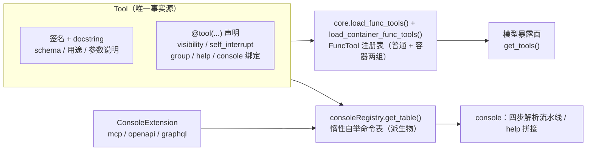

# Console CLI 重构：工具元数据收归 Tool，console 只做收集与拼接

> 状态：设计已确认，待实施（P0 未开始）

---

## 1. 背景与目标

### 1.1 现状问题：同一个工具的事实散在多处

以 `delete_dept` 为例，要弄清它「能不能被看到 / console 怎么调 / help 写什么」，需要翻多处：

| 信息 | 当前位置 | 问题 |
| --- | --- | --- |
| 参数 schema、用途、参数说明 | `tools.py` 签名 + docstring | ✅ 已在 Tool 上 |
| console 命令名、verb、locator、arity | [consoleCommands.py `COMMAND_SPECS`](../../../src/service/funcToolService/consoleCommands.py) | ❌ console 自建映射 |
| 选项别名（`--kw`、`--tz`…） | `consoleCommands._OPTION_ALIASES` | ❌ 另一张按命令 key 索引的表 |
| help 补充说明 | [consoleTool.py `_HELP_OVERLAY`](../../../src/service/funcToolService/consoleTool.py) | ❌ 手写文档副本 |
| 可见性 | [core.py `_declared_visibility`](../../../src/service/funcToolService/core.py) + `_EXPLICIT_VISIBILITY` + `_CONTAINER_TOOL_VISIBILITY` | ❌ 方向反了：工具可见性由 console 反推 |
| D2 收敛开关 | `consoleCommands.LEGACY_CONVERGED_TOOLS` | ❌ 工具属性放在 console 模块 |
| mcp / openapi 转发目标 | `consoleMcp.FORWARD_TOOL_NAMES`、`consoleSpec.FORWARD_TOOL_NAMES` | ❌ 只为喂给可见性推导 |
| 自中断 | 三个 driver 里各写一次 `fn_name == "reload_team"` + `CommandSpec.self_interrupt` | ❌ 散落 4 份 |
| 权限类目 | [toolRegistry.py `CATEGORY_CONFIG`](../../../src/service/agentService/toolRegistry.py) | ⏸ 同类问题，**本期不改**（见 §7） |

此外 console 内部还有零散硬编码：
- `_build_help_summary` 手写 mcp / openapi / graphql 两行；`console()` 里 `if tokens[0] == "mcp"` 硬分支；
- `console` 自身 docstring 写死资源清单；`resolve_command_spec` 对 `reload` 特判；`TOP_LEVEL_COMMANDS` 手写；
- `_handle_list` 提示文案写死 `--assignee / --reviewer / --scope / --kw`；`_CLEAR_FIELDS_PLACEHOLDER` 占位符；
- `_MECHANISM_OPTIONS = {"overwrite"}`、`patch_by_name` 补 `overwrite=True`：工具语义写在 console 处理器里；
- `consoleSchema._tool_metadata` 用 `getattr(tools, name)` 绕开注册表，不在 `tools.py` 的工具无法挂命令。

**根因**：① 缺少「工具声明」载体，非 schema 元数据只能在外部按名字建表；② 底层 `save_*` 混合了 create 与 update，把必填校验、覆盖保护和定位冲突逼到了 console 层打补丁。

### 1.2 目标架构与设计原则



四条原则：
1. **Tool 声明自己的一切**：可见性、D2 归属、自中断（静态标志与动态判定器）、分组（`default` / `container`）、console 绑定、help 补充。
2. **业务规则归回 Tool**：必填项靠签名表达，默认值与校验写在 Python 工具函数里，console 不替工具补业务语义。
3. **console 不认识任何具体工具名**：命令表、help、别名、选项面全部由注册表派生；console 只保留分词、类型转换、四步解析流水线、全局用法说明与错误格式。
4. **特殊子树插件化**：不能 1:1 映射到单个工具的子树（`mcp` / `openapi` / `graphql`）以 `ConsoleExtension` 注册，不在 console 里写 `if`。

---

## 2. 工具层清理：`save_*` 拆分与默认值归位

在收拢元数据之前，先消除迫使 console 打补丁的两个历史包袱。

### 2.1 `save_*` 拆分为 `create_*` + `update_*`

原 `save_dept / save_agent / save_room / save_role_template` 混装新建与更新，导致签名里必填项全被迫标成 `Optional = None`、需要 `overwrite=True` 防误覆盖，且 `name` 既做定位又做改名产生冲突。拆成 4 对共 8 个独立工具后：

- **`create_*`**：必填项直接在 Python 签名中声明为无默认值必填；同名已存在直接拒绝，无需 `overwrite`。
- **`update_*`**：有主键 ID 的资源（`dept` / `agent` / `room` / `task`）统一**只支持按必填正整数 `*_id: int` 定位**，不再按 `name` 定位。由此 `name: str | None = None` 纯粹表示「要改成的新名称」，无需引入 `new_name` 或 `overwrite`，也彻底消除同名成员的 `ambiguous_target` 歧义。无对外 ID 的 `role_template` 仍按 `name: str` 定位（不支持改名）。

| 原混合工具 | 拆分后工具 | Console 命令 | Python 签名核心参数（均带 `_context`） | 关键收益 |
| --- | --- | --- | --- | --- |
| `save_dept` | `create_dept` | `dept create` | `name: str, responsibility: str, manager_name: str, parent_name: str, member_names: list[str] \| None = None, i18n: dict \| None = None` | 必填项在签名层直接体现；`member_names` 在函数内默认 `[]`；无需 `overwrite` |
| `save_dept` | `update_dept` | `dept update` | `dept_id: int, name: str \| None = None, responsibility: str \| None = None, manager_name: str \| None = None, member_names: list[str] \| None = None, parent_name: str \| None = None, i18n: dict \| None = None, clear_fields: list[DeptClearField] \| None = None` | 仅按 `dept_id` 定位，`name` 纯粹表示重命名；无需 `new_name` 与 `overwrite` |
| `save_agent` | `create_agent` | `agent create` | `name: str, role_template_name: str, model: str \| None = None, driver: str \| None = None, allow_tools: list[str] \| None = None, allow_skills: list[str] \| None = None, i18n: dict \| None = None` | `name` 与 `role_template_name` 签名级必填；无需 `overwrite` |
| `save_agent` | `update_agent` | `agent update` | `agent_id: int, name: str \| None = None, role_template_name: str \| None = None, model: str \| None = None, driver: str \| None = None, allow_tools: list[str] \| None = None, allow_skills: list[str] \| None = None, i18n: dict \| None = None, clear_fields: list[AgentClearField] \| None = None` | 仅按 `agent_id` 定位（彻底消除同名成员歧义），`name` 纯粹用于重命名（自动迁移 workdir） |
| `save_room` | `create_room` | `room create` | `name: str, member_names: list[str], initial_topic: str \| None = None, max_rounds: int \| None = None` | `name` 与 `member_names` 签名级必填；无需 `overwrite` |
| `save_room` | `update_room` | `room update` | `room_id: int, name: str \| None = None, member_names: list[str] \| None = None, initial_topic: str \| None = None, max_rounds: int \| None = None, clear_fields: list[RoomClearField] \| None = None` | 仅按 `room_id` 定位，`name` 纯粹表示重命名 |
| `save_role_template` | `create_role_template` | `role create` | `name: str, soul: str, type: str \| None = None, i18n: dict \| None = None` | `name` 与 `soul` 签名级必填；无需 `overwrite` |
| `save_role_template` | `update_role_template` | `role update` | `name: str, soul: str \| None = None, type: str \| None = None, i18n: dict \| None = None` | 角色模板无对外 ID，按 `name` 定位，对 `soul / type / i18n` 做 PATCH 更新 |

> **Service 层零重复**：底层的 `deptService.upsert_dept`、`roomService.upsert_room`、`roleTemplateService.save_role_template` 保持不变，`create_*` 与 `update_*` 内部复用同一套 helper / service。

### 2.2 参数默认值与业务校验归回 Python 函数

- `create_dept`：`member_names is None` 时在函数内默认 `[]`（不再放在 console 的 `input_defaults`）。
- `list_tasks`：过滤条件（`assignee / reviewer / scope / title_keyword / mine`）全缺时，在函数内默认 `scope="self"`，并在返回体里显式附带 `auto_filled_filters` 与提示文案（不静默改口径）。
- `create_task`：成功返回体里直接附带 `hint`（「建单不会自动唤醒执行人」），不再走 console 的 `success_hint` 钩子。
- `update_*`：无任何有效变更字段时在工具函数内返回 `no_update_action`，console 不再维护 `_MECHANISM_OPTIONS`。

---

## 3. 声明层：`toolSpec.py`（新）

位置：`src/service/funcToolService/toolSpec.py`，只依赖 `constants` + 标准库（纯数据，`tools.py` 可直接 import，不引入环）。

### 3.1 数据模型

彻底删掉 `Verb`、`Locator`、`bind`、`input_defaults`、`filter_options`、`fallback_options`、`mechanism_params`、`min_args / max_args / needs_target`，收敛为 4 个纯数据结构（组合优先于继承，`Target` 作为 `Arg` 的属性）：

```python
@dataclass(frozen=True)
class Target:
    """值映射目标：将 CLI 输入转换为指定 tool 参数 `name`。"""
    name: str                                   # 映射到的 Python 工具参数名
    type: type[int] | type[str] | None = None   # 期望类型（None = 从工具 schema 派生 integer→int / string→str；派生不出则 build 报错）

@dataclass(frozen=True)
class Arg:
    """CLI 参数槽位（参考 Click / Typer / Clap）：
    - `target`：单个 `Target`（每个 Arg 严格 1:1 映射一个 Python 参数，不做隐式类型猜测）；
    - 位置参数（`positional=True`）严格按声明顺序占槽位 0, 1, 2...；
    - `required`：`True`=该 CLI 槽位必选，`False`=可选（默认 `False`；工具函数签名无默认值的参数仍会在最终校验/第 2 跳 schema 校验要求必填）；
    - 槽位属性（`positional / required / alias`）只定义在 `Arg` 上，与 `Target` 彻底分离。
    """
    target: Target
    required: bool = False
    positional: bool = False                    # True=位置参数，False=--选项
    alias: str | None = None                    # 可选：--选项短别名（如 "kw" → "title_keyword"）

@dataclass(frozen=True)
class ConsoleCommand:
    """工具挂到 console 上的一条子命令：声明资源、动作（支持主名 + 别名）、参数映射、payload 开关与 help 补充。"""
    resource: str                               # 资源词（如 "dept" / "task"）；顶层命令直接填命令名（如 "reload"）
    action: str | tuple[str, ...] = ""          # 动作词：单个 str 或元组（首个为主名用于 help 展示，其余为别名，如 ("rm", "remove")）；顶层命令留空 ""
    args: tuple[Arg, ...] = ()                  # 未列出的函数参数默认作为 --选项自动暴露
    payload: bool = False                       # 是否接受整包 JSON（尾部内联 '<json>' 或 --from payload）
    help: tuple[str, ...] = ()                  # 命令级 help 补充（只进 console help，不进 schema）

    @property
    def primary_action(self) -> str:
        return self.action[0] if isinstance(self.action, tuple) else self.action

    @property
    def actions(self) -> tuple[str, ...]:
        if isinstance(self.action, tuple):
            return self.action
        return (self.action,) if self.action else ()

    @property
    def key(self) -> str:
        return f"{self.resource} {self.primary_action}".strip()

    @property
    def keys(self) -> tuple[str, ...]:
        return tuple(f"{self.resource} {a}" for a in self.actions) if self.actions else (self.resource,)

@dataclass(frozen=True)
class ToolSpec:
    visibility: ToolVisibility = ToolVisibility.TOOL_ONLY
    self_interrupt: bool = False                # 静态自中断（取代 driver 里 fn_name == "reload_team"）
    self_interrupt_predicate: Callable[[Any], bool] | None = None  # 动态自中断判定器（console 专用）
    group: str = "default"                      # "container" 取代 CONTAINER_TOOL_NAMES
    help: tuple[str, ...] = ()                  # 工具级 help 补充（只进 console help，不进 schema）
    console: tuple[ConsoleCommand, ...] = ()

def tool(**kwargs) -> Callable[[F], F]:
    """往函数上挂 __tool_spec__ 并登记到 toolSpec 收集列表，不包装函数（签名反射零影响）。"""
```

### 3.2 典型声明示例

```python
# 列表 + 单个详情：get 的位置参数为 required=True 的正整数 ID（与 ls 彻底错开，裸敲 dept get 直接由 CLI 拦截）
@tool(
    visibility=ToolVisibility.BOTH,
    console=(
        ConsoleCommand("dept", "ls"),
        ConsoleCommand("dept", "get", args=(
            Arg(Target("dept_id", type=int), positional=True, required=True),
        ), help=(
            "只接受正整数 <id>，不接受按名称定位（按名称查询请先用 `dept ls` 取 ID；若同时传 `--name` 会被忽略）。",
        )),
    ),
)
async def get_dept_info(dept_id: int | None = None, name: str | None = None, _context=None) -> dict: ...

# 删除：位置参数绑定正整数 ID（可选），按名称删除显式用 `--name`（都不传时由 delete_dept 底层工具自身校验拒绝）+ action 别名
@tool(
    visibility=ToolVisibility.BOTH,
    help=(
        "位置参数 <id> 与 --name 二选一（至少给一个；同时给出时以 <id> 为准）。",
        "有子部门且未加 --recursive 时由服务层以 DEPT_HAS_CHILDREN 拒绝，不会部分删除。",
        "加 --dry-run 只预演（跑完全部校验，不写库），返回体里是 would_delete。",
    ),
    console=(
        ConsoleCommand("dept", ("rm", "remove"), args=(
            # dept rm 7 → dept_id=7；dept rm --name 研发部 → name="研发部"（零隐式猜测）
            Arg(Target("dept_id", type=int), positional=True, required=False),
        )),
    ),
)
async def delete_dept(name=None, dept_id=None, recursive=False, dry_run=False, _context=None) -> dict: ...

# 新建：必填项直接在 Python 签名表达，console 只需开 payload=True
@tool(
    visibility=ToolVisibility.BOTH,
    console=(ConsoleCommand("dept", "create", payload=True),),
)
async def create_dept(
    name: str, responsibility: str, manager_name: str, parent_name: str,
    member_names: list[str] | None = None, i18n: dict | None = None,
    _context: ToolCallContext = None,
) -> dict: ...

# 更新：纯 ID 定位 + payload=True，--name 纯粹用于重命名
@tool(
    visibility=ToolVisibility.BOTH,
    console=(
        ConsoleCommand("dept", "update", payload=True, args=(
            Arg(Target("dept_id", type=int), positional=True, required=True),
        )),
    ),
)
async def update_dept(
    dept_id: int, name: str | None = None, responsibility: str | None = None,
    manager_name: str | None = None, member_names: list[str] | None = None,
    parent_name: str | None = None, i18n: dict | None = None,
    clear_fields: list[DeptClearField] | None = None,
    _context: ToolCallContext = None,
) -> dict: ...

# 选项别名 + 纯 ID 更新 + payload
@tool(
    visibility=ToolVisibility.BOTH,
    console=(
        ConsoleCommand("task", "update", payload=True, args=(
            Arg(Target("task_id", type=int), positional=True, required=True),
            Arg(Target("new_status"), alias="status"),
            Arg(Target("clear_fields"), alias="remove-field"),
            Arg(Target("workflow_action"), alias="action"),
        )),
    ),
)
async def update_task(task_id: int, ...): ...

# 顶层自中断命令
@tool(visibility=ToolVisibility.BOTH,
      self_interrupt=True, console=(ConsoleCommand("reload"),))
async def reload_team(_context=None) -> dict: ...

# 容器组 + 顺序多位置参数（CONSOLE_ONLY）
@tool(
    visibility=ToolVisibility.CONSOLE_ONLY,
    group="container",
    console=(
        ConsoleCommand("container", "note", args=(
            Arg(Target("container_id", type=str), positional=True, required=True),
            Arg(Target("note", type=str), positional=True, required=True),
        )),
    ),
)
async def update_container_note(...): ...
```

`console` 工具本身：`@tool(visibility=ToolVisibility.TOOL_ONLY, self_interrupt_predicate=console_triggers_self_interrupt)`。

---

## 4. 注册、可见性与扩展：`consoleRegistry.py`（新）

### 4.1 注册表结构与惰性自举

```python
@dataclass(frozen=True)
class ResolvedCommand:          # 运行时命令 = 声明 + 所属工具（兼容原 CommandSpec 选项面接口）
    decl: ConsoleCommand
    tool: FuncTool | None       # HELP_SPEC 等纯本地命令为 None；其余必有 FuncTool

class CommandTable:
    specs: tuple[ResolvedCommand, ...]
    by_path: dict[str, ResolvedCommand]         # 索引所有 cmd.keys（主名 + action 别名指向同一 ResolvedCommand）
    by_resource: dict[str, tuple[ResolvedCommand, ...]]  # 按主名分组，用于 help 摘要展示
    extensions: dict[str, ConsoleExtension]

def build(func_tools: Iterable[FuncTool], extensions: Iterable[ConsoleExtension] = ()) -> CommandTable
def get_table() -> CommandTable
```

- **分组隔离不变**：`FuncTool` 新增 `spec: ToolSpec` 字段（同时支持 `async def` 与同步 `def` 如 `get_time`）。`core.py` 仍将 `_func_tools`（`group="default"`）与 `_container_func_tools`（`group="container"`）物理分离，保证 `get_tools()` 默认不带容器工具（Native / Claude SDK 暴露面零变化）。
- **规范排序与别名消费边界**：`by_path` 索引主名 + 所有 `action` 别名（如 `dept rm` 与 `dept remove` 均可路由）；而 `by_resource`、`HELP_SUMMARY` 与 `ACTIONS_BY_RESOURCE`（报错候选）**只收录 `primary_action` 主名**，按预设资源顺序及 `ls / get / create / update / rm / 其余` 排序，避免摘要重复或顺序随 `tools.py` 抖动。
- **选项面同源与 `positional_param_names` / `display_options` 派生公式**：`param_names / option_kinds / boolean_options / command_options_map` 的 schema 来源从 `getattr(tools, name)` 改为 `resolved.tool`；位置参数集合 `positional_param_names`（从 `display_options` 剔除并在 help 参数清单标「位置参数，不接受选项写法」）直接定义为 **`{a.target.name for a in positional_args}`**（所有位置槽绑定的参数——含 `dept/agent/room/task` 的 ID 位置参数、`role get/update/rm` 的 `role_name/name`、`agent wake/dm` 的 `agent_name` 及 `container note` 的 `container_id/note`——统一从 `display_options` 剔除并标注为位置参数，而 `dept/agent/room get/rm` 的 `--name` 作为正常选项保留在 `display_options` 中，零类型嗅探）；`HELP_SPEC` 以 `tool=None` 保留在 `CommandTable` 中。
- **惰性自举与防循环 import 三条硬约束（C-a / C-b / C-c）**：
  1. **构建不依赖 `core` + 收集列表防污染（C-b）**：`keep_legacy_admin_tools()` 与 `resolve_effective_visibility(declared)` 下沉到 `toolSpec` / `consoleRegistry`，由 `core` 反向 import；`@tool(...)` 装饰器将函数登记到 `toolSpec` 收集列表（对外只读快照 Tuple）。`consoleRegistry.get_table()` 只需确保 `tools` 与 `consoleTool` 已完整导入并按收集列表构造 `FuncTool`（涵盖普通 + 容器两组，共 49 个工具）+ extensions，**绝不反向调用 `core`**；`build(func_tools)` 保持纯函数（单测构造假工具一律直接调 `build` 不写全局列表），`consoleRegistry` 暴露 `clear_cache()` 供测试重置。
  2. **`HELP_SUMMARY` 与 `HELP_DETAIL` 同走 PEP 562 惰性属性（C-a / C-c）**：`consoleTool.py` 删掉模块顶层的 `HELP_SUMMARY = _build_help_summary()` 立即求值，与 `HELP_DETAIL` 一起通过 `__getattr__` 在首次访问时生成。
  3. **新模块顶层零 `core / tools` import**：`toolSpec.py`、`consoleRegistry.py`、`consoleCommands.py` 顶层不 import `core` 或 `tools`，对外符号通过函数内延迟 import 或 PEP 562 `__getattr__` 转发给 `get_table()`。

### 4.2 构建期一致性校验（fail-fast）

`build()` 时直接 `raise`（`tool=None` 的 `HELP_SPEC` 豁免工具 schema 校验）：
- **自举完整性校验**（仅默认 `get_table()` 全量构建时校验）：收集列表必须包含 `console` 自身，且 `group == "container"` 的工具数恰好为 6 个（防止模块半初始化时抢跑建表漏工具）；
- **命令冲突与别名边界**：所有 `cmd.keys`（含 action 别名）全局唯一，不允许冲突；`action` 为元组时不能为空；顶层命令（`action == ""`，如 `"reload"`）不能与两段命令的 `resource` 或 `extension.resources` 冲突；`by_resource` 与 `ACTIONS_BY_RESOURCE` 只含 `primary_action` 主名；同一命令下 `Arg.alias` 撞真名 / kebab 撞键；
- **参数与类型一致性**：`Arg.target.name` 必须在该工具 schema 里，`Target.type` 仅允许 `int` / `str` / `None`（`None` 从工具 schema 派生 `integer → int`、`string → str`，派生不出直接报错）且与 schema 一致；
- **位置参数与别名约束**：`Arg.alias` 仅允许用于 `positional=False` 的选项；不允许在 `positional=True, required=False` 之后再声明 `positional=True, required=True`；多位置参数顺序与函数签名顺序一致；
- **`payload=True` 约束**：工具至少存在 1 个非位置参数，且不能与可选位置参数（`positional=True, required=False`）同时声明（消除尾部内联 JSON 与可选位置参数的槽位二义性）；
- **可见性一致性**：挂了 console 命令的工具静态 `visibility` 须为 `console_visible`。

### 4.3 可见性与自中断

`ToolVisibility` 保持原有 4 个值（`NONE / TOOL_ONLY / CONSOLE_ONLY / BOTH`），不新增枚举值也不引入 `converged` 字段；由 D2 开关统一控制 `BOTH` 的解析逻辑：

```python
def resolve_effective_visibility(declared: ToolVisibility) -> ToolVisibility:
    if declared == ToolVisibility.BOTH and not keep_legacy_admin_tools():
        return ToolVisibility.CONSOLE_ONLY
    return declared
```

- D2 开启时：`BOTH` 保持 `BOTH`；D2 关闭时：所有 `BOTH` 工具（含 `task` 四工具与 MCP 注册表四工具）统一降为 `CONSOLE_ONLY`，不再保留按工具名特例豁免。
- 解析逻辑是纯函数（不查注册表、不维护 `LEGACY_CONVERGED_TOOLS`），`toolRegistry.RegisteredTool.effective_visibility` 直接传 `self.visibility` 即可。
- 命令是否可用 = 其工具的 `effective_visibility(tool).console_visible`（运行时判定，支持 D2 进程内切换）。
- 自中断由 `FuncTool.spec` 统一提供：三个 driver 注册工具时读 `spec.self_interrupt` 与 `spec.self_interrupt_predicate`，删除 `"reload_team"` 与 `"console"` 硬编码。
- **一次性删除的旧表**：`_declared_visibility`、`_CONSOLE_FORWARD_TARGETS`、`_EXPLICIT_VISIBILITY`、`_CONTAINER_TOOL_VISIBILITY`、`LEGACY_CONVERGED_TOOLS`、两个 `FORWARD_TOOL_NAMES`、`CONTAINER_TOOL_NAMES`。

### 4.4 扩展插件：`ConsoleExtension`（mcp / openapi / graphql）

```python
class ConsoleExtension(Protocol):
    resources: tuple[str, ...]                  # ("mcp",) / ("openapi", "graphql")
    summary: str                                # help 摘要行（openapi / graphql 共用一行）
    def help_payload(self, tokens: list[str]) -> dict[str, Any]: ...
    async def dispatch(self, command: str, tokens: list[str], ctx: Any) -> dict[str, Any]: ...
```

- 直接对齐现网 `consoleMcp` 与 `consoleSpec` 的 `help_payload(tokens) -> dict` 和 `dispatch(command, tokens, ctx) -> dict` 签名：
  - `console("mcp --help")` 走 `ext.dispatch(...)`；
  - `console("help mcp ...")` 走 `ext.help_payload([resource] + tokens[2:])`，由 `_help_text` 取 `payload.get("text")` 渲染。
- `openapi` 与 `graphql` 共用一个 `SpecConsoleExtension(resources=("openapi", "graphql"), summary=...)`，摘要迭代去重后的扩展实例，保持两行扩展摘要不变。
- 转发目标的可见性由各工具自己的 `@tool` 声明（`openapi_call / graphql_call` 标 `CONSOLE_ONLY`），extension 不再导出 `FORWARD_TOOL_NAMES`。

---

## 5. CLI 运行时：解析流水线与 Help 派生

### 5.1 统一四步参数解析与合并流水线

收到 `console(command="...", payload=...)` 后按 4 步执行（取代原 5 个 verb 处理器）：

1. **命令路由与分词**：
   - `shlex.split(command)` 分词；
   - **`help` 路由**：若 `tokens[0] == "help"`（或任意命令带 `--help / -h`），直接走内置 `HELP_SPEC` 处理器（支持 `help`、`help <resource>`、`help <resource> <action>` 三段解析；若 `<resource>` 属于 `ConsoleExtension` 则转交 `ext.help_payload([resource] + tokens[2:])`）；
   - **扩展与子命令路由**：优先匹配 `ConsoleExtension`（`mcp / openapi / graphql`），再匹配 `CommandTable.by_path`（2 词子命令含 action 别名，或 1 词顶层命令如 `"reload"`）。
   - 切出命令名之后的 token，拆为位置参数序列 `pos_tokens` 与 `--选项` 键值对 `opt_tokens`。
2. **位置参数解析（`pos_tokens` → `pos_args` + 可选 `inline_payload_token`）**：
   - 取 `positional_args = [a for a in cmd.args if a.positional]`，记必填数为 `min_pos = sum(1 for a in positional_args if a.required)`、总槽位数为 `max_pos = len(positional_args)`。
   - `cmd.payload` 为 `True` 时（构建期保证 `min_pos == max_pos`）允许在位置参数后多带 **1 个** token 作为 `inline_payload_token`（允许数 `max_pos .. max_pos + 1`）；否则允许数为 `min_pos .. max_pos`；数量越界报 `invalid_argument_count`（定位参数被写成 `--dept-id` 等选项时附 `_locator_rewrite_hint` 改写提示）。
   - 前 `min(len(pos_tokens), max_pos)` 个 token 严格按位置 `i` 一对一匹配 `target = positional_args[i].target`（零隐式类型猜测）：
     - 若有效类型为 `int`：`token.isdigit()` 且 `int(token) >= 1` 时转为 `int` 写入 `pos_args[target.name]`，否则直接报 `invalid_target`（如 `dept rm 研发部` 提示按名删除请用 `--name 研发部`；`dept get 研发部` / `dept update 研发部` 提示只接受正整数 ID，请先用 `dept ls` 查 ID；`dept rm 0` 直接拦截）；
     - 若有效类型为 `str`：原样写入 `pos_args[target.name]`。
3. **`--选项` 与整包 `payload` 解析（→ `opt_args` + `payload_args`）**：
   - `--kebab-case` / `--snake_case` / `Arg.alias` 统一归一为真实参数名（未知选项报 `unknown_option`），按 schema 类型转换值。
   - `cmd.payload` 开关收口整包配置输入：
     - `cmd.payload == False` 但传了 `payload` 或 `--from payload` → `ambiguous_input_source`（零特判守住 `reload` 自中断前置校验）；
     - `cmd.payload == True` 时沿用既有来源契约（`--from payload` 缺 `payload` → `missing_payload`；传 `payload` 没写 `--from payload` 或与内联 JSON 共存 → `ambiguous_input_source`；不支持的 `--from` → `unsupported_input_source`；非 JSON object → `invalid_source_json` / `invalid_payload_field`）；
     - `payload_args` 所有键必须在工具 schema 内（未知键报 `invalid_payload_field`）。
   - 冲突校验（禁止静默覆盖）：位置槽位占用的参数（`{a.target.name for a in positional_args}`）不得出现在 `--选项` 或 `payload_args`；同一普通参数不得同时出现在 `payload_args` 与 `opt_args`（均报 `ambiguous_input_source`）。
4. **合并、必填校验与转发**：
   - `call_args = {**pos_args, **payload_args, **opt_args}`；
   - 校验所有必填选项（`positional=False` 且 `Arg(required=True)`，或函数签名无默认值的非位置参数）均已提供（缺失报 `missing_required_option`）；
   - 抛出 `ForwardToolCall(tool_name=tool.name, arguments=call_args)` 交第 2 跳鉴权与执行。

### 5.2 `update` 纯 ID 定位与重命名示例

| 调用方式 | `pos_args` | `opt_args` / `payload_args` | 底层工具调用 | 结果 |
| --- | --- | --- | --- | --- |
| `dept update 7 --responsibility 研发` | `dept_id=7` | `responsibility="研发"` | `update_dept(dept_id=7, responsibility="研发")` | ✅ 按 ID 更新职责 |
| `dept update 7 --name 产品部` | `dept_id=7` | `name="产品部"` | `update_dept(dept_id=7, name="产品部")` | ✅ 按 ID 重命名 |
| `dept update 7 --from payload` (`{"name": "产品部"}`) | `dept_id=7` | `name="产品部"` | `update_dept(dept_id=7, name="产品部")` | ✅ 整包 payload 无冲突 |
| `dept update 研发部 --responsibility 研发` | 校验失败 | — | — | ❌ `invalid_target`（提示只接受正整数 ID，引导先 `dept ls` 查 ID） |
| 直接调 tool `update_dept(dept_id=7, name="产品部")` | — | — | `update_dept(dept_id=7, name="产品部")` | ✅ 与 console 口径一致 |

### 5.3 Help 纯拼接与 `_HELP_OVERLAY` 归宿

| help 片段 | 来源 |
| --- | --- |
| 摘要每行 `resource  ls\|get\|...` | `table.by_resource`（规范排序，仅展示 `primary_action` 主名） |
| mcp / openapi / graphql 摘要行 | 去重后的 `extension.summary` |
| 用法行 | `ConsoleCommand`（`resource` + `primary_action` + 位置槽占位符 + `payload=True` 时追加 `['<json>' \| --from payload]`） |
| 用途 | 工具 description 首句 |
| 参数清单（必填、默认值、别名、位置标注、形态说明） | 工具函数签名 schema + `ConsoleCommand.args` |
| 补充说明 | `ToolSpec.help`（工具级）+ `ConsoleCommand.help`（命令级） |
| 全局规则（重复选项、CSV / JSON 等价） | console 自有常量 |

- **用法行位置槽占位符派生规则**：
  - 必填 `int` 位置槽（如 `dept get/update`、`agent get/update`、`room get/update`、`task get/update`）：渲染为 `<id>`；
  - 可选 `int` 位置槽（如 `dept rm`、`room rm`）：渲染为 `[<id>]`（按名称删除在参数清单中自然展示 `--name <string>`）；
  - 单 `str` 位置槽（如 `role get/update/rm`、`agent wake`）：按语义渲染为 `<名称>` 或 `<target>`；多 `str` 位置槽按各自 `Target.name` 渲染为 `<container_id> <note>`。

> [!IMPORTANT]
> `ToolSpec.help` 与 `ConsoleCommand.help` **只进 console help，不进 `get_function_metadata` 产出的模型 schema**。

`_HELP_OVERLAY` 迁移归宿（拆分 `save_*` 后仅剩 3 个 `1:2` 查询工具，所有 `create / update` 均为 `1:1`）：
- **1:1 工具**（`create_*`、`update_*`、`delete_*`、`reload`、`task ls/create/update`）：收进 `@tool(help=...)` 或 `ConsoleCommand(help=...)`；
- **1:2 查询工具的单命令专属说明**（如 `agent get` 错误码）：放 `ConsoleCommand(help=...)`；
- **`task create` 不唤醒执行人提示**：返回体 `hint` 归 `create_task` 函数自身，help 提醒放 `@tool(help=...)`。

---

## 6. 迁移计划与护栏

| 阶段 | 内容 | 验收护栏 |
| --- | --- | --- |
| **P0** | ① `tools.py` 中 4 个 `save_*` 拆分为 4 对 `create_* / update_*`（总工具数从 45 变为 **49**：43 普通 + 6 容器；`dept/agent/room` 更新仅支持必填 `*_id: int`，删 `overwrite`；`create_*` 必填项进签名并在 docstring `Args` 写清语义）；默认值与提示归位（`create_dept.member_names=[]`、`list_tasks` 含 `mine` 无过滤默认 `scope="self"` + `auto_filled_filters`、`create_task` 返回 `hint`）；同步更新 `toolRegistry.CATEGORY_CONFIG` 与 `system_prompt.j2`；<br/>② 新增 `toolSpec.py` + `consoleRegistry.py`，全部 49 个工具（含同步 `get_time`）挂 `@tool(...)`；<br/>③ 切换 `consoleTool.py` 到 `consoleRegistry.get_table()` 与四步流水线 | ① **import 冒烟**：`python -c "import service.funcToolService.consoleCommands"` 零异常、无半初始化重入；新模块顶层零 `core / tools` import；<br/>② **独立基线可见性校验（49 个工具 × D2 开/关 = 98 个断言）**：用独立期望表逐个比对——除 4 对新拆工具及「废止 #187 裁定②的 8 个 `BOTH` 工具（`task` 四工具 + `mcp` 四工具在 D2 关闭时从 `BOTH` 变为 `CONSOLE_ONLY`）」外与现网 100% 全等；加 smoke 断言 D2 关闭时 `get_tools()` 不含这 8 个工具但 `console("task ...")` / `console("mcp ...")` 仍可用；硬断言 `update_container_note == CONSOLE_ONLY` 且 `group == "container"` 精确等于原 6 项；<br/>③ **有意行为变化清单与 schema 重定基线**：明确登记 6 项有意变化并更新对应单测与 schema 快照（`test_tool_schema_nullable.py`、`test_tool_schema_snapshot.py`）：<br/>  a) `save_*` 拆为 `create_*/update_*`（45 → 49 工具，必填项由第 2 跳 schema 校验拦截）；<br/>  b) `dept/agent/room get/update` 位置参数为必填正整数 ID（`required=True`，不拆 `get_*_info`，裸敲 `get` 直接由 CLI 以 `invalid_argument_count` 拦截；`get` 与 `update` 均取消按名定位通道，包括名称为纯数字的对象也只能通过 `ls` 取 ID 再 `get/update`，传名称报 `invalid_target` 并提示先 `ls` 查 ID，仅传 `--name` 会被 `min_pos=1` 拒绝，同时传 `<id> --name` 时按底层契约以 `<id>` 为准）；<br/>  c) `dept/room rm 0` 在位置解析层即以 `invalid_target` 拦截（不再下穿服务层报不存在）；<br/>  d) D2 关闭时 `task` 与 `mcp` 共 8 个工具统一收敛为 `CONSOLE_ONLY`；<br/>  e) `dept/room rm` 位置参数为可选正整数 ID（`required=False`，`[<id>]`），按名称删除语法从位置参数改为 `--name <名称>`（都不传时错误码由 CLI 码转为底层 `delete_dept/delete_room` 自身的 `invalid_tool_args`；同时传 `<id> --name` 时按底层契约以 `<id>` 为准）；<br/>  f) `positional_param_names` 统一为所有位置槽绑定的参数（`{a.target.name for a in positional_args}`），`role get/update/rm`、`agent wake/dm`、`container note` 的位置参数统一从 `display_options` 剔除并标注为位置参数 |
| **P1** | 清理旧实现：删 `COMMAND_SPECS`、`_OPTION_ALIASES`、`LEGACY_CONVERGED_TOOLS`、`_declared_visibility` 一族、两个 `FORWARD_TOOL_NAMES`、`CONTAINER_TOOL_NAMES`；driver 自中断改读 `FuncTool.spec` | 全量 console 单测与集成测试通过 |
| **P2** | help 收拢与去重：`_HELP_OVERLAY` 按 §5.3 收归 `@tool` / `ConsoleCommand`，删冗余手写条目 | 人工审 help diff；更新 help 体积基线（#154 CC6） |
| **P3** | `ConsoleExtension` 协议接入 `mcp / openapi / graphql` | 现有 mcp / spec 测试全绿 |

---

## 7. 关键决策记录

| # | 问题 | 结论 |
| --- | --- | --- |
| 1 | 声明载体 | `@tool(...)` 直接挂在工具函数上，与签名 / docstring 同处 |
| 2 | help 补充放哪 | `ToolSpec.help` / `ConsoleCommand.help`，只进 console help，不进模型 schema |
| 3 | `save_*` 拆分与定位策略 | 仅将 4 个 `save_*` 拆为 `create_*` + `update_*`（总工具数 45 → 49，**不拆 `get_*_info`**，避免改动高频 BASIC 查询工具与 token 基线）；`dept/agent/room` 的 `get / update` 位置槽均为必填 `*_id: int`（`required=True`，使 `get` 与无参 `ls` 彻底区分，按名查询先 `ls` 取 ID），`rm` 位置槽为可选 `*_id: int`（`required=False`，按名删除用 `--name`，全缺由 `delete_*` 工具自身报错）；`role` 按 `name` 定位且不改名（将来若需在 CLI 恢复 `get` 按名查询，备选方案为拆分 `list_*` 与 `get_*`，本期不采纳） |
| 4 | 整包 JSON / `--from payload` | `ConsoleCommand.payload: bool = False` 命令级开关，保持 `Target.name: str` 纯单参数语义 |
| 5 | D2 开关与 `ToolVisibility`（废止 #187 裁定②） | 不新增 `CONVERGED` 枚举、不保留 `converged` 字段；D2 关闭时所有 `BOTH` 工具（**含原本豁免的 `task` 四工具与 MCP 注册表四工具**）统一降为 `CONSOLE_ONLY`，Operator 已确认知情 |
| 6 | `CATEGORY_CONFIG` | **本期不改**（`create_* / update_*` 登记为 `ADMIN`）；表内含 11 个 TSP 外部工具无法挂装饰器，后续需要再加 `ToolSpec.category` |
