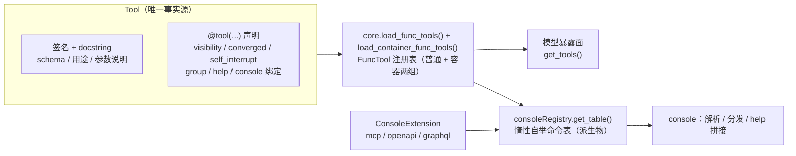

# Console CLI 重构：工具元数据收归 Tool，console 只做收集与拼接

> 状态：设计已确认，待实施（P0 未开始）

## 1. 现状问题：同一个工具的事实散在多处

以 `delete_dept` 为例，要弄清它「能不能被看到 / console 怎么调 / help 写什么」，需要翻这些地方：

| 信息 | 当前位置 | 性质 |
| --- | --- | --- |
| 参数 schema、用途、参数说明 | `tools.py` 签名 + docstring | ✅ 已经在 Tool 上 |
| console 命令名、verb、locator、arity | [consoleCommands.py `COMMAND_SPECS`](../../../src/service/funcToolService/consoleCommands.py) | ❌ console 自建映射 |
| 选项别名（`--kw`、`--tz`…） | `consoleCommands._OPTION_ALIASES` | ❌ 另一张按命令 key 索引的表 |
| help 补充说明 | [consoleTool.py `_HELP_OVERLAY`](../../../src/service/funcToolService/consoleTool.py) | ❌ 手写文档副本 |
| 可见性 | [core.py `_declared_visibility`](../../../src/service/funcToolService/core.py)：**由「console 是否转发它」反推** + `_EXPLICIT_VISIBILITY` + `_CONTAINER_TOOL_VISIBILITY` | ❌ 方向反了：工具可见性依赖 console |
| D2 收敛开关 | `consoleCommands.LEGACY_CONVERGED_TOOLS` | ❌ console 模块里放工具属性 |
| mcp / openapi 转发目标 | `consoleMcp.FORWARD_TOOL_NAMES`、`consoleSpec.FORWARD_TOOL_NAMES`（只为喂给可见性推导） | ❌ |
| 自中断 | 三个 driver 里各写一次 `fn_name == "reload_team"` + `CommandSpec.self_interrupt` | ❌ 4 份 |
| 权限类目 | [toolRegistry.py `CATEGORY_CONFIG`](../../../src/service/agentService/toolRegistry.py) | ⏸ 同类问题，**本期不改**（见 §7） |

此外 console 内部还有零散的硬编码：

- `_build_help_summary` 手写 mcp / openapi / graphql 两行；`console()` 里 `if tokens[0] == "mcp"` 硬分支；
- `console` 自身 docstring 写死资源清单 `dept / agent / room / role / task / container`；
- `_handle_list` 的提示文案写死 `--assignee / --reviewer / --scope / --kw`（本应由 `filter_options` 派生）；
- `_MECHANISM_OPTIONS = {"overwrite"}`、`patch_by_name` 补 `overwrite=True`：工具参数语义写在 console 处理器里；
- `resolve_command_spec` 对 `reload` 特判；`TOP_LEVEL_COMMANDS` 手写；
- `_CLEAR_FIELDS_PLACEHOLDER`：而 `clear_fields` 的 `Literal` 枚举其实已在 schema 里；
- `consoleSchema._tool_metadata` 用 `getattr(tools, name)` 取函数，绕开了注册表（`webFetchTool` 等不在 `tools.py` 的工具无法挂命令）。

**根因**：缺一个「工具声明」载体。签名 / docstring 只能表达 schema，于是所有非 schema 信息只能在别处按工具名建表。

## 2. 目标模型



原则：

1. **Tool 声明自己的一切**：可见性、D2 归属、自中断（静态标志与动态判定器）、分组（`default` / `container`）、console 绑定、help 补充。
2. **console 不认识任何具体工具名**：命令表、help、别名、选项面全部由注册表派生；`consoleRegistry.get_table()` 支持**惰性自举**（未调 `startup()` 的单测在首次访问时自动加载普通工具 + 容器工具 + extensions 完成构建）。
3. **console 自己只保留「CLI 怎么工作」的通用规则**：分词、CSV / JSON / 布尔解析、5 个 verb 处理器、全局用法说明、错误格式。
4. 不能 1:1 映射到单个工具的子树（mcp / openapi / graphql）以**插件（`ConsoleExtension`）**形式注册，而不是在 console 里写 `if`。

## 3. 声明层：`toolSpec.py`（新）

位置 `src/service/funcToolService/toolSpec.py`，只依赖 `constants` + 标准库（纯数据，`tools.py` 可直接 import，不引入环）。

> **第一性原理（Operator 拍板）**：`@tool` 注解只声明**「这条命令需要什么参数，以及 CLI 参数名/位置与 Python 方法参数的映射关系」**——彻底删掉 `Verb`（`GET / LIST / SAVE / DELETE / DIRECT`）、`Locator`、`min_args / max_args / accepts_input / needs_target / patch` 等引擎内部状态分类。参数类型与必填性一律从 Python 函数签名 schema 读取。

```python
ArgSlot = str | tuple[str, ...]                 # 单参数槽 "task_id" / "agent_name"，或多候选定位槽 ("dept_id", "name")

@dataclass(frozen=True)
class ConsoleCommand:
    """工具挂到 console 上的一条子命令（纯参数映射声明，无 Verb 枚举）。

    1. 位置参数映射 (`args`)：
       - 按顺序声明每个位置槽位映射到哪个（或哪组候选）Python 参数名：
         - 单候选槽位（如 `args=("task_id",)`、`args=("container_id", "note")`）：直接映射到该参数，类型与正整数校验从函数 schema 读取；
         - 多候选定位槽位（如 `args=(("dept_id", "name"),)`）：第 1 项（`targets[0]`）为主定位键（schema 为 integer，裸值为纯数字时落它），其余项（`targets[1:]`）既在裸值非数字时承接回退（沿用 D8 兼容语义，确保 `dept get root` / `dept rm 研发部` 100% 兼容），又开启 `<参数名>:<值>` 显式前缀通道（仅在位置参数 0 上拆分，如 `dept update name:研发部 --manager-name 张三`；未声明前缀如 `a:b` 原样当裸值）。
    2. 整份配置载荷 (`payload`)：
       - `payload=True` 表示允许额外传一段内联 JSON 位置参数或 `--from payload`（对应原 10 条 `SAVE` 命令），展开为 Python 方法的关键字参数字典。
       - 位置参数个数上下界自动派生：`min_args = len(args)`，`max_args = len(args) + (1 if payload else 0)`。
    3. 选项别名映射 (`options`)：
       - CLI `--选项` 默认由工具 schema 参数自动暴露；`options` 仅声明**追加别名 → Python 参数真名**（如 `{"kw": "title_keyword"}`、`{"role_name": "name"}`）。
    4. 默认/预设参数 (`defaults` + `filters`)：
       - `filters=()` 时：`defaults` 作为该命令绑定给 Python 方法的默认参数（如 `dept create` 的 `{"member_names": []}`、`dept update` 的 `{"overwrite": True}`）；
       - `filters` 非空时（如 `task ls` 的 `filters=("assignee", "reviewer", "scope", "title_keyword")`）：当且仅当 `filters` 中列出的参数在本次调用中**全部未提供**时，才补入 `defaults`（如 `{"scope": "self"}`）并在返回体写入 `auto_filled_filters`。
    5. 修改动作守卫 (`must_change`)：
       - `must_change=True`（6 条 `update` 命令）要求除位置定位参数与 `mechanism_params`（如 `overwrite`）外，调用方至少提供一项有效字段变更，否则报 `no_update_action`（#187 禁静默成功红线）。
    """
    path: str                                   # "dept get"；顶层命令写 "reload"
    args: tuple[ArgSlot, ...] = ()              # 位置参数槽位 → Python 参数名映射（单参数 str 或多候选 tuple[str, ...]）
    payload: bool = False                       # 是否接受内联 JSON / --from payload 整份配置输入（原 10 条 SAVE 命令）
    options: Mapping[str, str] = {}             # 追加 CLI 选项短别名 → Python 参数真名（如 {"kw": "title_keyword"}）
    defaults: Mapping[str, Any] = {}            # 命令预设/兜底的 Python 参数默认值（如 {"member_names": []}、{"overwrite": True}、{"scope": "self"}）
    must_change: bool = False                   # 修改类命令守卫：除定位参数与 mechanism_params 外必须有实际变更字段（6 条 update 命令）
    filters: tuple[str, ...] = ()               # 过滤参数组（仅 task ls）：该组参数全缺时才触发 defaults 兜底补参
    help: tuple[str, ...] = ()                  # 该命令专属的 help 补充（1 Tool : N Commands 时放命令级，防兄弟命令串台）

    @property
    def key(self) -> str:
        return self.path.strip()

    @property
    def resource(self) -> str:
        return self.key.partition(" ")[0]

    @property
    def action(self) -> str:
        return self.key.partition(" ")[2]

@dataclass(frozen=True)
class ToolSpec:
    visibility: ToolVisibility = ToolVisibility.TOOL_ONLY
    converged: bool = False                     # D2：开关关闭时 BOTH → CONSOLE_ONLY，取代 LEGACY_CONVERGED_TOOLS
    self_interrupt: bool = False                # 静态自中断，取代 driver 里的 fn_name == "reload_team"
    self_interrupt_predicate: Callable[[Any], bool] | None = None  # 动态自中断判定器（console 专用），取代 _SELF_INTERRUPT_PREDICATES
    group: str = "default"                      # "container" 取代 CONTAINER_TOOL_NAMES
    mechanism_params: tuple[str, ...] = ()      # 不构成「更新动作」的机制参数（如 ("overwrite",)），取代 _MECHANISM_OPTIONS
    success_hint: str = ""                      # 成功返回体追加提示（create_task）
    help: tuple[str, ...] = ()                  # 工具级 help 补充：仅限 1:1 工具或该工具所有子命令共用的说明；只进 console help，不进 schema
    console: tuple[ConsoleCommand, ...] = ()

def tool(**kwargs) -> Callable[[F], F]:
    """只往函数上挂 __tool_spec__，不包装函数（签名反射与校验零影响）。"""
```

> [!NOTE]
> **`ConsoleCommand` 第一性原理简化与派生规则要点**：
> 1. **彻底消灭 `Verb`、`Locator` 与包装类（`Locate / Arg`）**：
>    - 命令只声明「位置参数落到哪个 Python 参数（`args`）」、「是否接受 JSON 载荷（`payload`）」、「选项别名（`options`）」与「默认参数（`defaults`）」。
>    - 参数类型直接读函数 schema：`args=("task_id",)` 因 `task_id: int` 自动做正整数校验；`args=("agent_name",)` 因 `agent_name: str` 原样直通；`args=(("dept_id", "name"),)` 因 `(int, str)` 双候选自动启用「纯数字 → `dept_id`、非数字 → `name`、`name:xxx` → `name`」分派。
> 2. **全部旧 `CommandSpec` 属性 100% 由 `args / payload` 自动派生**（零手填）：
>    - `resource, _, action = path.partition(" ")`
>    - `accepts_input = payload`（原 `max_args=0` 在 `accepts_input=True` 时被 `_check_arity` 旁路的死值一并消除）
>    - `min_args = len(args)`，`max_args = len(args) + (1 if payload else 0)`
>    - `has_locator`：`len(args) == 1` 且（`isinstance(args[0], tuple)` 或该单槽在非直通命令中作定位键；P0/P1 中除 `agent wake / agent dm / container note` 3 条直通位置参数命令外，其余 `len(args) == 1` 命令均为 locator）
>    - `locator_kind`：多候选 `len(targets) > 1` ⇒ `"both"`；单候选按 schema `param_kinds(targets[0])` 派生（`"integer"` ⇒ `"id"`，`"string"` ⇒ `"name"`，P0 加 golden 字典断言锁死）
>    - `needs_target = (len(args) == 1)`
> 3. **P2 解锁 `dept update 7 --name 产品部` 时的冲突判定与 Help 联动（防止 help 说谎）**：
>    - **冲突判定**：当 `must_change=True` 且多候选槽位 `("dept_id", "name")` 本次实际命中了 `targets[0]`（如 `dept update 7`）时，允许 `--name` / JSON `name` 作为重命名赋值，仅禁止再传 `--<targets[0]>`（`--dept-id`）；当实际命中了 `targets[1:]`（如 `dept update 研发部` 或 `dept update name:研发部`）或非修改类命令（`must_change=False`，如 `dept get / dept rm`）时，禁止再传全部 `targets`（既解锁 `dept update 7 --name 产品部`，又防止 `dept get 7 --name x` 误放行，且保持存量 `test_cc6_locator_in_options_is_ambiguous` `dept update root --dept_id 1` 继续拦截）。
>    - **Help 与 `display_options` 联动（P2）**：对 `must_change=True` 且带多候选定位槽 `("dept_id", "name")` 的命令（`dept/agent/room update`），仅将 `targets[0]`（`*_id`）从 `display_options` 剔除并标「不接受选项写法」；`targets[1:]`（`name`）在 P2 回归 `display_options`，并在 `_positional_labels` 中标注「按 ID 定位时可用 `--name` 选项重命名」，确保 help 文案与实际行为 100% 一致。

### 3.1 用起来的样子

```python
@tool(
    visibility=ToolVisibility.BOTH,
    converged=True,
    help=(
        "有子部门且未加 --recursive 时由服务层以 DEPT_HAS_CHILDREN 拒绝，不会部分删除。",
        "加 --dry-run 只预演（跑完全部校验，不写库），返回体里是 would_delete。",
    ),
    console=(ConsoleCommand("dept rm", args=(("dept_id", "name"),)),),
)
async def delete_dept(name=None, dept_id=None, recursive=False, dry_run=False, _context=None) -> dict: ...

@tool(
    visibility=ToolVisibility.BOTH, converged=True,
    mechanism_params=("overwrite",),
    console=(
        ConsoleCommand("dept create", payload=True,
                       defaults={"member_names": []},
                       help=("新建必须给 --name / --responsibility / --member-names / --parent-name。",
                             "--dept-id / --clear-fields / --overwrite 属更新语义……")),
        ConsoleCommand("dept update", args=(("dept_id", "name"),), payload=True,
                       defaults={"overwrite": True}, must_change=True,
                       help=("PATCH 语义：只改出现的字段；member_names 出现即全量替换。",
                             "更新一个不存在的名字会落到原工具的「新建」分支……")),
    ),
)
async def save_dept(...): ...

@tool(visibility=ToolVisibility.BOTH,
      console=(ConsoleCommand("task ls",
                              options={"kw": "title_keyword"},
                              filters=("assignee", "reviewer", "scope", "title_keyword"),
                              defaults={"scope": "self"}),))
async def list_tasks(...): ...

@tool(visibility=ToolVisibility.BOTH,
      console=(ConsoleCommand("task get", args=("task_id",)),))
async def get_task_detail(task_id: int, event_limit: int = 3, _context=None) -> dict: ...

@tool(visibility=ToolVisibility.BOTH,
      console=(ConsoleCommand("task update", args=("task_id",), payload=True, must_change=True,
                              options={"status": "new_status", "remove_field": "clear_fields", "action": "workflow_action"}),))
async def update_task(task_id: int, ...): ...

@tool(visibility=ToolVisibility.BOTH, converged=True,
      console=(ConsoleCommand("agent wake", args=("agent_name",)),))
async def wake_up_agent(agent_name: str, _context=None) -> dict: ...

@tool(visibility=ToolVisibility.BOTH, converged=True,
      self_interrupt=True, console=(ConsoleCommand("reload"),))
async def reload_team(_context=None) -> dict: ...

@tool(visibility=ToolVisibility.CONSOLE_ONLY, group="container",
      console=(ConsoleCommand("container note", args=("container_id", "note")),))
async def update_container_note(...): ...
```

`console` 工具本身：`@tool(visibility=TOOL_ONLY, self_interrupt_predicate=console_triggers_self_interrupt)`。

### 3.2 注册表接入与启动/单测统一时序

- `FuncTool` 增加 `spec: ToolSpec` 字段，`load_func_tools()` 与 `load_container_func_tools()` 从 `func.__tool_spec__` 读取（无声明的函数取默认 `ToolSpec()`）。
- `visibility` 从 `spec.visibility` 取，一次性收口 `core.py` 原本的三处可见性事实源（① `_declared_visibility` 推导、② `_EXPLICIT_VISIBILITY`、③ `_CONTAINER_TOOL_VISIBILITY`）。
- `group="container"` 只替换容器工具的分桶依据（取代 `CONTAINER_TOOL_NAMES` 与 `_CONTAINER_TOOL_VISIBILITY`），`_func_tools` 与 `_container_func_tools` 两组字典在 `core.py` 中**仍保持物理分离**（保证 `get_tools()` 默认不带容器工具，Native / Claude SDK 暴露面零变化）。
- **惰性自举与防循环 import 三条硬约束（C-a / C-b / C-c）**：
  1. **构建不依赖 `core`（C-b）**：`keep_legacy_admin_tools()` 与 `resolve_effective_visibility()` 下沉到 `toolSpec` / `consoleRegistry`，由 `core` 反向 import；`consoleRegistry.get_table()` 构建时只需确保 `tools`（内含 44 个工具：38 普通 + 6 容器，含同步函数 `get_time`）与 `consoleTool`（含 `console` 自身，合计 45 个工具）已导入并构造 `FuncTool`，**绝不在 `build()` 内反向调用 `core`**，避免 `import core` 半初始化重入导致的 `AttributeError`。
  2. **`HELP_SUMMARY` 与 `HELP_DETAIL` 同走 PEP 562 惰性属性（C-a / C-c）**：`consoleTool.py` 删掉模块顶层的 `HELP_SUMMARY = _build_help_summary()` 立即求值，与 `HELP_DETAIL` 一起通过 `consoleTool.__getattr__` 在首次访问时生成——既消除 `import consoleTool` 期间的顶层抢跑建表，又保证 P3 接入 `extension.summary` 时扩展已注册完毕。
  3. **新模块顶层零 `core / tools` import**：`toolSpec.py`、`consoleRegistry.py`、`consoleCommands.py` 顶层均不 import `core` 或 `tools`，对外符号通过函数内延迟 import 或 PEP 562 `__getattr__` 转发给 `get_table()`。

## 4. 派生层：console 侧

### 4.1 `consoleRegistry.py`（新，取代 `COMMAND_SPECS` 及其索引）

```python
@dataclass(frozen=True)
class ResolvedCommand:          # 运行时命令 = 声明 + 所属工具（兼容原 CommandSpec 接口）
    decl: ConsoleCommand
    tool: FuncTool | None       # HELP_SPEC 等纯本地无工具命令为 None；其余必有 FuncTool

class CommandTable:
    specs: tuple[ResolvedCommand, ...]
    by_path: dict[str, ResolvedCommand]
    by_resource: dict[str, tuple[ResolvedCommand, ...]]
    extensions: dict[str, ConsoleExtension]

def build(func_tools: Iterable[FuncTool], extensions: Iterable[ConsoleExtension] = ()) -> CommandTable
def get_table() -> CommandTable
```

- `build` 接受任意 `FuncTool` 可迭代对象 ⇒ 单测也可以直接传假工具建表测试 fail-fast。
- `HELP_SPEC` 作为 `tool=None` 的内置本地命令保留在 `CommandTable` 中，使 `resolve_command_spec(["help", ...])` 原样工作。
- 选项面（`param_names / option_kinds / boolean_options / command_options_map / display_options / positional_param_names`）逻辑原样保留，schema 来源从 `getattr(tools, name)` 改为 `resolved.tool`。
- 自中断统一由 `FuncTool.spec` 提供：三个 driver 注册工具时读 `func_tool.spec.self_interrupt` 与 `func_tool.spec.self_interrupt_predicate`，删掉 `"reload_team"` 与 `"console"` 名字硬编码。

### 4.2 构建期一致性校验（fail-fast，取代散落的结构测试）

`build()` 时直接 `raise`（`tool=None` 的 `HELP_SPEC` 豁免工具 schema 校验）：

- 两个工具声明了同一 `key`；同一命令下别名撞真名 / kebab 撞键（现有 `_register` 逻辑）；
- `args`（展开全部槽位候选参数名）、`options` 的目标、`defaults` 的键、`filters`、`mechanism_params` 不在该工具 schema 里，或同一多候选槽位内有重复参数名；
- 多位置参数顺序校验：当 `len(args) > 1`（或单槽直通命令）时，`tuple(param_names[:len(args)]) == args`（防止工具参数调换顺序后位置参数静默塞错位）；
- 凡 schema 含 `overwrite` 的 SAVE 工具（`save_dept / save_agent / save_room / save_role_template`）均须声明 `mechanism_params=("overwrite",)`；
- 挂了 console 命令的工具，静态 `visibility` 不是 `console_visible`；
- `converged=True` 但 `visibility != BOTH`；
- `CONSOLE_ONLY` 工具既无命令、也没被任何 extension 用作转发目标（死工具，告警/报错）。

### 4.3 可见性

```python
def effective_visibility(tool: FuncTool) -> ToolVisibility:
    v = tool.spec.visibility
    if v == BOTH and tool.spec.converged and not keep_legacy_admin_tools():
        return CONSOLE_ONLY
    return v
```

删除：`_declared_visibility`、`_CONSOLE_FORWARD_TARGETS`、`_EXPLICIT_VISIBILITY`、`_CONTAINER_TOOL_VISIBILITY`、`LEGACY_CONVERGED_TOOLS`、两个 `FORWARD_TOOL_NAMES`、`CONTAINER_TOOL_NAMES`。命令是否可用 = 其工具的 `effective_visibility().console_visible`（运行时判，保持 D2 可在进程内切换）。

### 4.4 help = 纯拼接

| help 片段 | 来源 |
| --- | --- |
| 摘要每行 `resource  ls\|get\|...` | `table.by_resource` |
| mcp / openapi / graphql 摘要行 | `extension.summary`（按去重后的 extension 顺序附加） |
| 用法行 | `ConsoleCommand`（`args` + `payload` 派生） |
| 用途 | 工具 description 首句 |
| 参数清单（含必填、别名、位置参数标注、形态说明） | 工具 schema + `ConsoleCommand.options` + `args` |
| **枚举与可清除字段** | P0/P1 保持现有 `{ALLOWED_CLEAR_FIELDS}` 动态渲染不变；P2 评估由 schema / 常量统一派生（须同步兼容或更新 `test_console_task` 的 monkeypatch 判据） |
| fallback 提示 | `ConsoleCommand.filters` + `defaults` 生成（`_handle_list` 的硬编码文案同步改为派生） |
| 补充说明 | `ToolSpec.help`（工具级）+ `ConsoleCommand.help`（命令级） |
| 全局规则（重复选项、CSV / JSON 等价） | console 自有常量（属 CLI 规则，合理保留） |

> [!IMPORTANT]
> `help` 两个属性都**只进 console help，不进 `get_function_metadata` 产出的 schema**，docstring 不改，因此迁移后下发给模型的工具 schema 与现在逐字节一致（#154 token 口径不变）。

### 4.5 `_HELP_OVERLAY` 逐条归宿（严禁 1:N 工具把单命令说明放进 `@tool(help=...)`）

> **归属铁律**：凡 `1 Tool → N Commands` 的工具（`get_dept_info`、`save_dept`、`get_agent_info`、`save_agent`、`get_room_info`、`save_room`、`save_role_template`），只要某条说明不是该工具下**所有**子命令共用，就**必须**挂在 `ConsoleCommand(help=...)` 上，否则会串台污染兄弟命令（例如 `agent get` 的错误码不能出现在 `help agent ls`，`role create` 的限制不能出现在 `help role update`）。

| 原条目 | 归宿 |
| --- | --- |
| **1:1 工具**（`dept rm`、`room rm`、`role rm`、`reload`、`task ls`、`task create`、`task update`）的补充说明 | `ConsoleCommand(help=...)` 或 `@tool(help=...)`（1:1 下两者等价；建议 P0/P1 统一放 `ConsoleCommand(help=...)` 以保证 100% 机械对齐） |
| **1:N 工具的单命令专属说明**：`agent get` 错误码（不进 `agent ls`）；`role create` 限制（不进 `role update`）；`* update` 的 PATCH 语义；`* create` 的「更新语义参数可一并传入」；`agent update` 同名用 id 定位 | **必须**放 `ConsoleCommand(help=...)`（命令级） |
| `task create` 不唤醒执行人（返回体 `hint`） | `@tool(success_hint=...)`（help 文案仍在 `ConsoleCommand(help=...)`） |
| （P2）`task ls` 状态枚举、`task create` 必填项、`task ls` 过滤项说明、`task update` 数组型可重复说明 | P0/P1 原样保留在 `ConsoleCommand(help=...)` 确保 `help diff == 空`；P2 再做去重派生 |

### 4.6 `ConsoleExtension`：mcp / openapi / graphql

```python
class ConsoleExtension(Protocol):
    resources: tuple[str, ...]                  # ("mcp",) / ("openapi", "graphql")
    summary: str                                # help 摘要行（openapi / graphql 共用一行摘要）
    def help_payload(self, tokens: list[str]) -> dict[str, Any]: ...
    async def dispatch(self, command: str, tokens: list[str], ctx: Any) -> dict[str, Any]: ...
```

- 直接对齐现网 `consoleMcp` 与 `consoleSpec` 已有的 `help_payload(tokens) -> dict` 和 `dispatch(command, tokens, ctx) -> dict` 签名：
  - `console("mcp --help")` 走 `ext.dispatch(...)` 返回原结构；
  - `console("help mcp ...")` 走 `ext.help_payload([resource] + tokens[2:])`，由 `_help_text` 取 `payload.get("text")` 渲染，保证现有返回契约零回归。
- `openapi` 与 `graphql` 共用一个 `SpecConsoleExtension(resources=("openapi", "graphql"), summary="openapi / graphql：...")`，摘要迭代去重后的 `extensions`，保持 `_build_help_summary` 现有的两行扩展摘要格式不变。
- 转发目标的可见性由各工具自己的 `@tool` 声明（`openapi_call / graphql_call` 写 `CONSOLE_ONLY`），extension 不再需要导出 `FORWARD_TOOL_NAMES`。

## 5. 保留在 console 里的东西（不属于「工具信息」）

`consoleParsing`（分词、选项解析、`--from payload`）、`consoleSchema` 的类型 → 命令行形态翻译、通用参数映射与合并引擎（原 5 个 verb 处理器收拢为统一的「按 `args` 映射位置参数 + `payload` / `--选项` 收集 + `filters/defaults` 补值 + `must_change` 校验」）、`ForwardToolCall` 转发、错误格式、全局用法文案。这些是「CLI 引擎」，与具体工具无关。

## 6. 迁移计划

| 阶段 | 内容 | 护栏 |
| --- | --- | --- |
| **P0** | 新增 `toolSpec.py` + `consoleRegistry.py`；在 `tools.py`（44 个工具）及 `consoleTool.py`（`console`）共 45 个工具函数挂上 `@tool(...)` 声明；旧 `COMMAND_SPECS` 等表原地保留作为只读对照基线，不写两遍过渡生成代码 | ① **import 冒烟**：`python -c "import service.funcToolService.consoleCommands"` 零异常、无半初始化重入；新模块顶层零 `core / tools` import；<br/>② **安全与可见性等价（45 个工具全覆盖）**：对 39 个普通工具（`tools.py` 38 个含同步 `get_time` + `consoleTool.console`）+ 6 个容器工具逐个断言新旧 `effective_visibility` 一致（D2 开/关双向），**单点硬断言 `update_container_note == CONSOLE_ONLY`**，且 `{n for n, s in REGISTERED_TOOLS.items() if s.group == "container"}` 精确等于原 `CONTAINER_TOOL_NAMES` 6 项；<br/>③ **命令表、定位三态与 help 等价**：按下方「旧 `CommandSpec` 18 字段 → 新来源」对照表断言 28 条命令派生视图（含 `{c.key: c.locator_kind}` golden 字典及 `both` 态命令对数字/非数字裸值的 `_locator_args` 映射）与旧表逐项相等；新旧 `HELP_SUMMARY` / `HELP_DETAIL` 全量文本 diff == 空 |
| **P1** | 切换消费方到 `consoleRegistry.get_table()`；`HELP_SUMMARY` 改为 PEP 562 惰性属性；删旧 `COMMAND_SPECS`、`_OPTION_ALIASES`、`_HELP_OVERLAY`、`LEGACY_CONVERGED_TOOLS`、`_declared_visibility` 一族（含 `_EXPLICIT_VISIBILITY` / `_CONTAINER_TOOL_VISIBILITY`）、两个 `FORWARD_TOOL_NAMES`、`CONTAINER_TOOL_NAMES`，并同步移除 `empty_target_hint / example / option_tip` 的死消费分支；driver 自中断改读 `FuncTool.spec`；`consoleCommands` 留 PEP 562 `__getattr__` 兼容层 | P0 的全部等价测试与现有全量 console 单测/集成测试继续绿 |
| **P2** | 定位语法与引擎/help 收拢：① 支持 `<id>` 与 `name:<名称>`（`key:value` 显式前缀）定位语法；② `_handle_save` 的 `overlap` 冲突判定改按本次 resolved target 判定（当 `must_change=True` 且命中 `targets[0]` 时放行 `--name` 重命名、仅禁 `targets[0]`；命中 `targets[1:]` 或 `must_change=False` 时禁全部 `targets`）；③ 同步更新 `must_change=True` 多候选定位命令的 `display_options` 与 `_positional_labels`（`--name` 回归可用选项面并标注「按 ID 定位时可用 `--name` 重命名」，防止 help 仍写「不接受 `--name` 选项写法」与新行为自相矛盾）；④ 统一类型驱动正整数校验（`dept rm 0` 统一报 `invalid_target` 纳入白名单）；`_MECHANISM_OPTIONS` 改读 `spec.mechanism_params`（附变异测试）；`reload` 特判改由 `action == ""` 通用顶层命令规则派生；提示文案由 `filters` 派生 | ① **8 行定位与冲突判定矩阵全绿**：<br/>1) `dept update 7 --name 产品部` ⇒ ✅ 合法（`dept_id=7, name="产品部", overwrite=True`，且 `name` 计入有效动作、不报 `no_update_action`）；<br/>2) `dept update 7 '{"name":"产品部"}'` ⇒ ✅ 合法（JSON 路径）；<br/>3) `dept update 7 --from payload --name 产品部` ⇒ ❌ `ambiguous_input_source`（选项与 payload 同键 `duplicates` 判定保持生效）；<br/>4) `dept update 7 --dept-id 8` ⇒ ❌ `ambiguous_input_source`（命中 `targets[0]` 后再传 `targets[0]`）；<br/>5) `dept update root --dept_id 1` ⇒ ❌ `ambiguous_input_source`（存量 `test_cc6_locator_in_options_is_ambiguous` 原用例必须继续拦截）；<br/>6) `dept update root --name 产品部` ⇒ ❌ `ambiguous_input_source`（按名定位又传 `--name` 同键双值）；<br/>7) `dept update name:研发部 --manager-name 张三` ⇒ ✅ 合法（`key:value` 显式通道）；<br/>8) `dept get a:b`（`a` 不在 `targets[1:]`）⇒ ✅ 合法（未声明前缀整串当裸值）；<br/>② help 文本有意变化处人工审 diff（含 `dept/agent/room update` 的 `--name` 选项说明）；更新 help 体积基线（#154 CC6）；保持 `test_console_task` 动态白名单判据通过 |
| **P3** | `ConsoleExtension` 协议接入 `mcp / openapi / graphql`；视需要更新 `console` docstring 资源描述（若改 docstring 须同步更新 `test_tool_schema_snapshot.py` 与 `test_tool_schema_nullable.py:878-883` 的 `tools == 45 / params == 146 / BASELINE_TEXT_DIGEST` 基线） | 现有 mcp / spec 测试全绿 |

### 6.1 P0 对照基线：旧 `CommandSpec` 18 字段 → 新声明/派生来源

| 旧 `CommandSpec` 字段 | 新模型来源 / 派生公式 |
| --- | --- |
| `key / resource / action` | `cmd.path`（`resource, _, action = path.partition(" ")`） |
| `legacy_tool` | `@tool` 装饰的目标函数名 `tool.name` |
| `verb` | P0/P1 兼容期由 `payload`（`SAVE ↔ True`）+ `args` 形态派生；P2 引擎收拢为单一参数映射流水线后废弃 |
| `accepts_input` | `cmd.payload` |
| `needs_target` | `len(cmd.args) == 1` |
| `min_args / max_args` | `len(cmd.args)` / `len(cmd.args) + (1 if cmd.payload else 0)` |
| `locator`（`id_param / name_param / kind`） | `cmd.args[0]` 的候选元组 + schema `param_kinds(targets[0])`（配 7 行 golden 字典断言） |
| `positional_param_names` | P0/P1 为 locator 槽位的候选参数名；P2 对 `must_change=True` 的多候选槽位仅剔除 `targets[0]`（使 `--name` 回归 `display_options`） |
| `aliases` | `cmd.options` |
| `input_defaults` | `cmd.defaults`（排除 `overwrite` 与带 `filters` 的兜底项） |
| `patch_by_name` | `cmd.defaults.get("overwrite") is True` |
| `filter_options / fallback_options` | `cmd.filters` / `cmd.defaults`（当 `cmd.filters` 非空时） |
| `help / success_hint` | `cmd.help` + `tool.spec.help` / `tool.spec.success_hint` |
| `empty_target_hint / example / option_tip` | 删除（0 赋值僵尸字段，P1 同步删消费分支） |

**行为必须保持不变（P0 / P1）**：现在推导出的可见性要逐个写成显式声明——所有 console 转发目标（含 `list_tasks / get_task_detail / update_task / create_task` 与 mcp 注册表四工具）为 `BOTH`，`openapi_call / graphql_call / update_container_note` 为 `CONSOLE_ONLY`，其余 `TOOL_ONLY`；task 三工具保持 `converged=False`（沿用 #187 裁定②）。

**测试与生产兼容层（P1）**：`core.py` 与 11 个测试文件（90+ 处引用）直接访问 `consoleCommands` 的符号。P1 在 `consoleCommands.py` 保留必导符号 `ENV_KEEP_LEGACY_TOOLS / COMMAND_SPECS / COMMAND_INDEX / LEGACY_CONVERGED_TOOLS / HELP_SPEC / to_kebab`（有实测引用）及顺手导出的 `Locator / Verb / CommandSpec / resolve_command_spec / command_console_visible / RESOURCE_NAMES / ACTIONS_BY_RESOURCE / SPECS_BY_RESOURCE`，通过 PEP 562 `__getattr__` 转发给 `consoleRegistry.get_table()`，确保外部零改动平滑切换。

## 7. 决策记录

| # | 问题 | 结论 |
| --- | --- | --- |
| 1 | 声明写在哪 | `@tool(...)` 装饰器直接挂在工具函数上，与签名 / docstring 同处 |
| 2 | 命令级 / 工具级 help 补充放哪 | 装饰器属性 `ToolSpec.help` / `ConsoleCommand.help`；只进 console help，不进 schema、不改 docstring |
| 3 | `CATEGORY_CONFIG` 是否一起收进 `ToolSpec` | **本期不改**。原因：表里含 11 个 TSP 外部工具无法挂装饰器，收不干净；且它是权限面，与 console 重构同时动会增加排障难度。后续如需收敛，在 `ToolSpec` 加 `category` 字段、`FuncTool.to_openai_tool()` 填 `OpenAITool.category` 即可，`AgentToolRegistry.register()` 已支持优先读 `tool.category` |
