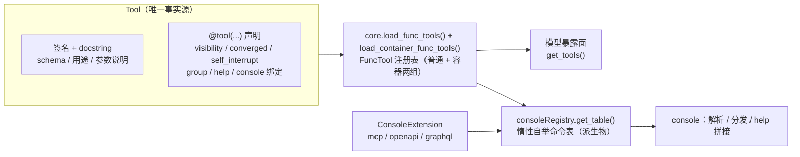

# Console CLI 重构：工具元数据收归 Tool，console 只做收集与拼接

> 状态：设计已确认，待实施（P0 未开始）

## 1. 现状问题：同一个工具的事实散在多处

以 `delete_dept` 为例，要弄清它「能不能被看到 / console 怎么调 / help 写什么」，需要翻这些地方：

| 信息 | 当前位置 | 性质 |
| --- | --- | --- |
| 参数 schema、用途、参数说明 | `tools.py` 签名 + docstring | ✅ 已经在 Tool 上 |
| console 命令名、verb、locator、arity | [consoleCommands.py `COMMAND_SPECS`](../../../src/service/funcToolService/consoleCommands.py) | ❌ console 自建映射 |
| 选项别名（`--kw`、`--tz`…） | `consoleCommands._OPTION_ALIASES` | ❌ 另一张按命令 key 索引的表 |
| help 补充说明 | [consoleTool.py `_HELP_OVERLAY`](../../../src/service/funcToolService/consoleTool.py) | ❌ 手写文档副本 |
| 可见性 | [core.py `_declared_visibility`](../../../src/service/funcToolService/core.py)：**由「console 是否转发它」反推** + `_EXPLICIT_VISIBILITY` + `_CONTAINER_TOOL_VISIBILITY` | ❌ 方向反了：工具可见性依赖 console |
| D2 收敛开关 | `consoleCommands.LEGACY_CONVERGED_TOOLS` | ❌ console 模块里放工具属性 |
| mcp / openapi 转发目标 | `consoleMcp.FORWARD_TOOL_NAMES`、`consoleSpec.FORWARD_TOOL_NAMES`（只为喂给可见性推导） | ❌ |
| 自中断 | 三个 driver 里各写一次 `fn_name == "reload_team"` + `CommandSpec.self_interrupt` | ❌ 4 份 |
| 权限类目 | [toolRegistry.py `CATEGORY_CONFIG`](../../../src/service/agentService/toolRegistry.py) | ⏸ 同类问题，**本期不改**（见 §7） |

此外 console 内部还有零散的硬编码：

- `_build_help_summary` 手写 mcp / openapi / graphql 两行；`console()` 里 `if tokens[0] == "mcp"` 硬分支；
- `console` 自身 docstring 写死资源清单 `dept / agent / room / role / task / container`；
- `_handle_list` 的提示文案写死 `--assignee / --reviewer / --scope / --kw`（本应由 `filter_options` 派生）；
- `_MECHANISM_OPTIONS = {"overwrite"}`、`patch_by_name` 补 `overwrite=True`：工具参数语义写在 console 处理器里；
- `resolve_command_spec` 对 `reload` 特判；`TOP_LEVEL_COMMANDS` 手写；
- `_CLEAR_FIELDS_PLACEHOLDER`：而 `clear_fields` 的 `Literal` 枚举其实已在 schema 里；
- `consoleSchema._tool_metadata` 用 `getattr(tools, name)` 取函数，绕开了注册表（`webFetchTool` 等不在 `tools.py` 的工具无法挂命令）。

**根因**：缺一个「工具声明」载体。签名 / docstring 只能表达 schema，于是所有非 schema 信息只能在别处按工具名建表。

## 2. 目标模型



原则：

1. **Tool 声明自己的一切**：可见性、D2 归属、自中断（静态标志与动态判定器）、分组（`default` / `container`）、console 绑定、help 补充。
2. **console 不认识任何具体工具名**：命令表、help、别名、选项面全部由注册表派生；`consoleRegistry.get_table()` 支持**惰性自举**（未调 `startup()` 的单测在首次访问时自动加载普通工具 + 容器工具 + extensions 完成构建）。
3. **console 自己只保留「CLI 怎么工作」的通用规则**：分词、CSV / JSON / 布尔解析、5 个 verb 处理器、全局用法说明、错误格式。
4. 不能 1:1 映射到单个工具的子树（mcp / openapi / graphql）以**插件（`ConsoleExtension`）**形式注册，而不是在 console 里写 `if`。

## 3. 声明层：`toolSpec.py`（新）

位置 `src/service/funcToolService/toolSpec.py`，只依赖 `constants` + 标准库（纯数据，`tools.py` 可直接 import，不引入环）。

```python
Verb = Literal["GET", "LIST", "SAVE", "DELETE", "DIRECT"]

@dataclass(frozen=True)
class ConsoleCommand:
    """工具挂到 console 上的一条子命令。
    
    位置参数定位规则（Operator 拍板，统一「找谁」与「改什么」的语法边界）：
    - 位置参数永远是「找谁（目标定位）」，`--选项` 永远是「改什么（字段赋值）」；
    - `target` 支持传单个参数名（`target="task_id"`）或参数名元组（`target=("dept_id", "name")`）：
      - 第 1 个参数（`targets[0]`）是**默认主定位键**：裸值（无 `:`，或 `:` 前缀不在 `targets[1:]` 内）落到它（如 `dept update 7 --name 产品部` → `dept_id=7, name="产品部"`）；
      - 其余参数（`targets[1:]`）直接以**参数名本身**作为 `key:value` 前缀（仅在位置参数 0 上拆分，如 `dept update name:研发部 --manager-name 张三` → `name="研发部"`；名字本身含冒号但前缀不在 `targets[1:]` 时整串原样作为裸值）。
    - **冲突判定与工具层边界**：
      - 本期**不修改底层工具签名**（保持 45 工具 / 146 参数 schema 逐字节不变）：`save_dept / save_agent / save_room` 原生支持「按 ID 定位 + `name` 重命名」（`dept update 7 --name 产品部` 合法），但工具层 `name` 只有一个键，不支持同时按 `name` 定位又传 `--name` 改名（同键双值仍报 `ambiguous_input_source`；按旧名改名需工具层新增 `from_name` 参数，单独立项评估）。
      - `_handle_save` 的定位与配置冲突判定为：**本次实际命中了 `id_param`（如 `dept update 7`）时，允许 `--name` / JSON `name` 作为重命名赋值，但禁止再传 `--dept-id`；本次实际命中了 `name_param`（如 `dept update 研发部` 或 `dept update name:研发部`）时，同时禁止再传 `--name` 与 `--dept-id`**（既解锁 `dept update 7 --name 产品部` 改名能力，又保持存量 `test_cc6_locator_in_options_is_ambiguous` `dept update root --dept_id 1` 继续拦截）。
    """
    path: str                                   # "dept get"；顶层命令写 "reload"
    verb: Verb = "DIRECT"                       # GET / LIST / SAVE / DELETE / DIRECT
    target: str | tuple[str, ...] = ()          # 定位参数名：单值 "task_id" 或元组 ("dept_id", "name")（首项为默认裸定位，其余支持 key:value）
    positional: tuple[str, ...] = ()            # DIRECT 命令按序映射的位置参数名（agent wake → ("agent_name",)，container note → ("container_id", "note")）
    defaults: Mapping[str, Any] = {}            # 配置层 setdefault 补值（如 dept create 的 {"member_names": []}，显式 null 保留）
    patch: bool = False                         # update 类命令的 PATCH 标记（args.get("overwrite") is None 时补 True）
    aliases: Mapping[str, str] = {}             # 命令级短别名 → 参数真名（如 role update 的 {"role_name": "name"}、task ls 的 {"kw": "title_keyword"}）
    help: tuple[str, ...] = ()                  # 该命令专属的 help 补充（1 Tool : N Commands 时放命令级，防兄弟命令串台）

    @property
    def targets(self) -> tuple[str, ...]:
        return (self.target,) if isinstance(self.target, str) else self.target

    @property
    def key(self) -> str:
        return self.path.strip()

    @property
    def resource(self) -> str:
        return self.key.partition(" ")[0]

    @property
    def action(self) -> str:
        return self.key.partition(" ")[2]

@dataclass(frozen=True)
class ToolSpec:
    visibility: ToolVisibility = ToolVisibility.TOOL_ONLY
    converged: bool = False                     # D2：开关关闭时 BOTH → CONSOLE_ONLY，取代 LEGACY_CONVERGED_TOOLS
    self_interrupt: bool = False                # 静态自中断，取代 driver 里的 fn_name == "reload_team"
    self_interrupt_predicate: Callable[[Any], bool] | None = None  # 动态自中断判定器（console 专用），取代 _SELF_INTERRUPT_PREDICATES
    group: str = "default"                      # "container" 取代 CONTAINER_TOOL_NAMES
    mechanism_params: tuple[str, ...] = ()      # 不构成「更新动作」的参数，取代 _MECHANISM_OPTIONS
    filter_options: tuple[str, ...] = ()        # LIST 工具必填过滤项（list_tasks）
    fallback_options: Mapping[str, Any] = {}    # 过滤项全缺时的自动补参（{"scope": "self"}）
    success_hint: str = ""                      # 成功返回体追加提示（create_task）
    help: tuple[str, ...] = ()                  # 工具级 help 补充：仅限 1:1 工具或该工具所有子命令共用的说明；只进 console help，不进 schema
    console: tuple[ConsoleCommand, ...] = ()

def tool(**kwargs) -> Callable[[F], F]:
    """只往函数上挂 __tool_spec__，不包装函数（签名反射与校验零影响）。"""
```

> [!NOTE]
> **`ConsoleCommand` 简化与定位语法升级要点**：
> 1. **只用一个 `target` 字段搞定主定位与 `key:value` 定位（消灭 `Locator` 与 `alt_targets` 字典）**：
>    - 因为 `key:value` 的前缀本来就叫 `name`，与底层工具参数名完全同名，`alt_targets={"name": "name"}` 这种 key/value 重复写两遍的字典完全多余！
>    - 直接把 `target` 设计为 `str | tuple[str, ...] = ()`：
>      - 只有一个定位键时写字符串：`target="task_id"` 或 `target="role_name"`；
>      - 支持 ID + 名称双定位时写元组：`target=("dept_id", "name")`（第 1 项 `"dept_id"` 接裸值 `7`，后面项 `"name"` 自动开启 `name:研发部` 前缀匹配）。
> 2. **砍掉 3 个僵尸字段（B 项）**：`empty_target_hint`、`example`、`option_tip` 在 `#291` 迁出 `mcp` 后全表 28 条命令 **0 赋值**，从声明模型与消费分支（`consoleTool._check_arity`、`consoleParsing._unknown_option_error` 及 line 247 特例）一并移除。
> 3. **5 个定位/计数属性 100% 自动派生**（在 `ResolvedCommand` 上计算，零手填）：
>    - `resource, _, action = path.partition(" ")`
>    - `accepts_input = (verb == "SAVE")`（现网 10 条 `SAVE` 命令 100% 为 `True`，其余 18 条 100% 为 `False`）
>    - `has_locator = bool(targets)`
>    - `locator_kind`：`len(targets) > 1` ⇒ `"both"`；`len(targets) == 1` 时按工具 schema 中 `param_kinds(targets[0])` 派生（`"integer"` ⇒ `"id"`，`"string"` ⇒ `"name"`；与现网全部带 locator 命令的 `Locator.kind` 100% 一致，并在 P0 加 golden 字典断言锁死）
>    - `needs_target = has_locator or len(positional) == 1`（`agent wake` / `agent dm` 声明 `positional=("agent_name",)` ⇒ `needs_target=True`，用法行原样产出 `<target>` 且 `--agent-name` 保留在 `display_options`）
>    - `min_args = max_args = 1 if has_locator else len(positional)`
>    - `positional_param_names`：取 `targets`（`verb == "DIRECT"` 的 `positional` 不从 `display_options` 剔除）
> 4. **区分两套补值语义（D 项）与命令级 `aliases`（A 项）**：
>    - `defaults`：对应 config 层的 `setdefault`（仅 `dept create` 的 `member_names=[]`，在输入冲突检测之后、选项合并之前应用，显式 `null` 保留）；
>    - `patch: bool = False`：对应 update 命令的 `overwrite` 补值（在 `_locator_args` 之后，仅当 `args.get("overwrite") is None` 时补 `True`，允许显式 `--overwrite=false` 覆盖）；
>    - `aliases` 保留在 `ConsoleCommand`（命令级），避免 `save_role_template` 的 `role update` 别名 `--role-name` 泄漏到兄弟命令 `role create`。

### 3.1 用起来的样子

```python
@tool(
    visibility=ToolVisibility.BOTH,
    converged=True,
    help=(
        "有子部门且未加 --recursive 时由服务层以 DEPT_HAS_CHILDREN 拒绝，不会部分删除。",
        "加 --dry-run 只预演（跑完全部校验，不写库），返回体里是 would_delete。",
    ),
    console=(ConsoleCommand("dept rm", "DELETE", target=("dept_id", "name")),),
)
async def delete_dept(name=None, dept_id=None, recursive=False, dry_run=False, _context=None) -> dict: ...

@tool(
    visibility=ToolVisibility.BOTH, converged=True,
    mechanism_params=("overwrite",),
    console=(
        ConsoleCommand("dept create", "SAVE",
                       defaults={"member_names": []},
                       help=("新建必须给 --name / --responsibility / --member-names / --parent-name。",
                             "--dept-id / --clear-fields / --overwrite 属更新语义……")),
        ConsoleCommand("dept update", "SAVE", target=("dept_id", "name"),
                       patch=True,
                       help=("PATCH 语义：只改出现的字段；member_names 出现即全量替换。",
                             "更新一个不存在的名字会落到原工具的「新建」分支……")),
    ),
)
async def save_dept(...): ...

@tool(visibility=ToolVisibility.BOTH, converged=True,
      console=(ConsoleCommand("task get", "GET", target="task_id"),))
async def get_task_detail(task_id: int, event_limit: int = 3, _context=None) -> dict: ...

@tool(visibility=ToolVisibility.BOTH, converged=True,
      console=(ConsoleCommand("agent wake", positional=("agent_name",)),))
async def wake_up_agent(agent_name: str, _context=None) -> dict: ...

@tool(visibility=ToolVisibility.BOTH, converged=True,
      self_interrupt=True, console=(ConsoleCommand("reload"),))
async def reload_team(_context=None) -> dict: ...

@tool(visibility=ToolVisibility.CONSOLE_ONLY, group="container",
      console=(ConsoleCommand("container note", positional=("container_id", "note")),))
async def update_container_note(...): ...
```

`console` 工具本身：`@tool(visibility=TOOL_ONLY, self_interrupt_predicate=console_triggers_self_interrupt)`。

### 3.2 注册表接入与启动/单测统一时序

- `FuncTool` 增加 `spec: ToolSpec` 字段，`load_func_tools()` 与 `load_container_func_tools()` 从 `func.__tool_spec__` 读取（无声明的函数取默认 `ToolSpec()`）。
- `visibility` 从 `spec.visibility` 取，一次性收口 `core.py` 原本的三处可见性事实源（① `_declared_visibility` 推导、② `_EXPLICIT_VISIBILITY`、③ `_CONTAINER_TOOL_VISIBILITY`）。
- `group="container"` 只替换容器工具的分桶依据（取代 `CONTAINER_TOOL_NAMES` 与 `_CONTAINER_TOOL_VISIBILITY`），`_func_tools` 与 `_container_func_tools` 两组字典在 `core.py` 中**仍保持物理分离**（保证 `get_tools()` 默认不带容器工具，Native / Claude SDK 暴露面零变化）。
- **惰性自举与防循环 import 三条硬约束（C-a / C-b / C-c）**：
  1. **构建不依赖 `core`（C-b）**：`keep_legacy_admin_tools()` 与 `resolve_effective_visibility()` 下沉到 `toolSpec` / `consoleRegistry`，由 `core` 反向 import；`consoleRegistry.get_table()` 构建时只需确保 `tools`（内含 44 个工具：38 普通 + 6 容器，含同步函数 `get_time`）与 `consoleTool`（含 `console` 自身，合计 45 个工具）已导入并构造 `FuncTool`，**绝不在 `build()` 内反向调用 `core`**，避免 `import core` 半初始化重入导致的 `AttributeError`。
  2. **`HELP_SUMMARY` 与 `HELP_DETAIL` 同走 PEP 562 惰性属性（C-a / C-c）**：`consoleTool.py` 删掉模块顶层的 `HELP_SUMMARY = _build_help_summary()` 立即求值，与 `HELP_DETAIL` 一起通过 `consoleTool.__getattr__` 在首次访问时生成——既消除 `import consoleTool` 期间的顶层抢跑建表，又保证 P3 接入 `extension.summary` 时扩展已注册完毕。
  3. **新模块顶层零 `core / tools` import**：`toolSpec.py`、`consoleRegistry.py`、`consoleCommands.py` 顶层均不 import `core` 或 `tools`，对外符号通过函数内延迟 import 或 PEP 562 `__getattr__` 转发给 `get_table()`。

## 4. 派生层：console 侧

### 4.1 `consoleRegistry.py`（新，取代 `COMMAND_SPECS` 及其索引）

```python
@dataclass(frozen=True)
class ResolvedCommand:          # 运行时命令 = 声明 + 所属工具（兼容原 CommandSpec 接口）
    decl: ConsoleCommand
    tool: FuncTool | None       # HELP_SPEC 等纯本地无工具命令为 None；其余必有 FuncTool

class CommandTable:
    specs: tuple[ResolvedCommand, ...]
    by_path: dict[str, ResolvedCommand]
    by_resource: dict[str, tuple[ResolvedCommand, ...]]
    extensions: dict[str, ConsoleExtension]

def build(func_tools: Iterable[FuncTool], extensions: Iterable[ConsoleExtension] = ()) -> CommandTable
def get_table() -> CommandTable
```

- `build` 接受任意 `FuncTool` 可迭代对象 ⇒ 单测也可以直接传假工具建表测试 fail-fast。
- `HELP_SPEC` 作为 `tool=None` 的内置本地命令保留在 `CommandTable` 中，使 `resolve_command_spec(["help", ...])` 原样工作。
- 选项面（`param_names / option_kinds / boolean_options / command_options_map / display_options / positional_param_names`）逻辑原样保留，schema 来源从 `getattr(tools, name)` 改为 `resolved.tool`。
- 自中断统一由 `FuncTool.spec` 提供：三个 driver 注册工具时读 `func_tool.spec.self_interrupt` 与 `func_tool.spec.self_interrupt_predicate`，删掉 `"reload_team"` 与 `"console"` 名字硬编码。

### 4.2 构建期一致性校验（fail-fast，取代散落的结构测试）

`build()` 时直接 `raise`（`tool=None` 的 `HELP_SPEC` 豁免工具 schema 校验）：

- 两个工具声明了同一 `key`；同一命令下别名撞真名 / kebab 撞键（现有 `_register` 逻辑）；
- `targets`、`positional`、`aliases` 的目标、`defaults` 的键、`mechanism_params`、`filter_options` 不在该工具 schema 里，或 `targets` 内有重复参数名（`len(set(targets)) != len(targets)`）；
- `positional` 顺序校验：`tuple(param_names[:len(positional)]) == positional`（防止工具参数调换顺序后 `_handle_direct` 静默塞错位），且 `{c.key for c in table if c.needs_target and not c.targets} == {"agent dm", "agent wake"}`；
- 凡 schema 含 `overwrite` 的 SAVE 工具（`save_dept / save_agent / save_room / save_role_template`）均须声明 `mechanism_params=("overwrite",)`；
- 挂了 console 命令的工具，静态 `visibility` 不是 `console_visible`；
- `converged=True` 但 `visibility != BOTH`；
- `CONSOLE_ONLY` 工具既无命令、也没被任何 extension 用作转发目标（死工具，告警/报错）。

### 4.3 可见性

```python
def effective_visibility(tool: FuncTool) -> ToolVisibility:
    v = tool.spec.visibility
    if v == BOTH and tool.spec.converged and not keep_legacy_admin_tools():
        return CONSOLE_ONLY
    return v
```

删除：`_declared_visibility`、`_CONSOLE_FORWARD_TARGETS`、`_EXPLICIT_VISIBILITY`、`_CONTAINER_TOOL_VISIBILITY`、`LEGACY_CONVERGED_TOOLS`、两个 `FORWARD_TOOL_NAMES`、`CONTAINER_TOOL_NAMES`。命令是否可用 = 其工具的 `effective_visibility().console_visible`（运行时判，保持 D2 可在进程内切换）。

### 4.4 help = 纯拼接

| help 片段 | 来源 |
| --- | --- |
| 摘要每行 `resource  ls\|get\|...` | `table.by_resource` |
| mcp / openapi / graphql 摘要行 | `extension.summary`（按去重后的 extension 顺序附加） |
| 用法行 | `ConsoleCommand`（`verb` / `target` / `positional` 派生） |
| 用途 | 工具 description 首句 |
| 参数清单（含必填、别名、位置参数标注、形态说明） | 工具 schema + `ConsoleCommand.aliases` + `target` |
| **枚举与可清除字段** | P0/P1 保持现有 `{ALLOWED_CLEAR_FIELDS}` 动态渲染不变；P2 评估由 schema / 常量统一派生（须同步兼容或更新 `test_console_task` 的 monkeypatch 判据） |
| fallback 提示 | `ToolSpec.filter_options` + `fallback_options` 生成（`_handle_list` 的硬编码文案同步改为派生） |
| 补充说明 | `ToolSpec.help`（工具级）+ `ConsoleCommand.help`（命令级） |
| 全局规则（重复选项、CSV / JSON 等价） | console 自有常量（属 CLI 规则，合理保留） |

> [!IMPORTANT]
> `help` 两个属性都**只进 console help，不进 `get_function_metadata` 产出的 schema**，docstring 不改，因此迁移后下发给模型的工具 schema 与现在逐字节一致（#154 token 口径不变）。

### 4.5 `_HELP_OVERLAY` 逐条归宿（严禁 1:N 工具把单命令说明放进 `@tool(help=...)`）

> **归属铁律**：凡 `1 Tool → N Commands` 的工具（`get_dept_info`、`save_dept`、`get_agent_info`、`save_agent`、`get_room_info`、`save_room`、`save_role_template`），只要某条说明不是该工具下**所有**子命令共用，就**必须**挂在 `ConsoleCommand(help=...)` 上，否则会串台污染兄弟命令（例如 `agent get` 的错误码不能出现在 `help agent ls`，`role create` 的限制不能出现在 `help role update`）。

| 原条目 | 归宿 |
| --- | --- |
| **1:1 工具**（`dept rm`、`room rm`、`role rm`、`reload`、`task ls`、`task create`、`task update`）的补充说明 | `ConsoleCommand(help=...)` 或 `@tool(help=...)`（1:1 下两者等价；建议 P0/P1 统一放 `ConsoleCommand(help=...)` 以保证 100% 机械对齐） |
| **1:N 工具的单命令专属说明**：`agent get` 错误码（不进 `agent ls`）；`role create` 限制（不进 `role update`）；`* update` 的 PATCH 语义；`* create` 的「更新语义参数可一并传入」；`agent update` 同名用 id 定位 | **必须**放 `ConsoleCommand(help=...)`（命令级） |
| `task create` 不唤醒执行人（返回体 `hint`） | `@tool(success_hint=...)`（help 文案仍在 `ConsoleCommand(help=...)`） |
| （P2）`task ls` 状态枚举、`task create` 必填项、`task ls` 过滤项说明、`task update` 数组型可重复说明 | P0/P1 原样保留在 `ConsoleCommand(help=...)` 确保 `help diff == 空`；P2 再做去重派生 |

### 4.6 `ConsoleExtension`：mcp / openapi / graphql

```python
class ConsoleExtension(Protocol):
    resources: tuple[str, ...]                  # ("mcp",) / ("openapi", "graphql")
    summary: str                                # help 摘要行（openapi / graphql 共用一行摘要）
    def help_payload(self, tokens: list[str]) -> dict[str, Any]: ...
    async def dispatch(self, command: str, tokens: list[str], ctx: Any) -> dict[str, Any]: ...
```

- 直接对齐现网 `consoleMcp` 与 `consoleSpec` 已有的 `help_payload(tokens) -> dict` 和 `dispatch(command, tokens, ctx) -> dict` 签名：
  - `console("mcp --help")` 走 `ext.dispatch(...)` 返回原结构；
  - `console("help mcp ...")` 走 `ext.help_payload([resource] + tokens[2:])`，由 `_help_text` 取 `payload.get("text")` 渲染，保证现有返回契约零回归。
- `openapi` 与 `graphql` 共用一个 `SpecConsoleExtension(resources=("openapi", "graphql"), summary="openapi / graphql：...")`，摘要迭代去重后的 `extensions`，保持 `_build_help_summary` 现有的两行扩展摘要格式不变。
- 转发目标的可见性由各工具自己的 `@tool` 声明（`openapi_call / graphql_call` 写 `CONSOLE_ONLY`），extension 不再需要导出 `FORWARD_TOOL_NAMES`。

## 5. 保留在 console 里的东西（不属于「工具信息」）

`consoleParsing`（分词、选项解析、`--from payload`）、`consoleSchema` 的类型 → 命令行形态翻译、5 个 verb 处理器、`ForwardToolCall` 转发、错误格式、全局用法文案。这些是「CLI 引擎」，与具体工具无关。

## 6. 迁移计划

| 阶段 | 内容 | 护栏 |
| --- | --- | --- |
| **P0** | 新增 `toolSpec.py` + `consoleRegistry.py`；在 `tools.py`（44 个工具）及 `consoleTool.py`（`console`）共 45 个工具函数挂上 `@tool(...)` 声明；旧 `COMMAND_SPECS` 等表原地保留作为只读对照基线，不写两遍过渡生成代码 | ① **import 冒烟**：`python -c "import service.funcToolService.consoleCommands"` 零异常、无半初始化重入；新模块顶层零 `core / tools` import；<br/>② **安全与可见性等价（45 个工具全覆盖）**：对 39 个普通工具（`tools.py` 38 个含同步 `get_time` + `consoleTool.console`）+ 6 个容器工具逐个断言新旧 `effective_visibility` 一致（D2 开/关双向），**单点硬断言 `update_container_note == CONSOLE_ONLY`**，且 `{n for n, s in REGISTERED_TOOLS.items() if s.group == "container"}` 精确等于原 `CONTAINER_TOOL_NAMES` 6 项；<br/>③ **命令表与 help 等价**：新表 `ResolvedCommand` 派生出的 28 条命令全部属性与旧 `COMMAND_SPECS` 逐项相等；新旧 `HELP_SUMMARY` / `HELP_DETAIL` 全量文本 diff == 空 |
| **P1** | 切换消费方到 `consoleRegistry.get_table()`；`HELP_SUMMARY` 改为 PEP 562 惰性属性；删旧 `COMMAND_SPECS`、`_OPTION_ALIASES`、`_HELP_OVERLAY`、`LEGACY_CONVERGED_TOOLS`、`_declared_visibility` 一族（含 `_EXPLICIT_VISIBILITY` / `_CONTAINER_TOOL_VISIBILITY`）、两个 `FORWARD_TOOL_NAMES`、`CONTAINER_TOOL_NAMES`，并同步移除 `empty_target_hint / example / option_tip` 的死消费分支；driver 自中断改读 `FuncTool.spec`；`consoleCommands` 留 PEP 562 `__getattr__` 兼容层 | P0 的全部等价测试与现有全量 console 单测/集成测试继续绿 |
| **P2** | 定位语法与 help/处理器精简：支持 `<id>` 与 `name:<名称>`（`key:value` 显式前缀）定位语法；`_MECHANISM_OPTIONS` 改读 `spec.mechanism_params`（附变异测试）；`reload` 特判改由 `action == ""` 通用顶层命令规则派生；`_handle_list` 提示文案由 `filter_options`（及其短别名）派生；清理 `_HELP_OVERLAY` 冗余项与 `ResolvedCommand` 过渡兼容属性 | help 文本有意变化处人工审 diff；更新 help 体积基线（#154 CC6）；保持 `test_console_task` 动态白名单判据通过 |
| **P3** | `ConsoleExtension` 协议接入 `mcp / openapi / graphql`；视需要更新 `console` docstring 资源描述（若改 docstring 须同步更新 `test_tool_schema_snapshot.py` 与 `test_tool_schema_nullable.py:878-883` 的 `tools == 45 / params == 146 / BASELINE_TEXT_DIGEST` 基线） | 现有 mcp / spec 测试全绿 |

**行为必须保持不变（P0 / P1）**：现在推导出的可见性要逐个写成显式声明——所有 console 转发目标（含 `list_tasks / get_task_detail / update_task / create_task` 与 mcp 注册表四工具）为 `BOTH`，`openapi_call / graphql_call / update_container_note` 为 `CONSOLE_ONLY`，其余 `TOOL_ONLY`；task 三工具保持 `converged=False`（沿用 #187 裁定②）。

**测试与生产兼容层（P1）**：`core.py` 与 11 个测试文件（90+ 处引用）直接访问 `consoleCommands` 的符号。P1 在 `consoleCommands.py` 保留必导符号 `ENV_KEEP_LEGACY_TOOLS / COMMAND_SPECS / COMMAND_INDEX / LEGACY_CONVERGED_TOOLS / HELP_SPEC / to_kebab`（有实测引用）及顺手导出的 `Locator / Verb / CommandSpec / resolve_command_spec / command_console_visible / RESOURCE_NAMES / ACTIONS_BY_RESOURCE / SPECS_BY_RESOURCE`，通过 PEP 562 `__getattr__` 转发给 `consoleRegistry.get_table()`，确保外部零改动平滑切换。

## 7. 决策记录

| # | 问题 | 结论 |
| --- | --- | --- |
| 1 | 声明写在哪 | `@tool(...)` 装饰器直接挂在工具函数上，与签名 / docstring 同处 |
| 2 | 命令级 / 工具级 help 补充放哪 | 装饰器属性 `ToolSpec.help` / `ConsoleCommand.help`；只进 console help，不进 schema、不改 docstring |
| 3 | `CATEGORY_CONFIG` 是否一起收进 `ToolSpec` | **本期不改**。原因：表里含 11 个 TSP 外部工具无法挂装饰器，收不干净；且它是权限面，与 console 重构同时动会增加排障难度。后续如需收敛，在 `ToolSpec` 加 `category` 字段、`FuncTool.to_openai_tool()` 填 `OpenAITool.category` 即可，`AgentToolRegistry.register()` 已支持优先读 `tool.category` |
