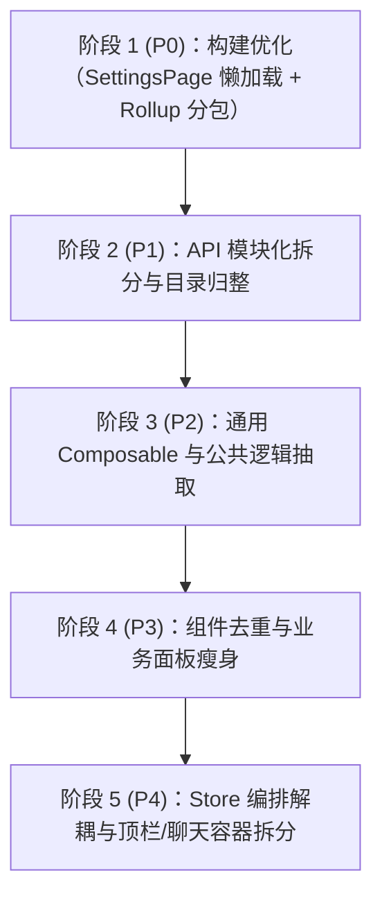

# 前端架构优化与重构方案

> 记录日期：2026-11-13（第二轮架构评审修订版）
> 范围：`frontend/src/`（Vue 3 + TypeScript + Vite，无第三方 UI 库，手写 scoped CSS）
> 关联文档：[`frontend_ui_duplication.md`](./frontend_ui_duplication.md)（注：旧文档记录于 2026-08-18，其中 `UiTag`、`ModalDialog` 等已部分实现；本文档扫描数据与计数以 2026-11 最新代码库实测为准）

---

## 一、 背景与现状扫描

前端代码目前约 5 万行，经过多轮功能迭代，全套测试保持稳定（57 个测试套件、499 个测试用例全绿），但积累了多项结构性技术债：

1. **单体大文件集中**：
   - `src/api.ts`（1,527 行）：含 79 个顶层导出（66 个函数/常量 + 13 个类型），混杂底层 HTTP Client、Token 拦截、数据清洗与 7 个业务领域 API。
   - `TopBar.vue`（1,556 行，其中样式 1,021 行）：顶栏承载了连接状态、重连、团队选择、深浅色切换、更新弹窗等多重职责。
   - `AgentActivityItem.vue`（1,506 行）：单组件内联了 9 种 Activity 类型的完整渲染逻辑与样式。
   - `TeamTreeEditor.vue`（1,283 行，其中 Script 1,196 行）：组织架构树的算法、校验、模型映射全内联在 SFC 内部。
   - `SettingsPage.vue`（1,153 行）、`ChatPanel.vue`（1,116 行）。
2. **根文件与同名目录并存混淆**：
   - `src/types.ts` 与 `src/types/` 并存（目录内仅有第三方库 shim `markdown-libs.d.ts`）。
   - `src/utils.ts` 与 `src/utils/` 并存（目录内为 `desktopLog`、`markdown`、`taskTree` 等独立功能模块）。
   - 并存容易造成模块定位混淆与导入路径歧义。
3. **公共逻辑样板代码重复**：
   - 7 个文件中共存在 **8 个 `ResizeObserver` 实例**（其中 `MessageStream.vue` 独占 2 个），手动维护创建、监听与注销。
   - 多处手写带 `try-catch` 容错的 `localStorage` 存取。
   - 单测中存在重复的 `FakeResizeObserver` 实现。
4. **UI 基础组件复用不彻底，伴生样式丢失缺陷**：
   - 虽已有 `ModalDialog.vue`，但仍有 13 个组件自带 overlay 类（其中 9 个常规表单弹窗适合统一迁移）。
   - 状态小件重复声明或引用缺失：`.error-banner` 在 6 个文件声明；而 `ConsoleTaskTreePanel.vue` **仅引用了 `.error-banner` 与 `.loading-card`，但 scoped style 中未声明样式**，形成隐蔽样式缺失 bug。
5. **构建分包与产物体积瓶颈**：
   - 设置页未做路由懒加载，单入口 chunk `main.js` 达 ~789–807 kB（gzip 后 256 kB），触发 Vite `Some chunks are larger than 500 kB` 警告。

---

## 二、 架构与模块拆分方案

### 1. API 层解耦（`src/api.ts` → `src/api/*`）

#### 现状问题
`src/api.ts` 超过 1,500 行，包含 79 个顶层导出（66 个函数/常量 + 13 个类型/接口），职责混杂。若使用 `export *` 拆分子模块，当不同文件存在同名符号时，TypeScript 会**静默从通配导出中剔除该符号**，调用方报未定义且排障极其困难。

#### 重构设计
拆分为按 7 个业务领域 + 基础层划分的子目录，统一使用**显式命名 re-export**：
```text
frontend/src/api/
├── client.ts         # 底层 requestJson<T> 封装、URL 拼接、Token 拦截、全局错误 Toast 派发
├── types.ts          # API 专属的 Raw*/Payload/Status 等 13 个请求/响应类型定义
├── normalizers/      # 数据归一化子目录（避免单文件超 450 行）
│   ├── agent.ts      # Agent 活动、内存等归一化
│   ├── task.ts       # 任务、任务事件等归一化
│   ├── context.ts    # 上下文用量归一化
│   └── index.ts      # 显式重导出 normalizer 函数
├── team.ts           # 团队列表、详情、启用/禁用、部门树 API
├── agent.ts          # Agent 详情、列表、内存管理、活动历史 API
├── room.ts           # 房间管理、历史消息 API
├── task.ts           # 任务列表、详情、事件时间线 API
├── model.ts          # 模型槽位、提供商配置、测试 API
├── settings.ts       # 角色模板、技能、第三方服务、系统维护 API
├── system.ts         # 更新检测、版本号、系统状态 API
└── index.ts          # 显式 re-export，禁止通配 export *
```

- **安全重导出示范**：
  ```ts
  // src/api/index.ts
  export { setApiBaseUrl, getApiBaseUrl } from './client';
  export { normalizeContextUsage, normalizeAgentTaskEvent } from './normalizers';
  export { getTeams, getTeamDetail, updateTeam, setDeptTree } from './team';
  export type { RawAgentTaskEvent, SystemStatus } from './types';
  // ... 其余 66 个函数/常量与 13 个类型逐项显式列出，确保零丢失、无静默剔除
  ```
  > 注：`requestJson` 目前在 `api.ts:258` 为内部函数，拆分至 `client.ts` 后供内部各业务模块调用；仅在需要时显式对外暴露。
- **兼容策略**：外部所有组件原有的 `import { ... } from '../../api'` 保持完全兼容，不产生破坏性改动。

---

### 2. 根文件与同名目录收敛

#### 现状澄清
- `types.ts`（类型定义）与 `types/`（环境声明 shim）无重复接口，问题在于命名空间容易割裂。
- `utils.ts`（通用时间/文字工具）与 `utils/`（领域特化工具）无重复函数，问题在于扁平文件与目录共存易产生引用混淆。

#### 重构设计
1. **类型目录规范化**：
   - 将 `src/types.ts` 按领域解耦入 `src/types/`：
     - `src/types/agent.ts`
     - `src/types/team.ts`
     - `src/types/room.ts`
     - `src/types/settings.ts`
   - 保留 `src/types/markdown-libs.d.ts`。
   - `src/types/index.ts` 显式重导出，废弃根目录 `types.ts`。
2. **工具目录规范化**：
   - 将 `src/utils.ts` 内的函数并入 `src/utils/` 相应模块：
     - `datetime.ts`：`parseBackendDateTime`、`formatBackendDateTime`、`formatTime`。
     - `i18n.ts`：`i18nText`、`displayName`。
     - `tree.ts`：`findDepartmentPath`、`isDepartmentLeader`。
     - `connection.ts`：`formatConnectionState`、`bubbleSide`。
     - `text.ts`：`stripAnsi`、`formatPreview`。
   - `src/utils/index.ts` 集中重导出，废弃根目录 `utils.ts`。

---

### 3. 全局状态（Store / State）分层与编排解耦

#### 现状问题
`runtimeStore.ts` 内部直接 `import` 并调用了 7 个 API 请求（如 `fetchAgentsByTeamId`、`fetchDeptTree`、`fetchRooms` 等），导致 Store 既包含响应式状态又承担业务请求编排，容易与页面组件主动发起的 API 产生竞态。

#### 迁移职责边界
| 状态类别 | 承载模块 | 职责与网络 I/O 约定 |
|---|---|---|
| **UI 瞬态** | `appUiState.ts` | Toast、弹窗显隐、全局加载遮罩等，纯前端状态，无远程 I/O。 |
| **凭证持久态** | `authStore.ts` | Token 存取（内存 + LocalStorage），纯读写。 |
| **持久化实体** | `teamStore.ts` | 团队列表、当前偏好团队，通过显式 action 加载与更新。 |
| **实时运行时态** | `runtimeStore.ts` | **剥离 API 编排**：组件或 Composable（如 `useConsoleRuntimeState`）负责触发初始 API 拉取，并将数据通过纯 Mutation 写入 Store；Store 自身仅响应 WebSocket 增量事件推进。 |

---

## 三、 巨石组件瘦身与逻辑抽离

### 1. `TeamTreeEditor.vue`（1,283 行，Script 1,196 行）
- **核心问题**：组织架构树草稿节点（`DraftOrgNode`）增删查改、深度递归遍历、层级校验、以及前后端格式转换（`DeptTreeNode` ↔ `DraftOrgNode`）全部堆在 SFC 中。
- **拆分方案**：
  1. 抽取 `utils/teamTreeModel.ts`：纯函数，负责前后端树模型双向映射与扁平化算法。
  2. 抽取 `composables/useTeamOrgTree.ts`：管理草稿树响应式状态、撤销重做栈与组织结构合规性校验。
  3. `TeamTreeEditor.vue` 专注处理拖拽事件、DOM 交互与弹窗挂载，`<script>` 行数预计降至 300 行以内。

---

### 2. `TopBar.vue`（1,556 行，Style 1,021 行）
- **核心问题**：顶栏样式超千行，同时承载了多项独立业务逻辑。
- **拆分方案**：
  - `TopBarConnection.vue`：连接状态、重连进度与状态文本。
  - `TopBarTeamSelector.vue`：团队切换下拉菜单、禁用标识。
  - `TopBarActions.vue`：深浅色切换、版本更新检查、关于对话框。
  - 样式随子组件拆分而天然隔离，大幅消除单文件超千行样式的维护负担。

---

### 3. `AgentActivityItem.vue`（1,506 行）
- **核心问题**：统一承接 9 种活动类型（`agent_state`、`llm_infer`、`reasoning`、`chat_reply`、`tool_call`、`compact`、`message_received`、`task_received` 以及 `unknown`）的渲染与溢出计算，分支判断极其臃肿。
- **拆分方案**：
  - 采用子组件策略分发：
    - `activity/ActivityReasoning.vue`：思考过程展示、3 行默认折叠、自适应测量。
    - `activity/ActivityToolCall.vue`：工具调用参数/响应展开与 ANSI 过滤。
    - `activity/ActivityLlmInfer.vue`：模型与推理元数据展示。
    - `activity/ActivityMessageFlow.vue`：消息收发与任务分流。
  - `AgentActivityItem.vue` 仅作为外壳，负责时间线轴、头像和类型分发。

---

### 4. `ChatPanel.vue`（1,116 行）
- **拆分方案**：
  - 抽取 `composables/useComposerResize.ts`：抽离输入框高度比例计算、拖拽边界判定及吸底滚动距离修正。
  - 拆出 `ChatMembersDrawer.vue`：收敛聊天室成员抽屉面板。

---

## 四、 公共逻辑与 Composables 抽取

### 1. 两层架构 `createResizeObserver` + `useResizeObserver`
现有 7 个文件中存在 **8 个实例**，诉求差异显著：
- 存在多目标监听需求（`useStickToBottom.ts` 同时监听 viewport + content，`useTeamGraphLayout.ts` 同时监听 graphRef + canvasRef）；
- 存在脱离组件模板 ref 的命令式调度需求（`useStickToBottom.ts` 在 `bind(nextViewport, content)` / `dispose()` 中手动挂载卸载，且存在非组件上下文调用情况）；
- 部分场景只需“尺寸变化即重算”，不需要 `entry` 参数。

#### 分层设计
1. **底层纯工厂 `createResizeObserver`**（无 Vue 生命周期依赖，不因初始 `target=null` 而静默 no-op）：
2. **组合式薄包装 `useResizeObserver`**（带 `watch` 与 `getCurrentInstance()` 卸载保护）：

```ts
// src/composables/useResizeObserver.ts
import { getCurrentInstance, onBeforeUnmount, unref, watch, type Ref } from 'vue';

export type MaybeElement = HTMLElement | null | undefined;
export type ResizeTarget = MaybeElement | Ref<MaybeElement>;
export type ResizeCallback = (entry?: ResizeObserverEntry) => void;

/** 纯工厂：适合 useStickToBottom 等命令式 bind / dispose 场景 */
export function createResizeObserver(callback: ResizeCallback) {
  let observer: ResizeObserver | null = null;

  const ensureObserver = () => {
    if (!observer && typeof ResizeObserver === 'function') {
      observer = new ResizeObserver((entries) => {
        callback(entries[0]);
      });
    }
    return observer;
  };

  return {
    observe(el: MaybeElement) {
      if (el) ensureObserver()?.observe(el);
    },
    unobserve(el: MaybeElement) {
      if (el && observer) observer.unobserve(el);
    },
    disconnect() {
      observer?.disconnect();
      observer = null;
    },
  };
}

/** 组件级 Composable：自动响应 Ref / Ref[] 变化并在组件卸载时清理 */
export function useResizeObserver(
  target: ResizeTarget | ResizeTarget[],
  callback: ResizeCallback
) {
  const { observe, unobserve, disconnect } = createResizeObserver(callback);

  // 通过 getter 规避 MultiWatchSources 联合类型在 vue-tsc 中的类型报错
  const getElements = (): HTMLElement[] => {
    const list = Array.isArray(target) ? target : [target];
    return list.map((item) => unref(item)).filter((el): el is HTMLElement => Boolean(el));
  };

  watch(
    getElements,
    (elements) => {
      disconnect();
      elements.forEach((el) => observe(el));
    },
    { immediate: true }
  );

  if (getCurrentInstance()) {
    onBeforeUnmount(disconnect);
  }

  return { observe, unobserve, stop: disconnect };
}
```

### 2. 本地存储安全存取（`useLocalStorageState`）
- 封装 `composables/useLocalStorageState.ts`，内置统一的类型序列化/反序列化与 Safari 无痕模式异常容错（`try-catch`），替换 `ChatPanel`、`useConsoleSidebarLayout`、`App.vue` 等处的重复写法。

### 3. 测试辅助 Mock 收敛（`testMocks.ts`）
- 将 `PendingMessageDock.test.ts` 和 `PendingMessageBar.test.ts` 中重复的 `FakeResizeObserver` 收敛至 `src/__tests__/testMocks.ts`。

---

## 五、 UI 基础组件复用与样式收敛

### 1. 弹窗外壳（`ModalDialog.vue`）适用范围界定
当前带有 `overlay` 类的组件共 13 个，精确分类如下（9 个常规弹窗 + 2 个基础原语 + 2 个全屏 Shell = 13 个）：

| 分类 | 包含组件 | 改造建议 |
|---|---|---|
| **常规表单/操作弹窗**（9 个） | `DepartmentEditorDialog`<br>`MemberEditorDialog`<br>`CreateRoomDialog`<br>`RoomSettingsDialog`<br>`ClearDataChoiceDialog`<br>`SkillDetailDialog`<br>`TeamPresetExportDialog`<br>`QuickInitModal`<br>`ThirdPartyServicesSection`（内联测试弹窗） | **统一迁移至 `ModalDialog.vue`**，消除重复的手写 overlay、dialog 容器及头部动作栏样式。（注：`ModelTestDialog.vue` 已使用 `ModalDialog`，无需迁移。） |
| **基础 UI 原语 / 确认框**（2 个） | `ConfirmDialog.vue`<br>`TokenDialog.vue` | 维持现状，作为底层原子组件或根据风格逐步统一。 |
| **复杂全屏 Shell**（2 个） | `AgentActivityDialogShell.vue`<br>`AgentTaskDetailModal.vue` | 内部结构复杂且含多面板联动，不适合套用标准表单弹窗，保持专有布局。 |

### 2. 状态小件与丢失样式修复
- **修复样式丢失 Bug**：`ConsoleTaskTreePanel.vue`（:168、:170）使用了 `.error-banner` 与 `.loading-card`，但 `<style scoped>` 遗漏了类声明。
- **组件化收敛**：
  - `StatusDot.vue`：支持 `success`、`error`、`pulse`、`inactive`，收敛 5 处手写实现。
  - `ErrorBanner.vue`：统一各处错误通知条（收敛 6 处样式声明，并直接修复 `ConsoleTaskTreePanel` 的丢失样式）。
  - `LoadingCard.vue`：统一加载占位卡片（收敛 5 处声明）。
  - `EmptyState.vue` vs `EmptyCard.vue`：
    - `EmptyState`：针对空白内容区的占位提示（含图标、文案、操作按钮），覆盖 `AgentLibraryCard`、`TeamDetailPage`。
    - `EmptyCard`：针对卡片网格列表为空时的容器卡片，覆盖 `TeamsSettingsSection` 等。

---

## 六、 构建性能与打包产物体积优化

### 1. 路由按需懒加载策略精准化
- **现状分析**：
  - 应用启动后根路由 `/` 仅是占位（`App.vue:176` 在无 activeTeam 时会跳转 `name: 'home'`，改造时须保留），逻辑随后立即重定向至 `/teams/:teamId/rooms/...`，即 **`ConsolePage` 是事实上的应用首屏**。
  - `vite.config.ts:72` 为了适配 Tauri 自定义协议，明确关闭了 `modulePreload`。若盲目懒加载 `ConsolePage`，不仅不能减少首屏传输字节，反而会产生串行脚本加载瀑布流。
- **精准优化策略**：
  - **首屏 `ConsolePage` 保持静态 `import`**，确保应用即时响应；
  - **庞大的 `SettingsPage`（包含模型、提供商、第三方服务、团队设置等数十个子面板）改为动态导入**：
    ```ts
    // src/router.ts
    import ConsolePage from './pages/ConsolePage.vue';

    const router = createRouter({
      history: createWebHashHistory(),
      routes: [
        {
          path: '/',
          name: 'home',
          component: { template: '<div class="route-placeholder"></div>' }, // 无 activeTeam 兜底，勿删
        },
        {
          path: '/teams/:teamId/rooms/:roomId?',
          name: 'console',
          component: ConsolePage, // 首屏保持静态导入
        },
        {
          path: '/teams/:teamId/settings/:section?',
          name: 'settings',
          component: () => import('./pages/SettingsPage.vue'), // 复杂设置页按需懒加载
        },
        // ... 保留其余重定向规则
      ],
    });
    ```

### 2. Vite / Rollup Manual Chunks 分包策略
分包解决的是**消除单 chunk 过大警告**与**第三方依赖的长效缓存隔离**，避免修改一行业务代码导致全量第三方库缓存失效。须覆盖 `@vue/*` 与 `@intlify/*` 等运行时子包，避免落入 `vendor-others`。

```ts
// frontend/vite.config.ts
export default defineConfig({
  // ...
  build: {
    rollupOptions: {
      output: {
        manualChunks(id) {
          if (!id.includes('node_modules')) return;

          if (
            id.includes('/node_modules/vue/') ||
            id.includes('/node_modules/@vue/') ||
            id.includes('/node_modules/vue-router/') ||
            id.includes('/node_modules/vue-i18n/') ||
            id.includes('/node_modules/@intlify/')
          ) {
            return 'vendor-vue';
          }
          if (
            id.includes('/node_modules/highlight.js/') ||
            id.includes('/node_modules/markdown-it/') ||
            id.includes('/node_modules/markdown-it-task-lists/')
          ) {
            return 'vendor-markdown';
          }
          return 'vendor-others';
        },
      },
    },
  },
});
```
- **收益预期**：消除 Vite `Some chunks are larger than 500 kB` 警告，主入口 chunk 体积显著收敛，具体指标构建后实测记录。

---

## 七、 实施路线图与量化验收判据

为完整承接正文所有重构项，分 P0 至 P4 五个阶段渐进实施（其中 `TopBar`、`ChatPanel` 与 `Store` 分层解耦纳入 P4 架构深度治理阶段）：



| 阶段 | 核心任务 | 涉及模块 | 风险 | 量化验收判据 | 验证手段 |
|---|---|---|---|---|---|
| **P0** | **构建优化**<br>1. `SettingsPage` 动态导入<br>2. Rollup 精准分包 | `src/router.ts`<br>`vite.config.ts` | 极低 | 1. Vite >500kB 构建警告消除<br>2. `@vue/*` 与 `@intlify/*` 正确归入 `vendor-vue` chunk<br>3. 控制台页面首屏无串行请求瀑布 | `npm run build`<br>启动预览验证路由跳转与 Network chunk |
| **P1** | **API 层拆分**<br>1. `src/api.ts` 解耦至 7 领域+基础层（含 `normalizers/` 与 `types.ts`）<br>2. 显式 re-export<br>3. 归整 `types/` 与 `utils/` | `src/api/`<br>`src/types/`<br>`src/utils/` | 低 | 1. 79 个顶层导出（66 个函数/常量 + 13 个类型）100% 显式保留无遗漏<br>2. 单个 API 域模块及 normalizer 子模块代码行数均 < 300 行<br>3. 业务组件无需调整现有 import 路径 | `npm run test:run`<br>执行 `src/__tests__/api.test.ts` 等现有测试 |
| **P2** | **Composables 抽取**<br>1. `createResizeObserver` + `useResizeObserver`<br>2. `useLocalStorageState`<br>3. 收敛 `testMocks.ts` | `src/composables/`<br>`src/__tests__/` | 低 | 1. 业务代码及非观察器原语文件中 `new ResizeObserver` 归零（8 → 0，仅保留在 `createResizeObserver` 内部）<br>2. 测试中重复 `FakeResizeObserver` 归零（2 → 1）<br>3. `useStickToBottom` 命令式 bind/dispose 行为一致 | 跑通现有全量单测（57 files, 499 tests） |
| **P3** | **组件去重与算法剥离**<br>1. `TeamTreeEditor` 抽离算法<br>2. `AgentActivityItem` 拆子项<br>3. 推广 `ModalDialog`<br>4. 修复样式丢失 Bug | `src/components/team/`<br>`src/components/agent/`<br>`src/components/ui/` | 中 | 1. 修复 `ConsoleTaskTreePanel` 样式丢失 bug<br>2. 9 个常规弹窗消除手写 overlay 类，统一复用 `ModalDialog`<br>3. `TeamTreeEditor.vue` Script 行数降至 300 行以内<br>4. 页面视觉与操作无回退 | 组件单元测试 + 视觉走查 |
| **P4** | **Store 解耦与容器组件拆分**<br>1. `runtimeStore` 剥离 7 个 API fetch<br>2. `TopBar.vue` 拆为 3 个子组件<br>3. `ChatPanel.vue` 抽离拖拽与成员抽屉 | `src/realtime/runtimeStore.ts`<br>`src/components/layout/`<br>`src/components/chat/` | 中 | 1. `runtimeStore.ts` 内不再直接 import 业务 fetch 函数<br>2. `TopBar.vue` 样式行数降至 300 行以内<br>3. `ChatPanel.vue` 总行数降至 500 行以内 | `runtimeStore.test.ts` + 集成联调 |
